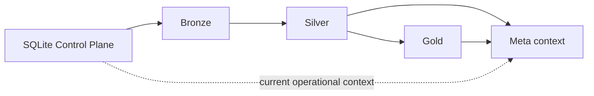
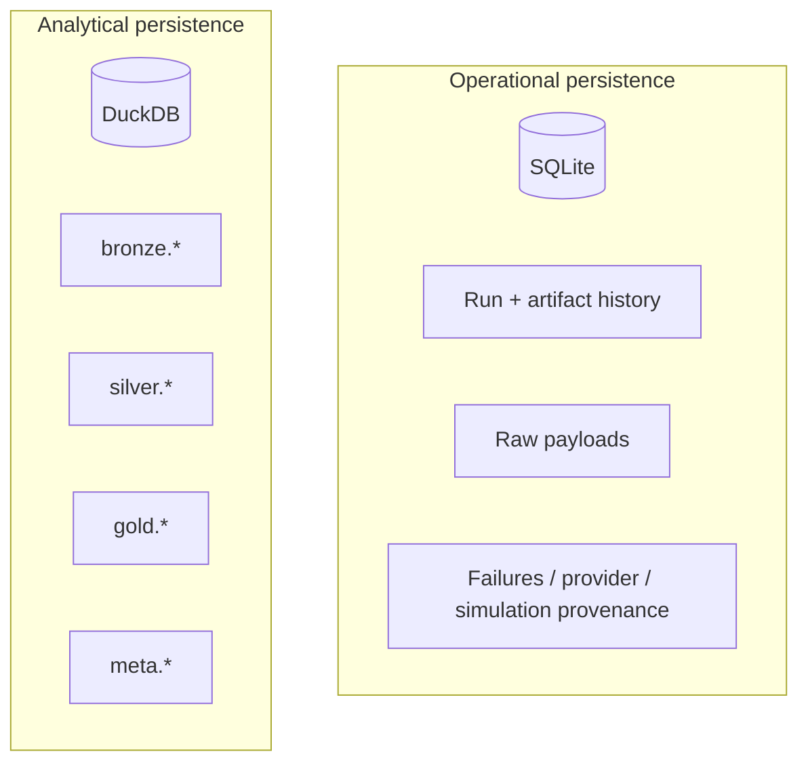
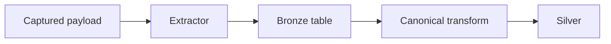
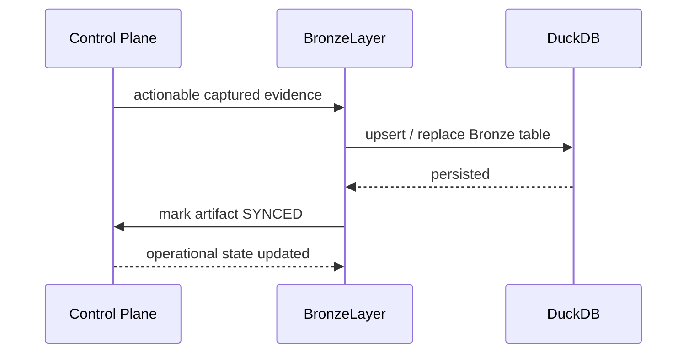
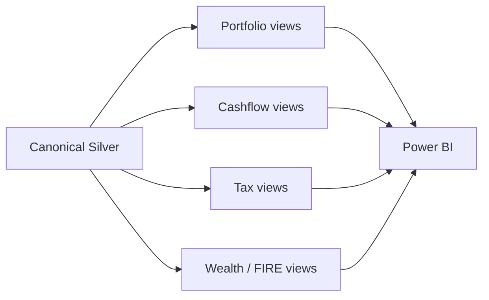
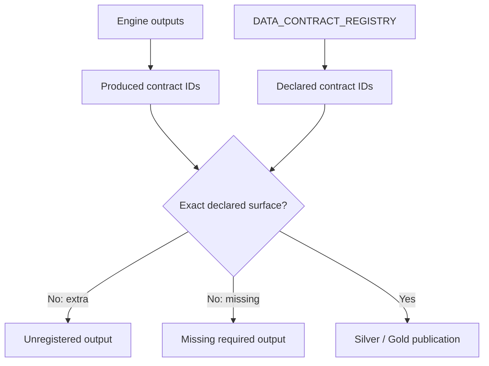
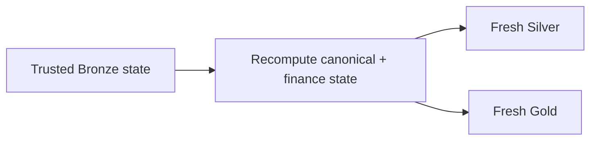

# Warehouse Architecture

The analytical warehouse has four layers because four different persistence jobs exist.

Bronze needs to preserve synchronized source-oriented evidence. Silver needs canonical analytical truth. Gold needs decision-ready presentation models. Meta needs current inspection context.

Trying to make one layer do all four would blur grain, ownership, and recovery semantics.



This specification defines those jobs, the contract registry that governs them, and the transaction/recovery model around publication.

## Persistence topology

The application persists two fundamentally different categories of state:



SQLite answers historical lifecycle questions.

DuckDB answers analytical questions.

The separation is intentional even though both are local database files.

## DuckDBManager owns connection mechanics, not analytical meaning

`DuckDBManager` creates and exposes the DuckDB connection and ensures the required schemas exist.

Layer-specific classes then own the behavior of Bronze, Silver, Gold, and Meta.

This keeps connection management separate from publication semantics.

```text
DuckDBManager
├── BronzeLayer
├── SilverLayer
├── GoldLayer
└── MetaLayer
```

The manager is deliberately small because the warehouse layers have different persistence contracts.

## Why SQLite remains outside the warehouse layer

It would be technically possible to create operational tables in DuckDB and call the whole thing one warehouse.

That would make the storage diagram shorter and the semantics worse.

Operational state has different needs:

- event-oriented history;
- raw payload retention;
- file registry mutation;
- run lifecycle mutation;
- savepoints for nested operations;
- crash/stale-run recovery;
- inter-process pipeline locking.

Analytical state has different needs:

- columnar scan performance;
- Polars/DuckDB interchange;
- schema recreation;
- table publication order;
- Power BI-friendly queryability.

Choosing two engines is therefore a consequence of workload shape, not technology collecting.

## Bronze is persistent analytical evidence

Bronze tables retain source-oriented records after synchronization.

They are not the canonical business model.

That distinction lets Bronze preserve useful source fidelity while still giving the analytical pipeline a durable rebuild boundary.



The Control Plane owns the original payload bytes and operational event history. Bronze owns the synchronized analytical representation.

## Bronze contracts map extraction to persistence

`BronzeDataContract` connects three concepts that otherwise tend to drift apart:

```python
# src/personal_finance_etl/infrastructure/warehouse/registry.py
@dataclass
class BronzeDataContract:
    """Relationship between extraction attributes, sync categories, and Bronze tables."""

    extraction_attribute: str
    sync_category: str
    physical_table: str
    is_full_replace: bool
```

The registry therefore answers:

- which field in `ExtractionResult` is being published;
- which Control Plane synchronization category owns it;
- which physical Bronze table receives it;
- whether the category is full-replace or incremental.

This is more robust than duplicating those mappings in discovery, extraction, and loading code independently.

## Bronze source families have different synchronization semantics

The registry includes both full-replace and incremental families.

Examples of full-replace state include reference/configuration-style sources such as:

- SQLite base tables;
- mappings;
- opening balances;
- benchmark master;
- macro parameters;
- column master.

Historical evidence families such as holdings, orders, market history, and transactions can be synchronized incrementally.

The architectural rule is not “Bronze is append-only.”

It is:

> persistence behavior follows source semantics declared by contract.

## Bronze identity survives rename migration

When the Control Plane identifies a rename rather than a new artifact, Bronze can migrate the associated path identity.

The executor invokes:

```python
if renames:
    bronze.migrate_identity(renames)
    meta_layer.migrate_identity(renames)
```

This prevents a path move from duplicating historical evidence or leaving stale current-context metadata behind.

Artifact identity therefore crosses the operational/analytical boundary intentionally.

## Bronze synchronization closes an operational loop

A successful Bronze write is not complete until the Control Plane knows the artifact has been synchronized.

The loop is:



If that final operational update cannot complete after DuckDB has changed, the lifecycle has a convergence problem rather than permission to pretend the two stores agree.

## Bronze readback is complete-state reconstruction

After synchronization, downstream transformation reads the complete Bronze state.

This is the key warehouse design choice that makes Silver/Gold full rebuild practical.

```text
small changed set
    ↓
Bronze synchronized incrementally
    ↓
full Bronze state read
    ↓
Silver/Gold rebuilt coherently
```

Bronze therefore functions as both a persistence layer and an incremental-to-full-rebuild adapter.

## Silver is canonical analytical publication

Silver tables contain normalized dimensions and facts used across financial domains.

They are closer to semantic truth than source truth.

Examples include:

- shared dimensions;
- canonical household transactions;
- investment master;
- canonical purchase/sale evidence;
- market and currency state;
- reconstructed/reconciled investment datasets;
- Tax evidence;
- wealth and FIRE analytical inputs/outputs.

The exact table contracts live in the Reference section. The architectural point is that Silver is where shared financial vocabulary becomes persistent.

## Silver publication is a full replacement

`SilverLayer.load()` drops and recreates the `silver` schema, re-executes the declarative DDL, and publishes registered contracts in `publication_order`.

```python
# src/personal_finance_etl/infrastructure/warehouse/silver.py
contracts = sorted(
    (c for c in DATA_CONTRACT_REGISTRY if c.layer == "silver"),
    key=lambda c: c.publication_order,
)
self.db_manager.conn.execute("DROP SCHEMA IF EXISTS silver CASCADE")
self.db_manager.conn.execute("CREATE SCHEMA silver")
self.db_manager.conn.execute(SILVER_DDL)
```

This is intentionally different from Bronze.

Silver represents the current coherent analytical reconstruction, so full replacement avoids partially stale downstream relationships.

## Publication order is part of the contract

`DataContract` declares:

```python
@dataclass
class DataContract:
    contract_id: str
    layer: str
    physical_table: str
    domain: str
    grain: str
    producer: str
    publication_order: int
```

That single record carries several forms of architectural metadata:

- in-memory dataset identity;
- target layer/table;
- financial domain;
- grain;
- producer ownership;
- physical publication order.

The registry therefore connects runtime completeness, documentation, physical persistence, and lineage.

## Silver performs publication-time quality checks

The investment master is one example where persistence refuses semantically dangerous nulls.

Before insertion, `SilverLayer._write()` checks critical fields such as `ISIN` and `TAX_TYPE`.

Missing values raise rather than silently publishing a dimension that would corrupt downstream identity or Tax logic.

This quality gate belongs at publication because it validates a property of the canonical analytical model, not merely raw source shape.

## Empty strings are normalized in dimensions

For dimension tables, empty string values are normalized to null before publication.

That may look like a small cleaning detail, but it protects analytical semantics:

```text
""   ≠ meaningful category
NULL = missing / not supplied
```

Without normalization, BI layers can accidentally treat empty labels as valid members.

## LazyFrames materialize at the publication boundary

Silver accepts `DataFrame` or `LazyFrame`.

If a lazy plan reaches publication, it is collected there with an explicit materialization annotation.

```python
if isinstance(df, pl.LazyFrame):
    # Materialization Boundary: PUBLICATION_BOUNDARY
    # Terminal execution of lazy transformation graph for DuckDB Silver table insertion
    df = df.collect()
```

That boundary is intentional because DuckDB insertion needs concrete rows and publication is the terminal consumer of the transformation graph.

The design does not optimize for the smallest possible count of `.collect()` calls. It optimizes for **classified eager boundaries**.

## Gold is decision-ready presentation publication

Gold tables are built for consumption rather than canonical reuse.

Typical consumers include Power BI and human-facing analytical exploration.

Gold is allowed to denormalize, aggregate, or reshape canonical state when that improves decision usability, provided the grain remains explicit.



Gold is therefore a presentation model, not a second canonical domain.

## Gold logs the optimized lazy plan before materialization

Gold publication exposes Polars optimizer behavior in debug logs before terminal execution.

```python
if isinstance(df, pl.LazyFrame):
    compact_plan = df.explain().replace("\n", " | ")
    logger.debug(
        "[DAG:OPTIMIZER] Physical Plan for Gold '%s': %s", table_name, compact_plan
    )
    df = df.collect()
```

That is useful for performance archaeology because a slow Gold publication can be investigated using the actual optimized graph rather than inferred from source expressions alone.

## Meta is an inspection layer

`meta.*` stores current analytical context such as:

- table row counts;
- current settings;
- current financial rules;
- contract inventory;
- current file state mirrored for convenience.

`MetaLayer.load()` truncates and refreshes those current-state tables after publication.

This makes Meta useful to BI, diagnostics, and human inspection without asking the Control Plane to become an analytical query model.

## Meta does not own history

A crucial authority rule:

> Meta may mirror current facts from operational state; it does not become the historical source of truth by doing so.

If a Meta row and the Control Plane disagree about a run/artifact history question, the Control Plane wins.

Meta is optimized for current analytical context. SQLite retains the event history needed to explain how that context was reached.

## The registry is the warehouse's contract spine

`DATA_CONTRACT_REGISTRY` governs both Silver and Gold publication.

It is used for more than loading.

The executor compares the entire produced in-memory dataset set with the registry before publication.



This prevents quiet warehouse drift.

A developer cannot casually create a new output and assume persistence will pick it up. Nor can a registered table silently disappear because an engine stopped producing it.

## Registry completeness is validated before execution

`validate_registry()` checks structural integrity of the declared contracts before the pipeline proceeds.

This catches registry-level defects independently of runtime data.

The contract system therefore has two validation layers:

1. registry self-consistency;
2. produced-output completeness against that registry.

## Contract fingerprints make publication structure reproducible

`infrastructure/warehouse/fingerprints.py` generates a fingerprint of the contract registry.

That is useful for reproducibility because identical financial inputs under a materially different publication contract should not be assumed to represent an identical analytical environment.

The fingerprint can participate in simulation/replay provenance alongside settings, rules, and model fingerprints.

## Publication is topological, but finance determines topology

`publication_order` is not merely a DDL convenience.

It reflects dependencies between dimensions and facts.

A dimension referenced by a downstream fact must exist before the fact is inserted if physical constraints require it.

More broadly, the sequence encodes the shape of the analytical model.

This is one reason the registry records both domain and grain rather than only a table name.

## Grain matters more than layer labels

A table being Gold does not make it safely additive.

Additivity follows grain and measure semantics.

For example:

- a daily snapshot value cannot be blindly summed across dates;
- a realized event can often be summed across events for compatible measures;
- a balance is typically semi-additive over time;
- a ratio such as XIRR is not additive at all.

The Reference specifications document exact table grains. The architecture requires that grain be explicit because BI safety depends on it.

## Physical schemas remain declarative

DDL is owned under `infrastructure/warehouse/schema/`:

```text
schema/
├── bronze.py
├── silver.py
├── gold.py
├── meta.py
├── control_plane.py
└── pragmas.py
```

This keeps physical schema declaration separate from layer loading logic and from domain calculation code.

The registry describes publication contracts; schema modules describe physical columns/constraints; domain/application code produces values.

Those are three different responsibilities.

## The warehouse transaction spans the analytical rebuild

DuckDB runs inside the run-level transaction opened by `RunLifecycleCoordinator`.

Bronze synchronization, Silver/Gold recreation, and Meta refresh happen before the final DuckDB commit.

If the run fails before that commit, the lifecycle can roll back the open DuckDB transaction.

Once DuckDB commits, however, its analytical state is durable even if SQLite subsequently fails to commit.

That is where warehouse architecture meets reliability architecture.

## Why DuckDB commits before SQLite

The chosen commit order is:

```text
1. DuckDB COMMIT
2. record DUCKDB_COMMITTED in Control Plane transaction
3. SQLite COMMIT
4. mark FULLY_COMMITTED / SUCCESS
```

If step 3 fails, DuckDB cannot be rolled back.

The system therefore records `RECOVERY_REQUIRED` rather than claiming atomicity it does not have.

The next successful rebuild can converge the Control Plane to the durable analytical state.

See [Reliability and Recovery](reliability-and-recovery.md) for the state machine.

## Healing handles expected divergence between stores

`MetaLayer.heal_duckdb_registry(cp)` runs before the new transactions begin.

Its job is to reconcile current DuckDB file-registry projections with authoritative Control Plane state.

The healing path includes logic to:

- inspect Bronze table file identities;
- add missing sync records where analytical evidence exists;
- prune dangling DuckDB registry rows;
- reconcile current artifact state.

This is not distributed rollback.

It is explicit convergence based on declared authority.

## Full analytical rebuild is a reliability strategy

Silver and Gold full replacement is sometimes described only as an implementation simplification.

It is also a recovery strategy.

If derived analytical state becomes suspect, the system can reconstruct it from complete Bronze evidence rather than applying an unbounded sequence of compensating mutations.



That narrows the number of persistent mutable layers that must be reasoned about during recovery.

## Row counts are telemetry, not correctness proof

Meta stores row counts for current tables.

Those counts are useful for:

- regression detection;
- quick diagnostics;
- BI inspection;
- release comparison.

They do not prove financial correctness.

A table can have the expected row count and still contain wrong values. Correctness requires domain invariants, identities, reconciliation, tests, and financial validation.

This distinction prevents operational metrics from masquerading as finance assurance.

## Fingerprints add stronger structural evidence

Fingerprints can capture whether contract definitions, inputs, or outputs changed even when row counts did not.

The architecture therefore uses row counts and fingerprints for different observability jobs:

```text
row count   → how much state exists?
fingerprint → did the relevant state/contract change?
```

Neither replaces financial validation, but together they make drift easier to diagnose.

## Snapshot architecture treats DuckDB and SQLite as one recovery unit

A valid snapshot includes the analytical warehouse and operational Control Plane together.

Capturing only DuckDB would preserve outputs while losing the run/artifact history that explains them.

Capturing only SQLite would preserve evidence/history while requiring analytical rebuild before the previous decision surface reappears.

Both recovery strategies are valid in different situations, but the coordinated snapshot manager intentionally captures the pair.

## Durability differs by layer

| State | Durable across runs? | Rebuilt routinely? | Primary authority |
|---|---:|---:|---|
| Control Plane payloads/events | yes | no | SQLite |
| Bronze | yes | synchronized incrementally | DuckDB Bronze |
| Silver | yes after successful commit | yes | current successful analytical rebuild |
| Gold | yes after successful commit | yes | current successful presentation rebuild |
| Meta | yes after successful commit | refreshed | current context only |
| in-memory LazyFrames | no | every run | transient execution state |

This table is more useful than simply saying “everything is persisted.” Persistence has different semantics by layer.

## Failure semantics differ by layer

### Control Plane failure

Can compromise operational state update or create split-commit recovery needs.

### Bronze write failure

Stops synchronization and should prevent the run from claiming analytical completeness.

### Silver/Gold publication failure

Occurs inside the DuckDB transaction before final commit and can normally be rolled back if DuckDB has not committed.

### Meta refresh failure

Still prevents successful run completion because current-context publication is part of the run contract.

### Post-DuckDB SQLite commit failure

Creates durable analytical state plus incomplete operational commit: `RECOVERY_REQUIRED`.

The architecture treats these failures differently because their rollback possibilities are different.

## Why not one database?

One database would remove a file and simplify backup diagrams.

It would also force one engine to optimize for two unlike workloads.

SQLite is a good fit for small, mutable, event-oriented operational state and raw binary payload storage.

DuckDB is a good fit for local analytical scans, schema-based publication, and Power BI consumption.

The cost of the split is coordinated commit/recovery complexity.

The architecture accepts that cost because the responsibility boundary is valuable enough to justify it.

## Warehouse invariants

1. Control Plane history is not replaced by DuckDB Meta.
2. Bronze represents synchronized source-oriented analytical evidence.
3. Silver represents canonical/reconstructed analytical state.
4. Gold represents decision-ready presentation state.
5. Meta represents current analytical context.
6. Bronze publication behavior is declared by `BRONZE_CONTRACT_REGISTRY`.
7. Silver/Gold publication is declared by `DATA_CONTRACT_REGISTRY`.
8. Produced analytical contracts must match declared contracts before publication.
9. Publication follows explicit order.
10. Lazy computation becomes eager only at justified boundaries.
11. Silver/Gold are rebuildable from complete upstream state.
12. split-commit truth is handled by the lifecycle, not hidden inside warehouse classes.

## Warehouse non-guarantees

The warehouse does not guarantee:

- that every source dataset is append-only;
- that every table is additive;
- that current Meta reconstructs historical operational events;
- that a row-count match proves value equality;
- that a DuckDB commit can be undone after it succeeds;
- that full replacement is the forever-optimal strategy at arbitrary scale;
- that external market evidence is complete merely because a table exists.

## Continue into operational history

The warehouse explains what analytical state persists. The next question is how the system knows **why** that state changed.

Continue with [Control Plane Artifact Lifecycle](control-plane-artifact-lifecycle.md), then [Deterministic Identity and Replay](deterministic-identity-and-replay.md).

## Related specifications

- [Architecture](README.md)
- [Data Lifecycle](data-lifecycle.md)
- [Control Plane Artifact Lifecycle](control-plane-artifact-lifecycle.md)
- [Data Model](data-model.md)
- [Deterministic Identity and Replay](deterministic-identity-and-replay.md)
- [Reliability and Recovery](reliability-and-recovery.md)
- [Reference: Bronze Data Contracts](../reference/bronze-data-contracts.md)
- [Reference: Silver Data Contracts](../reference/silver-data-contracts.md)
- [Reference: Gold Data Contracts](../reference/gold-data-contracts.md)
- [Reference: Meta Data Contracts](../reference/meta-data-contracts.md)
