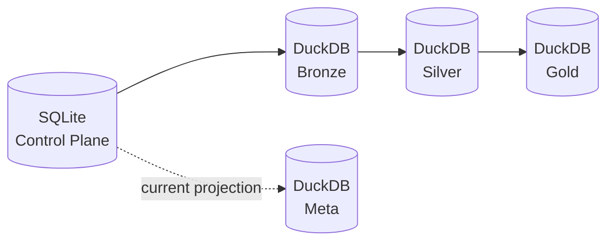
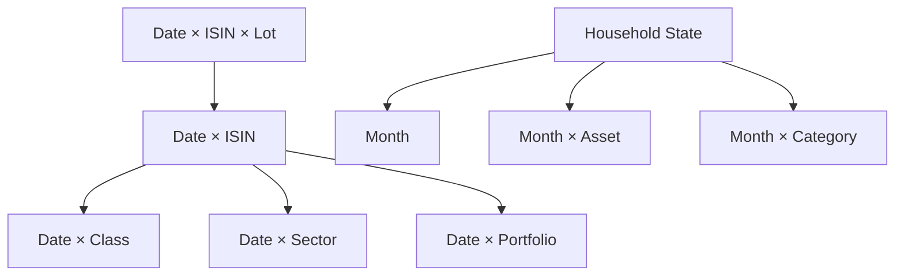

# Warehouse Architecture

Personal Finance ETL does not use one database for every responsibility.

The storage architecture is:

```text
SQLite Control Plane
→ evidence + operational history

DuckDB Bronze
→ persistent source-shaped analytical state

DuckDB Silver
→ canonical financial contracts

DuckDB Gold
→ decision-support serving marts

DuckDB Meta
→ lean current-state analytical telemetry
```

The important design decision is not "Medallion architecture."

It is **ownership**.

---

## 1. Physical authority and storage boundaries

| Plane / layer | Technology | Owns |
| --- | --- | --- |
| Control Plane | SQLite | Raw artifacts, payloads, sync state, runs, failures, config/rules provenance, logs |
| Bronze | DuckDB | Persistent source-shaped state |
| Silver | DuckDB | Canonical financial/reference facts and dimensions |
| Gold | DuckDB | Decision-support marts |
| Meta | DuckDB | Latest/current analytical telemetry |



---

**Implementation:** `src/personal_finance_etl/backend/load/database.py` (lines 1–40).

```python
import os

import duckdb
import psutil

from personal_finance_etl.backend.load.schema.gold import GOLD_DDL
from personal_finance_etl.backend.load.schema.meta import META_DDL
from personal_finance_etl.backend.load.schema.silver import SILVER_DDL
from personal_finance_etl.backend.utils.logger import logger


class DuckDBManager:
    """Owns the single persistent DuckDB file and its long-lived connection."""

    def __init__(self, base_path: str, db_name: str = "Personal_Finance_DB.duckdb"):
        self.base_path = base_path
        self.db_path = os.path.join(base_path, db_name)
        os.makedirs(base_path, exist_ok=True)
        self._conn: duckdb.DuckDBPyConnection | None = None

    @property
    def conn(self) -> duckdb.DuckDBPyConnection:
        """Returns the active connection. Raises if not opened."""
        if self._conn is None:
            raise RuntimeError("DuckDBManager.open() must be called before accessing conn.")
        return self._conn

    def open(self) -> duckdb.DuckDBPyConnection:
        """Opens the single long-lived connection. Called once at pipeline start."""
        if self._conn is not None:
            return self._conn
        logger.debug(f"[DATABASE:DUCKDB] Opening connection to {self.db_path}")
        self._conn = duckdb.connect(self.db_path)
        mem_gb = max(4, int(psutil.virtual_memory().total / (1024**3) * 0.75))
        self._conn.execute(f"PRAGMA memory_limit='{mem_gb}GB'")
        self._conn.execute("PRAGMA threads=4")
        logger.debug(f"[DATABASE:DUCKDB] Connection configured: memory_limit={mem_gb}GB, threads=4")
        return self._conn

    def close(self) -> None:
```

## 2. SQLite Control Plane history

Operational state is relational, compact and transaction-oriented.

The Control Plane needs to answer questions such as:

```text
Have I seen this artifact before?
What hash did it have?
Do I still have its bytes?
Has it reached Bronze?
Which configuration did this run use?
Did the run fail?
Where?
What did the execution log say?
```

SQLite is a natural fit for that local control workload.

The schema separates artifact metadata from payload bytes:

```sql
CREATE TABLE IF NOT EXISTS cp_file_registry (
    file_id TEXT PRIMARY KEY,
    relative_path TEXT NOT NULL UNIQUE,
    file_category TEXT NOT NULL,
    file_hash TEXT NOT NULL,
    sync_status TEXT DEFAULT 'PENDING_BRONZE',
    first_ingested TIMESTAMP NOT NULL,
    last_ingested TIMESTAMP NOT NULL
);

CREATE TABLE IF NOT EXISTS cp_file_payloads (
    file_id TEXT PRIMARY KEY,
    file_bytes BLOB,
    FOREIGN KEY(file_id)
        REFERENCES cp_file_registry(file_id)
        ON DELETE CASCADE
);
```

**Implementation:** `src/personal_finance_etl/backend/load/control_plane/connection.py` (lines 13–52).

```python
class SQLiteManager:
    """SQLite connection owner for the durable ETL control plane."""

    SCHEMA_VERSION = 2

    def __init__(self, base_path: str, db_name: str = "Raw_Documents.sqlite"):
        self.db_path = os.path.join(base_path or ".", db_name)
        self._conn: sqlite3.Connection | None = None

    @property
    def conn(self) -> sqlite3.Connection:
        if self._conn is None:
            raise RuntimeError("SQLiteManager connection not opened.")
        return self._conn

    def open(self) -> None:
        if self._conn is not None:
            return
        parent = os.path.dirname(os.path.abspath(self.db_path))
        os.makedirs(parent, exist_ok=True)
        logger.debug("[DATABASE:SQLITE] Opening connection to %s", self.db_path)
        connection: sqlite3.Connection | None = None
        try:
            connection = sqlite3.connect(
                self.db_path,
                timeout=30.0,
                isolation_level=None,
            )
            connection.execute("PRAGMA foreign_keys = ON;")
            connection.execute("PRAGMA busy_timeout = 30000;")
            connection.execute("PRAGMA journal_mode = WAL;")
            connection.execute("PRAGMA synchronous = NORMAL;")
            connection.execute("PRAGMA cache_size = -64000;")
            connection.execute("PRAGMA mmap_size = 2147483648;")
            connection.execute("PRAGMA temp_store = MEMORY;")
            if connection.execute("PRAGMA foreign_keys;").fetchone()[0] != 1:
                raise RuntimeError("SQLite foreign-key enforcement could not be enabled.")
            self._conn = connection
        except Exception:
            if connection is not None:
```

## 3. Payload bytes and lifecycle retention

A file path is not evidence if the file later disappears or changes.

Persisting bytes gives the system a stronger recovery position:

```text
filesystem artifact
      ↓
Control Plane registry + payload
      ↓
derived analytical state
```

The trade-off is storage duplication.

For this local financial workload, I prefer paying that storage cost in exchange for recoverability and provenance.

---

**Implementation:** `src/personal_finance_etl/backend/load/control_plane/artifact_repo.py` (lines 93–116).

```python
    def prune_category(self, category: str, keep_filepaths: list[str]) -> None:
        """Prune payloads for missing files, never hard-delete audit identities."""
        keep_paths = {normalize_path(path) for path in keep_filepaths}
        rows = self.db.conn.execute(
            "SELECT file_id, relative_path FROM cp_file_registry WHERE file_category = ?",
            (category,),
        ).fetchall()
        obsolete_ids = [file_id for file_id, path in rows if normalize_path(path) not in keep_paths]
        if not obsolete_ids:
            return
        with self.db.atomic():
            for offset in range(0, len(obsolete_ids), 500):
                batch = obsolete_ids[offset : offset + 500]
                placeholders = ",".join("?" for _ in batch)
                self.db.conn.execute(
                    f"DELETE FROM cp_file_payloads WHERE file_id IN ({placeholders})", batch
                )
        logger.info(
            "[ARTIFACT] Pruned payloads for %d obsolete files from category '%s'; "
            "registry identities and historical events retained.",
            len(obsolete_ids),
            category,
        )

```

## 4. DuckDB and persistent Bronze

DuckDB is optimized for local analytical SQL over columnar data.

The warehouse needs:

- persistent Bronze history,
- canonical Silver contracts,
- Gold serving marts,
- SQL inspection,
- Power BI consumption,
- fast local rebuilds.

The manager owns one persistent connection:

```python
self._conn = duckdb.connect(self.db_path)

mem_gb = max(
    4,
    int(psutil.virtual_memory().total / (1024**3) * 0.75),
)

self._conn.execute(
    f"PRAGMA memory_limit='{mem_gb}GB'"
)
self._conn.execute("PRAGMA threads=4")
```

The application therefore uses DuckDB as an embedded analytical engine rather than running a separate database server.

---

**Implementation:** `src/personal_finance_etl/backend/load/registry.py` (lines 24–57).

```python

BRONZE_CONTRACT_REGISTRY: list[BronzeDataContract] = [
    BronzeDataContract("zcategory", "sqlite_source", "bronze.r_SQLite_ZCategory", True),
    BronzeDataContract("assetgroup", "sqlite_source", "bronze.r_SQLite_AssetGroup", True),
    BronzeDataContract("assets", "sqlite_source", "bronze.r_SQLite_Assets", True),
    BronzeDataContract("currency", "sqlite_source", "bronze.r_SQLite_Currency", True),
    BronzeDataContract("inoutcome", "sqlite_source", "bronze.r_SQLite_InOutcome", True),
    BronzeDataContract("stg_mf_isin_mapping", "mf_isin", "bronze.r_MF_ISIN_Mapping", True),
    BronzeDataContract(
        "stg_benchmark_mapping", "benchmark_mapping", "bronze.r_Benchmark_Mapping", True
    ),
    BronzeDataContract(
        "raw_opening_balances", "opening_balances", "bronze.r_Opening_Balances", True
    ),
    BronzeDataContract(
        "raw_benchmark_master", "benchmark_master", "bronze.r_Benchmark_Master", True
    ),
    BronzeDataContract(
        "raw_macro_parameters", "macro_parameters", "bronze.r_Macro_Parameters", True
    ),
    BronzeDataContract("column_master", "column_master", "bronze.r_Column_Master", True),
    BronzeDataContract("mf_market_data_raw", "mf_holdings", "bronze.r_MF_Market_Data", False),
    BronzeDataContract(
        "us_stock_transactions_raw",
        "us_stock_transactions",
        "bronze.r_US_Stock_Transactions",
        False,
    ),
    BronzeDataContract(
        "currency_mapping_raw", "currency_mapping", "bronze.r_Currency_Mapping", True
    ),
    BronzeDataContract("currency_fx_raw", "currency_history", "bronze.r_Currency_FX_Data", False),
    BronzeDataContract("mf_transactions_raw", "mf_orders", "bronze.r_MF_Transactions", False),
    BronzeDataContract("stock_market_data_raw", "stock_pl", "bronze.r_Stock_Market_Data", False),
```

## 5. Canonical Silver contracts

Silver is the stable downstream vocabulary.

The current architecture publishes **20 Silver contracts**:

```text
11 dimensions / reference models
 9 facts
```

Examples include:

```text
d_Calendar
d_Investment_Master
f_Income_Transactions
f_Expense_Transactions
f_Investment_Purchase_Data
f_Investment_Sale_Data
f_Investment_Analytics_Lot
```

Silver is rebuilt each successful run.

The loader recreates the schema and writes registered contracts in publication order.

Conceptually:

```python
contracts = sorted(
    (c for c in DATA_CONTRACT_REGISTRY if c.layer == "silver"),
    key=lambda c: c.publication_order,
)

for contract in contracts:
    if contract.contract_id in dfs:
        self._write(
            dfs[contract.contract_id],
            contract.physical_table,
        )
```

**Implementation:** `src/personal_finance_etl/backend/load/registry.py` (lines 68–101).

```python

# A lightweight registry for Silver and Gold analytical layers
DATA_CONTRACT_REGISTRY: list[DataContract] = [
    # --- Silver Dimensions ---
    DataContract("df_d_calendar", "silver", "silver.d_Calendar", "Common", "Day", "CoreEngine", 10),
    DataContract(
        "df_d_income_category",
        "silver",
        "silver.d_Income_Category",
        "Wealth",
        "Category",
        "CoreEngine",
        20,
    ),
    DataContract(
        "df_d_income_subcategory",
        "silver",
        "silver.d_Income_Subcategory",
        "Wealth",
        "Subcategory",
        "CoreEngine",
        30,
    ),
    DataContract(
        "df_d_expense_category",
        "silver",
        "silver.d_Expense_Category",
        "Wealth",
        "Category",
        "CoreEngine",
        40,
    ),
    DataContract(
        "df_d_expense_subcategory",
```

## 6. Gold grains and publication

Gold publishes **17 marts**.

These are not "all useful intermediate frames."

They are datasets with an explicit decision purpose and grain.

Examples:

```text
Core_Monthly_Fact
Wealth_Asset_Breakdown
Cashflow_Activity_Summary
Wealth_FIRE_Analytics
Investment_Portfolio_Summary
Investment_By_ISIN
Investment_By_Class
Investment_By_Portfolio
```

Gold is deliberately multi-grain.



Different grains answer different questions.

---

**Implementation:** `src/personal_finance_etl/backend/load/registry.py` (lines 1–15).

```python
from dataclasses import dataclass


@dataclass
class DataContract:
    contract_id: str
    layer: str
    physical_table: str
    domain: str
    grain: str
    producer: str
    publication_order: int


@dataclass
```

## 7. Registry-driven mapping

The registry is intentionally lightweight:

```python
@dataclass
class DataContract:
    contract_id: str
    layer: str
    physical_table: str
    domain: str
    grain: str
    producer: str
    publication_order: int
```

A contract such as:

```python
DataContract(
    "df_f_investment_analytics_isin",
    "gold",
    "gold.Investment_By_ISIN",
    "Investments",
    "Date-ISIN",
    "InvestmentQuantEngine",
    200,
)
```

connects:

```text
in-memory output
      ↓
logical identity
      ↓
physical table
      ↓
domain
      ↓
grain
      ↓
producer
```

**Implementation:** `src/personal_finance_etl/backend/load/registry.py` (lines 477–502).

```python
def get_contract_by_table(physical_table: str) -> DataContract | None:
    for contract in DATA_CONTRACT_REGISTRY:
        if contract.physical_table.lower() == physical_table.lower():
            return contract
    return None


def validate_registry() -> None:
    seen_ids: set[str] = set()
    seen_tables: set[str] = set()
    silver_count = 0
    gold_count = 0

    for contract in DATA_CONTRACT_REGISTRY:
        if not contract.contract_id:
            raise ValueError("Contract ID cannot be empty.")
        if contract.contract_id in seen_ids:
            raise ValueError(f"Duplicate contract_id found: {contract.contract_id}")
        seen_ids.add(contract.contract_id)

        table_lower = contract.physical_table.lower()
        if table_lower in seen_tables:
            raise ValueError(
                f"Duplicate Silver/Gold physical table mapping: {contract.physical_table}"
            )
        seen_tables.add(table_lower)
```

## 8. Current Meta versus historical state

This distinction is central enough to state explicitly.

| Question | Authority |
| --- | --- |
| What raw artifacts exist? | SQLite Control Plane |
| What bytes were persisted? | SQLite Control Plane |
| What is their sync state? | SQLite Control Plane |
| What runs occurred? | SQLite Control Plane |
| What failed? | SQLite Control Plane |
| Which Settings/Rules snapshot did a run use? | SQLite Control Plane |
| What source files currently back Bronze? | DuckDB Meta projection |
| What are current table row counts? | DuckDB Meta |
| What current Settings/Rules are useful to BI? | DuckDB Meta |

DuckDB Meta is not a second control database.

---

**Implementation:** `src/personal_finance_etl/backend/load/metadata.py` (lines 1–38).

```python
import os

import polars as pl

from personal_finance_etl.backend.config.financial_rules import FinancialRules
from personal_finance_etl.backend.config.settings import Settings
from personal_finance_etl.backend.load.control_plane.orchestrator import ControlPlane
from personal_finance_etl.backend.load.control_plane.utils import (
    FILE_TYPE_MAP,
    compute_file_hash,
    generate_file_id,
)
from personal_finance_etl.backend.load.database import DuckDBManager
from personal_finance_etl.backend.load.registry import (
    BRONZE_CONTRACT_REGISTRY,
    DATA_CONTRACT_REGISTRY,
)
from personal_finance_etl.backend.utils.logger import logger
from personal_finance_etl.backend.utils.reproducibility import (
    generate_contract_registry_fingerprint,
)


class MetaLayer:
    """
    Manages all DuckDB analytical telemetry schemas.
    Maintains a strictly lean, "current-state" snapshot of the Lakehouse.
    Run tracking and historical lineages are deferred to the SQLite ControlPlane.
    """

    def __init__(self, db_manager: DuckDBManager, cfg: Settings, rules: FinancialRules | None):
        self.db_manager = db_manager
        self.cfg = cfg
        self.rules = rules
        self.conn = self.db_manager.conn

    def heal_duckdb_registry(self, cp: "ControlPlane") -> None:
        """Self-heals DuckDB file registry if items in SQLite control plane are missing."""
```

## 9. Full analytical rebuilds

The system could attempt incremental propagation through every derived table.

I deliberately do not do that.

Once complete Bronze is available, deterministic rebuild gives:

- simpler dependency reasoning,
- fewer partial-state failure modes,
- easier reconciliation,
- cleaner schema evolution,
- less incremental bookkeeping.

The workload is small enough after source synchronization that rebuilding derived state remains practical.

On my current production environment, the entire end-to-end pipeline is roughly **14–17 seconds**.

That benchmark is environment-specific, but it demonstrates that deterministic serving-layer rebuild is currently an affordable correctness choice.

---

**Implementation:** `src/personal_finance_etl/backend/load/silver.py` (lines 1–44).

```python
import polars as pl

from personal_finance_etl.backend.load.database import DuckDBManager
from personal_finance_etl.backend.load.registry import DATA_CONTRACT_REGISTRY
from personal_finance_etl.backend.load.schema.silver import SILVER_DDL
from personal_finance_etl.backend.utils.logger import logger


class SilverLayer:
    """Full-replace layer for engine-computed analytics and reference data."""

    def __init__(self, db_manager: DuckDBManager):
        self.db_manager = db_manager

    def _write(self, df: pl.DataFrame | pl.LazyFrame, table_name: str) -> int:
        if isinstance(df, pl.LazyFrame):
            df = df.collect()

        if df.height == 0:
            return 0

        # Clean empty strings into true nulls only for dimension tables
        if "d_" in table_name:
            string_cols = [
                c
                for c, d in zip(df.columns, df.dtypes, strict=True)
                if d in (getattr(pl, "Utf8", None), getattr(pl, "String", None))
            ]
            if string_cols:
                df = df.with_columns(
                    [
                        pl.when(pl.col(c) == "").then(None).otherwise(pl.col(c)).alias(c)
                        for c in string_cols
                    ]
                )

        if table_name == "silver.d_Investment_Master":
            critical_errors: list[str] = []
            if "ISIN" in df.columns:
                missing_isin = df.filter(pl.col("ISIN").is_null())
                if missing_isin.height > 0:
                    logger.error(
                        f"CRITICAL: Found {missing_isin.height} rows with missing ISIN in d_Investment_Master."
                    )
```

## 10. Recovery and storage trade-offs

`MetaLayer.heal_duckdb_registry()` compares DuckDB's current file registry with Control Plane artifact state.

If an authoritative artifact is missing analytically:

```python
cp.artifacts.db.conn.execute(
    """
    UPDATE cp_file_registry
    SET sync_status = 'PENDING_BRONZE'
    WHERE relative_path = ?
    """,
    [path],
)
```

The next synchronization path can rebuild it.

Authority flows from SQLite to DuckDB.

---

**Implementation:** `src/personal_finance_etl/backend/load/backup.py` (lines 17–56).

```python
class SystemBackupManager:
    """Coordinate SQLite Control Plane and DuckDB state as one recovery unit."""

    def __init__(
        self,
        base_path: str,
        sqlite_db_name: str = "Raw_Documents.sqlite",
        duckdb_name: str = "Personal_Finance_DB.duckdb",
    ):
        self.base_path = base_path
        self.sqlite_path = os.path.join(base_path, sqlite_db_name)
        self.duckdb_path = os.path.join(base_path, duckdb_name)
        self.backup_dir = os.path.join(base_path, "backups")
        os.makedirs(self.backup_dir, exist_ok=True)

    @staticmethod
    def _checkpoint_duckdb(db_path: str) -> None:
        """Flush committed DuckDB state before a filesystem-level snapshot."""

        connection = duckdb.connect(db_path)
        try:
            connection.execute("CHECKPOINT")
        finally:
            connection.close()

    @staticmethod
    def _validate_sqlite(db_path: str) -> None:
        connection = sqlite3.connect(f"file:{db_path}?mode=ro", uri=True)
        try:
            result = connection.execute("PRAGMA integrity_check").fetchone()
            if not result or result[0] != "ok":
                raise ValueError(f"Snapshot SQLite integrity check failed: {result!r}")
        finally:
            connection.close()

    @classmethod
    def _validate_duckdb(cls, db_path: str) -> None:
        """Open and checkpoint an extracted copy before production files are touched."""
        cls._checkpoint_duckdb(db_path)

```

## Integration and related specifications

- [System architecture](system-architecture.md)
- [Artifact lifecycle](control-plane-artifact-lifecycle.md)
- [Identity and replay](deterministic-identity-and-replay.md)
- [Backup and restore](backup-and-restore.md)

