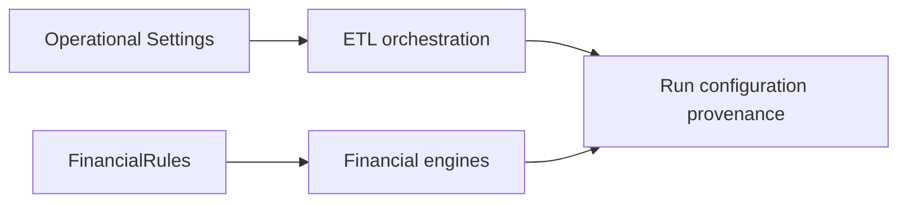

# Configuration

I use two independently loaded, typed configuration families: operational `Settings` for files, stores, and ingestion controls; and `FinancialRules` for the economic interpretation of my data, tax policy, wealth assumptions, and FIRE models. The separation keeps a path change from silently changing a financial definition.

## Technical specifications

| Document | Responsibility |
|---|---|
| [Configuration Architecture](configuration-architecture.md) | Loading, operational settings, financial rules, and runtime handoff |
| [Validation and Defaults](validation-and-defaults.md) | Pydantic checks, filesystem checks, cross-field constraints, materialized UID validation |
| [Configuration Snapshots](configuration-snapshots.md) | Canonical JSON, content-addressed snapshots, run linkage |
| [Financial Rules](financial-rules.md) | Detailed household, investment, allocation, and tax policy |
| [FIRE Configuration](fire-configuration.md) | Return regimes, simulation controls, withdrawal assumptions, inflation, and model choices |

## Ownership

I document *what settings mean and how they are validated* here. I document the actual financial calculations in [Finance](../finance/README.md), snapshot storage and operational lineage in [Control Plane](../control-plane/README.md), and precise physical tables in [Reference](../reference/README.md).

[← Documentation home](../README.md)
