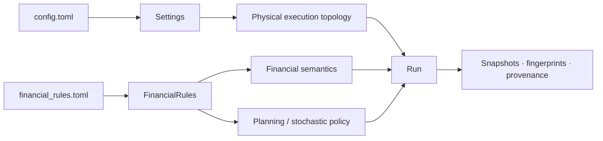
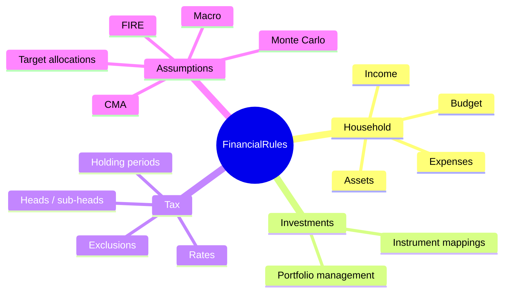
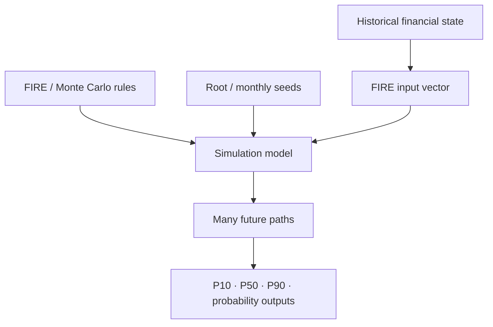
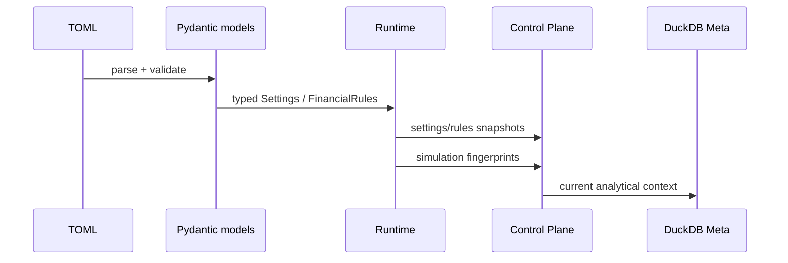

# Configuration

Configuration is where this system stops being generic software and becomes **my financial model running on my evidence**.

That sounds simple until the word “configuration” starts hiding three very different kinds of authority:

- where files and databases live;
- how financial evidence is classified and interpreted;
- which assumptions drive deterministic and stochastic planning.

A source path, a Tax holding-period rule, and a Markov transition matrix can all be represented in TOML. They absolutely do not have the same consequences.

The Configuration documentation therefore begins with a distinction that the codebase itself enforces:

> **Execution topology belongs to `Settings`. Financial interpretation belongs to `FinancialRules`. Simulation behavior is a specialized subtree of those financial rules.**



The three branches converge at execution, but they remain different kinds of truth.

## The first boundary: where the system runs

`Settings` describes the physical environment.

It answers questions such as:

- where source databases are discovered;
- where statements live;
- where DuckDB and the SQLite Control Plane are created;
- which dependency/master files must exist;
- whether file-content hashing is enabled for each format family.

It does **not** decide whether a category represents active income, whether an equity disposal is long-term, or what safe-withdrawal assumptions should be used.

That distinction matters because changing a path should not silently change financial meaning.

The complete runtime surface is specified in [Configuration Reference](configuration-reference.md).

## The second boundary: what the evidence means

`FinancialRules` is a Pydantic root model composed from domain-specific policy models.

It carries household, investment, budget, portfolio, Tax, macro, FIRE, Monte Carlo, and capital-market assumptions into the domains that consume them.



This is not merely convenient configuration extraction. It is **policy injection**.

A household transform can receive the same category map that Tax classification later audits. An investment service can consume the same financial rules object as portfolio analytics. The rule model becomes the single typed vocabulary for configurable financial policy.

That surface is specified in [Financial Rules Reference](financial-rules-reference.md).

## The third boundary: what future paths are allowed to look like

Historical financial facts should remain deterministic given the same evidence and rules.

Monte Carlo is different.

The stochastic subtree controls:

- simulation horizon and iteration count;
- annual volatility and real-return floors;
- Markov market regimes;
- human-capital shocks;
- retirement glide paths;
- jump diffusion;
- Guyton-Klinger withdrawal guardrails;
- mean-reverting inflation;
- long-term capital-market assumptions.

Those settings do not rewrite historical transactions. They alter the **distribution of modeled futures**.



That surface deserves its own specification because a simulation parameter is not “just another financial rule.” Its interpretation depends on a stochastic engine.

See [FIRE & Simulation Configuration](fire-and-simulation-reference.md).

## Configuration becomes provenance

The most interesting part of this architecture is what happens **after** configuration loads.

Both `Settings` and `FinancialRules` can flatten themselves into audit records. Simulation execution goes further and fingerprints the relevant FIRE, Monte Carlo, and CMA rule state together with its input and result data.

That turns configuration from ephemeral process input into evidence answering:

> Which environment and policy produced this run?

and, for simulations:

> Which model assumptions and input state produced this distribution?



That provenance story is why configuration documentation belongs next to architecture, not buried in a “customization tips” appendix.

## Loading is intentionally asymmetric

The two root models do not fail the same way.

`Settings.from_toml()` returns default settings when its path does not exist:

```python
# src/personal_finance_etl/config/settings.py
@classmethod
def from_toml(cls, filepath: str | os.PathLike[str], track_recent: bool = True) -> Settings:
    path_str = os.fspath(filepath)
    if not os.path.exists(path_str):
        return cls()

    with open(path_str, "rb") as f:
        data = tomllib.load(f)

    cfg = cls(**data)
```

The defaults are intentionally incomplete, so `validate_config()` will later fail if required physical paths are missing.

`FinancialRules.from_toml()` is stricter:

```python
# src/personal_finance_etl/config/financial_rules/model.py
@classmethod
def from_toml(cls, filepath: str | os.PathLike[str]) -> Self:
    path_str = os.fspath(filepath)
    if not path_str or not os.path.exists(path_str):
        raise FileNotFoundError(f"Financial rules config not found at {path_str}")

    with open(path_str, "rb") as f:
        data = tomllib.load(f)
        return cls.model_validate(data)
```

That asymmetry follows the roles of the models:

- an empty `Settings` object can exist before a user selects/configures physical paths;
- a requested `FinancialRules` file represents explicit financial policy and therefore must exist.

## Bootstrap resolves both, but does not blur them

`ServiceContainer` resolves the two configuration domains independently:

```python
# src/personal_finance_etl/bootstrap/container.py
def create_settings(self, config_path: str | None = None) -> Settings:
    target_path = config_path or self.default_config_path
    return Settings.from_toml(target_path) if target_path else Settings()

def create_rules(self, rules_path: str | None = None) -> FinancialRules | None:
    target_path = rules_path or self.default_rules_path
    return FinancialRules.from_toml(target_path) if target_path else None
```

That separation is architectural. A physical database path should never have to coexist in the same model as a Tax sub-head because both happen to be editable.

One giant `Config` object would be convenient in the same way one giant kitchen drawer is convenient: everything is technically somewhere.

## The documentation path

Read this folder in order:

1. **[Configuration Reference](configuration-reference.md)** follows physical runtime configuration from TOML to validation, dependency topology, hashing, preferences, and audit projection.
2. **[Financial Rules Reference](financial-rules-reference.md)** follows policy from category identifiers and budget rules through Tax classification and cross-domain consumers.
3. **[FIRE & Simulation Configuration](fire-and-simulation-reference.md)** zooms into the stochastic subtree, explains how each model family affects the engine, and closes with simulation provenance and sensitivity.

The sequence is deliberate:

```text
where does the system run?
        ↓
what financial meaning does it apply?
        ↓
what assumptions govern modeled futures?
        ↓
how can a later run explain exactly what happened?
```

## What configuration does not own

Configuration expresses policy. It does not execute the policy.

| Concern | Owner |
| --- | --- |
| File/database paths | `config.settings` |
| Financial policy | `config.financial_rules` |
| Financial algorithms | `domain/*` |
| Use-case sequencing | `application/*` |
| Persistence | `infrastructure/*` |
| UI preferences | `infrastructure.preferences` |
| CLI/Desktop interaction | `presentation/*` |

This keeps a useful distinction intact:

> **Rules describe the world the engine should assume. Domains decide how those rules become financial calculations.**

## Related specifications

- [Application & Dependency Architecture](../architecture/application-and-dependency-architecture.md)
- [Deterministic Identity & Replay](../architecture/deterministic-identity-and-replay.md)
- [Data Model](../architecture/data-model.md)
- [Engineering Standards](../developer/engineering-standards.md)
- [Financial Model](../finance/financial-model.md)
- [FIRE Methodology](../finance/fire-methodology.md)
