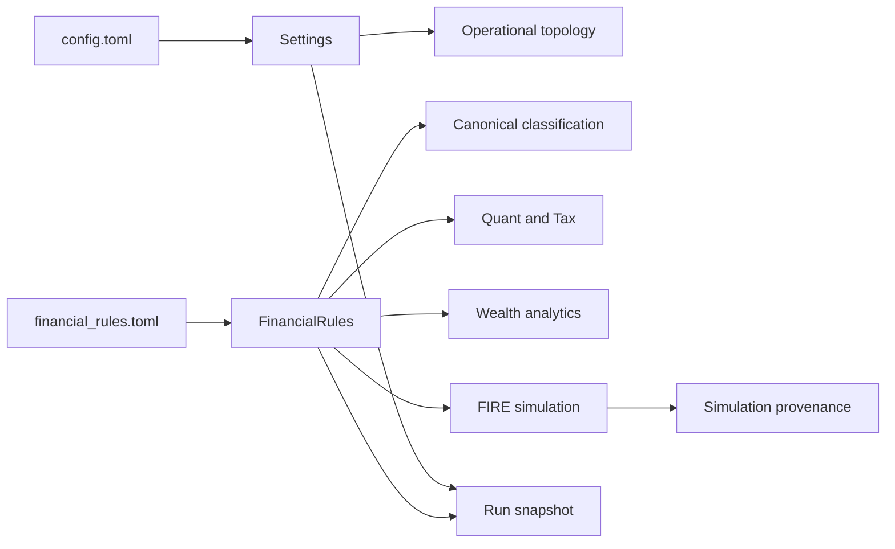

# Configuration

Personal Finance ETL treats configuration as executable context, not decorative preferences. Runtime settings decide where evidence is discovered and where state is persisted. Financial rules decide how that evidence is classified and interpreted. FIRE and Monte Carlo rules decide how current financial state is projected into uncertain futures. Those are different responsibilities and are documented separately.

## Understand what the knobs mean

For the conceptual boundary between runtime settings, financial policy, and stochastic assumptions, read **[Configuration & Customization](https://github.com/tks18/personal-finance-etl/wiki/14-Configuration-and-Customization)** first. Return here for the exact Pydantic-backed configuration contracts and validation behavior.

## Reading map

| Specification | Question it owns |
| --- | --- |
| [Configuration Reference](configuration-reference.md) | Where does the application read, discover and persist data? |
| [Financial Rules Reference](financial-rules-reference.md) | How is financial evidence classified and interpreted? |
| [FIRE and Simulation Reference](fire-and-simulation-reference.md) | Which parameters control deterministic FI planning and stochastic simulation? |

The configuration layer deliberately fails early for missing required paths and structurally invalid rule mappings. A beautifully parameterized model fed by the wrong files is still just a beautifully parameterized wrong answer.

## Configuration as provenance

Each ETL run snapshots Settings and FinancialRules into the SQLite Control Plane. Simulation provenance separately records the relevant rules/model/input fingerprints and stochastic seed context. Configuration therefore participates in auditability: a result is interpreted in the context of the rules under which it was produced.

## Related specifications

- [System Architecture](../architecture/system-architecture.md)
- [Deterministic Identity and Replay](../architecture/deterministic-identity-and-replay.md)
- [Financial Model](../finance/financial-model.md)
- [FIRE Methodology](../finance/fire-methodology.md)
- [Testing and Validation](../developer/testing-and-validation.md)
