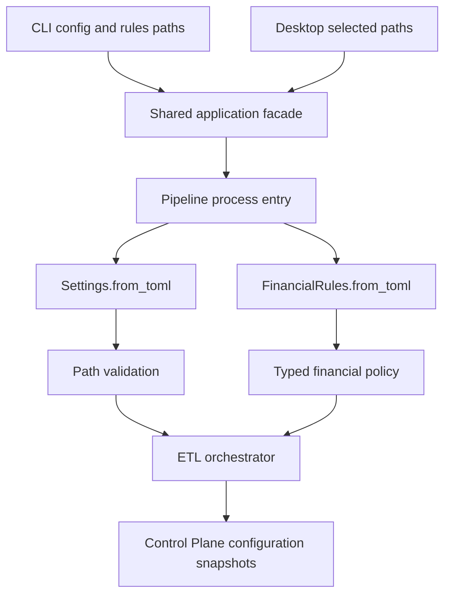

# Configuration architecture and resolution

I separate operational `Settings` from financial `FinancialRules` because filesystem locations and ingestion choices should not redefine the economic meaning of my transactions. Both models are Pydantic objects, but they have different loading and validation responsibilities.



## Two independently loaded configuration documents

I load the operational TOML through `Settings.from_toml()` and the financial policy TOML through `FinancialRules.from_toml()`. The pipeline entry point constructs these before orchestration. Unlike rules, a missing settings file returns a default `Settings` instance; a missing rules file raises `FileNotFoundError`. That difference is intentional behavior to document, not an interchangeable configuration fallback.

The CLI and desktop interface select paths and pass them to the shared backend. Recent paths are convenience preferences, not the authoritative run configuration.

## Operational boundary

`Settings` contains source locations, database naming, statements location, dependency master files, discovery control, and per-format file hashing policy. It does not define investment tax treatment or the FIRE stochastic model.

The `FILE_HASH_POLICY` default enables CSV hashing but disables Excel and SQLite hashing. This controls how change detection is performed for supported artifact classes; it is not a promise that every source is content-hashed on every run.

## Financial policy boundary

`FinancialRules` groups income, expenses, assets, instrument-specific investment rules, assumptions, budgets, portfolio-management settings, default currency, and mutual-fund scheme mappings. Its `assumptions` field is required, with further required nested domains.

I keep typed policy close to the finance domain but keep the mechanics of file discovery and warehouse paths in operational settings.

## Run-level handoff

The orchestrator receives validated objects and serializes their content for the Control Plane run record. This is different from using the recent-config preference file, which only remembers file paths.

Configuration inputs are not automatically a substitute for the external source artifacts. A repeatable run depends on those artifacts and software behavior as well as configuration snapshots.

## Selected production excerpts

I use these short excerpts to anchor the specification. The source modules remain authoritative for complete branches.

### Settings model

Source: `src/personal_finance_etl/backend/config/settings.py`

```python
class Settings(BaseModel):
    SOURCE_DB_FOLDER: str = ""
    TARGET_DB_BASE_PATH: str = ""
    TARGET_DB_NAME: str = "Personal_Finance_DB.duckdb"

    # Raw Store Config
    DISABLE_FILE_DISCOVERER: bool = False
    RAW_DOCUMENT_STORE_NAME: str = "Personal_Finance_DB_Raw_Store.sqlite"

    # Dependencies
    COLUMN_MASTER_PATH: str = ""
    MF_ISIN_CSV_PATH: str = ""
    BENCHMARK_MAPPING_CSV_PATH: str = ""
    BENCHMARK_MASTER_CSV_PATH: str = ""
    MACRO_PARAMETERS_CSV_PATH: str = ""
    OPENING_BALANCE_CSV_PATH: str = ""
```

### Financial rules model

Source: `src/personal_finance_etl/backend/config/financial_rules.py`

```python
class FinancialRules(BaseModel):
    income: IncomeRules = Field(default_factory=lambda: IncomeRules())
    expense: ExpenseRules = Field(default_factory=lambda: ExpenseRules())
    assets: AssetRules = Field(default_factory=lambda: AssetRules())
    investments: dict[str, InvestmentInstrumentRules] = Field(default_factory=dict)
    assumptions: AssumptionsRules = Field(...)
    budget: BudgetRules = Field(default_factory=BudgetRules)
    portfolio_management: PortfolioManagementRules = Field(default_factory=PortfolioManagementRules)

    # Transactional rules
    DEFAULT_CURRENCY_ID: str = "INR_INR"
    MF_SCHEME_MAPPINGS: dict[str, str] = Field(default_factory=dict)

    def validate_investment_exclusion_uids(self, df_subcategory: Any) -> None:
        """Validate configured investment exclusions against the actual subcategory dimension.

```

## Related technical specifications

I keep financial derivations in [Finance](../finance/README.md), run provenance in [Control Plane](../control-plane/README.md), and exact physical contracts in [Reference](../reference/README.md).
