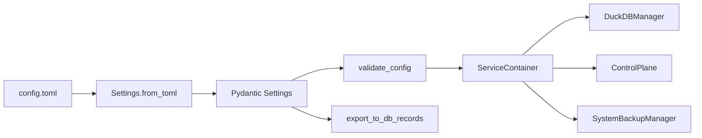
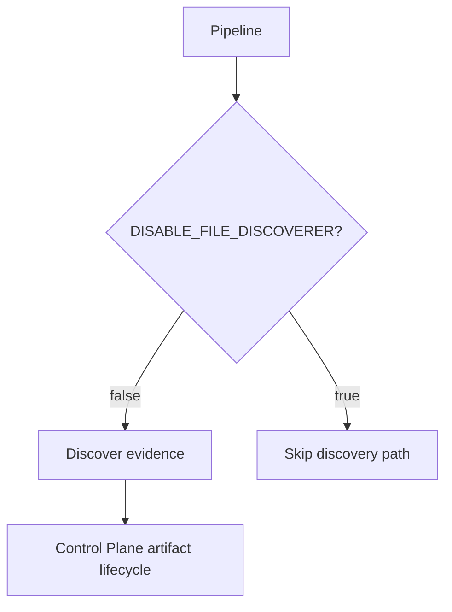
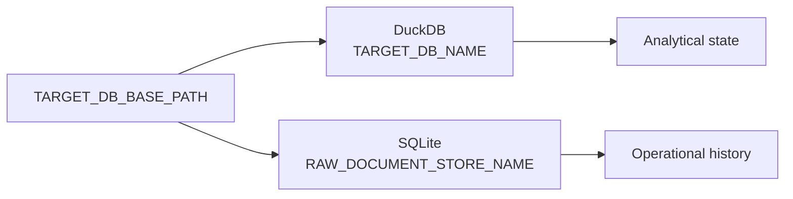
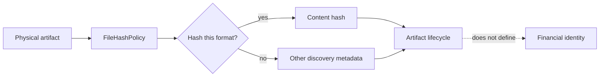
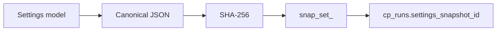
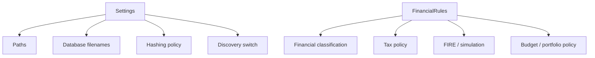
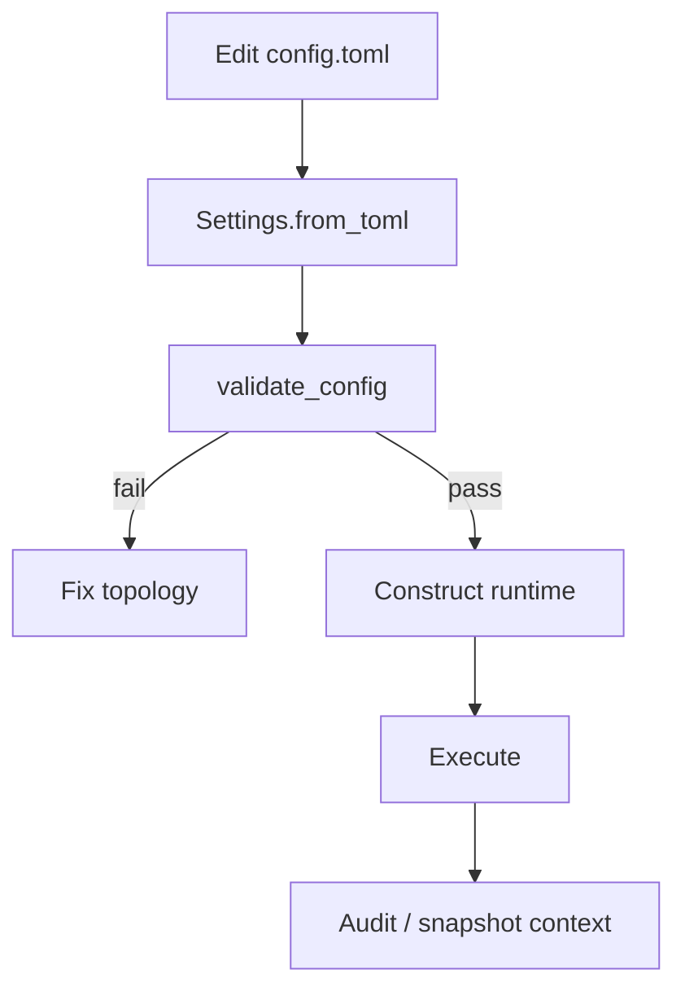

# Configuration Reference

`Settings` does not describe finance.

It describes the **physical world the finance engine is allowed to operate in**.

That includes source locations, warehouse names, raw-store location, dependency files, statements, and file-hashing policy. This sounds mundane until one remembers that every later claim about lineage, replay, backup, and reproducibility depends on resolving those paths consistently.

So the useful question is not “what keys exist in `config.toml`?”

It is:

> **How does a TOML file become a validated runtime topology, and what operational guarantees depend on that topology being correct?**

## The runtime path begins before financial rules

The physical configuration path is:



The model therefore participates in both **construction** and **auditability**.

## Source authority

The configuration contract is defined by:

```text
src/personal_finance_etl/config/settings.py
```

Sample TOML files are examples, not schema authority.

That distinction matters because examples can lag implementation. Pydantic models are the contract actually instantiated by the runtime.

## The complete `Settings` contract

The current model is intentionally small:

```python
# src/personal_finance_etl/config/settings.py
class Settings(BaseModel):
    SOURCE_DB_FOLDER: str = ""
    TARGET_DB_BASE_PATH: str = ""
    TARGET_DB_NAME: str = "Personal_Finance_DB.duckdb"

    DISABLE_FILE_DISCOVERER: bool = False
    RAW_DOCUMENT_STORE_NAME: str = "Personal_Finance_DB_Raw_Store.sqlite"

    COLUMN_MASTER_PATH: str = ""
    MF_ISIN_CSV_PATH: str = ""
    BENCHMARK_MAPPING_CSV_PATH: str = ""
    BENCHMARK_MASTER_CSV_PATH: str = ""
    MACRO_PARAMETERS_CSV_PATH: str = ""
    OPENING_BALANCE_CSV_PATH: str = ""
    CURRENCY_MAPPING_CSV_PATH: str = ""

    STATEMENTS_FOLDER: str = ""
    FILE_HASH_POLICY: FileHashPolicy = Field(default_factory=FileHashPolicy)
```

These fields fall into five operational groups.

## 1. Source discovery topology

### `SOURCE_DB_FOLDER`

Directory containing source databases/files discovered by the ingestion path.

This path must already exist when `validate_config()` runs.

### `STATEMENTS_FOLDER`

Directory containing statement artifacts used by the source pipeline.

It is also required to exist.

### `DISABLE_FILE_DISCOVERER`

Operational switch allowing discovery to be disabled.

This is not a financial rule. It changes whether a physical ingestion mechanism runs.



The switch should therefore be understood in the context of artifact lifecycle and replay, not as a generic performance toggle.

## 2. Persistence topology

### `TARGET_DB_BASE_PATH`

Directory that holds the runtime persistence pair.

Unlike the source directories, this directory may be created automatically by downstream infrastructure. The validation rule therefore checks that the value is **non-empty**, not that the directory already exists.

### `TARGET_DB_NAME`

DuckDB analytical warehouse filename.

Default:

```text
Personal_Finance_DB.duckdb
```

### `RAW_DOCUMENT_STORE_NAME`

SQLite Control Plane filename.

Default:

```text
Personal_Finance_DB_Raw_Store.sqlite
```

Those two names produce the local persistence pair:



The names live together because they share a physical base path. Their **authority does not**.

SQLite remains the Control Plane and historical operational authority. DuckDB remains the analytical warehouse.

## 3. Dependency/master files

Seven dependency paths are required:

| Setting | Runtime role |
| --- | --- |
| `COLUMN_MASTER_PATH` | Column/schema mapping dependency |
| `MF_ISIN_CSV_PATH` | Mutual-fund ISIN mapping |
| `BENCHMARK_MAPPING_CSV_PATH` | Instrument-to-benchmark mapping |
| `BENCHMARK_MASTER_CSV_PATH` | Benchmark master/reference data |
| `MACRO_PARAMETERS_CSV_PATH` | Macro-parameter evidence |
| `OPENING_BALANCE_CSV_PATH` | Opening-balance evidence |
| `CURRENCY_MAPPING_CSV_PATH` | Currency mapping/reference |

Every path must refer to an existing file during configuration validation.

These files are physical dependencies, even when their content later affects financial calculations. `Settings` answers **where the evidence lives**. The domain answers **what that evidence means**.

## 4. File hashing policy

`FILE_HASH_POLICY` is a nested model:

```python
# src/personal_finance_etl/config/settings.py
class FileHashPolicy(BaseModel):
    csv: bool = True
    excel: bool = False
    sqlite: bool = False
```

The default policy hashes CSV content while leaving Excel and SQLite hashing disabled.

That is an operational trade-off, not an identity contract.

File hashes participate in discovery/deduplication/change detection. They do not replace deterministic financial identities.



That distinction prevents two very different “hash” concepts from being conflated:

- **artifact hash**: physical evidence/change detection;
- **deterministic ID**: canonical financial identity.

## Loading semantics

`Settings.from_toml()` is intentionally tolerant of a missing file:

```python
# src/personal_finance_etl/config/settings.py
@classmethod
def from_toml(cls, filepath: str | os.PathLike[str], track_recent: bool = True) -> Settings:
    path_str = os.fspath(filepath)
    if not os.path.exists(path_str):
        return cls()

    with open(path_str, "rb") as f:
        data = tomllib.load(f)

    cfg = cls(**data)
```

A missing file yields a default model containing empty paths.

That does **not** mean execution can proceed successfully.

The next validation boundary catches incomplete topology.

## Validation is explicit and operational

`validate_config()` divides requirements into directories and files:

```python
# src/personal_finance_etl/config/settings.py
required_dirs = [
    ("SOURCE_DB_FOLDER", self.SOURCE_DB_FOLDER),
    ("STATEMENTS_FOLDER", self.STATEMENTS_FOLDER),
]

required_files = [
    ("COLUMN_MASTER_PATH", self.COLUMN_MASTER_PATH),
    ("MF_ISIN_CSV_PATH", self.MF_ISIN_CSV_PATH),
    ("BENCHMARK_MAPPING_CSV_PATH", self.BENCHMARK_MAPPING_CSV_PATH),
    ("BENCHMARK_MASTER_CSV_PATH", self.BENCHMARK_MASTER_CSV_PATH),
    ("MACRO_PARAMETERS_CSV_PATH", self.MACRO_PARAMETERS_CSV_PATH),
    ("OPENING_BALANCE_CSV_PATH", self.OPENING_BALANCE_CSV_PATH),
    ("CURRENCY_MAPPING_CSV_PATH", self.CURRENCY_MAPPING_CSV_PATH),
]
```

The method accumulates every missing/invalid path and raises one `FileNotFoundError` containing the full list.

That is a useful UX choice: a bad configuration should not force seven separate run attempts just to discover seven missing dependencies.

## Why the base path is validated differently

The base output directory is special:

```python
# src/personal_finance_etl/config/settings.py
if not self.TARGET_DB_BASE_PATH:
    errors.append("TARGET_DB_BASE_PATH is empty in configuration.")
```

The application can create the target directory later, so validation requires a configured destination rather than pre-existing storage.

This is a good example of validation reflecting **runtime ownership** instead of blindly calling `os.path.exists()` on everything.

## Failure matrix

| Situation | Model load | `validate_config()` | Meaning |
| --- | --- | --- | --- |
| TOML path absent | Returns default model | Fails on required paths | Configuration not yet resolved |
| Source folder absent | Loads | Fails | Evidence topology invalid |
| Statements folder absent | Loads | Fails | Statement topology invalid |
| Dependency file absent | Loads | Fails | Required reference evidence unavailable |
| Target base path empty | Loads | Fails | Persistence destination undefined |
| Target base directory does not yet exist | Loads | Allowed | Infrastructure may create it |
| Unknown TOML key | Pydantic default behavior applies | Not part of contract | Do not treat samples as authority |

The last row deserves attention.

A stale example file can contain keys that are no longer fields on `Settings`. That does not magically make those keys supported runtime configuration.

The model is the contract.

## Recent configuration history is a preference, not financial state

When a configuration successfully loads, `Settings.from_toml()` attempts to add the path to recent preferences:

```python
# src/personal_finance_etl/config/settings.py
if track_recent:
    try:
        PreferencesManager().add_recent_config(path_str)
    except Exception:
        pass
```

This operation is intentionally best-effort.

A failure to update recent-file UI state must not invalidate a financially valid configuration.

That gives us another clean ownership split:

```text
Settings
    runtime topology

PreferencesManager
    user convenience / recent files
```

The latter lives in `infrastructure.preferences`, not in financial configuration.

## Bootstrap turns topology into concrete infrastructure

Once settings are resolved, the composition root binds the configured paths to concrete infrastructure:

```python
# src/personal_finance_etl/bootstrap/container.py
def create_duckdb_manager(self, cfg: Settings) -> DuckDBManager:
    return DuckDBManager(cfg.TARGET_DB_BASE_PATH, cfg.TARGET_DB_NAME)

def create_control_plane(self, cfg: Settings) -> ControlPlane:
    return ControlPlane(cfg.TARGET_DB_BASE_PATH, cfg.RAW_DOCUMENT_STORE_NAME)
```

The same settings also bind backup/restore to the active pair:

```python
# src/personal_finance_etl/bootstrap/container.py
def create_backup_manager(self, cfg: Settings) -> SystemBackupManager:
    return SystemBackupManager(
        cfg.TARGET_DB_BASE_PATH,
        sqlite_db_name=cfg.RAW_DOCUMENT_STORE_NAME,
        duckdb_name=cfg.TARGET_DB_NAME,
    )
```

So changing a database name changes more than “where a file gets written.” It changes the persistence pair that run, backup, restore, and recovery all refer to.

## Configuration participates in backup semantics

Because the persistence filenames come from `Settings`, snapshot/restore tooling can bind to the same pair used by execution.

This avoids a dangerous class of mismatch where:

```text
pipeline writes A.duckdb
backup snapshots B.duckdb
```

Both commands can succeed while protecting two different realities. Very efficient. Very cursed.

Central path resolution prevents that architecture.

## Audit projection

`Settings` can flatten itself into database records:

```python
# src/personal_finance_etl/config/settings.py
def export_to_db_records(self) -> list[dict[str, str]]:
    records: list[dict[str, str]] = []
    data = self.model_dump()
    _flatten_settings_to_records(data, [], records)
    return records
```

The recursive flattener converts nested structures such as `FILE_HASH_POLICY` into records carrying:

```text
Setting_Group
Setting_Key
Setting_Value
```

This matters because configuration can later be inspected as data instead of only reconstructed from a TOML file that may have changed.

## Flattening semantics

The flattener uses the first path component as a group and joins deeper components into a setting key.

Conceptually:

```text
FILE_HASH_POLICY.csv = true
```

becomes an auditable record resembling:

```text
Setting_Group = File_hash_policy
Setting_Key   = csv
Setting_Value = True
```

The flattened representation is intentionally generic so new nested settings can participate without hand-maintained projection code.

## Run snapshots preserve the exact settings payload

At run creation, the Control Plane can snapshot the serialized settings payload.

The repository canonicalizes the JSON, hashes it with SHA-256, and derives a content-addressed snapshot ID:

```python
# src/personal_finance_etl/infrastructure/control_plane/run_repository.py
if cfg_json:
    canonical_cfg = self._canonical_json(cfg_json)
    digest_cfg = hashlib.sha256(canonical_cfg.encode("utf-8")).hexdigest()
    settings_id = f"snap_set_{digest_cfg}"
    self.db.conn.execute(
        "INSERT OR IGNORE INTO cp_settings_snapshots "
        "(snapshot_id, content_hash, canonical_payload, created_at) VALUES (?, ?, ?, ?)",
        (settings_id, digest_cfg, canonical_cfg, now),
    )
```

This gives the run a durable reference to **what the settings were**, not merely where the TOML file happened to be.

Two runs with byte-different but canonically equivalent JSON payloads converge on the same snapshot content hash. A later edit to `config.toml` does not rewrite the historical snapshot attached to an earlier run.



That makes configuration part of operational provenance rather than ephemeral process state.

## `Settings` is not `FinancialRules`

This boundary is worth repeating because many configuration systems eventually dissolve it.



A change to `TARGET_DB_NAME` should not require a Tax-engine regression review.

A change to `equity_ltcg` absolutely should.

Separate models make those risk boundaries visible.

## Safe editing workflow

A physical configuration change should follow this path:



Before running, verify:

- source and statements directories exist;
- every required master/reference path points to a file;
- target base path is intentional;
- DuckDB/SQLite names point to the expected persistence pair;
- hashing changes are understood as ingestion-behavior changes;
- discovery is not disabled accidentally.

## Changing hashing policy

Hashing can influence incremental discovery and deduplication behavior.

Therefore a hash-policy change should be treated as an ingestion/replay concern rather than a harmless local preference.

Ask:

- Will previously discovered artifacts be re-evaluated?
- Does the file format have unstable binary metadata?
- Is content hashing worth the I/O cost for this source family?
- Can a non-hashed source still be tracked reliably through other artifact metadata?

The answer can differ by format, which is exactly why the policy is format-specific.

## Changing persistence filenames

Changing `TARGET_DB_NAME` or `RAW_DOCUMENT_STORE_NAME` points the runtime at different state.

That can look like a fresh environment.

Before changing either:

1. decide whether the intention is migration, reset, or parallel environment;
2. preserve/snapshot the existing pair if it matters;
3. update automation/scripts that explicitly pass paths;
4. validate that restore/backup operations target the same pair.

A filename is small text with surprisingly large blast radius.

## Configuration invariants

The operational configuration should preserve these invariants:

1. Source and statement roots exist before a pipeline starts.
2. Required dependency/master files exist before domain work starts.
3. A non-empty target base path exists conceptually before persistence is constructed.
4. DuckDB and SQLite filenames are resolved from the same settings object used by execution.
5. File-hash policy affects physical artifact handling, not financial identity.
6. Recent-file preference failure cannot invalidate financial execution.
7. Settings audit projection is derived from the typed model, not from hand-maintained key lists.

## Where the story goes next

At this point the runtime knows **where** everything lives.

It still does not know:

- which income categories are active income;
- which assets are illiquid;
- which accounts behave as cash pools;
- which Tax sub-heads are taxable or exempt;
- how long an investment must be held for long-term treatment;
- what budget or portfolio thresholds should be used.

Those are no longer topology questions.

They are financial policy.

Continue with [Financial Rules Reference](financial-rules-reference.md).

## Related specifications

- [Control Plane & Artifact Lifecycle](../architecture/control-plane-artifact-lifecycle.md)
- [Backup & Restore](../architecture/backup-and-restore.md)
- [Data Lifecycle](../architecture/data-lifecycle.md)
- [Adding Data Sources](../developer/adding-data-sources.md)
- [Financial Rules Reference](financial-rules-reference.md)
