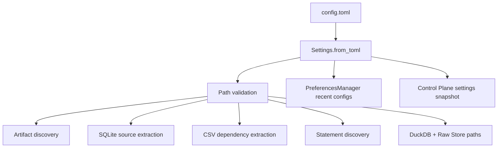
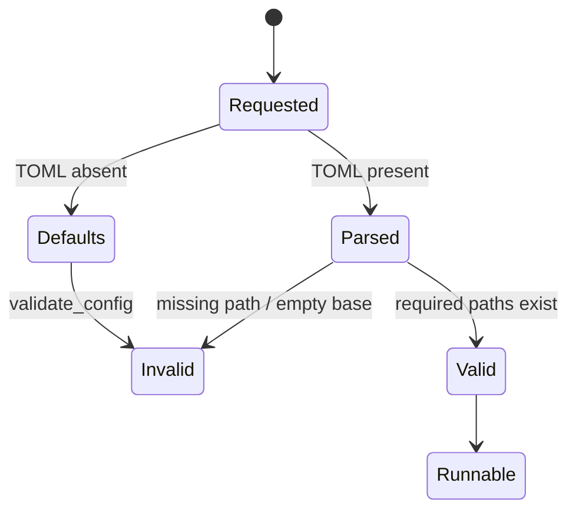
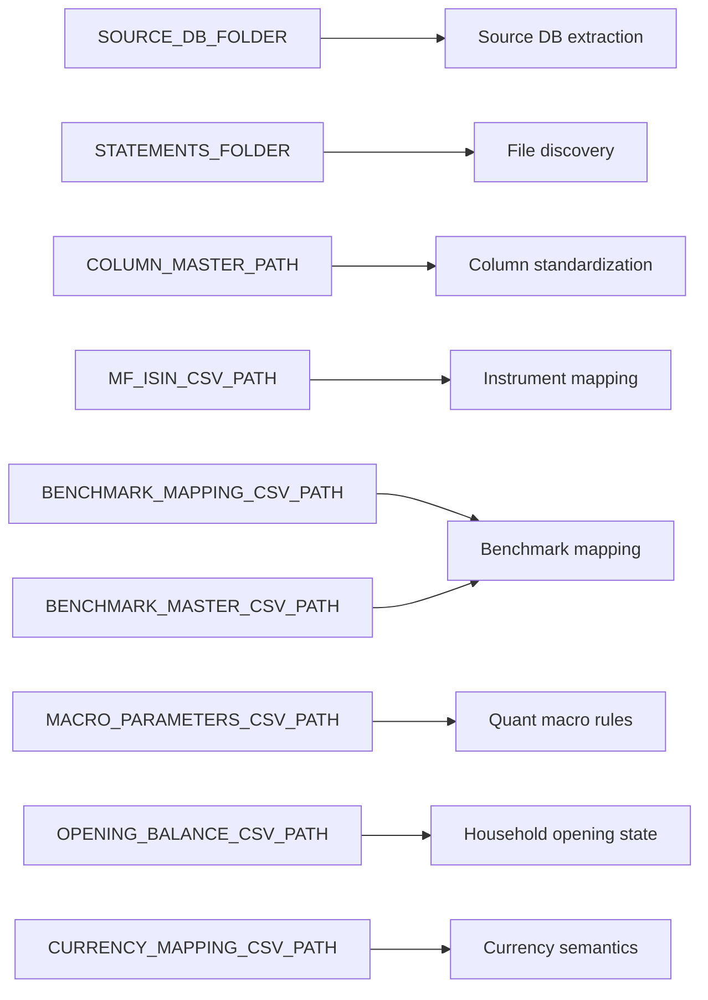
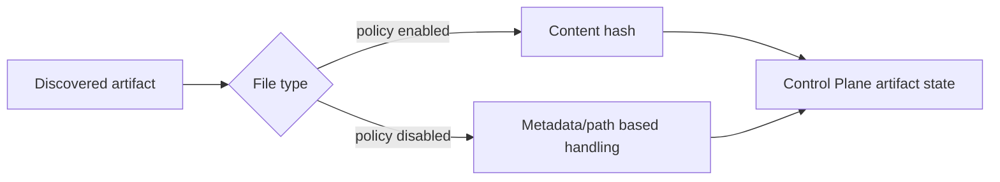
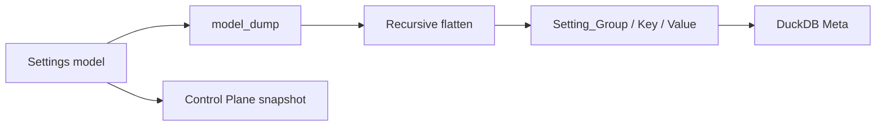
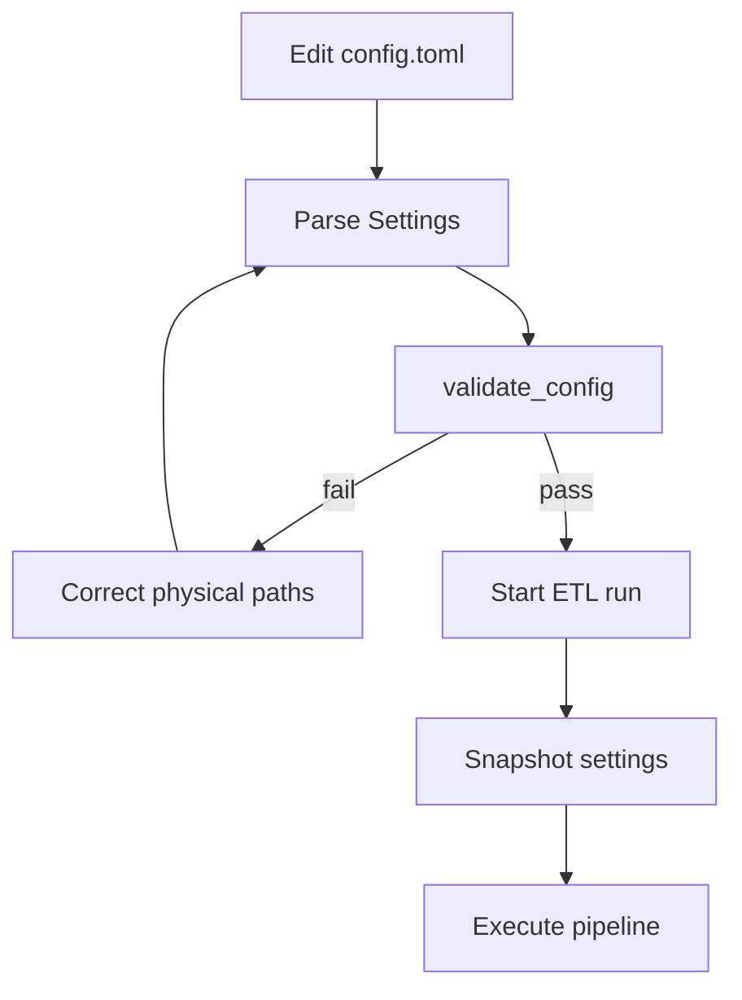

# Configuration Reference

## Purpose

`backend/config/settings.py` defines the operational configuration boundary. `Settings` answers a deliberately physical question: **where are source artifacts, dependency files, statements, and application databases located, and which file types participate in content hashing?** It does not contain tax policy, portfolio assumptions, or FIRE parameters. Those belong to `FinancialRules`.



## Source authority

- Model: `backend/config/settings.py::Settings`
- Loader: `Settings.from_toml()`
- Pre-run validation: `Settings.validate_config()`
- Audit projection: `Settings.export_to_db_records()`
- User preference helper: `PreferencesManager`

## Complete Settings contract

| Field | Type | Default | Meaning |
| --- | --- | --- | --- |
| SOURCE_DB_FOLDER | str | '' |  |
| TARGET_DB_BASE_PATH | str | '' |  |
| TARGET_DB_NAME | str | 'Personal_Finance_DB.duckdb' |  |
| DISABLE_FILE_DISCOVERER | bool | False |  |
| RAW_DOCUMENT_STORE_NAME | str | 'Personal_Finance_DB_Raw_Store.sqlite' |  |
| COLUMN_MASTER_PATH | str | '' |  |
| MF_ISIN_CSV_PATH | str | '' |  |
| BENCHMARK_MAPPING_CSV_PATH | str | '' |  |
| BENCHMARK_MASTER_CSV_PATH | str | '' |  |
| MACRO_PARAMETERS_CSV_PATH | str | '' |  |
| OPENING_BALANCE_CSV_PATH | str | '' |  |
| CURRENCY_MAPPING_CSV_PATH | str | '' |  |
| STATEMENTS_FOLDER | str | '' |  |
| FILE_HASH_POLICY | FileHashPolicy | factory |  |


`TARGET_DB_NAME` and `RAW_DOCUMENT_STORE_NAME` are filenames; `TARGET_DB_BASE_PATH` provides their physical base directory. `TARGET_DB_BASE_PATH` is intentionally not required to exist before validation because the application may create it, but an empty value is rejected.

## Loading semantics

```python
class Settings(BaseModel):
    SOURCE_DB_FOLDER: str = ""
    TARGET_DB_BASE_PATH: str = ""
    TARGET_DB_NAME: str = "Personal_Finance_DB.duckdb"

    # Raw Store Config
    DISABLE_FILE_DISCOVERER: bool = False
    RAW_DOCUMENT_STORE_NAME: str = "Personal_Finance_DB_Raw_Store.sqlite"

    # Dependencies
    COLUMN_MASTER_PATH: str = ""
    MF_ISIN_CSV_PATH: str = ""
    BENCHMARK_MAPPING_CSV_PATH: str = ""
    BENCHMARK_MASTER_CSV_PATH: str = ""
    MACRO_PARAMETERS_CSV_PATH: str = ""
    OPENING_BALANCE_CSV_PATH: str = ""
    CURRENCY_MAPPING_CSV_PATH: str = ""

    # Statements
    STATEMENTS_FOLDER: str = ""

    FILE_HASH_POLICY: FileHashPolicy = Field(default_factory=FileHashPolicy)

    @classmethod
    def from_toml(cls, filepath: str) -> Settings:
        """Loads a TOML configuration and returns a Settings instance."""
        if not os.path.exists(filepath):
            return cls()

        with open(filepath, "rb") as f:
            data = tomllib.load(f)

        cfg = cls(**data)
        PreferencesManager().add_recent_config(filepath)
        return cfg
```

`from_toml()` has an intentionally permissive missing-file behavior: if the requested TOML path does not exist, it returns a default `Settings` instance. That does **not** make an absent configuration runnable. `validate_config()` subsequently rejects empty/missing required paths before execution. Loading and run-readiness are therefore separate states.



## Path validation

The current implementation validates two required directories and seven dependency files.

### Required directories

- `SOURCE_DB_FOLDER`
- `STATEMENTS_FOLDER`

### Required dependency files

- `COLUMN_MASTER_PATH`
- `MF_ISIN_CSV_PATH`
- `BENCHMARK_MAPPING_CSV_PATH`
- `BENCHMARK_MASTER_CSV_PATH`
- `MACRO_PARAMETERS_CSV_PATH`
- `OPENING_BALANCE_CSV_PATH`
- `CURRENCY_MAPPING_CSV_PATH`

```python
def validate_config(self) -> None:
        """Validates that all necessary files and folders exist before starting."""
        required_dirs = [
            ("SOURCE_DB_FOLDER", self.SOURCE_DB_FOLDER),
            ("STATEMENTS_FOLDER", self.STATEMENTS_FOLDER),
        ]

        required_files = [
            ("COLUMN_MASTER_PATH", self.COLUMN_MASTER_PATH),
            ("MF_ISIN_CSV_PATH", self.MF_ISIN_CSV_PATH),
            ("BENCHMARK_MAPPING_CSV_PATH", self.BENCHMARK_MAPPING_CSV_PATH),
            ("BENCHMARK_MASTER_CSV_PATH", self.BENCHMARK_MASTER_CSV_PATH),
            ("MACRO_PARAMETERS_CSV_PATH", self.MACRO_PARAMETERS_CSV_PATH),
            ("OPENING_BALANCE_CSV_PATH", self.OPENING_BALANCE_CSV_PATH),
            ("CURRENCY_MAPPING_CSV_PATH", self.CURRENCY_MAPPING_CSV_PATH),
        ]

        errors: list[str] = []

        # We don't validate TARGET_DB_BASE_PATH because it is created automatically if missing
        if not self.TARGET_DB_BASE_PATH:
            errors.append("TARGET_DB_BASE_PATH is empty in configuration.")

        for name, path in required_dirs:
            if not path or not os.path.isdir(path):
                errors.append(f"Directory {name} not found: '{path}'")

        for name, path in required_files:
            if not path or not os.path.isfile(path):
                errors.append(f"File {name} not found: '{path}'")

        if errors:
            raise FileNotFoundError(
                "Configuration Validation Failed. The following paths are missing or invalid:\n"
                + "\n".join(errors)
            )
```

The validator aggregates failures and raises one `FileNotFoundError` containing every missing/invalid path. This is preferable to discovering configuration problems one artifact at a time halfway through a financial rebuild.

## Source and dependency topology



These files are operational dependencies but their contents have financial meaning. Settings owns *where to find them*; transformations and engines own *what they mean*. That boundary keeps path management from quietly becoming a finance engine in disguise.

## File hashing policy

`FILE_HASH_POLICY` is a nested `FileHashPolicy` model.

| Field | Type | Default | Meaning |
| --- | --- | --- | --- |
| csv | bool | True |  |
| excel | bool | False |  |
| sqlite | bool | False |  |


The defaults hash CSV content but do not hash Excel or SQLite sources. The policy affects changed-file detection cost and evidence sensitivity; it does not change canonical financial identities such as `PURCHASE`, `LOT`, or `TAX`. File identity/provenance and financial identity are separate contracts.



## File discoverer switch

`DISABLE_FILE_DISCOVERER` controls whether normal source-file discovery participates in a run. It is an operational switch, not a request to erase historical Control Plane records. Existing artifact history remains operational provenance.

## Database paths and authority

Settings names two persistent stores:

- DuckDB analytical warehouse: `TARGET_DB_BASE_PATH / TARGET_DB_NAME`
- SQLite Control Plane / Raw Store: `TARGET_DB_BASE_PATH / RAW_DOCUMENT_STORE_NAME`

The fact that both paths originate in one configuration object does not merge their responsibilities. SQLite remains historical operational authority; DuckDB remains analytical state. Two filenames, two jobs, zero identity crisis.

## PreferencesManager is not financial configuration

`PreferencesManager` stores recently used configuration/rules file paths under the user's application-data directory. It is UI convenience state. It does not participate in ETL financial semantics or reproducibility fingerprints. Invalid/missing recent paths are filtered when read.

## Audit projection

`export_to_db_records()` recursively flattens nested settings into `Setting_Group`, `Setting_Key`, and `Setting_Value` records. This is used for database-visible auditing/current analytical context.



The flattened Meta projection and the immutable run snapshot answer different questions: current inspectable settings versus historical run context.

## Configuration invariants

1. A runnable configuration has a non-empty target base path.
2. Required source directories exist before execution.
3. Required dependency files exist before execution.
4. Database filenames are interpreted relative to the configured target base path.
5. Hash policy changes artifact-change detection behavior, not financial-row identity.
6. Settings never owns financial classification policy.
7. Recent-file preferences are convenience state, not run authority.

## Failure matrix

| Condition | Behavior |
| --- | --- |
| TOML path absent | `from_toml()` returns default Settings |
| Target base path empty | validation failure |
| Required source directory missing | validation failure |
| Required dependency CSV missing | validation failure |
| Recent preference file corrupt | ignored by preference helper |
| Recent referenced path no longer exists | omitted from recent list |
| Unknown TOML key | governed by Pydantic model behavior; do not rely on it as a supported contract |

## Safe editing workflow



A configuration should be validated before a long rebuild, especially when moving the project between machines or changing source folders. Path configuration is wonderfully boring when correct and spectacularly annoying when discovered after ten transformation stages.

## Related specifications

- [System Architecture](../architecture/system-architecture.md)
- [Data Lifecycle](../architecture/data-lifecycle.md)
- [Control Plane Artifact Lifecycle](../architecture/control-plane-artifact-lifecycle.md)
- [Financial Rules Reference](financial-rules-reference.md)
- [Testing and Validation](../developer/testing-and-validation.md)
