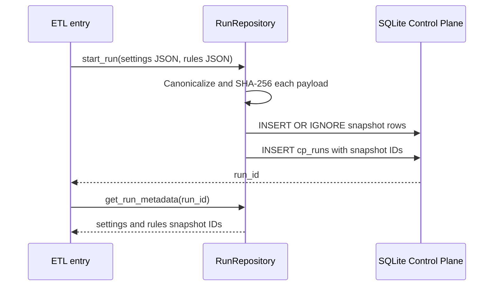

# Configuration snapshots and run provenance

I store configuration content alongside run metadata through content-addressed snapshots. That lets me distinguish the operational and financial policy used for a particular execution, even when the files at their original paths are subsequently edited.



## Canonical serialization

`RunRepository._canonical_json()` parses JSON where possible and serializes with sorted keys, compact separators, and `ensure_ascii=False`. If parsing fails, it returns the supplied string unchanged.

This makes semantically equivalent JSON key ordering converge on one canonical payload. It does not canonicalize arbitrary TOML or other text by itself: the repository receives JSON payloads from the caller.

## Snapshot identity

At run start, the repository computes SHA-256 over UTF-8 canonical content. Settings snapshots use `snap_set_` and financial-rules snapshots use `snap_rule_`, each followed by the digest.

`INSERT OR IGNORE` deduplicates identical snapshots. The `cp_runs` row records the snapshot identifiers together with application and Control Plane schema version metadata.

## Transaction and provenance boundary

Snapshot inserts and initial run creation occur in the SQLite manager’s atomic context. This protects the Control Plane registration step locally. It does not create an atomic transaction with DuckDB publication.

I preserve the distinction between a stored configuration snapshot and an archived full computational environment. To replay results, source artifacts, package dependencies, model implementation, and relevant execution conditions also matter.

## Retrieval and audit

`get_run_metadata(run_id)` reads the settings and rules snapshot IDs associated with a run. The snapshot tables hold canonical payload and digest, while `cp_runs` links that provenance to execution.

The application version recorded at run creation is metadata rather than a reason to version-stamp every documentation page.

## Selected production excerpts

I use these short excerpts to anchor the specification. The source modules remain authoritative for complete branches.

### Canonical JSON

Source: `src/personal_finance_etl/backend/load/control_plane/run_repo.py`

```python
    def _canonical_json(value: str) -> str:
        try:
            parsed = json.loads(value)
        except (TypeError, json.JSONDecodeError):
            return value
        return json.dumps(parsed, sort_keys=True, separators=(",", ":"), ensure_ascii=False)

    @staticmethod
    def _application_version() -> str:
        try:
            return f"v{importlib.metadata.version('personal-finance-etl')}"
        except importlib.metadata.PackageNotFoundError:
            return "v-unknown"

    def start_run(self, cfg_json: str | None = None, rules_json: str | None = None) -> str:
        run_id = str(uuid.uuid4())
```

### Run snapshot registration

Source: `src/personal_finance_etl/backend/load/control_plane/run_repo.py`

```python
    def start_run(self, cfg_json: str | None = None, rules_json: str | None = None) -> str:
        run_id = str(uuid.uuid4())
        now = datetime.now().isoformat(timespec="seconds")
        settings_id: str | None = None
        rules_id: str | None = None
        with self.db.atomic():
            for payload, prefix, table in (
                (cfg_json, "snap_set_", "cp_settings_snapshots"),
                (rules_json, "snap_rule_", "cp_rules_snapshots"),
            ):
                if not payload:
                    continue
                canonical = self._canonical_json(payload)
                digest = hashlib.sha256(canonical.encode("utf-8")).hexdigest()
                snapshot_id = f"{prefix}{digest}"
                self.db.conn.execute(
```

## Related technical specifications

I keep financial derivations in [Finance](../finance/README.md), run provenance in [Control Plane](../control-plane/README.md), and exact physical contracts in [Reference](../reference/README.md).
