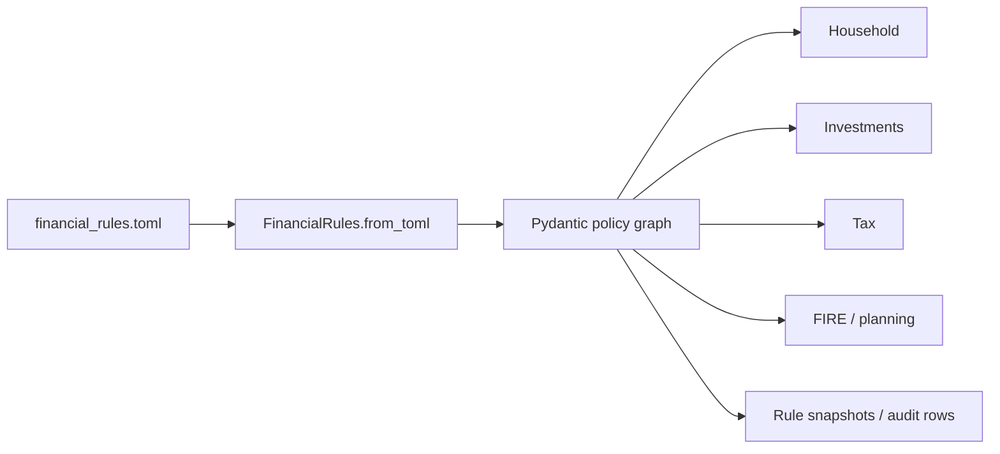
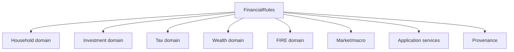
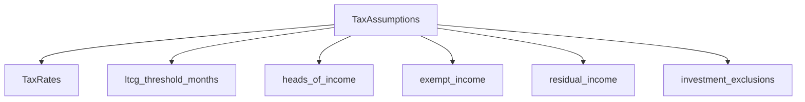
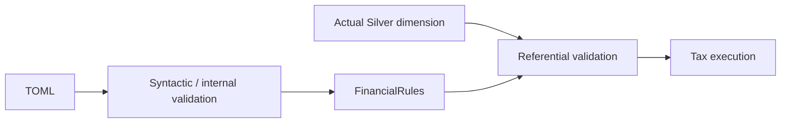
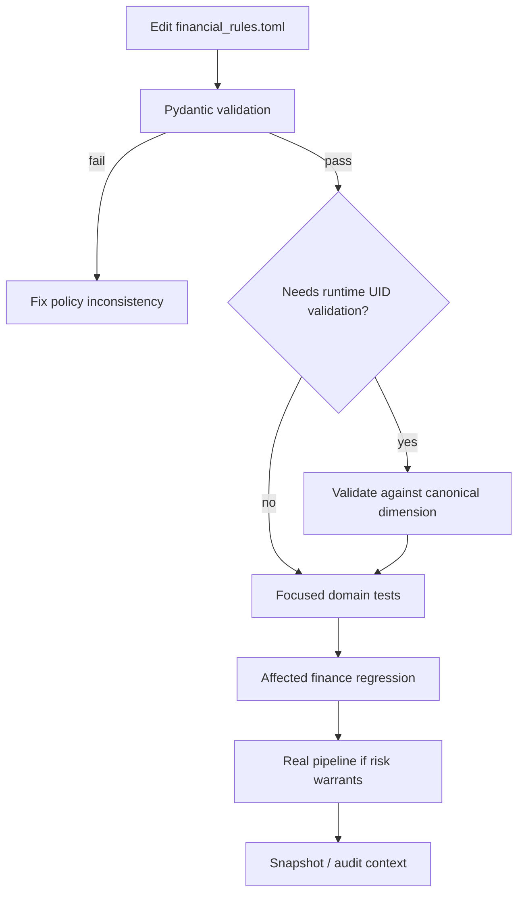

# Financial Rules Reference

A finance engine can hard-code policy into algorithms, or it can admit that policy changes.

This project chooses the second path.

`FinancialRules` separates **financial interpretation** from the algorithms that apply that interpretation. The distinction lets category mappings, statutory assumptions, budget targets, portfolio thresholds, and planning assumptions evolve without scattering magic numbers and UID lists across domain modules.

But configurability creates a new responsibility:

> **A rule must be typed, validated where possible, traceable to its consumer, and auditable after execution.**

Otherwise “configuration-driven” becomes a polite way of saying “the business logic moved into a TOML file and nobody knows who owns it now.”

## The rule path



The root model is the typed junction between configuration and domain behavior.

## Source authority

The policy model is decomposed across:

```text
src/personal_finance_etl/config/financial_rules/
├── model.py
├── household.py
├── investments.py
├── tax.py
└── fire.py
```

The decomposition is semantic:

- household classification and budgeting;
- investment instrument and portfolio policy;
- statutory Tax policy;
- macro, FIRE, stochastic, and CMA assumptions;
- root composition and cross-data validation.

## The top-level contract

```python
# src/personal_finance_etl/config/financial_rules/model.py
class FinancialRules(BaseModel):
    income: IncomeRules = Field(default_factory=IncomeRules)
    expense: ExpenseRules = Field(default_factory=ExpenseRules)
    assets: AssetRules = Field(default_factory=AssetRules)
    investments: dict[str, InvestmentInstrumentRules] = Field(default_factory=dict)
    assumptions: AssumptionsRules = Field(...)
    budget: BudgetRules = Field(default_factory=BudgetRules)
    portfolio_management: PortfolioManagementRules = Field(default_factory=PortfolioManagementRules)

    DEFAULT_CURRENCY_ID: str = "INR_INR"
    MF_SCHEME_MAPPINGS: dict[str, str] = Field(default_factory=dict)
```

The required field is `assumptions`. Most classification containers have safe empty/default factories so users can opt into policy mappings incrementally.

That asymmetry is deliberate: a financial run may have no custom active-income UID mapping, but planning/tax/macro assumptions must form a coherent model.

## Loading is strict

Unlike `Settings`, financial rules do not silently become an empty model when the requested file is missing:

```python
# src/personal_finance_etl/config/financial_rules/model.py
@classmethod
def from_toml(cls, filepath: str | os.PathLike[str]) -> Self:
    path_str = os.fspath(filepath)
    if not path_str or not os.path.exists(path_str):
        raise FileNotFoundError(f"Financial rules config not found at {path_str}")

    with open(path_str, "rb") as f:
        data = tomllib.load(f)
        return cls.model_validate(data)
```

That protects an important distinction:

```text
no explicit rules requested
    ≠
explicit rules path requested but missing
```

The first can be a supported application state. The second is configuration failure.

## Policy is injected, not rediscovered

Consumers receive `FinancialRules` directly.

The model is imported across household, investment, market, Tax, wealth, FIRE, application services, Control Plane logging, and Meta publication.



This is preferable to each subsystem reparsing TOML because there is one validated object graph and one runtime interpretation.

## Household income classification

Income policy is composed of four independent classification buckets:

```python
# src/personal_finance_etl/config/financial_rules/household.py
class IncomeRules(BaseModel):
    active: ActiveIncomeRules = Field(default_factory=ActiveIncomeRules)
    dividends: DividendIncomeRules = Field(default_factory=DividendIncomeRules)
    interest: InterestIncomeRules = Field(default_factory=InterestIncomeRules)
    non_cash: NonCashIncomeRules = Field(default_factory=NonCashIncomeRules)
```

Each bucket contains:

```text
category_ids
sub_category_ids
```

This allows policy to operate at either classification level.

### Why lists of UIDs belong in configuration

The financial semantics are stable:

```text
active income
interest income
dividend income
non-cash income
```

The actual household category/subcategory identifiers are user-specific master data.

Hard-coding those UIDs in `domain/household/income.py` would couple the algorithm to one personal chart of accounts.

The rule model separates the concept from the local identifier vocabulary.

## Expense classification

The current expense policy exposes `core` expense identifiers:

```python
class ExpenseRules(BaseModel):
    core: CoreExpenseRules = Field(default_factory=CoreExpenseRules)
```

Core-vs-non-core classification feeds cashflow, budget, emergency-fund, and FIRE interpretations.

That means a UID moving into or out of `expense.core` can change:

- trailing core spend;
- emergency-fund targets;
- FIRE target calculations;
- budget alerts;
- savings/runway analytics.

One classification edit can therefore propagate into several downstream metrics without changing a single algorithm.

That is exactly why it belongs in a documented policy contract.

## Asset semantics

`AssetRules` separates three distinct ideas:

```python
# src/personal_finance_etl/config/financial_rules/household.py
class AssetRules(BaseModel):
    illiquid: IlliquidAssetRules = Field(default_factory=IlliquidAssetRules)
    cashflow: CashflowAssetRules = Field(default_factory=CashflowAssetRules)
    digital: DigitalAssetRules = Field(default_factory=DigitalAssetRules)
```

### Illiquid assets

`category_ids` and `sub_category_ids` identify assets whose liquidity treatment differs from cash-like holdings.

### Digital assets

`category_ids` provide a dedicated classification surface for digital/crypto-style assets.

### Cashflow conduits

The cashflow policy is richer:

```python
class CashflowAssetRules(BaseModel):
    cash_pools: list[str] = Field(default_factory=list)
    non_cash_pnl_sources: list[str] = Field(default_factory=list)
    working_capital_conduits: list[str] = Field(default_factory=list)
    investing_activities: list[str] = Field(default_factory=list)
    financing_liabilities: list[str] = Field(default_factory=list)
```

These lists drive statement-like cashflow interpretation.

An account can be economically different depending on whether it behaves as:

- spendable cash;
- a non-cash P&L source;
- working-capital conduit;
- investing activity;
- financing liability.

The classification is not merely reporting cosmetics. It changes how movement is interpreted.

## Budget policy

Budgeting is split into allocation, alert, and smoothing rules.

### Income allocation

```python
class IncomeAllocationRules(BaseModel):
    core_expense_pct: float = Field(default=0.40, ...)
    non_core_expense_pct: float = Field(default=0.20, ...)
    investment_pct: float = Field(default=0.30, ...)
```

The remainder is an implicit buffer rather than another stored field.

For the defaults:

\[
1 - 0.40 - 0.20 - 0.30 = 0.10
\]

The model does not currently enforce that the three explicit percentages sum to at most one. That is therefore a **semantic expectation**, not a Pydantic guarantee.

Do not document unenforced invariants as validation behavior.

### Alerts

```text
overspend_alert_threshold
emergency_fund_target_months
```

The first determines when over-budget behavior is flagged. The second links core-expense classification to emergency-fund analytics.

### Smoothing

```text
income_smoothing_months
```

controls the trailing smoothing horizon used by household budgeting logic.

This makes budget policy a useful example of three configuration kinds living under one domain concept:


## Investment instrument classification

Investment mappings are dynamic by key:

```python
investments: dict[str, InvestmentInstrumentRules] = Field(default_factory=dict)
```

Each named instrument group can supply category and subcategory identifiers.

This supports local classification vocabularies without hard-coding “stocks”, “mutual funds”, “ETF”, or similar buckets into one fixed model schema.

The algorithms remain responsible for investment behavior. The rules say which local master-data identifiers belong to each configured instrument grouping.

## Mutual-fund scheme mappings

`MF_SCHEME_MAPPINGS` maps source scheme names to canonical scheme names.

This is a normalization policy surface.

It exists because vendor naming can drift while the economic instrument remains the same.

The mapping should therefore be interpreted as **name normalization**, not as proof that two unrelated instruments are economically interchangeable.

A mapping edit can affect downstream joins and instrument continuity, so it deserves the same source-control discipline as code.

## Default currency

`DEFAULT_CURRENCY_ID` defaults to:

```text
INR_INR
```

This is a fallback/default identifier, not permission to erase explicit source currency.

Multi-currency domains still preserve transaction/local/base currency semantics where the model requires them.

Defaults should resolve missing policy, not overwrite observed evidence.

## Portfolio management

The current portfolio policy has one explicit threshold:

```python
# src/personal_finance_etl/config/financial_rules/investments.py
class PortfolioManagementRules(BaseModel):
    rebalance_tolerance_pct_points: float = Field(
        default=5.0,
        description="Threshold (in percentage points) for triggering a rebalance requirement.",
    )
```

The unit is **percentage points**, not a decimal ratio.

That wording matters.

A configured `5.0` means a five-percentage-point drift threshold, not `500%` and not `5% of the target weight`.

Units are part of configuration semantics.

## Macro assumptions

`MacroAssumptions` provides four fallbacks:

| Field | Meaning |
| --- | --- |
| `default_trading_days` | annualization basis for volatility-style calculations |
| `fallback_inflation_rate` | inflation used when historical macro evidence is unavailable |
| `fallback_risk_free_rate` | risk-free fallback |
| `fallback_ordinary_income_rate` | ordinary-income fallback rate |

These are fallbacks, not replacements for observed macro data.

For example, inflation construction uses historical macro data where available and fills missing observations with the configured fallback:

```python
# src/personal_finance_etl/domain/fire/inflation.py
.with_columns(
    pl.col("Inflation_Rate")
    .fill_null(self.rules.assumptions.macro.fallback_inflation_rate)
    .alias("INFLATION_YOY_PCT")
)
```

That is an important semantic pattern:

```text
observed evidence if available
        ↓
fallback policy only when missing
```

Configuration should not bulldoze evidence merely because a default exists.

## Tax policy is the most strongly validated subtree

Tax configuration carries statutory interpretation, so it has the richest validation logic.

The subtree includes:

- holding-period thresholds;
- debt-fund cutoff date;
- harvesting wait threshold;
- equity LTCG exemption fallback;
- asset-class Tax rates;
- taxable/non-taxable/review classification;
- ordinary/capital-gains/exempt/review methods;
- head/sub-head mappings;
- Tax-credit category mappings;
- investment exclusions.



## Tax rates

The current rate model contains:

```text
equity_ltcg
equity_stcg
foreign_equity_ltcg
foreign_equity_stcg
debt_ltcg
debt_stcg
gold_ltcg
gold_stcg
```

These fields are policy assumptions consumed by Tax/investment logic. Documentation should describe them as configured statutory assumptions, not guarantees that every personal Tax circumstance is fully modeled.

Indicative estimates remain indicative.

## Taxability and method are explicit vocabularies

Two literals constrain classification:

```python
TaxabilityType = Literal["taxable", "non_taxable", "review"]
TaxMethodType = Literal["ordinary_rate", "capital_gains", "exempt", "review"]
```

The `review` state is important.

Unclassified/ambiguous evidence should be able to remain visible as requiring review rather than being forced into a confident Tax answer.

That is a healthier financial model than “unknown means taxable at some random default.”

## A Tax sub-head is a structured policy contract

```python
# src/personal_finance_etl/config/financial_rules/tax.py
class TaxSubHeadConfig(BaseModel):
    tax_head_display_name: str
    sub_head_display_name: str
    cat_ids: list[str] = Field(default_factory=list)
    sub_cat_ids: list[str] = Field(default_factory=list)
    tax_credit_sub_cat_ids: list[str] = Field(default_factory=list)
    taxability: TaxabilityType = "review"
    tax_method: TaxMethodType = "review"
```

The model keeps display vocabulary, source identifier mapping, tax-credit mapping, taxability, and method together.

That makes each sub-head auditable as a coherent policy unit.

## Tax credit overlap is rejected

A subcategory cannot be both income and Tax credit within the same sub-head:

```python
# src/personal_finance_etl/config/financial_rules/tax.py
overlap = income_ids.intersection(credit_ids)
if overlap:
    raise ValueError(
        "A subcategory UID cannot be configured as both income and tax credit: "
        f"{sorted(overlap)}"
    )
```

Duplicates are also rejected.

This is a good example of Pydantic doing more than type checking. It enforces a domain invariant at configuration load time.

## Cross-sub-head uniqueness is validated too

`TaxAssumptions` performs model-level validation across Tax head collections.

The intent is to prevent one UID from being assigned inconsistently across overlapping head/sub-head vocabularies.

Configuration-time rejection is valuable because a Tax ambiguity is cheaper to diagnose when loading rules than after producing a yearly summary.

## Investment exclusions are validated in two stages

First, Pydantic validates the configured lists themselves:

```python
# src/personal_finance_etl/config/financial_rules/tax.py
stcg = set(self.stcg_sub_cat_ids)
ltcg = set(self.ltcg_sub_cat_ids)
overlap = stcg.intersection(ltcg)
if overlap:
    raise ValueError(
        f"Overlapping sub_cat_ids between STCG and LTCG exclusions: {sorted(overlap)}"
    )
```

It also rejects blanks, whitespace-padded values, and duplicates.

Second, `FinancialRules` validates those configured UIDs against the **materialized subcategory dimension**:

```python
# src/personal_finance_etl/config/financial_rules/model.py
available = {
    str(uid).strip()
    for uid in df_materialized.get_column("UID").drop_nulls().to_list()
    if str(uid).strip()
}
unknown = sorted(configured - available)
if unknown:
    raise ValueError(
        "Configured STCG/LTCG investment exclusion UID(s) do not exist in "
        f"silver.d_Income_Subcategory: {unknown}"
    )
```

This two-stage pattern is architecturally important:



Pydantic can validate the configuration graph. Only runtime data can prove that a configured UID actually exists.

## Why referential validation materializes

`validate_investment_exclusion_uids()` accepts a `DataFrame | LazyFrame` and collects the lazy input when needed.

That is a justified materialization boundary:

- the validation needs the actual set of UIDs;
- the result is small dimension metadata;
- failure must occur before Tax processing consumes invalid policy.

“Keep everything lazy forever” would be the wrong optimization here.

## Tax policy does not own the Tax engine

The configuration package defines rates and mappings.

The Tax domain owns computation and event semantics.

```text
config.financial_rules.tax
    says what policy applies

domain.tax
    applies that policy to canonical evidence
```

That separation prevents statutory values from being scattered through algorithm code while keeping financial computation in the domain.

## FIRE and stochastic policy are part of `FinancialRules`, but deserve a separate lens

`AssumptionsRules` groups:

```python
class AssumptionsRules(BaseModel):
    macro: MacroAssumptions = Field(...)
    fire: FireAssumptions = Field(...)
    monte_carlo: MonteCarloAssumptions = Field(...)
    tax: TaxAssumptions = Field(...)
    cma: CMAAssumptions = Field(...)
    target_allocations: dict[str, float] = Field(default_factory=dict)
```

The FIRE/Monte Carlo subtree is specified separately because its fields form an interacting stochastic model rather than a flat rule catalog.

Continue with [FIRE & Simulation Configuration](fire-and-simulation-reference.md).

## Target allocations

`target_allocations` maps named asset/instrument buckets to target weights.

The root model currently stores the mapping but does not universally enforce that configured values sum to exactly `1.0`.

Therefore:

> “weights should represent a coherent allocation” is a semantic expectation unless a consuming path performs additional validation.

Again, documentation distinguishes **desired policy** from **implemented validator**.

## Rule audit projection

Rules can flatten themselves into database records:

```python
# src/personal_finance_etl/config/financial_rules/model.py
def export_to_db_records(self) -> list[dict[str, str]]:
    records: list[dict[str, str]] = []
    data = self.model_dump()
    _flatten_data_to_records(data, [], records)
    return records
```

Leaf values become records carrying:

```text
Rule_Domain
Rule_Type
Target_Level
Target_ID
```

Lists create one record per configured value.

This design scales when nested rule models gain new leaves; the audit projection does not require a hand-written insert for every new policy field.

## The projection normalizes rule vocabulary

Helper functions map configuration paths into normalized audit fields.

Examples include:

- plural domain names becoming singular where appropriate;
- acronyms such as FIRE/MF/ETF/ROI retaining readable capitalization;
- `category_ids` mapping to `Category` target level;
- `sub_category_ids` mapping to `Subcategory`.

The result is a relational view over a nested policy object.

That is useful for governance and inspection, even though the nested Pydantic model remains the runtime authority.

## Rule snapshots preserve policy history

A run can persist the serialized financial-rules payload in the Control Plane using the same content-addressed pattern as settings.

```python
# src/personal_finance_etl/infrastructure/control_plane/run_repository.py
if rules_json:
    canonical_rules = self._canonical_json(rules_json)
    digest_rules = hashlib.sha256(canonical_rules.encode("utf-8")).hexdigest()
    rules_id = f"snap_rule_{digest_rules}"
    self.db.conn.execute(
        "INSERT OR IGNORE INTO cp_rules_snapshots "
        "(snapshot_id, content_hash, canonical_payload, created_at) VALUES (?, ?, ?, ?)",
        (rules_id, digest_rules, canonical_rules, now),
    )
```

The run then stores `rules_snapshot_id`.

This matters because financial policy is allowed to evolve. If a Tax rate, classification UID, budget threshold, or FIRE assumption changes later, historical runs still point to the policy payload that produced them.

A rules file is therefore both **configuration** and **financial provenance**.

## Change-impact map

Different rule edits have different blast radii.

| Rule family | Typical consumers | Risk character |
| --- | --- | --- |
| Income/expense IDs | household, wealth, FIRE | classification + downstream metric drift |
| Asset/cashflow rules | household cashflow/wealth | statement classification |
| Budget | household budgeting | target/alert changes |
| Investment mappings | investment transforms/services | instrument classification |
| MF scheme mapping | normalization | identity/join continuity risk |
| Portfolio tolerance | portfolio analytics | rebalance flags |
| Macro fallbacks | market/FIRE/investment analytics | fallback behavior |
| Tax rates/heads | Tax/investment analytics | statutory interpretation |
| FIRE assumptions | deterministic planning | target/coverage changes |
| Monte Carlo assumptions | simulation | distribution/model behavior |
| Target allocations | portfolio analytics | allocation/rebalance interpretation |

## Safe rule-change workflow



When changing financial policy:

1. identify every domain consumer;
2. decide whether the edit changes classification, algorithm inputs, or only fallback behavior;
3. verify units and null/default semantics;
4. run configuration/model validation;
5. run referential validation when IDs point into canonical dimensions;
6. run focused domain regression tests;
7. compare affected financial outputs;
8. preserve the rules file together with the run/snapshot provenance.

## What not to do

Do not:

- duplicate a rule as a constant inside a domain module;
- use config to override observed evidence silently;
- describe unvalidated cross-field relationships as enforced;
- treat all Tax estimates as statutory filing outputs;
- reuse a UID in conflicting Tax meanings because “the downstream query will figure it out”; it will, just not in a way anyone enjoys.

## Where the story goes next

`FinancialRules` now explains **what policy exists**.

The final configuration question is more subtle:

> What does a policy field mean when it changes a probability distribution rather than a deterministic classification?

That is the role of [FIRE & Simulation Configuration](fire-and-simulation-reference.md).

## Related specifications

- [Financial Model](../finance/financial-model.md)
- [Cashflow & Wealth](../finance/cashflow-and-wealth.md)
- [Tax Methodology](../finance/tax-methodology.md)
- [Investment Data Model](../finance/investment-data-model.md)
- [FIRE & Simulation Configuration](fire-and-simulation-reference.md)
- [Data Contract & Schema Evolution](../developer/data-contract-and-schema-evolution.md)
