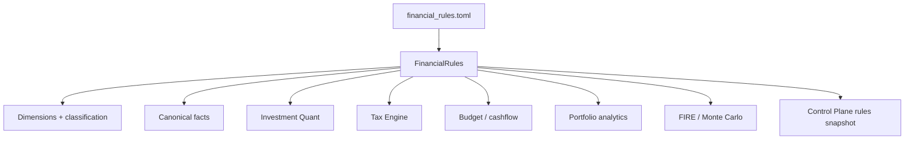
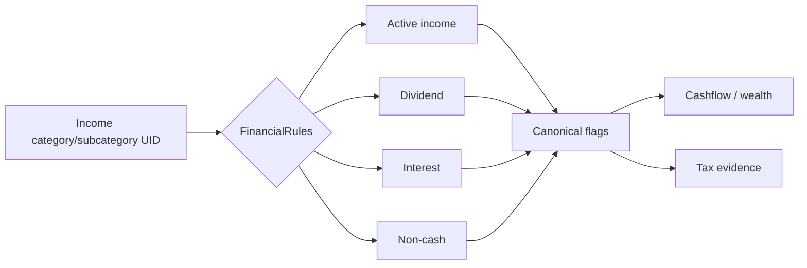
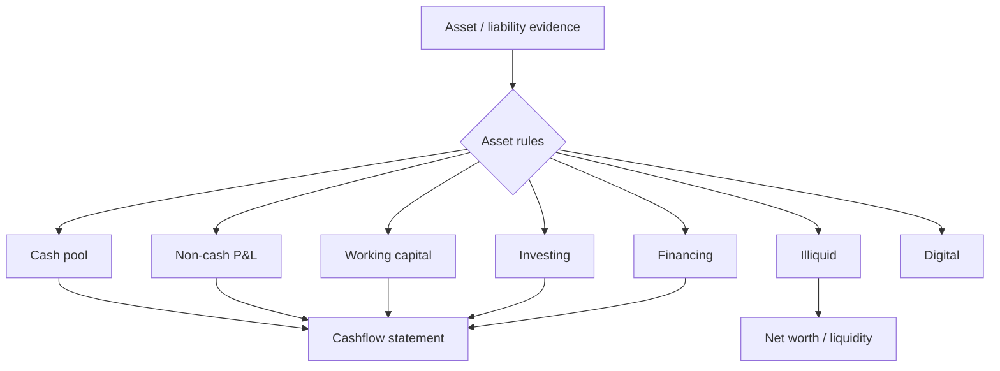
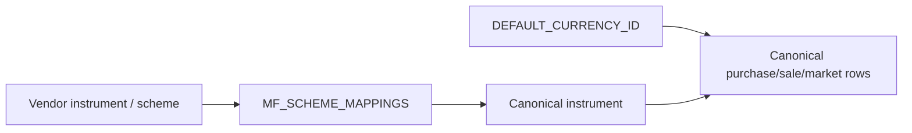
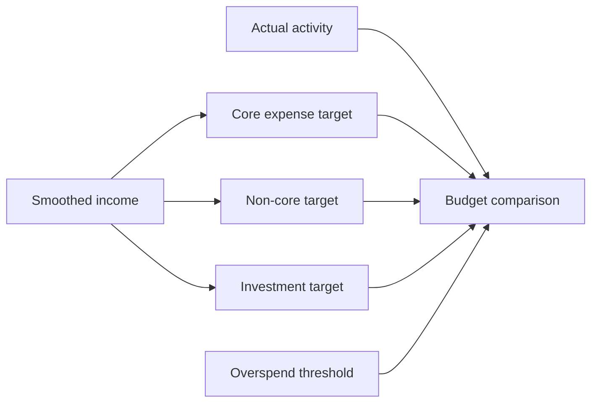
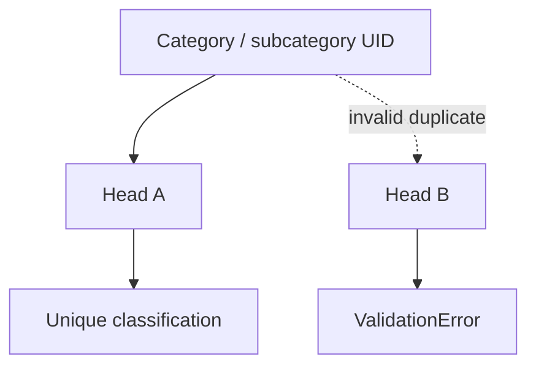
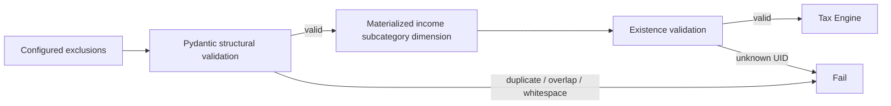
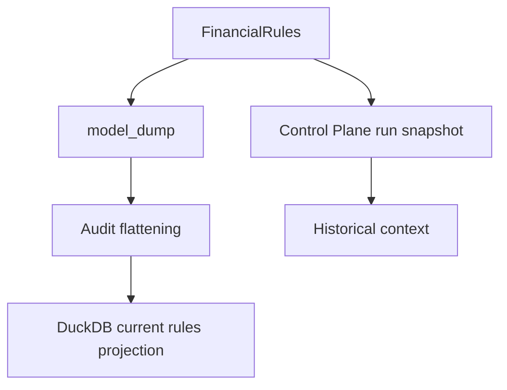
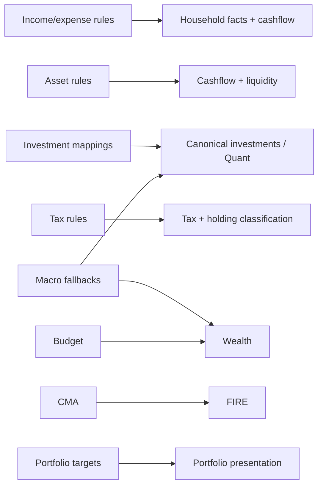

# Financial Rules Reference

## Purpose

`backend/config/financial_rules.py` defines the semantic configuration model for Personal Finance ETL. These rules classify household evidence, identify asset behavior, normalize investment sources, control tax interpretation, provide macro fallbacks, set portfolio targets, and feed wealth/FIRE analytics. Unlike `Settings`, these values can change the *meaning* of financial outputs.



## Source authority and load behavior

- Model: `backend/config/financial_rules.py::FinancialRules`
- Loader: `FinancialRules.from_toml()`
- Dynamic audit projection: `FinancialRules.export_to_db_records()`
- Source-aware exclusion validation: `validate_investment_exclusion_uids()`

Unlike `Settings.from_toml()`, `FinancialRules.from_toml()` is fail-closed: a missing/empty path raises `FileNotFoundError`. Financial semantics are not optional runtime decoration.

```python
class FinancialRules(BaseModel):
    income: IncomeRules = Field(default_factory=lambda: IncomeRules())
    expense: ExpenseRules = Field(default_factory=lambda: ExpenseRules())
    assets: AssetRules = Field(default_factory=lambda: AssetRules())
    investments: dict[str, InvestmentInstrumentRules] = Field(default_factory=dict)
    assumptions: AssumptionsRules = Field(...)
    budget: BudgetRules = Field(default_factory=BudgetRules)
    portfolio_management: PortfolioManagementRules = Field(default_factory=PortfolioManagementRules)

    # Transactional rules
    DEFAULT_CURRENCY_ID: str = "INR_INR"
    MF_SCHEME_MAPPINGS: dict[str, str] = Field(default_factory=dict)
```

## Top-level contract

| Field | Type | Default | Meaning |
| --- | --- | --- | --- |
| income | IncomeRules | factory |  |
| expense | ExpenseRules | factory |  |
| assets | AssetRules | factory |  |
| investments | dict[str, InvestmentInstrumentRules] | factory |  |
| assumptions | AssumptionsRules | ... |  |
| budget | BudgetRules | factory |  |
| portfolio_management | PortfolioManagementRules | factory |  |
| DEFAULT_CURRENCY_ID | str | 'INR_INR' |  |
| MF_SCHEME_MAPPINGS | dict[str, str] | factory |  |


The model groups rules by domain rather than by consuming module. That is intentional: one classification may feed several downstream engines.

## Complete model inventory

### `FinancialRules`

| Field | Type | Default | Meaning |
| --- | --- | --- | --- |
| income | IncomeRules | factory |  |
| expense | ExpenseRules | factory |  |
| assets | AssetRules | factory |  |
| investments | dict[str, InvestmentInstrumentRules] | factory |  |
| assumptions | AssumptionsRules | ... |  |
| budget | BudgetRules | factory |  |
| portfolio_management | PortfolioManagementRules | factory |  |
| DEFAULT_CURRENCY_ID | str | 'INR_INR' |  |
| MF_SCHEME_MAPPINGS | dict[str, str] | factory |  |


### `IncomeRules`

| Field | Type | Default | Meaning |
| --- | --- | --- | --- |
| active | ActiveIncomeRules | factory |  |
| dividends | DividendIncomeRules | factory |  |
| interest | InterestIncomeRules | factory |  |
| non_cash | NonCashIncomeRules | factory |  |


### `BudgetRules`

| Field | Type | Default | Meaning |
| --- | --- | --- | --- |
| income_allocation | IncomeAllocationRules | IncomeAllocationRules() |  |
| alerts | BudgetAlerts | BudgetAlerts() |  |
| smoothing | BudgetSmoothing | BudgetSmoothing() |  |


### `IncomeAllocationRules`

| Field | Type | Default | Meaning |
| --- | --- | --- | --- |
| core_expense_pct | float | 0.4 | Max % of smoothed income allocated to core/fixed expenses (40% default). |
| non_core_expense_pct | float | 0.2 | Max % of smoothed income allocated to non-core/discretionary expenses (20% default). |
| investment_pct | float | 0.3 | Minimum % of smoothed income to invest/save via net transfers (30% default). |


### `BudgetAlerts`

| Field | Type | Default | Meaning |
| --- | --- | --- | --- |
| overspend_alert_threshold | float | 0.05 | Fractional overage above budget target that triggers Is_Overspent flags (5% default). |
| emergency_fund_target_months | int | 6 | Target number of months of core expenses to hold as emergency fund. |


### `BudgetSmoothing`

| Field | Type | Default | Meaning |
| --- | --- | --- | --- |
| income_smoothing_months | int | 3 | Number of trailing months used for recency-weighted income smoothing. |


### `AssetRules`

| Field | Type | Default | Meaning |
| --- | --- | --- | --- |
| illiquid | IlliquidAssetRules | factory |  |
| cashflow | CashflowAssetRules | factory |  |
| digital | DigitalAssetRules | factory |  |


### `CashflowAssetRules`

| Field | Type | Default | Meaning |
| --- | --- | --- | --- |
| cash_pools | list[str] | factory |  |
| non_cash_pnl_sources | list[str] | factory |  |
| working_capital_conduits | list[str] | factory |  |
| investing_activities | list[str] | factory |  |
| financing_liabilities | list[str] | factory |  |


### `MacroAssumptions`

| Field | Type | Default | Meaning |
| --- | --- | --- | --- |
| default_trading_days | float | ... | Default number of trading days in a year for annualized volatility calculations. |
| fallback_inflation_rate | float | ... | Fallback annualized inflation rate if historical macro data is unavailable. |
| fallback_risk_free_rate | float | ... | Fallback annualized risk-free rate if historical macro data is unavailable. |
| fallback_ordinary_income_rate | float | 0.3 | Fallback ordinary income tax rate (marginal slab) if not found in macro table. |


### `TaxAssumptions`

| Field | Type | Default | Meaning |
| --- | --- | --- | --- |
| debt_mf_cutoff_date | str | ... | Date before which debt mutual funds have indexation benefits. |
| harvest_wait_days_threshold | int | ... | Minimum days to wait before re-buying a harvested instrument to avoid wash-sale rules. |
| ltcg_threshold_months | dict[str, int] | ... | Holding period thresholds in calendar months for Long Term Capital Gains across asset classes. |
| fallback_equity_ltcg_exemption | float | ... | Annual tax-free exemption limit for equity Long Term Capital Gains. |
| rates | TaxRates | factory |  |
| heads_of_income | dict[str, TaxHeadConfig] | factory | Taxable income categories partitioned into heads of income and sub-heads. |
| residual_income | dict[str, TaxHeadConfig] | factory | Residual taxable income heads and sub-heads (typically for parent category fallbacks). |
| exempt_income | dict[str, TaxHeadConfig] | factory | Exempt / non-taxable income heads and sub-heads (defaults to non_taxable & exempt). |
| investment_exclusions | InvestmentExclusionsConfig | factory |  |


### `TaxRates`

| Field | Type | Default | Meaning |
| --- | --- | --- | --- |
| equity_ltcg | float | 0.125 | LTCG tax rate for listed Indian equity (Section 112A). |
| equity_stcg | float | 0.2 | STCG tax rate for listed Indian equity (Section 111A). |
| foreign_equity_ltcg | float | 0.125 | LTCG tax rate for foreign listed equity (US stocks via LRS) — 12.5% post-Budget 2024. |
| foreign_equity_stcg | float | 0.3 | STCG tax rate for foreign listed equity (US stocks via LRS) — slab rate. |
| debt_ltcg | float | 0.2 | LTCG tax rate for debt. |
| debt_stcg | float | 0.3 | STCG tax rate for debt. |
| gold_ltcg | float | 0.2 | LTCG tax rate for gold. |
| gold_stcg | float | 0.3 | STCG tax rate for gold. |


### `InvestmentExclusionsConfig`

| Field | Type | Default | Meaning |
| --- | --- | --- | --- |
| stcg_sub_cat_ids | list[str] | factory |  |
| ltcg_sub_cat_ids | list[str] | factory |  |


### `CMAAssumptions`

| Field | Type | Default | Meaning |
| --- | --- | --- | --- |
| expected_real_return | float | 0.05 | Expected real return for long-term forecasting. |
| fat_tail_multiplier | float | 1.2 | Multiplier to adjust normal volatility for fat tails. |


### `PortfolioManagementRules`

| Field | Type | Default | Meaning |
| --- | --- | --- | --- |
| rebalance_tolerance_pct_points | float | 5.0 | Threshold (in percentage points) for triggering a rebalance requirement. |


The stochastic submodels under `FireAssumptions` and `MonteCarloAssumptions` are specified separately in [FIRE and Simulation Reference](fire-and-simulation-reference.md).

## Income classification

Income rules classify category/subcategory UIDs into active income, dividends, interest and non-cash income. The transformations materialize these semantics into canonical dimensions/facts rather than making every downstream Gold builder repeat UID lists.



Both category-level and subcategory-level lists are supported. Consumers normalize configured UIDs for matching. Configuration therefore controls classification, while source transactions remain source evidence.

## Expense classification

`expense.core` identifies core/fixed expenses. This classification feeds household analytics, budget targets, emergency-fund calculations and FIRE spending assumptions. A transaction does not become a different transaction when this list changes; its analytical interpretation changes.

## Asset semantics

Asset rules distinguish several behavioral roles:

- **illiquid**: categories/subcategories excluded from liquid-resource interpretations;
- **cash pools**: liquid stores used in cashflow/liquidity analysis;
- **non-cash P&L sources**: value changes that should not masquerade as cash movement;
- **working-capital conduits**: balance-sheet channels such as credit/reimbursement/prepaid flows;
- **investing activities**: asset movements classified as investing cashflow;
- **financing liabilities**: debt-like financing flows;
- **digital assets**: dedicated category classification.



These lists encode accounting/analytical behavior. Overlapping or poorly chosen classifications can therefore alter cashflow presentation even when raw balances are unchanged.

## Investment mappings and transaction normalization

`investments` is a dictionary of named `InvestmentInstrumentRules`, each with category/subcategory UID lists. `DEFAULT_CURRENCY_ID` supplies the default reporting/source currency where transformations require a fallback. `MF_SCHEME_MAPPINGS` normalizes known mutual-fund scheme-name variants before canonical instrument matching.



Scheme mapping is normalization, not fuzzy inference. Explicit aliases are preferable to hoping punctuation differences develop telepathy.

## Macro assumptions

`MacroAssumptions` provides fallback values when historical macro evidence cannot supply a value required by an engine:

- annual trading days for annualization;
- fallback inflation;
- fallback risk-free rate;
- fallback ordinary-income tax rate.

Fallbacks are not observations. Documentation and analytics should preserve that semantic distinction.

## Budget rules

Budget configuration combines allocation targets, alert thresholds and income smoothing.



`income_smoothing_months` controls the trailing horizon used by budget logic. The percentage fields are configuration inputs; the reference does not invent a validation constraint that the current Pydantic model does not enforce. In particular, the model does not currently enforce that allocation percentages sum to one. That is a configuration responsibility, not a hidden guarantee.

## Portfolio management

`rebalance_tolerance_pct_points` is converted from percentage points to a fractional tolerance by investment presentation analytics. Target allocations live under `assumptions.target_allocations`. Together they support target-versus-actual allocation and rebalance flags.

## Tax configuration

Tax rules are the most validation-heavy deterministic part of `FinancialRules`.

### Heads and sub-heads

Each `TaxSubHeadConfig` can map category IDs, income subcategory IDs and tax-credit subcategory IDs to a display name, taxability and tax method. Allowed enums are:

- taxability: `taxable`, `non_taxable`, `review`;
- tax method: `ordinary_rate`, `capital_gains`, `exempt`, `review`.

### Local validator

```python
class TaxSubHeadConfig(BaseModel):
    tax_head_display_name: str
    sub_head_display_name: str
    cat_ids: list[str] = Field(default_factory=list)
    sub_cat_ids: list[str] = Field(default_factory=list)
    tax_credit_sub_cat_ids: list[str] = Field(default_factory=list)
    taxability: TaxabilityType = "review"
    tax_method: TaxMethodType = "review"

    @model_validator(mode="after")
    def validate_tax_credit_ids(self) -> Self:
        income_ids = set(self.sub_cat_ids)
        credit_ids = set(self.tax_credit_sub_cat_ids)
        if len(income_ids) != len(self.sub_cat_ids):
            raise ValueError("Duplicate sub_cat_ids configured for a tax sub-head.")
        if len(credit_ids) != len(self.tax_credit_sub_cat_ids):
            raise ValueError("Duplicate tax_credit_sub_cat_ids configured for a tax sub-head.")
        overlap = income_ids.intersection(credit_ids)
        if overlap:
            raise ValueError(
                "A subcategory UID cannot be configured as both income and tax credit: "
                f"{sorted(overlap)}"
            )
        return self
```

A subcategory cannot simultaneously be configured as income and a tax credit inside one sub-head, and duplicates are rejected.

### Global mutual exclusivity

`TaxAssumptions.validate_mutual_exclusivity()` extends that constraint across all configured heads, residual income and exempt income. Category IDs, income subcategory IDs and tax-credit subcategory IDs must not be multiply assigned across the tax classification tree.



### Investment exclusions

`InvestmentExclusionsConfig` maintains separate STCG and LTCG ledger subcategory exclusion lists. It rejects blanks, surrounding whitespace, duplicates and overlap between the two lists. `FinancialRules.validate_investment_exclusion_uids()` then performs a second-stage validation against the materialized `silver.d_Income_Subcategory` dimension.

```python
class InvestmentExclusionsConfig(BaseModel):
    stcg_sub_cat_ids: list[str] = Field(default_factory=list)
    ltcg_sub_cat_ids: list[str] = Field(default_factory=list)

    @model_validator(mode="after")
    def validate_exclusions(self) -> Self:
        for field_name, values in (
            ("stcg_sub_cat_ids", self.stcg_sub_cat_ids),
            ("ltcg_sub_cat_ids", self.ltcg_sub_cat_ids),
        ):
            if any(not uid or not uid.strip() for uid in values):
                raise ValueError(f"{field_name} cannot contain blank UIDs.")
            if any(uid != uid.strip() for uid in values):
                raise ValueError(f"{field_name} cannot contain UIDs with surrounding whitespace.")
            if len(set(values)) != len(values):
                raise ValueError(f"Duplicate UIDs found in {field_name}.")

        stcg = set(self.stcg_sub_cat_ids)
        ltcg = set(self.ltcg_sub_cat_ids)
        overlap = stcg.intersection(ltcg)
        if overlap:
            raise ValueError(
                f"Overlapping sub_cat_ids between STCG and LTCG exclusions: {sorted(overlap)}"
            )
        return self
```

This two-stage design is important: Pydantic can prove internal configuration consistency, but only current source data can prove that a configured UID actually exists.



The exclusions prevent household-ledger capital-gain categories from being counted again when Quant realized events already own investment realization.

## Tax rates and holding-period rules

`TaxRates` provides configured fallback/rule rates for equity, foreign equity, debt and gold STCG/LTCG. `TaxAssumptions.ltcg_threshold_months` is a dictionary of holding thresholds in **calendar months** consumed by Quant macro rules. This exact field name and unit are authoritative; older example files that describe day-based `ltcg_thresholds` are stale and should not be copied forward.

The tax configuration also includes debt-MF cutoff date, harvesting wait threshold and fallback equity-LTCG exemption. These are inputs to analytics, not claims that the Tax Engine implements complete statutory liability.

## CMA and target allocation assumptions

CMA rules provide expected real return and a fat-tail volatility multiplier used in long-horizon planning. `target_allocations` maps allocation labels to target fractions for portfolio presentation. The current Pydantic model does not enforce that target allocations sum to exactly one, so configuration authors must treat that as a semantic responsibility unless/until implementation validation is added.

## Rule snapshot and audit projection

`FinancialRules.export_to_db_records()` recursively flattens nested rules into records with:

- `Rule_Domain`;
- `Rule_Type`;
- `Target_Level`;
- `Target_ID`.

The Control Plane separately stores run-specific rule snapshots.



## Validation matrix

| Rule area | Enforced by current model | Requires source/runtime context |
| --- | --- | --- |
| Tax sub-head duplicate income IDs | yes | no |
| Income ID also tax-credit ID | yes | no |
| Global tax-head duplicate category/subcategory | yes | no |
| STCG/LTCG exclusion duplicates | yes | no |
| STCG/LTCG exclusion overlap | yes | no |
| Exclusion UID actually exists | no | **yes**, explicit runtime validation |
| Budget allocation percentages sum to 100% | **not enforced** | configuration responsibility |
| Target allocations sum to 100% | **not enforced** | configuration responsibility |
| Markov transition probabilities form valid rows | **not enforced by Pydantic** | simulation/configuration responsibility |

The last three rows matter. Documentation should describe guarantees the code actually makes, not validators that would be aesthetically pleasing if they existed.

## Change-impact map



A rule change should therefore be reviewed by *consumer domain*, not only by TOML section.

## Related specifications

- [Financial Model](../finance/financial-model.md)
- [Tax Methodology](../finance/tax-methodology.md)
- [Investment Performance and Risk](../finance/investment-performance-and-risk.md)
- [FIRE and Simulation Reference](fire-and-simulation-reference.md)
- [Deterministic Identity and Replay](../architecture/deterministic-identity-and-replay.md)

## Source map

| Concern | Implementation authority |
| --- | --- |
| Runtime model definitions | `backend/config/financial_rules.py` |
| Household dimension classification | `backend/transform/dimensions.py` |
| Household fact flags | `backend/transform/facts.py` |
| Quant macro/tax interpretation | `backend/engines/analytics/rules/macro.py` |
| Tax event construction | `backend/engines/tax/core/base_events.py` |
| Budget analytics | `backend/engines/presentation/modules/budget_forecast.py` |
| Portfolio allocation presentation | `backend/engines/presentation/modules/investment_analytics.py` |
| Wealth/FIRE metrics | `backend/engines/presentation/modules/wealth_risk_analytics.py` |
| Monte Carlo kernel/wrapper | `backend/engines/presentation/helpers/fire_mc_sim.py` |
| Run/simulation provenance | `backend/load/control_plane/run_repo.py` |
