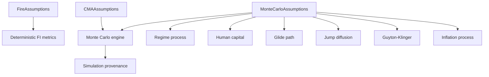
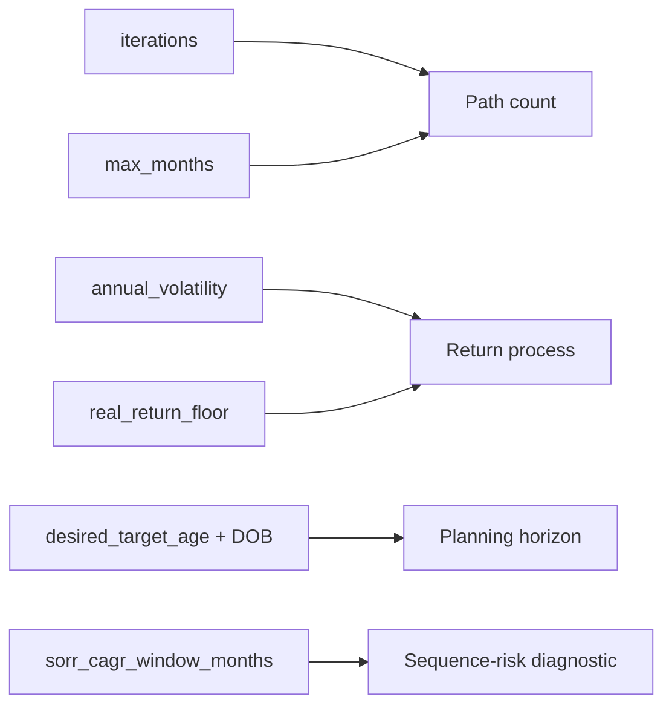
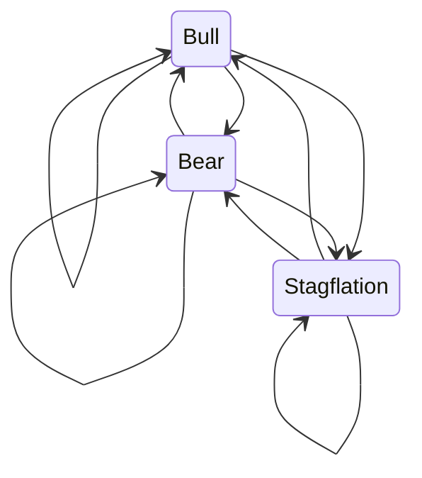
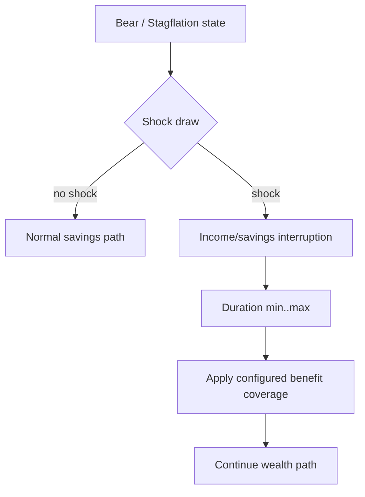
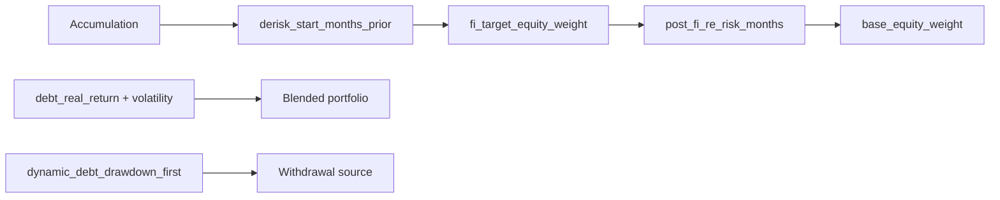
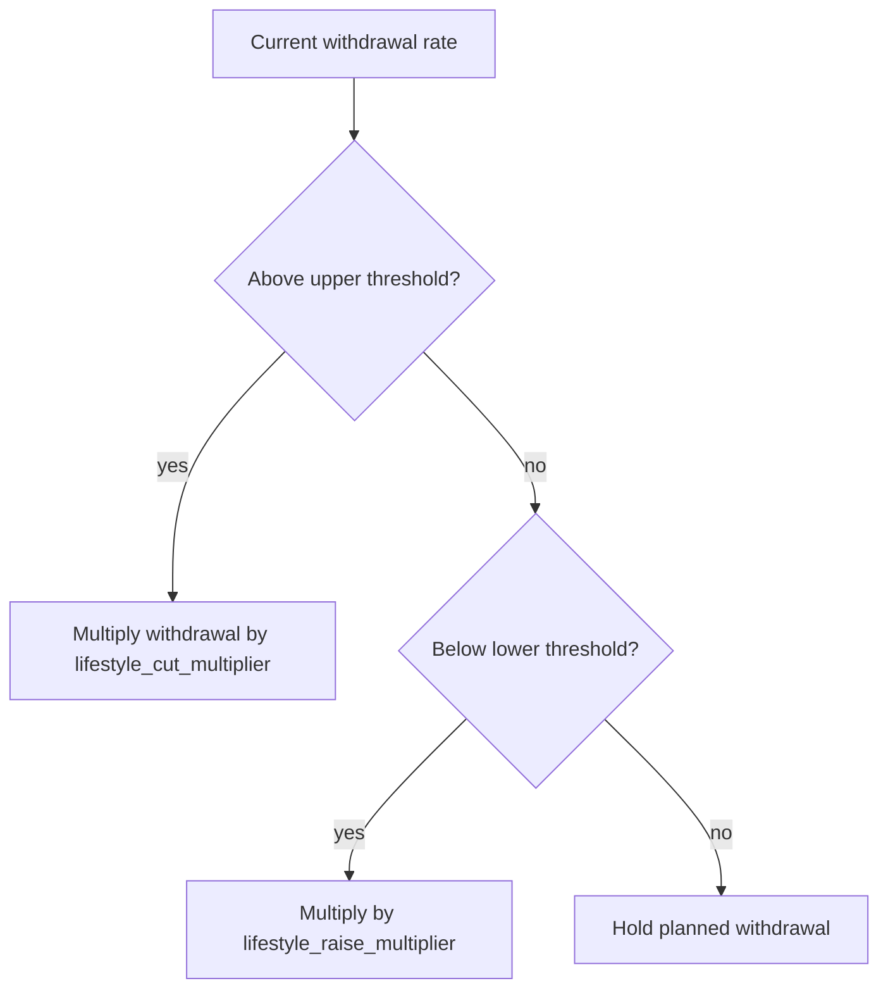
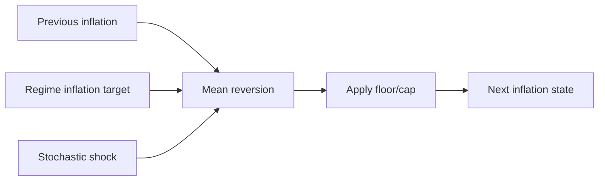
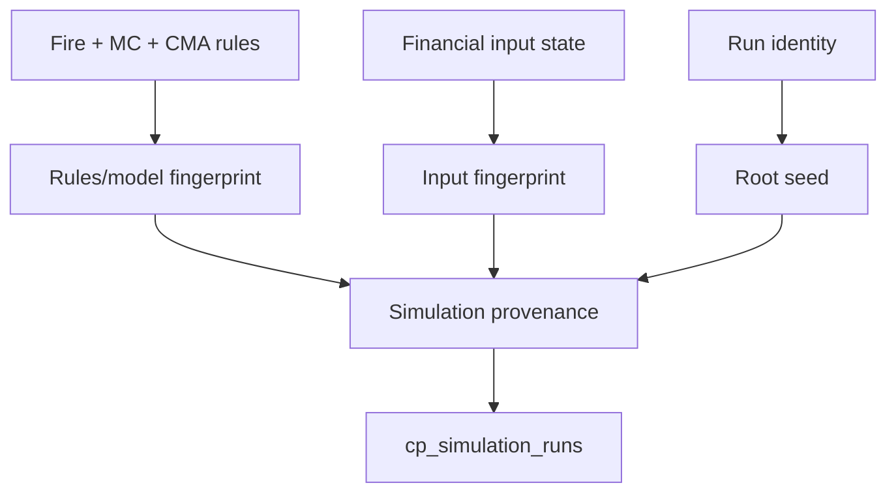
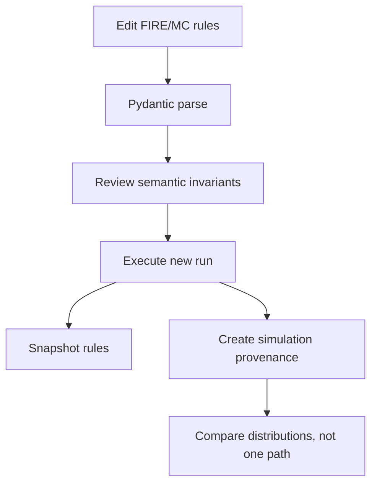

# FIRE and Simulation Reference

## Purpose

This specification is the configuration companion to [FIRE Methodology](../finance/fire-methodology.md). The methodology explains the financial model and stochastic mechanics; this page specifies the **actual Pydantic parameter surface** that controls those mechanics. The authority is `backend/config/financial_rules.py`, with consumption centered in `backend/engines/presentation/modules/wealth_risk_analytics.py` and `backend/engines/presentation/helpers/fire_mc_sim.py`.



## Complete configuration surface

### `FireAssumptions`

| Field | Type | Default | Meaning |
| --- | --- | --- | --- |
| swr_multiplier | float | ... | Safe Withdrawal Rate multiplier (e.g., 25.0 for 4% rule). |
| coast_fi_real_return | float | ... | Assumed real (inflation-adjusted) return for Coast FI calculations. |
| coast_fi_years | int | ... | Number of years to coast (compound) for Coast FI. |
| lean_fi_ratio | float | ... | Ratio of Target FI considered sufficient for Lean FI. |
| fallback_trailing_return | float | ... | Fallback nominal return to use for FIRE forecasting if historical returns are unavailable. |
| cape_swr_floor | float | ... | Floor SWR during severe drawdown. |
| cape_swr_ceiling | float | ... | Ceiling SWR during moderate drawdown. |
| cape_swr_base | float | ... | Base SWR during normal markets. |
| human_capital_max_age | float | ... | Maximum age until which you expect to be healthy and working. |
| human_capital_discount_rate | float | ... | Discount rate for human capital. |


### `MonteCarloAssumptions`

| Field | Type | Default | Meaning |
| --- | --- | --- | --- |
| iterations | int | ... | Number of Monte Carlo paths/simulations to run. |
| max_months | int | ... | Maximum duration of the Monte Carlo simulation in months. |
| annual_volatility | float | ... | Assumed annualized standard deviation (volatility) of returns. |
| real_return_floor | float | ... | Absolute minimum annualized real return applied during forecasting. |
| sorr_cagr_window_months | int | 60 | Months window used to evaluate Sequence of Returns Risk (SORR) CAGR. |
| desired_target_age | int | ... | Desired target age for FIRE calculations. |
| date_of_birth | str | ... | Date of birth in YYYY-MM-DD format. |
| markov_regime | MarkovRegimeConfig | factory |  |
| human_capital | HumanCapitalConfig | factory |  |
| glide_path | GlidePathConfig | factory |  |
| jump_diffusion | JumpDiffusionConfig | factory |  |
| guyton_klinger | GuytonKlingerConfig | factory |  |
| inflation_model | InflationModelConfig | factory |  |


### `MarkovRegimeConfig`

| Field | Type | Default | Meaning |
| --- | --- | --- | --- |
| transition_matrix | list[list[float]] | [[0.9, 0.08, 0.02], [0.15, 0.8, 0.05], [0.1, 0.15, 0.75]] | 3x3 Matrix for probabilities of transitioning between Bull, Bear, and Stagflation states. |
| state_bull | tuple[float, float, float] | (0.1, 0.12, 0.04) | Bull Market parameters: (drift, volatility, inflation target) |
| state_bear | tuple[float, float, float] | (-0.15, 0.25, 0.02) | Bear Market parameters: (drift, volatility, inflation target) |
| state_stag | tuple[float, float, float] | (-0.05, 0.18, 0.08) | Stagflation parameters: (drift, volatility, inflation target) |


### `HumanCapitalConfig`

| Field | Type | Default | Meaning |
| --- | --- | --- | --- |
| shock_probability | float | 0.2 | Probability of an income shock (job loss, zero bonus) when in Bear or Stagflation states. |
| shock_duration_min | int | 6 | Minimum duration (in months) of the income shock. |
| shock_duration_max | int | 12 | Maximum duration (in months) of the income shock. |
| unemployment_benefit_coverage_pct | float | 0.0 | Percentage of core expenses covered by unemployment benefits or severance during a shock. |


### `GlidePathConfig`

| Field | Type | Default | Meaning |
| --- | --- | --- | --- |
| derisk_start_months_prior | int | 60 | Months prior to the FI target date to begin de-risking the portfolio. |
| post_fi_re_risk_months | int | 120 | Months after reaching FI to slowly re-risk the portfolio back to base. |
| base_equity_weight | float | 0.7 | Base/maximum equity allocation weight (e.g., 70%). |
| fi_target_equity_weight | float | 0.4 | Target minimum equity allocation weight upon reaching FI (e.g., 40%). |
| debt_real_return | float | 0.02 | Expected real return for the non-equity (debt) portion of the glide path. |
| debt_volatility | float | 0.04 | Expected volatility for the non-equity (debt) portion of the glide path. |
| dynamic_debt_drawdown_first | bool | False | If True, during decumulation down-months, withdrawals are taken from debt, bypassing equity liquidation. |


### `JumpDiffusionConfig`

| Field | Type | Default | Meaning |
| --- | --- | --- | --- |
| jump_probability_annual | float | 0.05 | Annual probability of a Black Swan market crash (e.g., 5%). |
| jump_magnitude | float | -0.2 | The magnitude of the crash when a jump occurs (e.g., -20%). |
| expense_ratio_drag | float | 0.005 | Annual portfolio expense ratio or fee drag deducted from returns (e.g., 50 bps). |


### `GuytonKlingerConfig`

| Field | Type | Default | Meaning |
| --- | --- | --- | --- |
| withdrawal_upper_threshold | float | 1.2 | Multiplier over initial SWR to trigger a lifestyle cut (e.g., 1.2 for +20%). |
| withdrawal_lower_threshold | float | 0.8 | Multiplier under initial SWR to trigger a lifestyle raise (e.g., 0.8 for -20%). |
| lifestyle_cut_multiplier | float | 0.9 | Multiplier for withdrawal amount when cutting lifestyle (e.g., 0.90 for -10%). |
| lifestyle_raise_multiplier | float | 1.1 | Multiplier for withdrawal amount when raising lifestyle (e.g., 1.10 for +10%). |


### `InflationModelConfig`

| Field | Type | Default | Meaning |
| --- | --- | --- | --- |
| mean_reversion_speed | float | 0.1 | Speed of mean reversion (theta) for Ornstein-Uhlenbeck inflation process. |
| volatility_annual | float | 0.015 | Annual volatility of inflation. |
| max_inflation_cap | float | 0.15 | Absolute maximum cap for inflation (e.g., 15%). |
| min_deflation_floor | float | -0.02 | Absolute minimum floor for deflation (e.g., -2%). |


## Deterministic FIRE assumptions

`FireAssumptions` controls deterministic planning metrics before stochastic paths are simulated.

### `swr_multiplier`

Multiplies annual spending to produce the base FI target. A value of 25 corresponds to a 4% withdrawal heuristic; larger multipliers imply a lower implied withdrawal rate and a larger target.

### Coast and Lean FI

`coast_fi_real_return`, `coast_fi_years`, and `lean_fi_ratio` govern alternative FI milestones. They do not alter source wealth; they alter the planning threshold against which wealth is compared.

### CAPE-style withdrawal bounds

`cape_swr_floor`, `cape_swr_ceiling`, and `cape_swr_base` provide configurable withdrawal-rate levels used by wealth/FIRE analytics. These are planning assumptions, not observed market facts.

### Human-capital valuation

`human_capital_max_age` and `human_capital_discount_rate` bound/discount future earning capacity. This deterministic human-capital view is distinct from the stochastic employment-shock process under Monte Carlo.

## Monte Carlo envelope

The top-level Monte Carlo model specifies simulation size, horizon, volatility, return floor, sequence-risk window and life-planning dates.



### Iterations

More paths improve sampling stability at increased compute cost. The model treats this as an explicit configuration choice rather than hiding a hard-coded simulation budget.

### `max_months`

Bounds the accumulation horizon used when searching for FI attainment. It is not a promise that FI will occur within that period. Paths that do not attain the target remain informative failures.

### `real_return_floor`

Constrains the annualized real-return assumption applied in forecasting logic. It is a model guardrail, not an observed return.

## Markov regime model

`MarkovRegimeConfig` supplies a 3x3 transition matrix and parameter tuples for Bull, Bear and Stagflation states. Each state tuple contains `(drift, volatility, inflation target)`.



The implementation flattens the configured matrix and passes it into the simulation kernel. **The current Pydantic model does not validate matrix dimensions, probability bounds, or row sums.** Configuration authors must therefore preserve a valid transition matrix. The docs deliberately do not invent a validator because the code forgot to invite one to the party.

```python
class MarkovRegimeConfig(BaseModel):
    transition_matrix: list[list[float]] = Field(
        default=[
            [0.90, 0.08, 0.02],
            [0.15, 0.80, 0.05],
            [0.10, 0.15, 0.75],
        ],
        description="3x3 Matrix for probabilities of transitioning between Bull, Bear, and Stagflation states.",
    )
    state_bull: tuple[float, float, float] = Field(
        default=(0.10, 0.12, 0.04),
        description="Bull Market parameters: (drift, volatility, inflation target)",
    )
    state_bear: tuple[float, float, float] = Field(
        default=(-0.15, 0.25, 0.02),
        description="Bear Market parameters: (drift, volatility, inflation target)",
    )
    state_stag: tuple[float, float, float] = Field(
        default=(-0.05, 0.18, 0.08),
        description="Stagflation parameters: (drift, volatility, inflation target)",
    )
```

## Human-capital shocks

The stochastic human-capital model controls income interruption in adverse regimes.

- `shock_probability`: probability of an employment/income shock under the modeled adverse-state logic;
- `shock_duration_min` / `shock_duration_max`: duration bounds in months;
- `unemployment_benefit_coverage_pct`: fraction of core expenses covered during a shock.



The current model does not enforce `shock_duration_min <= shock_duration_max` or probability range constraints at Pydantic load time. Those values should be treated as configuration invariants.

## Glide path

The glide-path model controls equity/debt weights around FI and the behavior of withdrawals during down markets.



`base_equity_weight` and `fi_target_equity_weight` are fractions. The current Pydantic schema does not enforce `0 <= weight <= 1` or target/base ordering. Those relationships are semantic configuration responsibilities.

## Jump diffusion

`JumpDiffusionConfig` adds a discontinuous crash process and fee drag on top of ordinary return dynamics.

- annual jump probability;
- jump magnitude;
- annual expense-ratio drag.


This is a scenario model, not a claim that crashes follow a known annual Bernoulli process in the real world. Configuration makes the assumption explicit so it can be inspected, changed and fingerprinted.

## Guyton-Klinger configuration

The four guardrail fields control withdrawal adjustments relative to the initial withdrawal-rate context. Upper-threshold breaches trigger lifestyle cuts; lower-threshold conditions permit raises, using the configured multipliers.



The model does not Pydantic-validate ordering between lower and upper thresholds or constrain multipliers. Treat these as model invariants during configuration review.

## Inflation model

The inflation configuration controls an Ornstein-Uhlenbeck-style mean-reverting stochastic process:

- `mean_reversion_speed`;
- annual inflation volatility;
- maximum inflation cap;
- minimum deflation floor.



The cap/floor protect simulation paths from unconstrained extremes. They do not assert that actual inflation cannot exceed those levels.

## CMA assumptions

`CMAAssumptions.expected_real_return` and `fat_tail_multiplier` supply long-run capital-market assumptions used by FIRE analytics. The fat-tail multiplier increases effective volatility relative to the normal-volatility input. These assumptions are deliberately configuration-visible because long-horizon outputs are sensitive to them.

## Seed and provenance relationship

Configuration is only one part of stochastic reproducibility. The engine combines run-specific seed context with rule/model/input fingerprints.



Matching configuration does not mean independent runs must produce identical paths because the run-specific seed is part of the context. Replay means preserving the recorded context under a compatible implementation/runtime.

## Runtime consumer map

| Parameter family | Primary consumer | Financial effect |
| --- | --- | --- |
| FIRE target/SWR | `wealth_risk_analytics.py` | FI targets and milestone metrics |
| Monte Carlo envelope | `fire_mc_sim.py` | path count, horizon, return process |
| Markov regimes | `fire_mc_sim.py` | state-dependent return/inflation dynamics |
| Human capital | `fire_mc_sim.py` | savings/income interruption |
| Glide path | `fire_mc_sim.py` | equity/debt allocation over lifecycle |
| Jump diffusion | `fire_mc_sim.py` | discontinuous crash events and fee drag |
| Guyton-Klinger | `fire_mc_sim.py` | adaptive retirement withdrawals |
| Inflation model | `fire_mc_sim.py` | stochastic spending/inflation path |
| CMA | wealth/FIRE analytics | expected real return and fat-tail adjustment |

## Configuration invariants not currently enforced by Pydantic

This section is intentionally explicit because a reference should distinguish **model validation** from **model expectations**.

| Relationship | Pydantic-enforced? | Expected for meaningful simulation |
| --- | --- | --- |
| Markov matrix is 3x3 | no | yes |
| Markov rows sum to 1 | no | yes |
| Probabilities in `[0,1]` | no | yes |
| `shock_duration_min <= shock_duration_max` | no | yes |
| Equity weights in `[0,1]` | no | yes |
| FI target equity <= base equity | no | usually intended by current model design |
| Inflation floor <= cap | no | yes |
| GK lower threshold < upper threshold | no | yes |
| Iterations > 0 | not constrained by `Field` | yes |
| Max months > 0 | not constrained by `Field` | yes |

This is not an invitation to add undocumented behavior. It is an audit map for configuration QA and future validator hardening.

## Sensitivity and interpretation

Several parameters have nonlinear interactions. Increasing volatility can affect FI timing and retirement survival differently. A lower FI equity target may reduce sequence risk near retirement while reducing expected growth. Higher inflation volatility can alter both spending paths and real wealth. Human-capital shocks matter most before FI when savings are still a major driver.

Therefore parameter changes should be evaluated as scenario/model changes, not one-dimensional “better/worse” sliders.

## Safe change workflow



For stochastic settings, comparison should focus on distributions and diagnostics rather than demanding one path reproduce another unrelated run.

## Related specifications

- [FIRE Methodology](../finance/fire-methodology.md)
- [Metrics and Methodology](../finance/metrics-and-methodology.md)
- [Deterministic Identity and Replay](../architecture/deterministic-identity-and-replay.md)
- [Financial Rules Reference](financial-rules-reference.md)
- [Testing and Validation](../developer/testing-and-validation.md)

## Source map

| Concern | Implementation authority |
| --- | --- |
| Runtime model definitions | `backend/config/financial_rules.py` |
| Household dimension classification | `backend/transform/dimensions.py` |
| Household fact flags | `backend/transform/facts.py` |
| Quant macro/tax interpretation | `backend/engines/analytics/rules/macro.py` |
| Tax event construction | `backend/engines/tax/core/base_events.py` |
| Budget analytics | `backend/engines/presentation/modules/budget_forecast.py` |
| Portfolio allocation presentation | `backend/engines/presentation/modules/investment_analytics.py` |
| Wealth/FIRE metrics | `backend/engines/presentation/modules/wealth_risk_analytics.py` |
| Monte Carlo kernel/wrapper | `backend/engines/presentation/helpers/fire_mc_sim.py` |
| Run/simulation provenance | `backend/load/control_plane/run_repo.py` |
