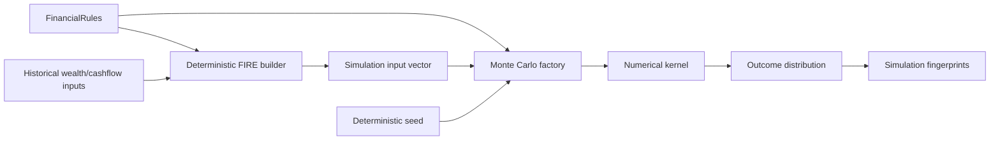
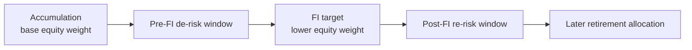
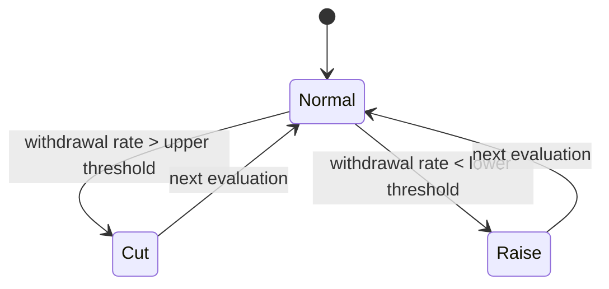
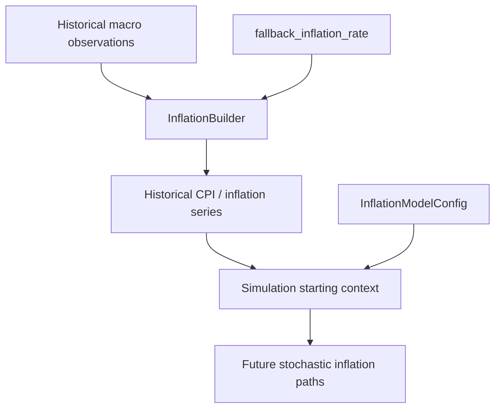
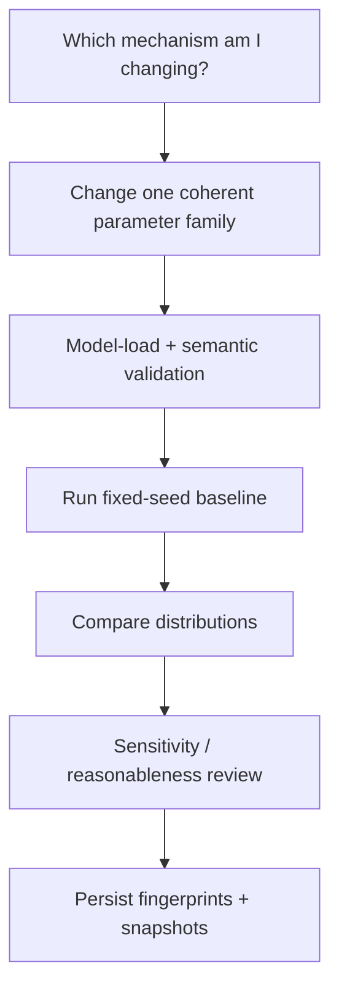

# FIRE & Simulation Configuration

Historical finance asks:

> What happened?

Deterministic planning asks:

> Given this state and these assumptions, what target follows?

Monte Carlo asks something different:

> **Across many modeled futures, how often and how quickly does this plan survive?**

That difference is why the FIRE/Monte Carlo subtree cannot be documented as a flat table of knobs.

Its parameters form a model.

Changing one assumption can change the distribution of future wealth, the sequence of income shocks, withdrawal behavior, inflation, allocation glide path, or crash frequency. The correct unit of documentation is therefore the **mechanism each parameter controls**.

## The configuration-to-simulation path



The model has two tightly connected halves:

- deterministic FI metrics derived from historical state;
- stochastic simulation of future state.

## Configuration surface

The root assumption graph is:

```text
AssumptionsRules
├── macro
├── fire
├── monte_carlo
│   ├── markov_regime
│   ├── human_capital
│   ├── glide_path
│   ├── jump_diffusion
│   ├── guyton_klinger
│   └── inflation_model
├── tax
├── cma
└── target_allocations
```

This page focuses on `fire`, `monte_carlo`, `cma`, and the macro values consumed by planning.

## Deterministic FIRE assumptions

`FireAssumptions` defines the deterministic planning frame:

```python
# src/personal_finance_etl/config/financial_rules/fire.py
class FireAssumptions(BaseModel):
    """Financial Independence and Safe Withdrawal Rate forecasting rules."""

    swr_multiplier: float = Field(
        ..., description="Safe Withdrawal Rate multiplier (e.g., 25.0 for 4% rule)."
    )
    coast_fi_real_return: float = Field(
        ..., description="Assumed real (inflation-adjusted) return for Coast FI calculations."
    )
    coast_fi_years: int = Field(
        ..., description="Number of years to coast (compound) for Coast FI."
    )
    lean_fi_ratio: float = Field(
        ..., description="Ratio of Target FI considered sufficient for Lean FI."
    )
```

These fields are not all consumed by the same formula. They represent several planning concepts.

## Safe-withdrawal multiplier

The deterministic builder computes current FI target as:

\[
\text{Target FI Today}
= \text{Trailing 12M Spend} \times \text{SWR Multiplier}
\]

The implementation is direct:

```python
# src/personal_finance_etl/domain/fire/deterministic.py
.with_columns(
    (pl.col("Trailing_12M_Spend") * swr).alias("Target_FI_Today"),
    (pl.col("Trailing_12M_Total_Spend") * swr).alias("Target_FI_Today_Total"),
)
```

A multiplier of `25` corresponds to the reciprocal of a `4%` withdrawal rate:

\[
\frac{1}{0.04}=25
\]

The configuration stores the **multiplier**, not the percentage.

That unit distinction prevents a very expensive typo.

## Lean FI ratio

`lean_fi_ratio` scales the full FI target into a lean target.

Conceptually:

\[
\text{Lean FI} = \text{Target FI} \times \text{Lean Ratio}
\]

It is a planning preference, not a historical financial fact.

## Coast FI

Coast FI uses a configured real return and time horizon to reason about how much wealth needs to exist today if future contributions stop and compounding carries the portfolio toward the target.

The configured pair is:

```text
coast_fi_real_return
coast_fi_years
```

The return is explicitly **real**, so it should not be combined with nominal targets without consistent inflation treatment.

## CAPE-style withdrawal boundaries

Three configured rates define adaptive withdrawal levels:

```text
cape_swr_floor
cape_swr_ceiling
cape_swr_base
```

These are model assumptions used to represent different market/valuation conditions.

They should not be interpreted as statutory or guaranteed safe withdrawal rates.

A simulation can explore a policy. It cannot certify the future.

## Human-capital valuation assumptions

The deterministic FIRE configuration also includes:

```text
human_capital_max_age
human_capital_discount_rate
```

These parameters govern how future earning capacity is bounded/discounted in planning analytics.

They belong to FIRE assumptions because they model future economic capacity, not because the application has observed a future salary.

## Macro fallbacks

Planning consumes `MacroAssumptions` when observed macro evidence is unavailable:

```text
default_trading_days
fallback_inflation_rate
fallback_risk_free_rate
fallback_ordinary_income_rate
```

Observed macro evidence remains preferred.

Fallbacks are there to avoid turning a missing historical parameter into an accidental divide-by-nothing festival.

## Capital Market Assumptions

`CMAAssumptions` currently carries:

```python
class CMAAssumptions(BaseModel):
    expected_real_return: float = Field(0.05, ...)
    fat_tail_multiplier: float = Field(1.2, ...)
```

The expected real return anchors long-horizon forecasting.

The fat-tail multiplier adjusts normal-volatility assumptions toward heavier-tail behavior.

These values influence the stochastic engine, so they are included in the simulation model fingerprint.

## The Monte Carlo envelope

`MonteCarloAssumptions` establishes the global simulation frame:

```python
# src/personal_finance_etl/config/financial_rules/fire.py
class MonteCarloAssumptions(BaseModel):
    """Monte Carlo multi-path simulation boundaries and embedded stochastic engines."""

    iterations: int = Field(..., description="Number of Monte Carlo paths/simulations to run.")
    max_months: int = Field(
        ..., description="Maximum duration of the Monte Carlo simulation in months."
    )
    annual_volatility: float = Field(
        ..., description="Assumed annualized standard deviation (volatility) of returns."
    )
    real_return_floor: float = Field(
        ..., description="Absolute minimum annualized real return applied during forecasting."
    )
```

and embeds six stochastic submodels.

## Iterations

`iterations` controls the number of simulated paths.

More paths reduce Monte Carlo sampling noise but increase execution cost.

This is a performance/precision trade-off, not a “higher is always better” rule.

If the simulation runs 10,000 paths where 2,000 already stabilizes the statistic being inspected, the extra 8,000 paths may mostly be exercising the CPU’s commitment to the project.

## Maximum horizon

`max_months` limits how far the simulation searches forward.

A path that has not reached the modeled FI condition within the horizon must remain distinguishable from a path that reached it late.

The configured horizon therefore affects interpretation of percentile outputs.

## Annual volatility and real-return floor

`annual_volatility` contributes to the return process.

`real_return_floor` bounds the modeled annualized real return behavior where the engine applies that floor.

Both are model assumptions, not empirical facts automatically estimated from the current portfolio.

## Age and date of birth

The deterministic builder derives age in months from `date_of_birth`:

```python
# src/personal_finance_etl/domain/fire/deterministic.py
dob_parts = rules.assumptions.monte_carlo.date_of_birth.split("-")
self._dob_year = int(dob_parts[0])
self._dob_month = int(dob_parts[1])
```

Later it builds monthly age:

```python
((pl.col("_temp_year") - self._dob_year) * 12
 + (pl.col("_temp_month") - self._dob_month))
.cast(pl.Int32)
.alias("Age_Months")
```

The current Pydantic field is a string. A malformed date can therefore survive type validation and fail when the consumer splits/casts it.

That is an honest implementation boundary worth documenting.

## Sequence-of-returns-risk window

`sorr_cagr_window_months` defines the evaluation horizon for early-sequence return behavior.

It affects how the simulation characterizes risk near the FI transition.

A short horizon reacts quickly but may be noisy. A long horizon smooths more history but can dilute sharp early-retirement sequences.

## Markov regime model

The market-regime configuration models three states:

```text
Bull
Bear
Stagflation
```

A 3×3 transition matrix defines the probability of moving from the current state to the next state.

```python
# src/personal_finance_etl/config/financial_rules/fire.py
transition_matrix: list[list[float]] = Field(
    default=[
        [0.90, 0.08, 0.02],
        [0.15, 0.80, 0.05],
        [0.10, 0.15, 0.75],
    ],
    description="3x3 Matrix for probabilities of transitioning between Bull, Bear, and Stagflation states.",
)
```

Each state also carries a tuple:

```text
(drift, volatility, inflation target)
```

The simulation factory flattens these structures before entering the numerical kernel:

```python
# src/personal_finance_etl/domain/fire/simulation.py
tm_flat = np.array(mc_rules.markov_regime.transition_matrix).flatten()
st_bull = np.array(mc_rules.markov_regime.state_bull)
st_bear = np.array(mc_rules.markov_regime.state_bear)
st_stag = np.array(mc_rules.markov_regime.state_stag)
```

### What is not enforced at model load

The Pydantic model currently does not prove that:

- the matrix is exactly 3×3;
- each row sums to one;
- probabilities lie in `[0,1]`;
- state tuples have economically sensible parameter ranges.

The defaults have the intended shape, but custom values should be treated carefully.

Documentation must not upgrade “expected shape” into “validated invariant.”

## Human-capital shocks

`HumanCapitalConfig` controls income-shock behavior during adverse regimes:

```text
shock_probability
shock_duration_min
shock_duration_max
unemployment_benefit_coverage_pct
```

The model captures a financially important reality: investment returns and earning capacity can deteriorate together.

A pure portfolio Monte Carlo that assumes salary continues serenely through every bear market can understate real household risk.

The configuration lets the simulation couple those risks.

### Cross-field expectations

The model does not currently enforce:

```text
0 <= shock_probability <= 1
shock_duration_min <= shock_duration_max
0 <= unemployment_benefit_coverage_pct <= 1
```

Those are semantic validity expectations for safe customization.

## Glide path

`GlidePathConfig` models portfolio de-risking around the FI transition:

```text
derisk_start_months_prior
post_fi_re_risk_months
base_equity_weight
fi_target_equity_weight
debt_real_return
debt_volatility
dynamic_debt_drawdown_first
```



The two weights represent different points on the glide path.

A coherent configuration would normally keep them in `[0,1]` and set the FI target weight no higher than the base weight when “de-risking” is intended. That relationship is not currently enforced by Pydantic.

## Dynamic debt drawdown

`dynamic_debt_drawdown_first` changes withdrawal behavior in down markets.

When enabled, the simulation can draw from debt before equity under specified decumulation conditions.

That is not merely an allocation parameter. It changes **path dependency** because the assets sold during a downturn influence future recovery potential.

## Jump diffusion

`JumpDiffusionConfig` adds discrete crash behavior and fee drag:

```text
jump_probability_annual
jump_magnitude
expense_ratio_drag
```

The simulation converts annual assumptions into monthly behavior and incorporates expected jump/fee effects into the return process.

The configuration intentionally separates:

- normal volatility;
- regime behavior;
- discrete jumps;
- ongoing expense drag.

That allows tail risk to be modeled explicitly instead of pretending every crash is just a large Gaussian Tuesday.

## Guyton-Klinger withdrawal guardrails

The withdrawal model defines:

```text
withdrawal_upper_threshold
withdrawal_lower_threshold
lifestyle_cut_multiplier
lifestyle_raise_multiplier
```

These parameters introduce adaptive spending.

A static withdrawal plan asks:

> What if I spend the same policy amount regardless of portfolio state?

The guardrail model asks:

> What if lifestyle adjusts when the withdrawal rate becomes too high or unusually low relative to its starting point?



The exact multipliers control the size of those adjustments.

## Mean-reverting inflation

`InflationModelConfig` describes an Ornstein-Uhlenbeck-style inflation process:

```text
mean_reversion_speed
volatility_annual
max_inflation_cap
min_deflation_floor
```

Mean reversion prevents inflation from behaving as an unconstrained random walk forever.

The cap and floor bound extreme simulated values.

Those bounds are model design choices. They should be stress-tested, not treated as predictions.

## Historical inflation and simulated inflation are different

Historical monthly inflation is built from observed macro evidence with a configured fallback.

Future simulation uses stochastic inflation policy.



That distinction keeps “what happened” separate from “what future paths are modeled.”

## Seeds and reproducibility

The deterministic builder derives monthly seed expressions from a root seed:

```python
# src/personal_finance_etl/domain/fire/deterministic.py
build_monthly_seed_expr(
    self.root_seed, year_col="_temp_year", month_col="_temp_month"
),
```

The simulation factory then constructs independent NumPy generators from those seed integers before entering the Numba kernel.

Reusing seed lineage helps reproduce stochastic execution given the same model and inputs.

But seed equality alone is not sufficient reproducibility.

If rules or inputs changed, the same random stream is simulating a different model.

## Simulation provenance fingerprints the model

The Control Plane records a simulation run with:

- root seed;
- iterations;
- horizon;
- input as-of date;
- settings snapshot ID;
- rules snapshot ID;
- model implementation identifier;
- input fingerprint;
- model fingerprint;
- result fingerprint;
- status.

The model fingerprint is built from the exact rule subtrees relevant to simulation:

```python
# src/personal_finance_etl/infrastructure/control_plane/run_repository.py
combined_rules = {
    "monte_carlo": rules.assumptions.monte_carlo.model_dump(),
    "fire": rules.assumptions.fire.model_dump(),
    "cma": rules.assumptions.cma.model_dump(),
}
model_fingerprint = hashlib.sha256(
    json.dumps(
        self._json_safe(combined_rules),
        sort_keys=True,
        separators=(",", ":"),
        ensure_ascii=False,
        allow_nan=False,
    ).encode("utf-8")
).hexdigest()
```

That is the key reproducibility contract:

```text
seed
+ input fingerprint
+ model fingerprint
+ implementation identifier
= explainable simulation context
```

## Input fingerprint

Tabular simulation input is fingerprinted deterministically.

The implementation serializes column order and JSON-safe rows into SHA-256:

```python
# src/personal_finance_etl/infrastructure/control_plane/run_repository.py
columns: list[str] = [str(column) for column in df.columns]
rows = cast(list[dict[str, object]], df.to_dicts())
digest = hashlib.sha256()
header = json.dumps(columns, ensure_ascii=False, separators=(",", ":"))
digest.update(header.encode("utf-8"))
```

The method then updates the digest row by row.

This means a later investigation can distinguish:

```text
same model + different financial input
same input + different model assumptions
same model/input + different result
```

That is much more useful than “I think I used the same TOML.”

## Result fingerprint

Where a result frame is available, the same deterministic table fingerprinting approach can record the output.

The fingerprint is not a financial metric. It is an integrity/provenance token.

A changed result fingerprint tells us the result changed. It does not tell us whether the change is correct.

That still requires domain/regression analysis.

## Simulation output interpretation

The stochastic engine exposes percentile/probability-style outputs such as:

```text
Months_To_FI_Conservative_P90
Months_To_FI_Base_P50
Months_To_FI_Aggressive_P10
Probability_Of_Success_Pct
Target_FI_Future_Nominal_P50
Runway_Months_Stressed_P10
Runway_Months_Base_P50
Terminal_Wealth_Nominal_P50
```

These are distribution summaries.

They should never be described as predictions with certainty.

The entire purpose of the stochastic model is to represent uncertainty rather than hide it.

## Configuration invariants not currently enforced by Pydantic

The current model intentionally stays relatively lightweight. Safe customization should still respect several semantic relationships.

### Probability/rate ranges

Normally expected in `[0,1]` where applicable:

```text
shock_probability
unemployment_benefit_coverage_pct
base_equity_weight
fi_target_equity_weight
jump_probability_annual
```

### Duration ordering

Expected:

```text
shock_duration_min <= shock_duration_max
```

### Markov matrix

Expected:

- three rows;
- three probabilities per row;
- each probability non-negative;
- each row approximately sums to `1.0`.

### Inflation bounds

Expected:

```text
min_deflation_floor < max_inflation_cap
```

### Withdrawal guardrails

Expected:

```text
withdrawal_lower_threshold < withdrawal_upper_threshold
lifestyle_cut_multiplier < 1
lifestyle_raise_multiplier > 1
```

### Glide-path semantics

For a conventional de-risking path:

```text
fi_target_equity_weight <= base_equity_weight
```

The code may accept configurations outside these expectations. Acceptance is not endorsement.

## Sensitivity map

Different parameter families alter different model mechanisms.

| Family | Primary effect |
| --- | --- |
| `swr_multiplier` | deterministic FI target scale |
| `coast_fi_*` | Coast FI compounding |
| `lean_fi_ratio` | lean target |
| CMA return | long-run return anchor |
| CMA fat-tail multiplier | tail-risk scaling |
| iterations | Monte Carlo sampling density |
| max months | horizon/censoring |
| volatility | dispersion |
| Markov transitions | regime persistence/switching |
| human-capital shock | income interruption risk |
| glide path | allocation path around FI |
| jump diffusion | crash/fee behavior |
| Guyton-Klinger | adaptive spending |
| inflation model | stochastic purchasing-power path |

This is why changing five parameters at once makes interpretation difficult. If outcomes change, attribution becomes guesswork.

## Safe simulation-change workflow



A disciplined change should:

1. identify the mechanism being changed;
2. avoid bundling unrelated assumption edits;
3. validate structural relationships manually where Pydantic does not;
4. use fixed seeds when comparing model changes;
5. compare percentile distributions rather than one path;
6. inspect probability and terminal-wealth shifts;
7. persist the resulting model/input fingerprints;
8. describe the change as a model sensitivity, not as proof of future performance.

## Deterministic and stochastic truths should not be conflated

This separation is the final configuration invariant:

```text
historical evidence
    observed / reconstructed

deterministic FIRE
    formula-driven planning under explicit assumptions

Monte Carlo FIRE
    distribution-driven planning under explicit assumptions + random paths
```

A deterministic FI target can be reproduced exactly from the same state and rules.

A stochastic run can be reproduced when seed, inputs, model rules, and implementation context are held stable.

Neither one certifies the future.

## Where configuration hands off to finance methodology

Configuration tells us **which assumptions the engine receives**.

The finance documentation explains **what the engine does with them**.

Continue with:

- [FIRE Methodology](../finance/fire-methodology.md)
- [Cashflow & Wealth](../finance/cashflow-and-wealth.md)
- [Metrics & Methodology](../finance/metrics-and-methodology.md)

That boundary keeps this page from becoming a second FIRE implementation spec.

## Related specifications

- [Financial Rules Reference](financial-rules-reference.md)
- [Deterministic Identity & Replay](../architecture/deterministic-identity-and-replay.md)
- [Reliability & Recovery](../architecture/reliability-and-recovery.md)
- [FIRE Methodology](../finance/fire-methodology.md)
- [Testing & Validation](../developer/testing-and-validation.md)
