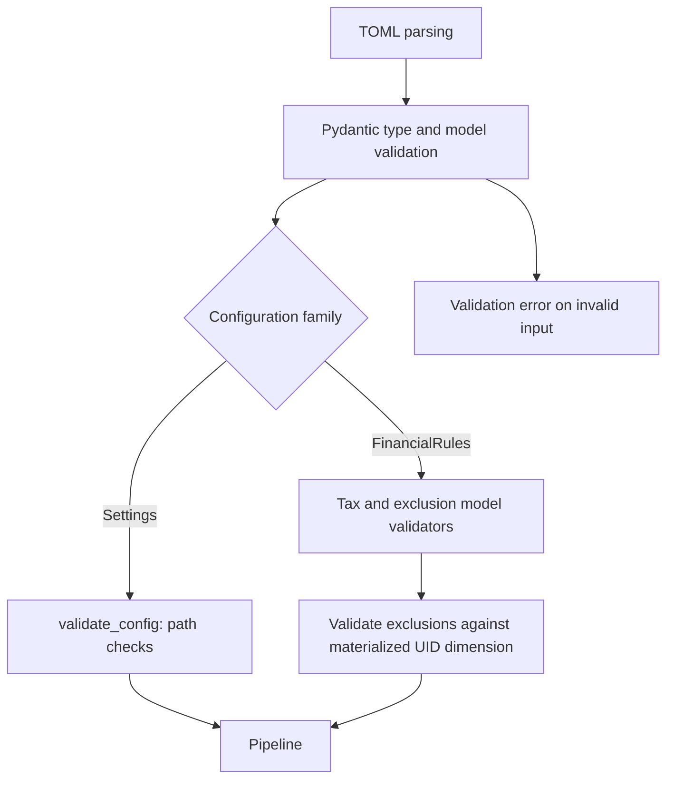

# Configuration validation and defaults

I distinguish type validation, existence checks, cross-field policy validation, and validation that requires materialized source dimensions. They happen at different stages and catch different classes of errors.



## Settings defaults and filesystem validation

`Settings` has empty-string defaults for source paths and dependency master files, a default DuckDB name, a default SQLite raw-store name, and a default `FileHashPolicy`. These defaults permit constructing an object, but do not mean the pipeline has usable paths.

`validate_config()` checks source and statements directories, eight dependency file paths, and the presence of a target database base path. The target base directory itself is not required to pre-exist because the application creates it. The method aggregates missing paths and raises one `FileNotFoundError` containing the individual failures.

## Policy validation in Pydantic

Financial policy uses nested models, typed enumerations, defaults, and `model_validator` hooks. For example, a tax sub-head rejects duplicate income subcategory IDs, duplicate tax-credit IDs, and overlap between those two groups.

Investment exclusions reject blank IDs, surrounding whitespace, duplicates, and STCG/LTCG overlap. The tax assumptions also enforce global mutual exclusivity of categories and subcategories across income heads. These checks validate configured relationships, not whether an ID exists in source data.

## Validation against actual dimensions

`FinancialRules.validate_investment_exclusion_uids(df_subcategory)` requires the materialized dimension to contain `UID`. It collects configured STCG/LTCG exclusion IDs and checks them against non-null IDs in the dimension. Unknown IDs raise a `ValueError`.

This second-stage validation is necessary because a Pydantic model cannot know the contents of a source-derived dimension at configuration-load time.

## What is not guaranteed

Typed floats do not automatically mean every financial parameter has a non-negative bound. I describe only explicit `Field` constraints and validators, and do not assume implicit range checks where none exist.

Likewise, a valid TOML file and an existing path do not establish that source files contain economically consistent or reconciled transactions. Data-quality checks belong to the ingestion and analytical layers.

## Selected production excerpts

I use these short excerpts to anchor the specification. The source modules remain authoritative for complete branches.

### Settings validation

Source: `src/personal_finance_etl/backend/config/settings.py`

```python
    def validate_config(self) -> None:
        """Validates that all necessary files and folders exist before starting."""
        required_dirs = [
            ("SOURCE_DB_FOLDER", self.SOURCE_DB_FOLDER),
            ("STATEMENTS_FOLDER", self.STATEMENTS_FOLDER),
        ]

        required_files = [
            ("COLUMN_MASTER_PATH", self.COLUMN_MASTER_PATH),
            ("MF_ISIN_CSV_PATH", self.MF_ISIN_CSV_PATH),
            ("BENCHMARK_MAPPING_CSV_PATH", self.BENCHMARK_MAPPING_CSV_PATH),
            ("BENCHMARK_MASTER_CSV_PATH", self.BENCHMARK_MASTER_CSV_PATH),
            ("MACRO_PARAMETERS_CSV_PATH", self.MACRO_PARAMETERS_CSV_PATH),
            ("OPENING_BALANCE_CSV_PATH", self.OPENING_BALANCE_CSV_PATH),
            ("CURRENCY_MAPPING_CSV_PATH", self.CURRENCY_MAPPING_CSV_PATH),
        ]
```

### Tax sub-head validator

Source: `src/personal_finance_etl/backend/config/financial_rules.py`

```python
    def validate_tax_credit_ids(self) -> Self:
        income_ids = set(self.sub_cat_ids)
        credit_ids = set(self.tax_credit_sub_cat_ids)
        if len(income_ids) != len(self.sub_cat_ids):
            raise ValueError("Duplicate sub_cat_ids configured for a tax sub-head.")
        if len(credit_ids) != len(self.tax_credit_sub_cat_ids):
            raise ValueError("Duplicate tax_credit_sub_cat_ids configured for a tax sub-head.")
        overlap = income_ids.intersection(credit_ids)
        if overlap:
            raise ValueError(
                "A subcategory UID cannot be configured as both income and tax credit: "
                f"{sorted(overlap)}"
            )
        return self


```

### Dimension-based validation

Source: `src/personal_finance_etl/backend/config/financial_rules.py`

```python
    def validate_investment_exclusion_uids(self, df_subcategory: Any) -> None:
        """Validate configured investment exclusions against the actual subcategory dimension.

        Pydantic can validate duplicate/overlapping configuration values, but only the
        materialized dimension can establish whether a UID exists in the current source data.
        """
        if "UID" not in df_subcategory.columns:
            raise ValueError(
                "Income subcategory dimension must contain UID to validate investment exclusions."
            )

        configured = set(self.assumptions.tax.investment_exclusions.stcg_sub_cat_ids)
        configured.update(self.assumptions.tax.investment_exclusions.ltcg_sub_cat_ids)
        if not configured:
            return

```

## Related technical specifications

I keep financial derivations in [Finance](../finance/README.md), run provenance in [Control Plane](../control-plane/README.md), and exact physical contracts in [Reference](../reference/README.md).
