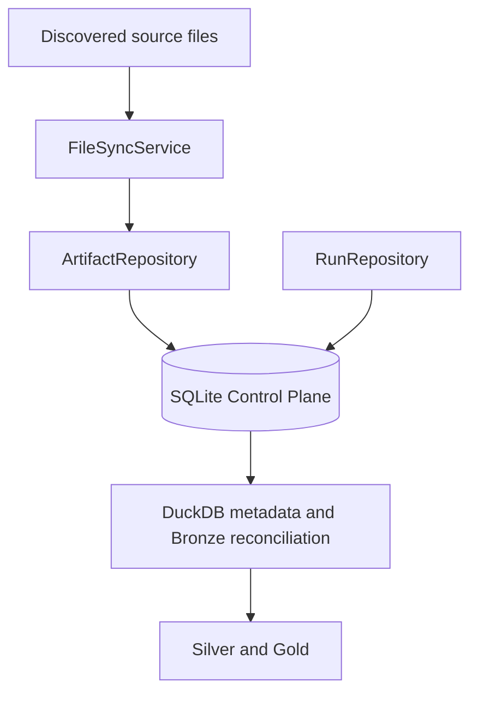

# Control Plane: Technical Index

I separate operational truth from analytical outputs. My SQLite Control Plane maintains artifact identities, retained bytes, run history, configuration/rules snapshots, and simulation provenance. DuckDB serves the analytical warehouse and mirrors selected latest-run facts. This folder specifies the operational authority; [architecture](../architecture/README.md) owns the system-wide view, while [reference](../reference/meta-data-contracts.md) owns lookup-oriented schemas.

## Read in this order

1. [Control Plane architecture](control-plane-architecture.md): components, locking, database responsibilities.
2. [Artifact identity and lineage](artifact-identity-and-lineage.md): stable IDs, hashes, retained payloads, audit events.
3. [Artifact lifecycle](artifact-lifecycle.md): transitions and event semantics.
4. [Run lifecycle](run-lifecycle.md): start, snapshots, completion, stale-run recovery.
5. [Configuration provenance](configuration-provenance.md): canonical JSON snapshots and content addressing.
6. [Synchronization and healing](synchronization-and-healing.md): discovery, deduplication, rename, and repair.
7. [Simulation provenance](simulation-provenance.md): persisted simulation metadata and input fingerprints.

## Guarantees and boundaries

- My Control Plane has its own SQLite transaction boundary. It does **not** make the DuckDB commit globally atomic.
- The operational lock serializes cooperating processes using the same lock path; it is not a universal distributed lock.
- The event log records mutations when an active run ID is set; an event log is not proof that every historical action was recorded.
- I distinguish source-inspected behavior from tested recovery guarantees.

