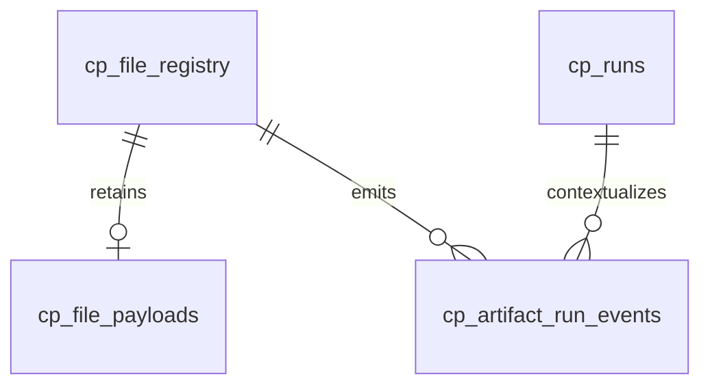

# Artifact Identity and Lineage

I distinguish a **file identity** from its current path, its content digest, and its retained payload. Those are separate concepts: a rename may preserve identity, while a changed file may preserve its path.



## Path and hash contracts

**Implementation:** `src/personal_finance_etl/backend/load/control_plane/utils.py:22-33`

```python
def normalize_path(filepath: str) -> str:
    """Canonicalize separators and dot segments while preserving path identity.

    Virtual artifacts deliberately retain their URI scheme's double slash.
    """
    if not filepath or not filepath:
        raise ValueError("Artifact path must be a non-empty string.")
    normalized = filepath.replace("\\", "/")
    if normalized.startswith("virtual://"):
        scheme, rest = normalized.split("://", 1)
        return f"{scheme}://{posixpath.normpath('/' + rest).lstrip('/')}"
    return posixpath.normpath(normalized)
```

**Implementation:** `src/personal_finance_etl/backend/load/control_plane/utils.py:52-54`

```python
def generate_file_id(filepath: str) -> str:
    """Generate a stable ID from a canonical path, independent of slash style."""
    return hashlib.sha256(normalize_path(filepath).encode("utf-8")).hexdigest()
```

`compute_file_hash()` hashes a disk file, while `hash_bytes()` operates on in-memory bytes. I use hashes to detect content changes and to consider rename candidates, not as a globally unique source-file identity.

## Retained payloads and audit identities

**Implementation:** `src/personal_finance_etl/backend/load/control_plane/artifact_repo.py:83-91`

```python
    def has_payload(self, filepath: str) -> bool:
        path = normalize_path(filepath)
        row = self.db.conn.execute(
            """SELECT 1 FROM cp_file_payloads p
               JOIN cp_file_registry r ON r.file_id = p.file_id
               WHERE r.relative_path = ? AND p.file_bytes IS NOT NULL""",
            (path,),
        ).fetchone()
        return row is not None
```

**Implementation:** `src/personal_finance_etl/backend/load/control_plane/artifact_repo.py:93-115`

```python
    def prune_category(self, category: str, keep_filepaths: list[str]) -> None:
        """Prune payloads for missing files, never hard-delete audit identities."""
        keep_paths = {normalize_path(path) for path in keep_filepaths}
        rows = self.db.conn.execute(
            "SELECT file_id, relative_path FROM cp_file_registry WHERE file_category = ?",
            (category,),
        ).fetchall()
        obsolete_ids = [file_id for file_id, path in rows if normalize_path(path) not in keep_paths]
        if not obsolete_ids:
            return
        with self.db.atomic():
            for offset in range(0, len(obsolete_ids), 500):
                batch = obsolete_ids[offset : offset + 500]
                placeholders = ",".join("?" for _ in batch)
```

The prune method removes retained bytes for obsolete paths but explicitly keeps registry identities and historical event records. A retained registry row therefore does not necessarily imply a retained payload.

## Event provenance

**Implementation:** `src/personal_finance_etl/backend/load/control_plane/artifact_repo.py:28-59`

```python
    def _insert_event(
        self,
        *,
        file_id: str,
        event_type: str,
        event_at: str,
        path: str | None,
        content_hash: str | None = None,
        previous_status: str | None = None,
        new_status: str | None = None,
        reason: str | None = None,
    ) -> None:
        if not self.active_run_id:
            return
```

`_insert_event()` returns without writing if `active_run_id` is absent. This is a meaningful scope limitation: I do not describe the event table as an unconditional record of all filesystem activity.

## Identity migration

**Implementation:** `src/personal_finance_etl/backend/load/control_plane/artifact_repo.py:117-235`

```python
    def migrate_identity(
        self,
        old_rel_path: str,
        new_filepath: str,
        *,
        observed_hash: str | None = None,
        file_size_bytes: int | None = None,
    ) -> bool:
        """Atomically move an artifact's current identity, retaining the old history.

        Returns False if the source has no payload to transfer. The caller should
        ingest the destination as a new artifact rather than claiming a successful rename.
        """
        old_path = normalize_path(old_rel_path)
```

A rename candidate is considered only after category-scoped content matching, and ambiguity is treated conservatively. The exact selection algorithm lives in [synchronization](synchronization-and-healing.md).

