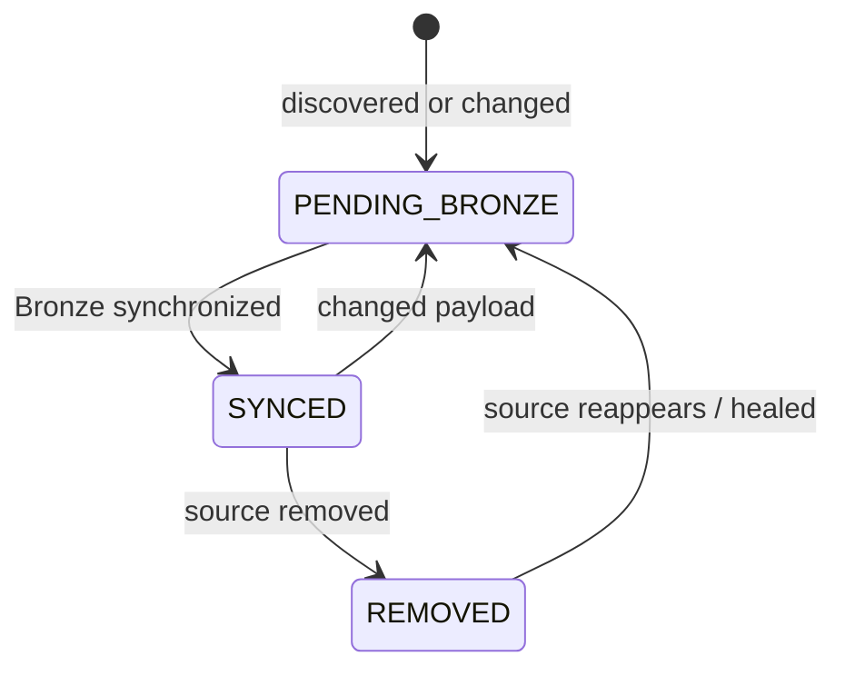

# Artifact Lifecycle and Event Semantics

I track artifact registration and synchronization as distinct operational states. Events record transitions with previous/new status and the active run ID where available.



The diagram is a conceptual projection of repository operations, **not** a database-enforced transition constraint. I verify actual statuses and event strings in the repository methods before treating a transition as a guarantee.

## Registration and synchronization

**Implementation:** `src/personal_finance_etl/backend/load/control_plane/artifact_repo.py:237-299`

```python
    def _upsert_registry(
        self,
        *,
        filepath: str,
        filename: str,
        category: str,
        file_type: str,
        file_hash: str,
        file_size: int,
        now: str,
    ) -> tuple[str, str | None]:
        """Upsert metadata without assuming the persisted ID is path-derived."""
        path = normalize_path(filepath)
        existing = self.db.conn.execute(
```

**Implementation:** `src/personal_finance_etl/backend/load/control_plane/artifact_repo.py:426-459`

```python
    def mark_synced(self, filepaths: list[str]) -> None:
        if not filepaths:
            return
        now = self._now()
        marked = 0
        with self.db.atomic():
            for path in dict.fromkeys(normalize_path(fp) for fp in filepaths):
                row = self.db.conn.execute(
                    "SELECT file_id, sync_status, last_synced_run_id, file_hash FROM cp_file_registry WHERE relative_path = ?",
                    (path,),
                ).fetchone()
                if not row:
                    logger.warning("[ARTIFACT] Cannot mark unknown file as SYNCED: %s", path)
                    continue
```

## Healing and removal

**Implementation:** `src/personal_finance_etl/backend/load/control_plane/artifact_repo.py:461-491`

```python
    def mark_healed(self, filepaths: list[str]) -> None:
        if not filepaths:
            return
        now = self._now()
        healed = 0
        with self.db.atomic():
            for path in dict.fromkeys(normalize_path(fp) for fp in filepaths):
                row = self.db.conn.execute(
                    "SELECT file_id, sync_status, file_hash FROM cp_file_registry WHERE relative_path = ?",
                    (path,),
                ).fetchone()
                if not row or row[1] != "REMOVED":
                    continue
                file_id, previous_status, digest = row
```

**Implementation:** `src/personal_finance_etl/backend/load/control_plane/artifact_repo.py:493-526`

```python
    def mark_removed(self, filepaths: list[str]) -> None:
        if not filepaths:
            return
        now = self._now()
        removed = 0
        with self.db.atomic():
            for path in dict.fromkeys(normalize_path(fp) for fp in filepaths):
                row = self.db.conn.execute(
                    "SELECT file_id, sync_status, file_hash FROM cp_file_registry WHERE relative_path = ?",
                    (path,),
                ).fetchone()
                if not row or row[1] == "REMOVED":
                    continue
                file_id, previous_status, digest = row
```

## Event log semantics

**Implementation:** `src/personal_finance_etl/backend/load/control_plane/artifact_repo.py:28-59`

```python
    def _insert_event(
        self,
        *,
        file_id: str,
        event_type: str,
        event_at: str,
        path: str | None,
        content_hash: str | None = None,
        previous_status: str | None = None,
        new_status: str | None = None,
        reason: str | None = None,
    ) -> None:
        if not self.active_run_id:
            return
```

I store event type, event timestamp, observed path, content hash, previous and new status, and a reason where supplied. The event log is run-scoped when an active run is available; it is not a substitute for the current registry state.

## Practical invariants

- I normalize paths before registry lookup.
- I keep historical registry identities when pruning obsolete payloads.
- I distinguish `REMOVED` from physical deletion of the audit record.
- I do not infer a successful Bronze publication solely from the existence of a registry row.

