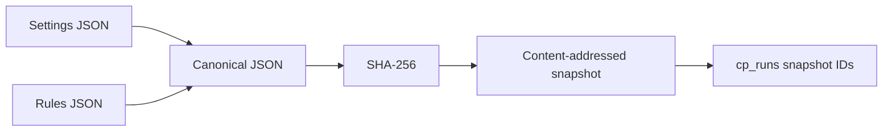

# Configuration and Rules Provenance

I snapshot the resolved configuration and financial rules associated with a run rather than relying only on whatever settings happen to exist today. This allows me to distinguish **which assumptions were recorded for a run** from the latest settings on disk.



## Canonicalization

**Implementation:** `src/personal_finance_etl/backend/load/control_plane/run_repo.py:19-24`

```python
    def _canonical_json(value: str) -> str:
        try:
            parsed = json.loads(value)
        except (TypeError, json.JSONDecodeError):
            return value
        return json.dumps(parsed, sort_keys=True, separators=(",", ":"), ensure_ascii=False)
```

## Snapshot storage

**Implementation:** `src/personal_finance_etl/backend/load/control_plane/run_repo.py:33-70`

```python
    def start_run(self, cfg_json: str | None = None, rules_json: str | None = None) -> str:
        run_id = str(uuid.uuid4())
        now = datetime.now().isoformat(timespec="seconds")
        settings_id: str | None = None
        rules_id: str | None = None
        with self.db.atomic():
            for payload, prefix, table in (
                (cfg_json, "snap_set_", "cp_settings_snapshots"),
                (rules_json, "snap_rule_", "cp_rules_snapshots"),
            ):
                if not payload:
                    continue
                canonical = self._canonical_json(payload)
                digest = hashlib.sha256(canonical.encode("utf-8")).hexdigest()
                snapshot_id = f"{prefix}{digest}"
                self.db.conn.execute(
                    f"INSERT OR IGNORE INTO {table} (snapshot_id, content_hash, canonical_payload, created_at) VALUES (?, ?, ?, ?)",
                    (snapshot_id, digest, canonical, now),
                )
```

The snapshot key uses a type-specific prefix and SHA-256 of the canonical payload. `INSERT OR IGNORE` avoids duplicating an existing snapshot for the same canonical content.

## Run linkage

**Implementation:** `src/personal_finance_etl/backend/load/control_plane/run_repo.py:72-79`

```python
    def get_run_metadata(self, run_id: str) -> dict[str, str | None]:
        row = self.db.conn.execute(
            "SELECT settings_snapshot_id, rules_snapshot_id FROM cp_runs WHERE run_id = ?",
            (run_id,),
        ).fetchone()
        if row:
            return {"settings_snapshot_id": row[0], "rules_snapshot_id": row[1]}
        return {}
```

I maintain separate settings and rules snapshot identifiers. A null snapshot ID means the corresponding payload was not supplied to `start_run()`, not that the run necessarily used no configuration.

## Limits

This mechanism records supplied JSON; it does not by itself prove that all external environmental inputs or third-party data sources were captured. For the exact configuration fields see [configuration](../configuration/README.md).

