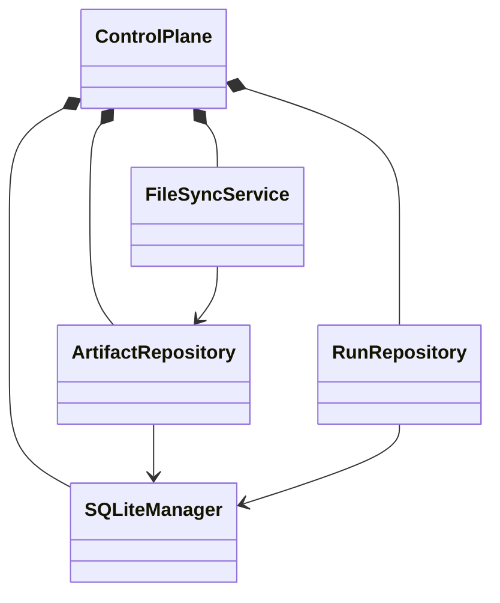

# Control Plane Architecture

I encapsulate SQLite connectivity and operational repositories behind `ControlPlane`. The facade composes `SQLiteManager`, `ArtifactRepository`, `RunRepository`, and `FileSyncService`. The `FileLock` prevents a second cooperating production process from opening the same base path concurrently.



## Opening, schema validation, and lock ownership

**Implementation:** `src/personal_finance_etl/backend/load/control_plane/orchestrator.py:42-58`

```python
    def open(self) -> None:
        if self._lock_acquired and self.db.is_open:
            return
        os.makedirs(self.base_path or ".", exist_ok=True)
        try:
            self._lock.acquire(timeout=0)
            self._lock_acquired = True
        except Timeout:
            raise RuntimeError(
                "Another instance of the production pipeline is currently running."
            ) from None
        try:
            self.db.open()
        except Exception:
```

I acquire the lock with zero wait, open SQLite, and release the lock if database opening fails. `close()` releases the lock in a `finally` block and clears the active run identity. `ensure_schema()` delegates schema enforcement and invokes stale-run recovery.

**Implementation:** `src/personal_finance_etl/backend/load/control_plane/orchestrator.py:69-71`

```python
    def ensure_schema(self) -> None:
        self.db.ensure_schema()
        self.runs.recover_stale_runs()
```

## Transaction boundaries

**Implementation:** `src/personal_finance_etl/backend/load/control_plane/connection.py:71-83`

```python
    def atomic(self) -> Generator[None]:
        """Atomic scope that works both standalone and nested in a pipeline transaction."""
        savepoint = f"cp_scope_{uuid.uuid4().hex}"
        self.conn.execute(f"SAVEPOINT {savepoint}")
        try:
            yield
            self.conn.execute(f"RELEASE SAVEPOINT {savepoint}")
        except Exception:
            try:
                self.conn.execute(f"ROLLBACK TO SAVEPOINT {savepoint}")
            finally:
                self.conn.execute(f"RELEASE SAVEPOINT {savepoint}")
            raise
```

`SQLiteManager.atomic()` scopes a SQLite unit of work. I do not claim atomicity across SQLite and DuckDB; the orchestration commit ordering is documented in [run lifecycle](run-lifecycle.md) and [architecture](../architecture/execution-lifecycle.md).

## Source map

- `ControlPlane.open/close`: `backend/load/control_plane/orchestrator.py:42-58` and `backend/load/control_plane/orchestrator.py:60-67`.
- `SQLiteManager.ensure_schema`: `backend/load/control_plane/connection.py:90-137`.
- `SQLiteManager._validate_current_schema`: `backend/load/control_plane/connection.py:139-233`.
- `SQLiteManager._create_indexes`: `backend/load/control_plane/connection.py:235-245`.

## Trade-off

I accept a second database and coordination overhead to keep provenance durable and separate from rebuilt analytical tables. I must therefore handle partial commit and recovery explicitly rather than assuming a distributed transaction.

