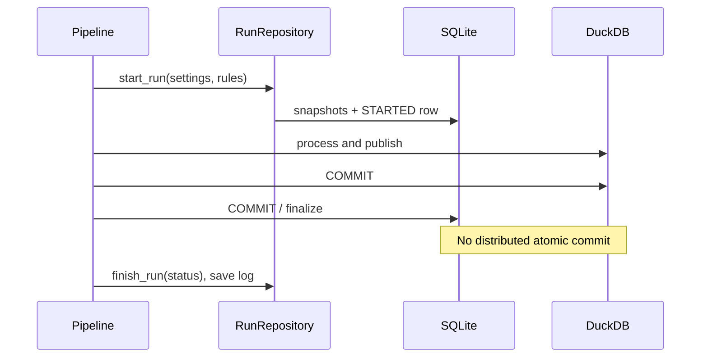

# Run Lifecycle and Execution Provenance

I create a durable run record before performing the main data work. A run links application/schema version, configuration snapshots, execution log bytes, failure details, and a final status.



## Starting a run

**Implementation:** `src/personal_finance_etl/backend/load/control_plane/run_repo.py:33-70`

```python
    def start_run(self, cfg_json: str | None = None, rules_json: str | None = None) -> str:
        run_id = str(uuid.uuid4())
        now = datetime.now().isoformat(timespec="seconds")
        settings_id: str | None = None
        rules_id: str | None = None
        with self.db.atomic():
            for payload, prefix, table in (
                (cfg_json, "snap_set_", "cp_settings_snapshots"),
                (rules_json, "snap_rule_", "cp_rules_snapshots"),
            ):
                if not payload:
                    continue
                canonical = self._canonical_json(payload)
                digest = hashlib.sha256(canonical.encode("utf-8")).hexdigest()
```

I generate a UUID run ID, canonicalize configuration JSON, store deduplicated snapshots, and write `STARTED` to `cp_runs`. The initial record exists independently of the later analytical transaction.

## Status and logs

**Implementation:** `src/personal_finance_etl/backend/load/control_plane/run_repo.py:81-90`

```python
    def update_run_status(self, run_id: str, status: str) -> None:
        normalized_status = status.strip().upper()
        if not normalized_status:
            raise ValueError("Run status must be a non-empty string.")
        with self.db.atomic():
            cursor = self.db.conn.execute(
                "UPDATE cp_runs SET status = ? WHERE run_id = ?", (normalized_status, run_id)
            )
            if cursor.rowcount != 1:
                raise KeyError(f"Cannot update unknown run ID: {run_id}")
```

**Implementation:** `src/personal_finance_etl/backend/load/control_plane/run_repo.py:92-98`

```python
    def save_execution_log(self, run_id: str, log_data: bytes) -> None:
        with self.db.atomic():
            cursor = self.db.conn.execute(
                "UPDATE cp_runs SET execution_log = ? WHERE run_id = ?", (log_data, run_id)
            )
            if cursor.rowcount != 1:
                raise KeyError(f"Cannot save execution log for unknown run ID: {run_id}")
```

**Implementation:** `src/personal_finance_etl/backend/load/control_plane/run_repo.py:100-111`

```python
    def finish_run(self, run_id: str, status: str) -> None:
        normalized_status = status.strip().upper()
        if not normalized_status:
            raise ValueError("Run status must be a non-empty string.")
        now = datetime.now().isoformat(timespec="seconds")
        with self.db.atomic():
            cursor = self.db.conn.execute(
                "UPDATE cp_runs SET status = ?, finished_at = ? WHERE run_id = ?",
                (normalized_status, now, run_id),
            )
            if cursor.rowcount != 1:
                raise KeyError(f"Cannot finish unknown run ID: {run_id}")
```

A finished status and a saved log are separate operations. I do not imply they are one indivisible write.

## Failure recovery

**Implementation:** `src/personal_finance_etl/backend/load/control_plane/run_repo.py:214-229`

```python
    def log_run_failure(
        self,
        run_id: str,
        failed_isin: str | None,
        stage: str,
        error_type: str,
        error_message: str,
        traceback_log: str | None = None,
    ) -> None:
        now = datetime.now().isoformat(timespec="seconds")
        self.db.conn.execute(
            """INSERT INTO cp_run_failures
               (run_id, failed_isin, stage, error_type, error_message, traceback_log, created_at)
               VALUES (?, ?, ?, ?, ?, ?, ?)""",
```

**Implementation:** `src/personal_finance_etl/backend/load/control_plane/run_repo.py:231-258`

```python
    def recover_stale_runs(self) -> None:
        """Atomically mark interrupted runs failed; safe to repeat after a crash."""
        now = datetime.now().isoformat(timespec="seconds")
        recovered = 0
        with self.db.atomic():
            stale_runs = self.db.conn.execute(
                "SELECT run_id, status FROM cp_runs WHERE UPPER(status) IN ('STARTED', 'RUNNING', 'COMMITTING')"
            ).fetchall()
            for run_id, status in stale_runs:
                cursor = self.db.conn.execute(
                    "UPDATE cp_runs SET status = 'FAILED', finished_at = ? "
                    "WHERE run_id = ? AND UPPER(status) IN ('STARTED', 'RUNNING', 'COMMITTING')",
                    (now, run_id),
                )
```

`ensure_schema()` invokes stale-run recovery on Control Plane startup. That reconciles recorded run state, not necessarily every possible partially published analytical artifact.

## Implementation boundary

The complete pipeline commit and exception paths live in `backend/pipeline/etl_pipeline.py`; I cross-reference [architecture/execution-lifecycle.md](../architecture/execution-lifecycle.md).

