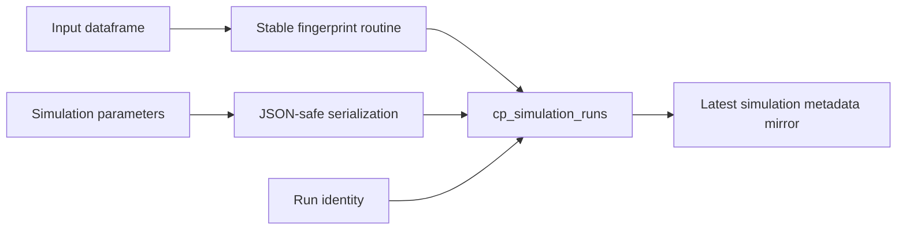

# Simulation Provenance

I retain simulation execution metadata in the Control Plane to make model runs inspectable beyond the immediate analytical result. The simulation record links execution identity, model details, input fingerprints, and serialized parameters/results according to the implementation.



## Input fingerprint

**Implementation:** `src/personal_finance_etl/backend/load/control_plane/run_repo.py:130-150`

```python
    def _fingerprint_dataframe(cls, input_df: Any | None) -> str:
        if input_df is None:
            return "no-input"
        if not hasattr(input_df, "to_dicts") or not hasattr(input_df, "columns"):
            raise TypeError(
                "Simulation input must expose Polars-compatible columns and to_dicts()."
            )
        columns: list[str] = [str(column) for column in input_df.columns]
        rows = cast(list[dict[str, object]], input_df.to_dicts())
        digest = hashlib.sha256()
        header = json.dumps(columns, ensure_ascii=False, separators=(",", ":"))
        digest.update(header.encode("utf-8"))
        digest.update(b"\n")
        for row in rows:
```

## Simulation persistence

**Implementation:** `src/personal_finance_etl/backend/load/control_plane/run_repo.py:152-212`

```python
    def log_simulation_run(
        self,
        run_id: str,
        root_seed: str,
        rules: Any,
        input_df: Any | None = None,
        settings_snapshot_id: str | None = None,
        rules_snapshot_id: str | None = None,
    ) -> None:
        sim_id = f"sim_{run_id}"
        now = datetime.now().isoformat(timespec="seconds")
        combined_rules = {
            "monte_carlo": rules.assumptions.monte_carlo.model_dump(),
            "fire": rules.assumptions.fire.model_dump(),
            "cma": rules.assumptions.cma.model_dump(),
        }
        model_fingerprint = hashlib.sha256(
            json.dumps(
                self._json_safe(combined_rules),
```

I serialize non-JSON-native values using `_json_safe`, including date/datetime and nonfinite floating-point values. This is a provenance mechanism, not a guarantee that different NumPy/Numba versions produce identical numerical paths.

## Serialized metadata

**Implementation:** `src/personal_finance_etl/backend/load/control_plane/run_repo.py:114-127`

```python
    def _json_safe(value: object) -> object:
        if isinstance(value, dict):
            mapping = cast(dict[object, object], value)
            return {str(key): RunRepository._json_safe(item) for key, item in mapping.items()}
        if isinstance(value, (list, tuple)):
            items = cast(list[object] | tuple[object, ...], value)
            return [RunRepository._json_safe(item) for item in items]
        if isinstance(value, float) and not math.isfinite(value):
            return str(value)
        if isinstance(value, (date, datetime)):
            return value.isoformat()
        if value is None or isinstance(value, (str, int, float, bool)):
            return value
        return str(value)
```

The latest-simulation DuckDB Meta mirror is an analytical convenience; SQLite is the Control Plane record authority.

## Limits

A recorded seed and fingerprint support replay investigation, but strict cross-environment bitwise reproducibility requires pinned runtime dependencies and regression fixtures. Financial FIRE assumptions are specified in [finance](../finance/fire-methodology.md).

