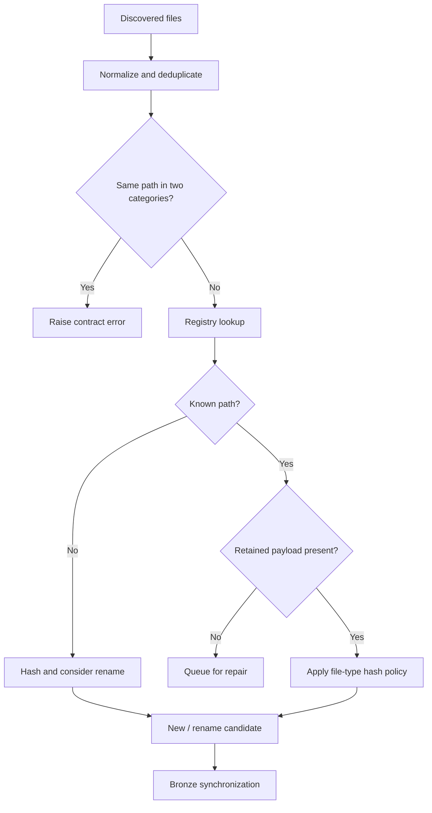

# Artifact Synchronization and Healing

I synchronize discovered filesystem artifacts against the authoritative registry before downstream Bronze processing. This is not simply a file-count comparison: I normalize paths, optionally verify hashes, detect missing payloads, consider unambiguous renames, and mark removals.



## Atomic scan boundary

**Implementation:** `src/personal_finance_etl/backend/load/control_plane/file_sync.py:30-38`

```python
    def sync_with_disk(
        self,
        discovered_files: dict[str, list[str]],
        hash_policy: FileHashPolicy,
        full_replace_categories: list[str],
    ) -> tuple[dict[str, list[str]], dict[str, list[str]], int, list[tuple[str, str, str]]]:
        """Synchronize the scan as one atomic control-plane operation."""
        with self.artifact_repo.db.atomic():
            return self._sync_with_disk(discovered_files, hash_policy, full_replace_categories)
```

The scan is scoped by `artifact_repo.db.atomic()`. This does not make downstream DuckDB publication part of the same SQLite transaction.

## Cross-category protection

**Implementation:** `src/personal_finance_etl/backend/load/control_plane/file_sync.py:40-218`

```python
    def _sync_with_disk(
        self,
        discovered_files: dict[str, list[str]],
        hash_policy: FileHashPolicy,
        full_replace_categories: list[str],
    ) -> tuple[dict[str, list[str]], dict[str, list[str]], int, list[tuple[str, str, str]]]:
        registry_with_status = self.artifact_repo.get_registry_with_status()
        registry: dict[str, tuple[str, str]] = {
            path: (digest, category)
            for path, (digest, category, _status) in registry_with_status.items()
        }

        hash_to_paths: dict[str, dict[str, list[str]]] = {}
        for path, (digest, category, status) in registry_with_status.items():
            if status != "REMOVED" and digest:
                hash_to_paths.setdefault(category, {}).setdefault(digest, []).append(path)

        new_files: dict[str, list[str]] = {}
        changed_files: dict[str, list[str]] = {}
```

I reject a canonical path discovered under multiple categories rather than silently changing its meaning.

## Rename behavior

When a new path has a digest matching exactly one nonactive path in the same category, I attempt identity migration. If multiple candidates share the digest, I treat the new path as new. If the old identity has no payload, migration may fail and ingestion falls back to a new artifact. See `backend/load/control_plane/file_sync.py:40-218`.

## Healing versus reconstruction

**Implementation:** `src/personal_finance_etl/backend/load/control_plane/artifact_repo.py:461-491`

```python
    def mark_healed(self, filepaths: list[str]) -> None:
        if not filepaths:
            return
        now = self._now()
        healed = 0
        with self.db.atomic():
            for path in dict.fromkeys(normalize_path(fp) for fp in filepaths):
                row = self.db.conn.execute(
                    "SELECT file_id, sync_status, file_hash FROM cp_file_registry WHERE relative_path = ?",
                    (path,),
                ).fetchone()
                if not row or row[1] != "REMOVED":
                    continue
                file_id, previous_status, digest = row
```

**Implementation:** `src/personal_finance_etl/backend/load/control_plane/artifact_repo.py:404-411`

```python
    def get_pending_files(self) -> dict[str, list[str]]:
        cursor = self.db.conn.execute(
            "SELECT file_category, relative_path FROM cp_file_registry WHERE sync_status = 'PENDING_BRONZE' ORDER BY file_category, relative_path"
        )
        pending: dict[str, list[str]] = {}
        for category, path in cursor.fetchall():
            pending.setdefault(category, []).append(normalize_path(path))
        return pending
```

I distinguish the source registry's healing event from the actual rebuilding of Bronze or analytics. A successful healing marker alone does not establish that all downstream tables have been revalidated.

## Hash-policy limitation

File-type hash checks are configurable. A path with a retained payload may avoid rehashing when its policy disables that check; I should not claim universal content verification on every cached run.

