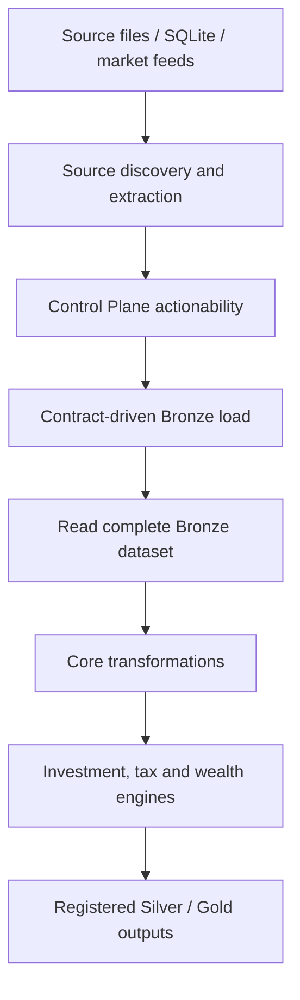

# Data Engineering

I designed my data pipeline around a deliberate split: the SQLite Control Plane decides which source artifacts require attention; DuckDB Bronze retains source-oriented rows; the transformation and financial engines rebuild the analytical state; Silver and Gold publish contracted outputs.

## Navigation

| Specification | What I explain |
|---|---|
| [source-discovery.md](source-discovery.md) | Where inputs are located and how extraction is routed |
| [artifact-ingestion.md](artifact-ingestion.md) | How actionable files cross into Bronze |
| [bronze-processing.md](bronze-processing.md) | Full-replace versus file-incremental Bronze |
| [transformation-pipeline.md](transformation-pipeline.md) | Full-dataset reconstruction and canonical transforms |
| [market-data-and-benchmarks.md](market-data-and-benchmarks.md) | Market, currency, and benchmark source paths |
| [silver-gold-publication.md](silver-gold-publication.md) | Registry checks and BI publication |
| [data-quality-and-validation.md](data-quality-and-validation.md) | What is checked and what remains unverified |

## The processing model

**Important:** Bronze ingestion is partly incremental, but downstream analytical reconstruction is not end-to-end incremental. I use explicit registry definitions rather than claiming arbitrary sources and outputs are supported.

## Related domains

- [Control Plane](../control-plane/README.md): identities, provenance, and synchronization.
- [Finance](../finance/README.md): accounting algorithms and financial formulas.
- [Reference](../reference/README.md): exact physical data contracts.
- [Architecture](../architecture/README.md): system-wide dependencies.
