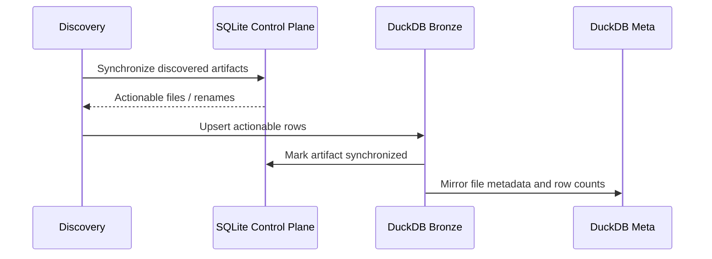

# Artifact ingestion and synchronization handoff

I coordinate ingestion with the SQLite Control Plane rather than letting the warehouse infer file identity solely from row contents. The operational lifecycle and the Bronze materialization are deliberately separate.

## Implementation map

| Implementation | Function | Lines |
|---|---|---|
| `load/bronze.py` | `__init__()` | 17–20 |
| `load/bronze.py` | `upsert_table()` | 22–83 |
| `load/bronze.py` | `load()` | 85–135 |
| `load/bronze.py` | `migrate_identity()` | 137–161 |
| `load/bronze.py` | `get_table()` | 163–168 |
| `load/bronze.py` | `get_full_dataset()` | 170–207 |
| `load/bronze.py` | `_get_lf()` | 174–179 |
| `load/bronze.py` | `_get_df()` | 181–186 |
| `load/control_plane/file_sync.py` | `__init__()` | 16–18 |
| `load/control_plane/file_sync.py` | `active_run_id()` | 21–22 |
| `load/control_plane/file_sync.py` | `active_run_id()` | 25–28 |
| `load/control_plane/file_sync.py` | `sync_with_disk()` | 30–38 |
| `load/control_plane/file_sync.py` | `_sync_with_disk()` | 40–218 |
| `load/control_plane/orchestrator.py` | `__init__()` | 17–26 |
| `load/control_plane/orchestrator.py` | `active_run_id()` | 29–30 |
| `load/control_plane/orchestrator.py` | `active_run_id()` | 33–36 |
| `load/control_plane/orchestrator.py` | `set_active_run_id()` | 38–40 |
| `load/control_plane/orchestrator.py` | `open()` | 42–58 |
| `load/control_plane/orchestrator.py` | `close()` | 60–67 |
| `load/control_plane/orchestrator.py` | `ensure_schema()` | 69–71 |
| `load/control_plane/orchestrator.py` | `begin_transaction()` | 73–74 |
| `load/control_plane/orchestrator.py` | `commit()` | 76–77 |
| `load/control_plane/orchestrator.py` | `rollback()` | 79–80 |

## Execution and dependency model



## Actionable files

The loader receives `actionable_files` grouped by synchronization category. For each registered Bronze contract, I select the extraction attribute and the category-specific files to process. An empty actionable list causes no write for that contract.

## Successful synchronization markers

After a Bronze table write, the loader iterates over actionable paths, marks them synchronized in the Control Plane, and mirrors a row count into DuckDB Meta. These operations execute within the orchestrator’s transaction sequencing; they are not a single distributed commit.

## Rename handling

The Bronze layer has `migrate_identity()` to update `__file_name__` when the Control Plane identifies a rename. This avoids unnecessary reingestion where the migration applies. The update is best effort for tables without the expected column.

## Critical basename limitation

`upsert_table()` derives basenames with `os.path.basename()` and filters/deletes by `__file_name__`. Therefore I must not claim that Bronze row replacement distinguishes two different source paths with identical basenames. That uniqueness assumption needs explicit validation or an implementation change.

### Source excerpt: `load()`

**Source:** `src/personal_finance_etl/backend/load/bronze.py:85`

```python
    def load(
        self,
        extracted_data: ExtractionResult,
        actionable_files: dict[str, list[str]],
    ) -> None:
        """Writes all raw extracted dataframes to bronze.* via db_manager.conn."""

        total_upserts = 0
        total_rows = 0

        for contract in BRONZE_CONTRACT_REGISTRY:
            df = getattr(extracted_data, contract.extraction_attribute, None)
            if df is not None:
                actionable = actionable_files.get(contract.sync_category, [])
                if actionable:
```

### Source excerpt: `migrate_identity()`

**Source:** `src/personal_finance_etl/backend/load/bronze.py:137`

```python
    def migrate_identity(self, renames: list[tuple[str, str, str]]) -> None:
        """Migrates file identity (rename) in all Bronze tables without re-ingesting rows."""
        if not renames:
            return

        cat_to_table = {
            contract.sync_category: contract.physical_table for contract in BRONZE_CONTRACT_REGISTRY
        }

        for old_path, new_path, category in renames:
            table = cat_to_table.get(category)
            if not table:
                continue

            old_name = os.path.basename(old_path)
```

## Verification boundaries

The SQLite and DuckDB commits are not globally atomic. See [operations](../operations/transaction-boundaries.md) for the failure window.

## Related specifications

I keep physical table names, types, and grains in [the data-contract reference](../reference/README.md), and operational identity and artifact history in [the Control Plane](../control-plane/README.md). The [architecture overview](../architecture/README.md) describes system-wide boundaries.
