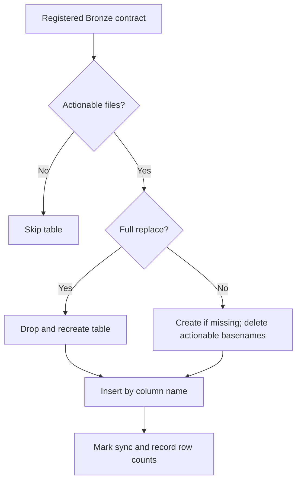

# Bronze materialization and replacement policies

I use Bronze as a persistent, source-oriented staging layer. Its ingestion strategy is contract-specific: some sources are replaced completely, while others use file-scoped replacement.

## Implementation map

| Implementation | Function | Lines |
|---|---|---|
| `load/bronze.py` | `__init__()` | 17–20 |
| `load/bronze.py` | `upsert_table()` | 22–83 |
| `load/bronze.py` | `load()` | 85–135 |
| `load/bronze.py` | `migrate_identity()` | 137–161 |
| `load/bronze.py` | `get_table()` | 163–168 |
| `load/bronze.py` | `get_full_dataset()` | 170–207 |
| `load/bronze.py` | `_get_lf()` | 174–179 |
| `load/bronze.py` | `_get_df()` | 181–186 |
| `load/registry.py` | `get_contract_by_table()` | 477–481 |
| `load/registry.py` | `validate_registry()` | 484–536 |

## Execution and dependency model



## Registry-controlled policies

`BRONZE_CONTRACT_REGISTRY` defines twenty contracts. Twelve use `is_full_replace=True`; eight use file-scoped replacement. These policies are declared in code and must not be inferred from source format alone.

## Full replacement

When a contract is full-replace, `upsert_table()` drops the physical table and recreates it using an empty schema frame. It then inserts filtered rows. The loader also clears that category’s DuckDB Meta file-registry rows before rebuilding its mirrors.

## File-scoped replacement

For an incremental contract, the loader creates the table if necessary, deletes rows whose `__file_name__` is among actionable basenames, and inserts the extracted rows by column name. This is a replace-by-file strategy, not row-level merge/upsert by financial transaction ID.

## Empty sources

When actionable files exist but the extracted frame has zero matching rows, the deletion/recreation still occurs, and the inserted row count is zero. When no actionable files exist, `upsert_table()` returns without writing.

## Physical contract inventory

I do not duplicate the full physical Bronze catalog here. The authoritative registry is `backend/load/registry.py`, and the detailed table reference belongs in `reference/bronze-data-contracts.md`.

### Source excerpt: `upsert_table()`

**Source:** `src/personal_finance_etl/backend/load/bronze.py:22`

```python
    def upsert_table(
        self,
        df: pl.DataFrame | pl.LazyFrame,
        table_name: str,
        actionable_files: list[str],
        full_replace: bool = False,
    ) -> dict[str, int]:
        """Uses db_manager.conn directly. If full_replace is True, truncates the table first.
        Otherwise, deletes existing rows matching __file_name__ then re-inserts.
        Returns dict mapping filename to row count."""
        if isinstance(df, pl.LazyFrame):
            compact_plan = df.explain().replace("\n", " | ")
            logger.debug(f"[DAG:OPTIMIZER] Physical Plan for Bronze '{table_name}': {compact_plan}")
            df = df.collect()

```

## Verification boundaries

Incremental Bronze does not imply an incremental Silver/Gold rebuild. `__file_name__` basename collisions remain a documented risk.

## Related specifications

I keep physical table names, types, and grains in [the data-contract reference](../reference/README.md), and operational identity and artifact history in [the Control Plane](../control-plane/README.md). The [architecture overview](../architecture/README.md) describes system-wide boundaries.
