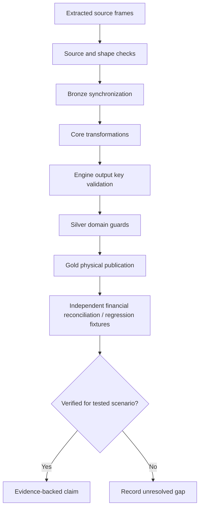

# Data quality and validation boundaries

I distinguish data-shape validation, operational provenance, and financial correctness. A pipeline can satisfy its registry contracts and still need numerical reconciliation tests for financial edge cases.

## Implementation map

| Implementation | Function | Lines |
|---|---|---|
| `pipeline/etl_pipeline.py` | `__init__()` | 48–54 |
| `pipeline/etl_pipeline.py` | `_extract()` | 56–62 |
| `pipeline/etl_pipeline.py` | `_transform()` | 64–66 |
| `pipeline/etl_pipeline.py` | `_process_benchmark()` | 68–74 |
| `pipeline/etl_pipeline.py` | `_process_currency()` | 76–99 |
| `pipeline/etl_pipeline.py` | `_process_us_market_data()` | 101–148 |
| `pipeline/etl_pipeline.py` | `_run_engines()` | 150–246 |
| `pipeline/etl_pipeline.py` | `run()` | 248–537 |
| `pipeline/etl_pipeline.py` | `process_wrapper()` | 540–594 |
| `pipeline/etl_pipeline.py` | `__init__()` | 546–549 |
| `pipeline/etl_pipeline.py` | `write()` | 551–562 |
| `pipeline/etl_pipeline.py` | `flush()` | 564–565 |
| `load/bronze.py` | `__init__()` | 17–20 |
| `load/bronze.py` | `upsert_table()` | 22–83 |
| `load/bronze.py` | `load()` | 85–135 |
| `load/bronze.py` | `migrate_identity()` | 137–161 |
| `load/bronze.py` | `get_table()` | 163–168 |
| `load/bronze.py` | `get_full_dataset()` | 170–207 |
| `load/bronze.py` | `_get_lf()` | 174–179 |
| `load/bronze.py` | `_get_df()` | 181–186 |
| `load/silver.py` | `__init__()` | 12–13 |
| `load/silver.py` | `_write()` | 15–73 |
| `load/silver.py` | `load()` | 75–105 |
| `load/gold.py` | `__init__()` | 12–13 |
| `load/gold.py` | `_write()` | 15–28 |
| `load/gold.py` | `load()` | 30–60 |
| `load/registry.py` | `get_contract_by_table()` | 477–481 |
| `load/registry.py` | `validate_registry()` | 484–536 |

## Execution and dependency model

## Validation layers

Source extraction has format assumptions; Bronze uses source-file scoping; the orchestrator checks analytical contract completeness; Silver contains targeted domain null checks; the Control Plane tracks artifacts and runs. These are separate controls with different failure coverage.

## Observed limitations

The audited FIFO implementation can stop after exhausting lots without itself raising for an unconsumed sale remainder; upstream prevention remains unverified. FX missingness has divergent handling paths. FIRE without portfolio analytics contains a source-level missing-column risk. CLI cron failure reporting also needs a runtime regression test.

## What daily reconciliation proves

The maintainer reports paise-to-paise reconciliation in daily use. This is meaningful operational evidence for the actual workload, but it does not establish exhaustive behavior for malformed inputs, all tax boundaries, or interruption scenarios.

## Regression priorities

I would validate: duplicated basenames; empty and removed files; oversold quantities; missing FX; debt mutual-fund cutoff boundaries; missing portfolio analytics in FIRE; partial DuckDB/SQLite commit failure; Gold DDL/frame compatibility; and unattended CLI exit codes.

## Documentation truth standard

I label a property as source-inspected, execution-traced, fixture-tested, or maintainer-observed. I avoid promoting a method name, a docstring, or a successful daily run into a stronger guarantee.

## Verification boundaries

This document is a control map, not a claim that all listed regression fixtures currently exist or pass.

## Related specifications

I keep physical table names, types, and grains in [the data-contract reference](../reference/README.md), and operational identity and artifact history in [the Control Plane](../control-plane/README.md). The [architecture overview](../architecture/README.md) describes system-wide boundaries.
