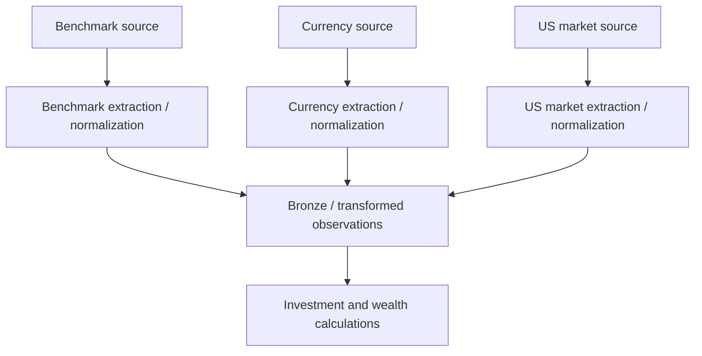

# Market data, currencies, and benchmark ingestion

I separate the acquisition and normalization of market observations from their eventual use in financial attribution. This keeps source handling, date alignment, and financial formulas independently explainable.

## Implementation map

| Implementation | Function | Lines |
|---|---|---|
| `pipeline/etl_pipeline.py` | `__init__()` | 48–54 |
| `pipeline/etl_pipeline.py` | `_extract()` | 56–62 |
| `pipeline/etl_pipeline.py` | `_transform()` | 64–66 |
| `pipeline/etl_pipeline.py` | `_process_benchmark()` | 68–74 |
| `pipeline/etl_pipeline.py` | `_process_currency()` | 76–99 |
| `pipeline/etl_pipeline.py` | `_process_us_market_data()` | 101–148 |
| `pipeline/etl_pipeline.py` | `_run_engines()` | 150–246 |
| `pipeline/etl_pipeline.py` | `run()` | 248–537 |
| `pipeline/etl_pipeline.py` | `process_wrapper()` | 540–594 |
| `pipeline/etl_pipeline.py` | `__init__()` | 546–549 |
| `pipeline/etl_pipeline.py` | `write()` | 551–562 |
| `pipeline/etl_pipeline.py` | `flush()` | 564–565 |
| `extract/benchmark_extractor.py` | `__init__()` | 22–30 |
| `extract/benchmark_extractor.py` | `_fetch_ticker_delta()` | 32–112 |
| `extract/benchmark_extractor.py` | `extract_benchmark_delta()` | 114–229 |
| `extract/currency_extractor.py` | `__init__()` | 20–28 |
| `extract/currency_extractor.py` | `_fetch_ticker_delta()` | 30–104 |
| `extract/currency_extractor.py` | `extract_currency_delta()` | 106–216 |
| `extract/us_market_extractor.py` | `__init__()` | 20–28 |
| `extract/us_market_extractor.py` | `_fetch_ticker_delta()` | 30–95 |
| `extract/us_market_extractor.py` | `extract_us_market_delta()` | 97–205 |
| `transform/benchmark_transformer.py` | `__init__()` | 18–19 |
| `transform/benchmark_transformer.py` | `transform()` | 21–184 |
| `transform/currency_transformer.py` | `transform_currency_fx_rates()` | 6–156 |

## Execution and dependency model



## Distinct ingestion branches

The orchestrator exposes `_process_benchmark()`, `_process_currency()`, and `_process_us_market_data()` rather than treating all market series as one undifferentiated input. Each path interacts with its extractor and transformation implementation.

## Market data provenance

The Bronze registry includes mutual fund holdings, domestic stock market data, US stock prices, currency history, and benchmark history as file-incremental categories. These are retained source observations, not automatically guaranteed complete market histories.

## Downstream use

Benchmark shadow-unit attribution is implemented in investment analytics; FX conversions are used in financial calculations. Their formulas and missing-rate behavior belong to `finance/benchmark-attribution.md` and `finance/fx-methodology.md`.

## Data quality boundary

A valid source record does not imply a usable valuation for every date. The audited execution paths handle missing FX differently, so documentation must avoid promising a uniform fallback policy.

### Source excerpt: `_process_benchmark()`

**Source:** `src/personal_finance_etl/backend/pipeline/etl_pipeline.py:68`

```python
    def _process_benchmark(self, cp: ControlPlane, bronze: BronzeLayer) -> None:
        pipeline = BenchmarkPipeline(cp, bronze, self.status_queue)
        self.dfs["df_f_investment_benchmark_data"] = pipeline.process(
            df_market=self.dfs.get("df_f_investment_market_data"),
            df_purchase=self.dfs.get("df_f_tf_inv_purchase"),
            df_master=self.dfs["df_d_benchmark_master"],
        )
```

### Source excerpt: `_process_currency()`

**Source:** `src/personal_finance_etl/backend/pipeline/etl_pipeline.py:76`

```python
    def _process_currency(self, cp: ControlPlane, bronze: BronzeLayer) -> None:
        pipeline = CurrencyPipeline(cp, bronze, self.status_queue, max_workers=8)

        # Start Date: Earliest date in Calendar
        cal_pd = self.dfs["df_d_calendar"]
        if cal_pd.is_empty():
            global_start_date = date.today()
        else:
            sd = cal_pd.select(pl.min("Date")).item()
            global_start_date = sd if sd is not None else date.today()

        # End Date: Max date of Indian Market Data
        df_market = self.dfs.get("df_f_investment_market_data")
        global_end_date = date.today()
        if df_market is not None and not df_market.is_empty():
```

### Source excerpt: `_process_us_market_data()`

**Source:** `src/personal_finance_etl/backend/pipeline/etl_pipeline.py:101`

```python
    def _process_us_market_data(self, cp: ControlPlane, bronze: BronzeLayer) -> None:
        pipeline = USMarketPipeline(cp, bronze, self.status_queue, max_workers=8)

        # Start Date: Earliest US Stock transaction
        df_purchase = self.dfs.get("df_f_tf_inv_purchase")
        df_sale = self.dfs.get("df_f_tf_inv_sale")

        valid_starts: list[date] = []
        if df_purchase is not None and not df_purchase.is_empty():
            us_p = df_purchase.filter(pl.col("__file_category__") == "US Stocks")
            if not us_p.is_empty():
                d = us_p.select(pl.col("Date").drop_nulls().min()).item()
                if isinstance(d, date):
                    valid_starts.append(d)

```

## Verification boundaries

The current source audit does not establish complete trading-calendar coverage or universally valid FX fallbacks.

## Related specifications

I keep physical table names, types, and grains in [the data-contract reference](../reference/README.md), and operational identity and artifact history in [the Control Plane](../control-plane/README.md). The [architecture overview](../architecture/README.md) describes system-wide boundaries.
