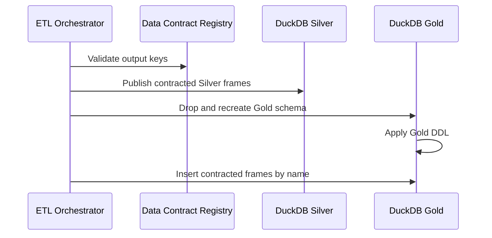

# Contract validation and Silver/Gold publication

I publish analytics through explicit contract registries and physical schema definitions. This separates the dataframe keys produced by engines from the tables consumed by BI clients.

## Implementation map

| Implementation | Function | Lines |
|---|---|---|
| `load/registry.py` | `get_contract_by_table()` | 477–481 |
| `load/registry.py` | `validate_registry()` | 484–536 |
| `load/silver.py` | `__init__()` | 12–13 |
| `load/silver.py` | `_write()` | 15–73 |
| `load/silver.py` | `load()` | 75–105 |
| `load/gold.py` | `__init__()` | 12–13 |
| `load/gold.py` | `_write()` | 15–28 |
| `load/gold.py` | `load()` | 30–60 |
| `pipeline/etl_pipeline.py` | `__init__()` | 48–54 |
| `pipeline/etl_pipeline.py` | `_extract()` | 56–62 |
| `pipeline/etl_pipeline.py` | `_transform()` | 64–66 |
| `pipeline/etl_pipeline.py` | `_process_benchmark()` | 68–74 |
| `pipeline/etl_pipeline.py` | `_process_currency()` | 76–99 |
| `pipeline/etl_pipeline.py` | `_process_us_market_data()` | 101–148 |
| `pipeline/etl_pipeline.py` | `_run_engines()` | 150–246 |
| `pipeline/etl_pipeline.py` | `run()` | 248–537 |
| `pipeline/etl_pipeline.py` | `process_wrapper()` | 540–594 |
| `pipeline/etl_pipeline.py` | `__init__()` | 546–549 |
| `pipeline/etl_pipeline.py` | `write()` | 551–562 |
| `pipeline/etl_pipeline.py` | `flush()` | 564–565 |

## Execution and dependency model



## Output registry

`DATA_CONTRACT_REGISTRY` contains 24 Silver and 22 Gold contracts. Each contract records a key, physical table, domain, grain, producer label, and publication order. The orchestrator checks unexpected and missing registered analytical outputs before publication.

## Silver loading

The Silver loader materializes registered analytical frames into the Silver schema. Its schema checks and specific null guards are meaningful structural safeguards, not a substitute for numerical financial reconciliation.

## Gold lifecycle

`GoldLayer.load()` executes `DROP SCHEMA IF EXISTS gold CASCADE`, recreates the schema, executes `GOLD_DDL`, and inserts registered outputs in publication order. The implementation therefore recreates the physical schema, despite a docstring referring to truncation.

## Empty output semantics

`GoldLayer._write()` returns zero for empty frames. The DDL-created table remains empty. Insertions use `INSERT INTO ... BY NAME`, so column alignment is by name rather than dataframe position.

## BI boundary

Gold is the BI-oriented publication layer. It should not be described as the source of truth for operational lineage or as a transactionally independent commit from DuckDB.

### Source excerpt: `load()`

**Source:** `src/personal_finance_etl/backend/load/gold.py:30`

```python
    def load(self, dfs: dict[str, pl.DataFrame]) -> None:
        """Truncates all gold.* tables and re-inserts presentation DataFrames."""

        logger.info("Loading presentation datasets into Gold layer...")

        contracts = sorted(
            (c for c in DATA_CONTRACT_REGISTRY if c.layer == "gold"),
            key=lambda c: c.publication_order,
        )
        # Phase 1: Cleanly wipe the entire schema
        self.db_manager.conn.execute("DROP SCHEMA IF EXISTS gold CASCADE")
        self.db_manager.conn.execute("CREATE SCHEMA gold")
        self.db_manager.conn.execute(GOLD_DDL)

        # Phase 2: Insert all data
```

### Source excerpt: `_write()`

**Source:** `src/personal_finance_etl/backend/load/gold.py:15`

```python
    def _write(self, df: pl.DataFrame | pl.LazyFrame, table_name: str) -> int:
        if isinstance(df, pl.LazyFrame):
            compact_plan = df.explain().replace("\n", " | ")
            logger.debug(f"[DAG:OPTIMIZER] Physical Plan for Gold '{table_name}': {compact_plan}")
            df = df.collect()

        if df.height == 0:
            return 0

        self.db_manager.conn.register("temp_df", df)
        logger.debug(f"[GOLD:DETAIL] Rebuilt {table_name}: {df.height} rows processed.")
        self.db_manager.conn.execute(f"INSERT INTO {table_name} BY NAME SELECT * FROM temp_df")
        self.db_manager.conn.unregister("temp_df")
        return df.height
```

## Verification boundaries

Contract completeness checks do not prove financial correctness. Gold schema recreation may invalidate external assumptions about persistent Gold-side objects.

## Related specifications

I keep physical table names, types, and grains in [the data-contract reference](../reference/README.md), and operational identity and artifact history in [the Control Plane](../control-plane/README.md). The [architecture overview](../architecture/README.md) describes system-wide boundaries.
