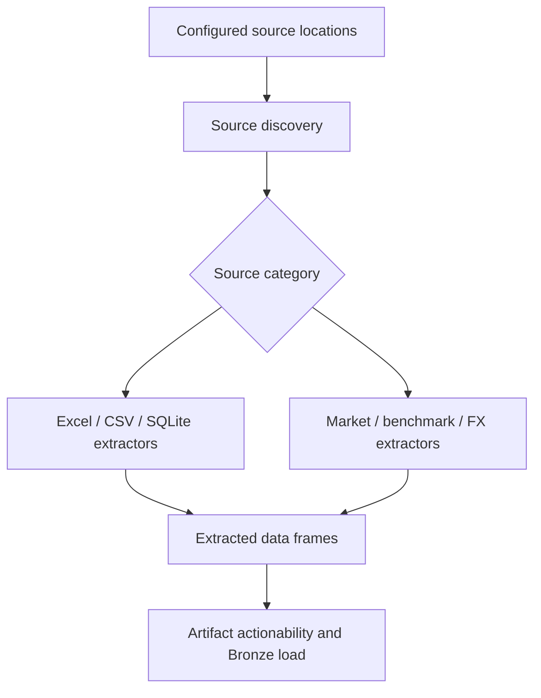

# Source discovery and extraction routing

I treat source discovery as an explicit step of execution, not as an implicit side effect of loading tables. I separate source-location concerns, format-specific extraction, and the Control Plane's determination of actionable artifacts.

## Implementation map

| Implementation | Function | Lines |
|---|---|---|
| `extract/statement_locator.py` | `categorize_statement_files()` | 7–38 |
| `extract/excel_extractor.py` | `_clean_excel_headers()` | 12–32 |
| `extract/excel_extractor.py` | `_process_mf_statement()` | 35–63 |
| `extract/excel_extractor.py` | `extract_mf_market_data_raw()` | 66–91 |
| `extract/excel_extractor.py` | `_process_mf_transaction_statements()` | 94–120 |
| `extract/excel_extractor.py` | `extract_mf_transactions_raw()` | 123–151 |
| `extract/excel_extractor.py` | `_process_stock_closing_statement()` | 154–189 |
| `extract/excel_extractor.py` | `extract_stock_market_data_raw()` | 192–216 |
| `extract/excel_extractor.py` | `_process_stock_transactions()` | 219–237 |
| `extract/excel_extractor.py` | `extract_stock_transactions_raw()` | 240–254 |
| `extract/excel_extractor.py` | `_process_us_stock_transactions()` | 256–269 |
| `extract/excel_extractor.py` | `extract_us_stock_transactions_raw()` | 271–285 |
| `extract/csv_extractor.py` | `extract_stg_mf_isin_mapping()` | 8–17 |
| `extract/csv_extractor.py` | `extract_currency_mapping_raw()` | 20–36 |
| `extract/csv_extractor.py` | `extract_stg_benchmark_mapping()` | 39–61 |
| `extract/csv_extractor.py` | `extract_benchmark_master_raw()` | 64–78 |
| `extract/csv_extractor.py` | `extract_macro_parameters_raw()` | 81–113 |
| `extract/csv_extractor.py` | `extract_opening_balances_raw()` | 116–120 |
| `extract/sqlite_extractor.py` | `__init__()` | 12–13 |
| `extract/sqlite_extractor.py` | `get_latest_sqlite_backup()` | 15–22 |
| `extract/sqlite_extractor.py` | `extract_base_tables()` | 24–72 |
| `extract/sqlite_extractor.py` | `add_file_info()` | 29–33 |
| `extract/benchmark_extractor.py` | `__init__()` | 22–30 |
| `extract/benchmark_extractor.py` | `_fetch_ticker_delta()` | 32–112 |
| `extract/benchmark_extractor.py` | `extract_benchmark_delta()` | 114–229 |
| `extract/currency_extractor.py` | `__init__()` | 20–28 |
| `extract/currency_extractor.py` | `_fetch_ticker_delta()` | 30–104 |
| `extract/currency_extractor.py` | `extract_currency_delta()` | 106–216 |
| `extract/us_market_extractor.py` | `__init__()` | 20–28 |
| `extract/us_market_extractor.py` | `_fetch_ticker_delta()` | 30–95 |
| `extract/us_market_extractor.py` | `extract_us_market_delta()` | 97–205 |

## Execution and dependency model

## Discovery versus extraction

A discovered path is not yet a successfully parsed financial record. I use source categories to route files to the corresponding extractor and to track synchronization decisions. The `statement_locator.py` module handles statement location, while format-specific extractors perform parsing. The precise folder and filename rules belong to the implementation and configuration, not an assumed universal directory convention.

## Supported extraction modules

The repository contains dedicated modules for Excel, CSV, SQLite, benchmark, currency, and US market data. These modules should not be described as a generic arbitrary-format plugin framework. Their supported source layouts and error behavior are defined by their actual parsing branches.

## Provenance boundary

A file path is operational input; `__file_name__` is a Bronze row-level source marker. These are not interchangeable identities. The Control Plane preserves fuller artifact identity and event history.

## Verification boundaries

The exact file-pattern acceptance rules require branch-by-branch fixture tests; this document does not claim arbitrary source formats are supported.

## Related specifications

I keep physical table names, types, and grains in [the data-contract reference](../reference/README.md), and operational identity and artifact history in [the Control Plane](../control-plane/README.md). The [architecture overview](../architecture/README.md) describes system-wide boundaries.
