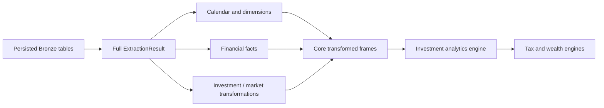

# Canonical transformation pipeline

After synchronizing Bronze, I reconstruct the full extraction dataset and apply the domain transformations. I keep transformation semantics distinct from the downstream investment, tax, and presentation engines.

## Implementation map

| Implementation | Function | Lines |
|---|---|---|
| `pipeline/etl_pipeline.py` | `__init__()` | 48–54 |
| `pipeline/etl_pipeline.py` | `_extract()` | 56–62 |
| `pipeline/etl_pipeline.py` | `_transform()` | 64–66 |
| `pipeline/etl_pipeline.py` | `_process_benchmark()` | 68–74 |
| `pipeline/etl_pipeline.py` | `_process_currency()` | 76–99 |
| `pipeline/etl_pipeline.py` | `_process_us_market_data()` | 101–148 |
| `pipeline/etl_pipeline.py` | `_run_engines()` | 150–246 |
| `pipeline/etl_pipeline.py` | `run()` | 248–537 |
| `pipeline/etl_pipeline.py` | `process_wrapper()` | 540–594 |
| `pipeline/etl_pipeline.py` | `__init__()` | 546–549 |
| `pipeline/etl_pipeline.py` | `write()` | 551–562 |
| `pipeline/etl_pipeline.py` | `flush()` | 564–565 |
| `transform/facts.py` | `get_base_transactions()` | 33–103 |
| `transform/facts.py` | `transform_f_income_transactions()` | 106–174 |
| `transform/facts.py` | `transform_f_expense_transactions()` | 177–213 |
| `transform/facts.py` | `transform_f_transfer_transactions()` | 216–274 |
| `transform/facts.py` | `transform_f_opening_balances()` | 277–325 |
| `transform/dimensions.py` | `_get_tax_maps()` | 6–40 |
| `transform/dimensions.py` | `transform_d_income_category()` | 42–93 |
| `transform/dimensions.py` | `transform_d_income_subcategory()` | 98–213 |
| `transform/dimensions.py` | `transform_d_expense_category()` | 218–245 |
| `transform/dimensions.py` | `transform_d_expense_subcategory()` | 248–290 |
| `transform/dimensions.py` | `transform_d_asset_category()` | 293–387 |
| `transform/dimensions.py` | `transform_d_asset_subcategory()` | 390–507 |
| `transform/dimensions.py` | `transform_d_currency()` | 510–560 |
| `transform/dimensions.py` | `transform_d_investment_benchmark_master()` | 563–574 |
| `transform/dimensions.py` | `transform_d_macro_parameters()` | 577–613 |
| `transform/investments.py` | `get_purchase_reference()` | 9–43 |
| `transform/investments.py` | `get_sale_reference()` | 46–126 |
| `transform/investments.py` | `transform_stg_investment_market_data()` | 129–254 |
| `transform/investments.py` | `_compute_purchase_id()` | 257–265 |
| `transform/investments.py` | `_compute_sale_id()` | 268–276 |
| `transform/investments.py` | `get_f_tf_investment_purchase_data()` | 279–340 |
| `transform/investments.py` | `get_f_tf_investment_sale_data()` | 343–416 |
| `transform/investments.py` | `get_d_investment_master()` | 419–462 |
| `transform/mutual_funds.py` | `get_stg_mf_market_data()` | 4–65 |
| `transform/mutual_funds.py` | `get_stg_mf_market_data_ref()` | 68–111 |
| `transform/mutual_funds.py` | `get_base_mf_transactions()` | 114–144 |
| `transform/mutual_funds.py` | `transform_stg_mf_trades()` | 147–184 |
| `transform/mutual_funds.py` | `get_stg_mf_master_ref()` | 187–236 |
| `transform/stocks.py` | `get_stg_stock_market_data()` | 4–94 |
| `transform/stocks.py` | `get_stg_stock_market_data_ref()` | 97–130 |
| `transform/stocks.py` | `get_base_stock_transactions()` | 133–176 |
| `transform/stocks.py` | `transform_stg_stock_trades()` | 179–199 |
| `transform/stocks.py` | `get_stg_stock_master_ref()` | 202–236 |
| `transform/us_stocks.py` | `get_base_us_stock_transactions()` | 4–44 |
| `transform/us_stocks.py` | `transform_stg_us_stock_trades()` | 47–63 |
| `transform/us_stocks.py` | `get_stg_us_stock_master_ref()` | 66–91 |
| `transform/us_stocks_transformer.py` | `transform_us_market_data()` | 11–307 |

## Execution and dependency model



## Full-dataset reconstruction

`BronzeLayer.get_full_dataset()` reads the persisted Bronze tables and assembles an `ExtractionResult`. The orchestrator then invokes the transformation stage. Consequently, only the ingestion side is selectively incremental; the analytical reconstruction operates on the complete retained dataset.

## Transformation families

The package separates calendar and dimension builders, financial facts, investments, mutual funds, domestic stocks, US stocks, currency transformation, and benchmark transformation. Their boundaries should be traced from their real functions, not grouped under an invented generic transformer abstraction.

## Financial semantics

The sale-reference transformation’s historical average purchase-cost calculation is not the same as FIFO lot accounting. FIFO and realized events belong to the investment analytics engine and are documented in the finance domain.

## Dataframe execution

The implementation uses Polars DataFrames and LazyFrames. The Bronze and Gold loaders collect lazy plans when necessary and log a compact optimizer plan. This is not evidence that all transforms remain lazy end to end.

### Source excerpt: `_transform()`

**Source:** `src/personal_finance_etl/backend/pipeline/etl_pipeline.py:64`

```python
    def _transform(self, extracted_data: ExtractionResult) -> None:
        transformer = TransformationDAG(self.cfg, self.status_queue, self.rules)
        self.dfs = transformer.run(extracted_data)
```

### Source excerpt: `get_full_dataset()`

**Source:** `src/personal_finance_etl/backend/load/bronze.py:170`

```python
    def get_full_dataset(self, original_mappings: dict[str, dict[str, str]]) -> ExtractionResult:
        """Reads the full dataset from Bronze tables via DuckDB and returns a complete ExtractionResult."""
        logger.info("Reading full dataset from Bronze Layer Lakehouse...")

        def _get_lf(table_name: str) -> pl.LazyFrame:
            try:
                return self.db_manager.conn.query(f"SELECT * FROM {table_name}").pl().lazy()
            except duckdb.CatalogException:
                logger.debug(f"[Bronze] Table {table_name} does not exist. Returning empty frame.")
                return pl.LazyFrame()

        def _get_df(table_name: str) -> pl.DataFrame:
            try:
                return self.db_manager.conn.query(f"SELECT * FROM {table_name}").pl()
            except duckdb.CatalogException:
```

## Verification boundaries

Transformation correctness, record ordering, and source-specific parsing assumptions require targeted numerical fixtures; static inspection alone is not a financial reconciliation certificate.

## Related specifications

I keep physical table names, types, and grains in [the data-contract reference](../reference/README.md), and operational identity and artifact history in [the Control Plane](../control-plane/README.md). The [architecture overview](../architecture/README.md) describes system-wide boundaries.
