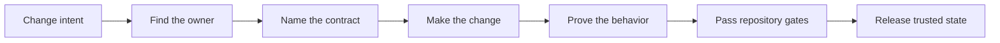
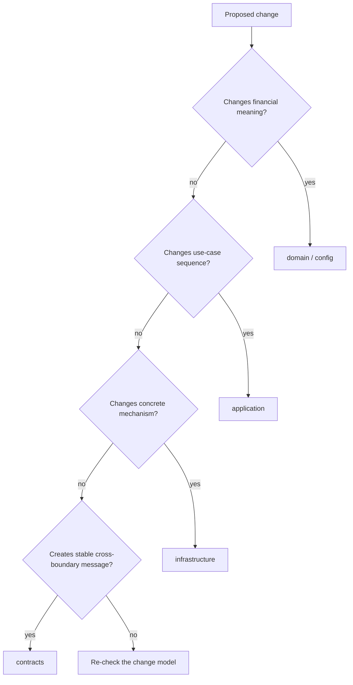
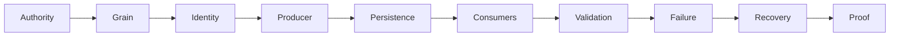
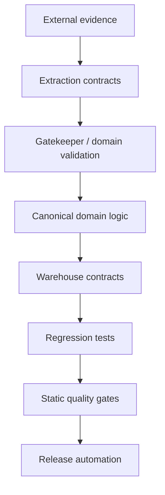
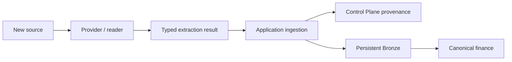
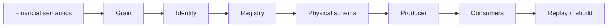

# Developer Engineering

Changing Personal Finance ETL is another kind of state transition.

A source adapter changes what evidence can enter the system. A transformation changes how evidence becomes financial meaning. A Gold mart changes what analytical state is published. A schema change can alter grain, identity, or compatibility. A release turns all of those choices into something another machine can install.

Those changes look different in code, but they share one engineering problem:

> **How do I extend the system without accidentally moving authority, weakening a contract, or making a financially plausible result out of invalid evidence?**

That is what this section specifies.



The sequence is deliberate. Starting with a file instead of an owner is how a convenient helper quietly becomes the second implementation of Tax, FIFO, or persistence semantics. Starting with a schema instead of a grain is how a dashboard gets numbers that add up beautifully and mean absolutely nothing. Starting with release automation before verification is how deployment becomes a live-action debugging event. 😭

The rest of this section follows one change all the way from idea to release.

## A code change has four dimensions

Before I touch implementation, I classify the change along four axes.

| Dimension | Question | Typical owner |
|---|---|---|
| **Meaning** | Does this change what a financial fact *means*? | `domain/` + `config/` policy |
| **Sequence** | Does this change which use case runs, when, or with which dependency? | `application/` |
| **Mechanism** | Does this change how evidence, persistence, providers, logging, or recovery physically work? | `infrastructure/` |
| **Boundary** | Does a stable result, status, or message cross package/process boundaries? | `contracts/` |

Presentation and bootstrap answer two additional questions:

- `presentation/`: how does a human invoke or inspect the application?
- `bootstrap/`: how are concrete dependencies assembled?

That ownership map is not just folder etiquette. It determines which code may know which facts.



The full legal dependency shape is specified in [Application and Dependency Architecture](../architecture/application-and-dependency-architecture.md). Developer work starts by respecting it.

## The developer contract begins with authority

Every non-trivial extension must be able to answer these questions before I consider it complete:

1. **Authority**: which subsystem owns the fact or behavior?
2. **Grain**: what does one record, event, or row mean?
3. **Identity**: how is that record recognized across reruns and rebuilds?
4. **Producer**: which function, service, or engine creates it?
5. **Persistence**: where does it become durable, if anywhere?
6. **Consumers**: what downstream logic assumes its shape or semantics?
7. **Validation**: what rejects malformed or incomplete input?
8. **Failure**: what durable state can exist if the operation stops halfway?
9. **Recovery**: can the system converge from that state?
10. **Proof**: what test, gate, or run demonstrates the intended behavior?



This is the extension invariant for the entire Developer section.

## Why the system resists "just one quick change"

Personal finance data is unusually good at producing values that are syntactically valid and economically wrong.

A permissive cast can convert a malformed amount into null. A fill can convert that null into zero. A join can duplicate a holding. A schema rename can preserve every row count while changing a BI measure. A provider can return only 146 of 147 requested entities and still produce a perfectly healthy DataFrame.

That is why the codebase separates several kinds of protection:



No single layer is expected to prove everything.

- extraction proves what was requested and what actually arrived;
- validation proves required structure and values are acceptable;
- domain code owns financial meaning;
- warehouse contracts own durable analytical shape;
- tests prove behavior and invariants;
- static tools prove type/style/architecture properties;
- release tooling packages evidence rather than replacing it.

## Stable shapes deserve names

The current codebase is intentionally selective about Python abstraction mechanisms.

A stable result that crosses a boundary should not remain an anonymous tuple or an unbounded mapping forever.

The extraction layer is a good example:

```python
# src/personal_finance_etl/contracts/extraction.py
@dataclass
class ExtractionBatchResult:
    """Structured extraction outcome across concurrent entity workers."""

    requested_entities: list[str] = field(default_factory=lambda: list[str]())
    successful_entities: list[str] = field(default_factory=lambda: list[str]())
    cached_entities: list[str] = field(default_factory=lambda: list[str]())
    no_new_data_entities: list[str] = field(default_factory=lambda: list[str]())
    failed_entities: dict[str, str] = field(default_factory=lambda: dict[str, str]())
    frames: list[pl.DataFrame] = field(default_factory=lambda: list[pl.DataFrame]())
```

That structure lets application code reason about completeness without knowing provider-specific implementation details.

The project uses:

- dataclasses for concrete state/result records;
- `TypedDict` when mapping semantics are genuinely part of the interface;
- Protocols for behavioral capability boundaries;
- Pydantic models for validated configuration and financial policy;
- enums when legal machine states are finite;
- plain functions when the job is a deterministic transformation rather than an object lifecycle.

The standard is not "everything must be a class." The standard is "the abstraction should explain the responsibility."

## Lazy execution is part of the developer model

Polars `LazyFrame` is not merely a performance trick. It is part of the pipeline contract.

Canonical transformations remain lazy where possible so projection, predicate, and query-plan optimization survive across transformation boundaries.

Materialization is therefore something I classify:

```text
publication boundary
stateful financial algorithm
third-party API boundary
process boundary
scalar extraction
validation / diagnostic boundary
```

A new `.collect()` is not automatically wrong. It just needs a reason.

A `LazyFrame -> DataFrame -> to_dicts() -> DataFrame -> lazy()` round-trip with no stateful or external boundary is usually the codebase politely asking why we have Polars in the first place. 😂

## The repository enforces the standards before extension work leaves my machine

The permanent standards are backed by an explicit tooling surface: Poe tasks, tracked Git hooks, fast/full quality gates, structured audit exports, commit automation, PR certification, builds, GitHub releases, and PyPI publishing.

That machinery matters *before* I learn the extension recipes because it defines the proof loop every extension will eventually pass through.

[Tooling, Quality, and Release Engineering](tooling-quality-and-release-engineering.md) specifies that enforcement system.

## A source extension is an evidence change

Adding a broker file or market-data provider is not mainly a parsing task.

It changes the evidence graph:



That is why [Adding Data Sources](adding-data-sources.md) starts with source authority, completeness, artifact identity, and provenance before it discusses column mapping.

## A transformation extension is a meaning change

A transformation can be physically simple and financially dangerous.

The Developer contract asks the transformation to declare:

```text
input authority
input grain
output grain
identity behavior
currency semantics
null / invalid semantics
join cardinality
stateful boundaries
consumers
```

Only then do I care whether the implementation is a `with_columns()` chain or a service method.

[Adding Transformations](adding-transformations.md) follows that sequence.

## A Gold mart is a publication change

Gold is a decision surface, not a second domain layer.

A Gold extension must answer:

- which canonical state it presents;
- what one row means;
- which measures are additive, semi-additive, or non-additive;
- how the schema is registered;
- how publication order and failure semantics work;
- what Power BI is allowed to assume.

[Adding Gold Marts](adding-gold-marts.md) treats a mart as a contract, not just a query.

## Schema evolution is where innocent changes stop being innocent

A column addition may be local.

A grain change is not.

An identity change is definitely not.

A schema change can touch domain semantics, registry completeness, physical DDL, producer output, BI compatibility, replay behavior, and deterministic identity continuity.



[Data Contract and Schema Evolution](data-contract-and-schema-evolution.md) is the Developer section's compatibility specification.

## Verification is layered because risk is layered

A focused domain test, an AST architecture test, a full pipeline run, and a static type checker prove different things.

The test strategy therefore escalates:

```text
focused behavior
    -> contract / grain / identity
    -> affected domain or phase
    -> architecture boundaries
    -> full suite
    -> real pipeline when the risk warrants it
```

[Testing and Validation](testing-and-validation.md) explains the proof model, including failure injection, financial regression, architecture certification, and documentation QA.

## This section is one continuous story

Read the documents in this order:

| Step | Specification | Question it answers |
|---:|---|---|
| 1 | [Development Guide](development-guide.md) | How do I locate ownership and trace a change through the current architecture? |
| 2 | [Engineering Standards](engineering-standards.md) | What permanent rules keep those changes legible and safe? |
| 3 | [Tooling, Quality, and Release Engineering](tooling-quality-and-release-engineering.md) | How are the standards enforced from local edit through build and release? |
| 4 | [Adding Data Sources](adding-data-sources.md) | How does new evidence enter without leaking provider semantics into finance? |
| 5 | [Adding Transformations](adding-transformations.md) | How does evidence become new canonical meaning without breaking grain or identity? |
| 6 | [Adding Gold Marts](adding-gold-marts.md) | How does canonical state become a new decision-ready analytical surface? |
| 7 | [Data Contract and Schema Evolution](data-contract-and-schema-evolution.md) | What happens when a change alters a durable contract? |
| 8 | [Testing and Validation](testing-and-validation.md) | What actually proves that the changed system is still correct? |

The first document begins where Architecture ends: **ownership is known; now I need to change something without violating it.**

## Related specifications

- [Architecture](../architecture/README.md)
- [Application and Dependency Architecture](../architecture/application-and-dependency-architecture.md)
- [Data Lifecycle](../architecture/data-lifecycle.md)
- [Data Model](../architecture/data-model.md)
- [Design Decisions](../architecture/design-decisions.md)
- [Identity and Grain Contracts](../reference/identity-and-grain-contracts.md)
