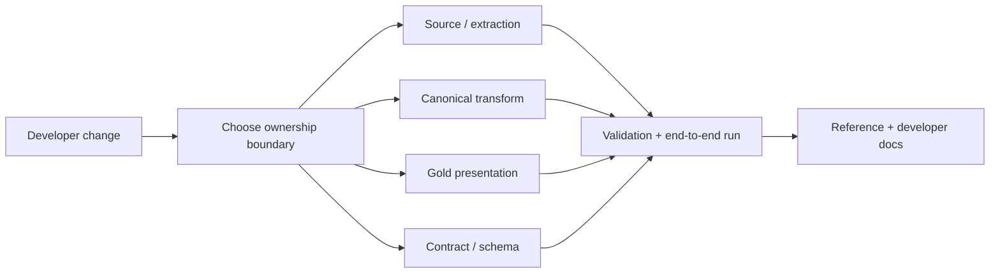
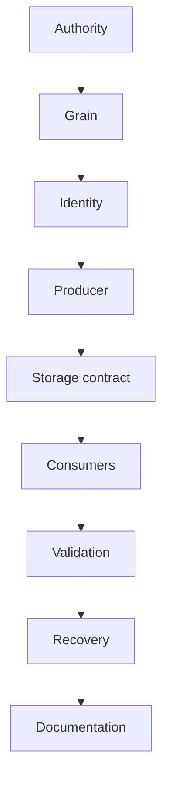

# Developer Guide

Personal Finance ETL is extensible, but its extension seams are contracts rather than blank spaces in the package tree. A source, transformation, Gold mart, schema change, or financial rule becomes part of the system only when its producer, grain, identity, persistence contract, validation behavior, downstream consumers, and documentation agree.

That sounds stricter than "add a function and see what happens." Good. Financial pipelines benefit from fewer surprise side quests.



## What this section owns

| Specification | Question it answers |
|---|---|
| [Development Guide](development-guide.md) | How is the codebase organized and what development rules preserve its architecture? |
| [Adding Data Sources](adding-data-sources.md) | How does new external evidence enter discovery, the Control Plane, Bronze, and canonical finance? |
| [Adding Transformations](adding-transformations.md) | How is new canonical or analytical logic introduced without breaking grain and ownership? |
| [Adding Gold Marts](adding-gold-marts.md) | How is a BI-facing dataset added to the contract-governed Gold publication? |
| [Data Contract and Schema Evolution](data-contract-and-schema-evolution.md) | How do registry, DDL, grain, identity, producers, and consumers evolve together? |
| [Testing and Validation](testing-and-validation.md) | What is actually tested, validated at runtime, smoke-tested, or still dependent on manual QA? |

## The extension invariant

A safe extension answers all of these before it is considered complete:

1. **Authority:** which source or subsystem owns the fact?
2. **Grain:** what does one row mean?
3. **Identity:** how is the row or event recognized across rebuilds?
4. **Producer:** which function or engine creates it?
5. **Persistence:** Bronze, Silver, Gold, Meta, Control Plane, or no persistence?
6. **Consumers:** what downstream logic assumes its shape or semantics?
7. **Validation:** what fails when the contract is violated?
8. **Recovery:** can a partial failure leave durable state inconsistent?
9. **Documentation:** where is the contract specified?



## Dependency direction

Developer work should preserve the same dependency direction documented by the architecture layer:

```text
frontend -> backend API -> pipeline/orchestration
                         -> extraction / transforms / engines
                         -> load / Control Plane
configuration ----------> financial and operational consumers
```

Presentation code should not become an alternative financial authority. Gold builders should not quietly reconstruct FIFO. Extractors should not decide tax treatment. The Control Plane should not become a financial model because it happens to have SQLite available.

## Read in this order

For general work, begin with [Development Guide](development-guide.md). Then choose the extension guide that matches the change. Read [Data Contract and Schema Evolution](data-contract-and-schema-evolution.md) before changing a persistent Silver or Gold shape, and finish with [Testing and Validation](testing-and-validation.md).

## Related specifications

- [System Architecture](../architecture/system-architecture.md)
- [Data Lifecycle](../architecture/data-lifecycle.md)
- [Data Contract and Schema Evolution](data-contract-and-schema-evolution.md)
- [Testing and Validation](testing-and-validation.md)
- [Identity and Grain Contracts](../reference/identity-and-grain-contracts.md)
