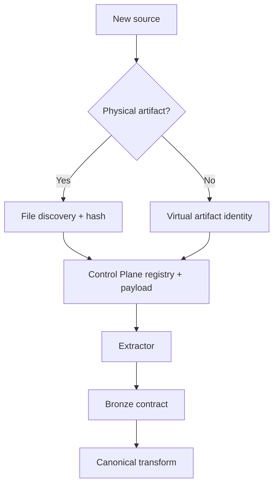
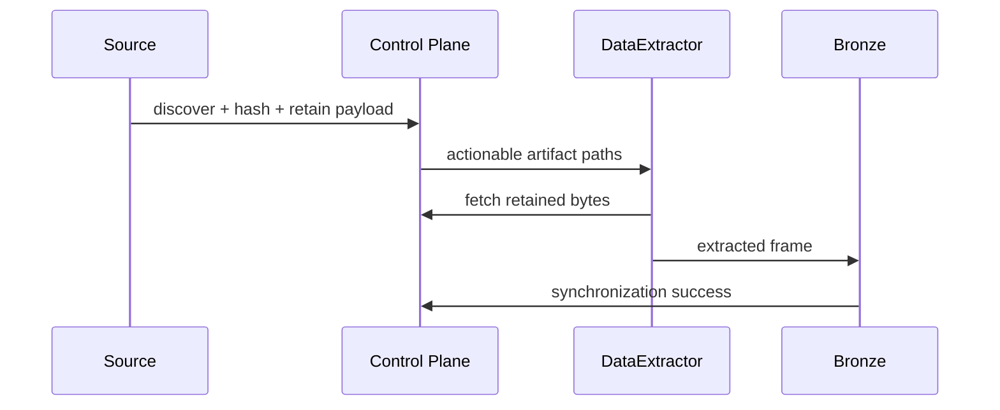
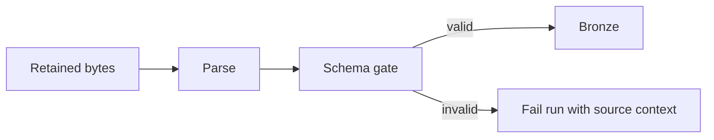
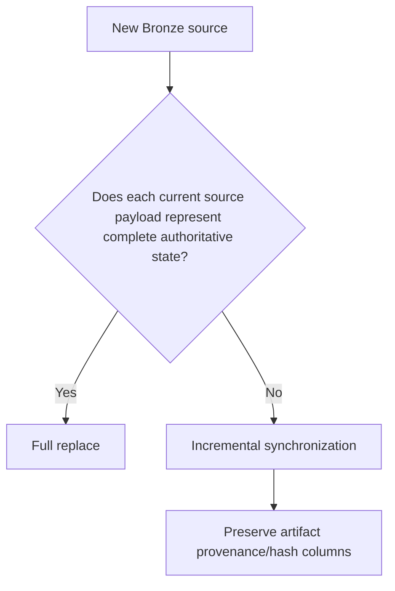
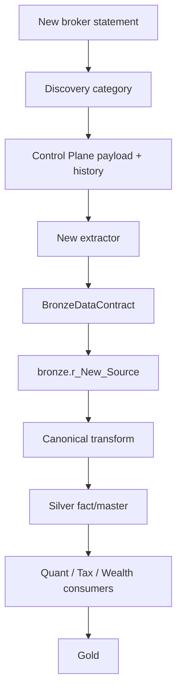
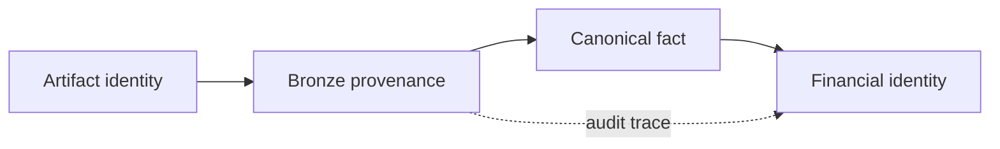

# Adding Data Sources

A new data source enters Personal Finance ETL through an operational evidence lifecycle before it becomes financial data. The safe extension path is therefore not "write an Excel reader." It is discovery -> Control Plane identity/payload -> extraction -> Bronze synchronization -> canonical transformation -> analytical consumers.

This guide describes that complete path.

## 1. Classify the source first

Decide whether the source is:

- a physical file discovered from configured paths;
- the household SQLite database;
- a configuration/reference CSV;
- provider/API evidence represented as a virtual artifact;
- a new market/transaction source requiring historical synchronization.

The category determines discovery, hashing, payload retention, and Bronze replacement semantics.



## 2. Discovery category is an operational contract

The Control Plane groups artifacts into synchronization categories such as `sqlite_source`, `mf_orders`, `stock_pl`, `currency_history`, or `us_stock_market`. A new source needs an unambiguous category before extraction.

The category connects:

```text
artifact discovery
    -> pending/actionable file set
    -> extraction dispatch
    -> Bronze sync category
    -> mark_synced lifecycle
```

Do not overload an existing category simply because the files share an extension.

## 3. File hashing and change detection

Physical sources participate in content-based change detection according to `Settings.FILE_HASH_POLICY`. The Control Plane owns artifact identity/history; downstream extractors should not invent their own "last modified" cache.

A file path is location, not identity. Rename handling and historical artifact continuity belong to the Control Plane.

See [Control Plane Artifact Lifecycle](../architecture/control-plane-artifact-lifecycle.md).

## 4. Evidence is persisted before extraction

`DataExtractor` reads bytes from the Raw Store rather than reopening arbitrary source paths:

```python
def _get_bytes(self, filepath: str) -> bytes:
    """Fetches bytes from Raw Store. Raises if missing."""
    raw_bytes = self.cp.artifacts.get_file_bytes(filepath)
    if raw_bytes is None:
        raise FileNotFoundError(
            f"Binary payload not found in Raw Store for: {filepath}"
        )
    return raw_bytes
```

This makes the operational sequence explicit:



A new physical source should preserve this boundary rather than bypassing retained evidence.

## 5. Implement extraction at the boundary

Source-specific parsing belongs under `backend/extract/` or a dedicated pipeline adapter. Extraction should decode representation, normalize obvious technical types, and attach provenance columns where the existing source family does so.

It should not decide:

- FIFO ownership;
- tax treatment;
- portfolio classification that belongs to FinancialRules/master data;
- Gold aggregation.

## 6. Extend the extraction result deliberately

The core `ExtractionResult` is the handoff from extraction into Bronze/core transformation. If the source is part of the primary extraction phase, add a clearly named attribute and update every construction/consumer site.

Empty/non-actionable streams should follow existing empty-frame semantics rather than introducing `None` into paths that expect frames.

## 7. Gatekeeper validation

The core extractor performs schema validation across active extraction streams. New streams should define appropriate schema expectations and participate in the quality gate when their shape is required for safe downstream processing.



Do not "fix" missing required columns by manufacturing null columns unless the source contract explicitly defines them as optional.

## 8. Register Bronze persistence

Bronze source contracts live in `BRONZE_CONTRACT_REGISTRY`:

```python
@dataclass
class BronzeDataContract:
    extraction_attribute: str
    sync_category: str
    physical_table: str
    is_full_replace: bool
```

A new Bronze source needs all four decisions.

| Field | Meaning |
|---|---|
| `extraction_attribute` | attribute produced by extraction |
| `sync_category` | Control Plane synchronization category |
| `physical_table` | DuckDB Bronze table |
| `is_full_replace` | replacement versus persistent incremental semantics |

## 9. Choose replacement semantics deliberately

**Full replace** fits small authoritative reference/config datasets where the current file represents the whole state.

**Incremental** fits accumulating evidence such as transaction/history files.



Choosing the wrong mode can either retain obsolete rows or erase historical evidence. This flag is tiny. Its consequences are not.

## 10. Dynamic Bronze schema behavior

Bronze tables are created from extracted frame schemas. They are not governed by the fixed Silver/Gold DDL catalogs.

This means source-schema changes require careful compatibility review even when DuckDB can physically accept the frame. A technically writable Bronze table can still break canonical transformations downstream.

## 11. Mark synchronization only after persistence

The source should become synchronized only after its Bronze write succeeds. Do not advance Control Plane state before durable analytical ingestion.

That ordering supports healing after cross-store divergence.

## 12. Complete Bronze reconstruction

After synchronization, transformations read complete Bronze state, not only the files changed in the current run. New source extensions must be available to this reconstruction path.

Incremental ingestion therefore does not imply incremental canonical finance.

## 13. Transform into canonical finance

Once source evidence is in Bronze, normalize it into existing canonical contracts where possible.

Examples:

- broker order -> canonical purchase/sale fact;
- market file -> canonical market observation;
- currency provider -> canonical Date-Currency FX observation;
- reference file -> canonical dimension/master.

If a new source needs a new canonical contract, follow [Adding Transformations](adding-transformations.md) and [Data Contract and Schema Evolution](data-contract-and-schema-evolution.md).

## 14. Preserve source versus financial semantics

Source columns can be messy. Canonical output should not preserve source ambiguity merely for convenience.

For example, a broker field called `Value` is not a sufficient canonical semantic name if it might mean proceeds, market value, cost basis, or local-currency amount depending on file type.

## 15. Provider/API sources and virtual artifacts

Provider data without a physical source file should still have operational identity if it participates in incremental evidence history. Use the Control Plane's virtual-artifact pattern rather than inventing an untracked in-memory source.

The same principles apply:

- stable artifact identity;
- content/version observation;
- synchronization state;
- event history;
- Bronze persistence.

## 16. Failure semantics

Decide explicitly what happens when:

| Condition | Typical response |
|---|---|
| payload missing from Raw Store | fail closed |
| required source column missing | fail schema gate |
| malformed optional row | source-specific reject/filter only if contract permits |
| provider returns no data | distinguish valid empty result from failed acquisition |
| stale market/FX observation | follow financial pipeline staleness rules |
| duplicate financial identity | fail or reconcile according to canonical contract |

Do not silently skip a source because the rest of the portfolio can still calculate. Partial financial truth is still partial.

## 17. Operational configuration

New physical locations or reference files may require `Settings` fields and `validate_config()` changes. New financial interpretation belongs in `FinancialRules`, not `Settings`.

If configuration changes, update snapshot/fingerprint implications and [Configuration Reference](../configuration/configuration-reference.md).

## 18. Downstream reconciliation

Before calling the source complete, verify:

- Bronze row counts and provenance;
- canonical row counts;
- deterministic IDs;
- quantity/value reconciliation;
- affected Quant outputs;
- affected tax evidence;
- affected Gold marts.

A source extension is an end-to-end change even if most downstream code requires no modification.

## 19. Example extension topology



Not every source requires every new box. Reuse existing canonical contracts whenever semantics genuinely match.

## 20. Source-extension checklist

- [ ] source authority and category defined;
- [ ] discovery/hashing behavior defined;
- [ ] payload retention path preserved;
- [ ] extractor implemented from retained bytes;
- [ ] extraction schema validated;
- [ ] `ExtractionResult` updated if required;
- [ ] Bronze contract registered;
- [ ] full-replace/incremental semantics justified;
- [ ] complete Bronze read path updated;
- [ ] canonical transformation defined;
- [ ] grain and identity verified;
- [ ] downstream reconciliation completed;
- [ ] failure behavior tested;
- [ ] configuration/docs updated.

## 21. Source provenance columns

Bronze evidence commonly carries technical provenance such as source filename/folder and artifact/hash context. Preserve provenance that is required for synchronization, audit, or later reconstruction, but avoid leaking technical source columns into canonical finance when they are no longer semantically required.



Operational provenance and financial identity are related but not interchangeable.

## 22. Duplicate and overlap strategy

New sources often overlap existing evidence. Decide whether overlap represents:

- duplicate copies of the same artifact;
- two brokers reporting the same economic event;
- historical snapshots with repeated holdings;
- complementary fields at different grains.

Do not deduplicate solely on amount/date when a deterministic transaction identity or stronger source key exists.

## 23. Historical-source backfills

A backfill may cause large portions of Bronze history to become newly available. Because Silver/Gold rebuild from complete Bronze state, downstream analytics will naturally reconstruct against the expanded history.

Validate that:

- deterministic IDs remain stable for unchanged facts;
- historical valuations do not use future observations;
- FIFO event order remains correct;
- tax-year attribution does not drift unexpectedly;
- Gold history changes only where new evidence justifies it.

## 24. Source replacement and retirement

Retiring a source adapter requires more than deleting its extractor. Review discovery categories, Bronze contracts, historical retained evidence, canonical consumers, configuration fields, and documentation.

Historical Control Plane events should remain interpretable even after a source family stops being actively discovered.

## 25. Security and privacy considerations

Treat source files as sensitive financial evidence. Adapters should:

- avoid temporary plaintext copies when bytes can be processed in memory;
- avoid verbose payload logging;
- validate archive/file paths if introducing compressed sources;
- keep credentials/tokens outside committed configuration;
- minimize retained provider secrets.

## 26. Source QA matrix

| Scenario | Expected evidence behavior | Expected analytical behavior |
|---|---|---|
| unchanged file | no new ingestion work | outputs unchanged |
| content changed, same path | artifact event + resync | affected analytics rebuild |
| rename, same content | identity continuity/migration | financial outputs unchanged |
| file removed | removal event | depends on retained/sync semantics |
| malformed required schema | fail before canonicalization | no partial publication |
| valid empty source | synchronized empty evidence | downstream contract-specific empty behavior |

## Related specifications

- [Control Plane Artifact Lifecycle](../architecture/control-plane-artifact-lifecycle.md)
- [Bronze Data Contracts](../reference/bronze-data-contracts.md)
- [Adding Transformations](adding-transformations.md)
- [Data Contract and Schema Evolution](data-contract-and-schema-evolution.md)
- [Testing and Validation](testing-and-validation.md)
