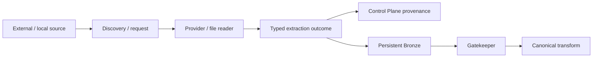
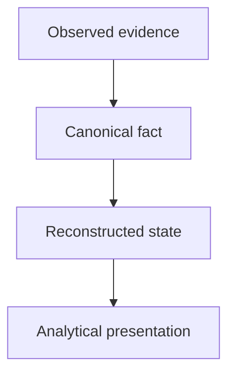
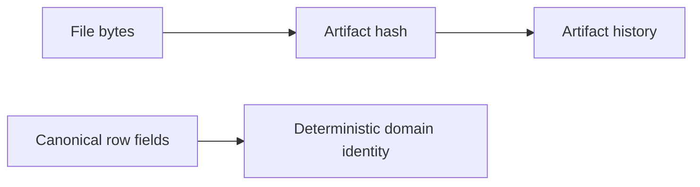
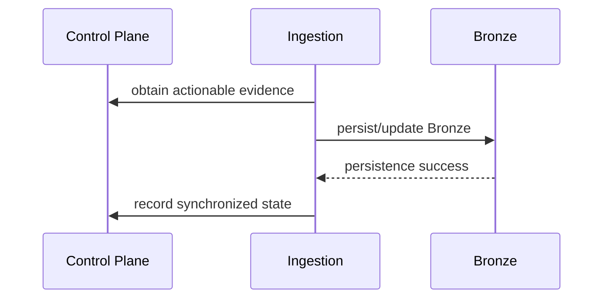
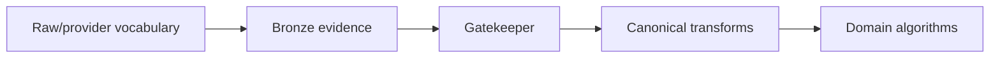

# Adding Data Sources

A new source is the first place the system can become wrong.

That sounds dramatic for a CSV reader, but it is the correct engineering posture.

Every downstream model depends on the evidence boundary answering three questions truthfully:

1. **What did I ask for?**
2. **What did I actually receive?**
3. **What evidence became durable enough to reconstruct later?**

If those answers are fuzzy, every later layer inherits uncertainty that looks suspiciously like normal data.

This guide follows a source from external evidence to persistent Bronze and then into canonical finance.



The important point is that a source is not considered integrated merely because a DataFrame exists.

## Begin by classifying the source

Before writing an extractor, decide what kind of evidence is being introduced.

### Local artifact

Examples:

- Excel broker exports;
- CSV masters;
- local SQLite transaction databases;
- downloaded statements.

These participate in artifact discovery, hashing, payload retention, rename/removal behavior, and Bronze synchronization.

### External provider

Examples:

- market prices;
- benchmark history;
- FX history.

These participate in request completeness, retries, entity-level status, provider provenance, and often virtual-artifact semantics.

### Configuration / master evidence

Examples:

- mapping files;
- macro parameters;
- currency mappings;
- opening balances.

These may be local artifacts but have stronger policy or reference semantics than ordinary transactional feeds.

The classification determines the lifecycle.

## A source extension begins with authority

Ask what the source is authoritative for.

A broker transaction export may be authoritative evidence of a purchase/sale record.

A market-data provider may be authoritative only for the values it returned for a requested interval, not for perfect global market history.

A reconstructed holding is not source evidence at all.

That distinction should survive the entire pipeline.



Do not design a source adapter that silently jumps from observed evidence to reconstructed financial truth.

## File sources enter through artifact discovery

Local artifacts are discovered and classified before extraction.

The Control Plane keeps historical artifact identity and payload state so the pipeline can determine whether a source is:

```text
new
changed
unchanged
renamed
removed
missing payload / requiring healing
```

That operational classification is separate from the file's financial content.

A transaction workbook can be unchanged operationally even if its financial rows contain an issue. Conversely, a file rename can be operationally meaningful without changing financial content.

## Hashing is evidence identity, not row identity

Artifact hashing answers whether bytes/content changed.

It does **not** replace deterministic row/event identity in canonical finance.



Do not reuse an artifact hash as a transaction ID merely because both are hashes.

They answer different questions.

## Retain evidence before interpreting it

The Control Plane raw store preserves source payload bytes for actionable local artifacts.

That design means extraction can operate from retained evidence rather than repeatedly trusting the live filesystem path.

The application ingestion coordinator fetches bytes through the Control Plane:

```python
# src/personal_finance_etl/application/ingestion/coordinator.py
def _get_bytes(self, filepath: str) -> bytes:
    """Fetch bytes from Raw Store. Raise FileNotFoundError if missing."""
    raw_bytes = self.cp.artifacts.get_file_bytes(filepath)
    if raw_bytes is None:
        raise FileNotFoundError(f"Binary payload not found in Raw Store for: {filepath}")
    return raw_bytes
```

That is an important development boundary.

A new local extractor should not quietly reopen arbitrary live paths if the pipeline contract says the retained payload is the evidence authority.

## Provider implementation belongs in infrastructure

Physical readers live under:

```text
infrastructure/providers/files/
```

External market providers live under:

```text
infrastructure/providers/market/
```

Provider code may know:

- file format details;
- HTTP/provider SDK behavior;
- retries;
- request intervals;
- raw payload quirks;
- provider error conditions.

Provider code should not own:

- canonical investment classification;
- FIFO;
- Tax treatment;
- Gold aggregation;
- run commit policy.

The provider adapts an external world. It does not become the finance engine.

## The extraction outcome is deliberately richer than a frame

For external/entity-based extraction, the contracts package defines categorical outcomes:

```python
# src/personal_finance_etl/contracts/extraction.py
class ExtractorEntityStatus(StrEnum):
    """Categorical status for single-entity extraction outcomes."""

    SUCCESS = "SUCCESS"
    CACHED = "CACHED"
    NO_NEW_DATA = "NO_NEW_DATA"
    PARTIAL = "PARTIAL"
    EMPTY_RESPONSE = "EMPTY_RESPONSE"
    FAILED = "FAILED"
    RETRY_EXHAUSTED = "RETRY_EXHAUSTED"
    INVALID_PAYLOAD = "INVALID_PAYLOAD"
```

That vocabulary prevents several dangerous states from collapsing into one empty DataFrame.

For a requested instrument:

```text
EMPTY_RESPONSE
```

is not equivalent to:

```text
RETRY_EXHAUSTED
```

The first may be valid evidence. The second is incomplete acquisition.

## Entity-level outcomes survive concurrency

`ExtractorEntityResult` retains context per requested entity:

```python
@dataclass
class ExtractorEntityResult:
    """Structured extraction outcome for a single entity returned by worker tasks."""

    entity: str
    status: ExtractorEntityStatus
    message: str
    df: pl.DataFrame = field(default_factory=lambda: pl.DataFrame())
    context: dict[str, object] = field(default_factory=lambda: dict[str, object]())
    attempt_count: int = 1
    requested_start: date | None = None
    requested_end: date | None = None
    failure_class: str | None = None
    final_error: str | None = None
```

That design matters when provider work runs concurrently.

Concurrency should improve throughput without erasing attribution.

If one of 147 requested entities fails, the system should be able to say which one, why, after how many attempts, and for which interval.

## Batch completeness is application policy

`ExtractionBatchResult` aggregates entity outcomes and exposes completeness:

```python
@property
def is_complete(self) -> bool:
    """Return True if every requested entity succeeded, was cached, or returned valid empty data."""
    return len(self.failed_entities) == 0
```

Application code can then enforce policy explicitly:

```python
def assert_complete(self, extractor_name: str = "Extractor") -> None:
    """Raise ExtractionCompletenessError if any required entity failed."""
    if not self.is_complete:
        interval = (
            (self.start_date, self.end_date) if self.start_date and self.end_date else None
        )
        raise ExtractionCompletenessError(
            f"{extractor_name} batch extraction failed completeness policy: "
            f"{len(self.failed_entities)} required entity/entities failed",
            failed_entities=self.failed_entities,
            requested_interval=interval,
            provider=self.provider,
        )
```

This is the right place for completeness semantics because application ingestion owns coordination between provider evidence and downstream pipeline continuation.

## Provenance is a first-class output

Entity outcomes can be normalized into structured Control Plane records:

```python
class ExtractionProviderRequest(TypedDict, total=False):
    """Normalized provider request audit log record for control plane."""

    provider: str
    entity: str
    requested_start: date | None
    requested_end: date | None
    attempt_count: int
    status: str
    failure_class: str | None
    final_error: str | None
```

This allows later operational analysis to answer:

```text
Which provider was called?
Which entity?
For what interval?
How many attempts?
What final state?
What failure classification?
```

That provenance is more useful than a generic "market sync failed" log line.

## Virtual artifacts connect external evidence to the artifact lifecycle

External provider results may not begin as physical files, but the application still needs a way to reason about their evidence/provenance lifecycle.

Virtual-artifact behavior exists to bridge that gap.

When extending a provider, review:

- how injected/virtual artifact identifiers are constructed;
- whether they participate in Bronze persistence;
- how synchronization is recorded;
- whether replay can reconstruct equivalent state from retained evidence.

Do not create a parallel evidence lifecycle simply because the source came over HTTP.

## File readers should normalize format, not finance

CSV/Excel/SQLite provider modules are responsible for physical extraction.

Typical responsibilities include:

```text
sheet/table selection
column access
physical parsing
lazy scan/read mechanics
raw naming adaptation where appropriate
```

They should not decide whether a cash movement is income, whether a sale is short-term Tax, or whether a holding mismatch requires reconciliation.

That interpretation belongs downstream.

## Source-specific vocabulary should stop at the boundary

A broker might call the same concept:

```text
Qty
Quantity
Units
No. of Shares
```

The canonical domain should not accumulate branches for every spelling.

Use source adaptation/mapping to normalize the physical vocabulary before domain transformations rely on it.

That is the anti-corruption boundary between vendor representation and financial meaning.

## Gatekeeper validation runs before financial interpretation

The ingestion coordinator owns gatekeeper schema validation and dry-run evaluation of actionable streams.

This protects downstream transforms from malformed required structure.

For a new source, define what must be true before canonical logic runs:

- required columns exist;
- required populated values can be parsed;
- dates/numerics satisfy expected forms;
- duplicate keys are handled intentionally;
- the lazy query can execute;
- source-specific invariants hold.

Do not use downstream financial defaults as a substitute for source validation.

## Invalid populated values should not silently become null

A common dangerous pipeline is:

```text
"not-a-number"
    -> cast(strict=False)
    -> null
    -> fill_null(0)
```

The result is operationally convenient and financially misleading.

If a field is required and populated, validate it before permissive coercion can erase the distinction between invalid and missing.

## Bronze is durable evidence-shaped analytical state

Persistent Bronze sits between retained operational evidence and rebuildable analytical state.

When adding a new Bronze-backed source, define:

- table/contract name;
- source provenance columns;
- replacement/upsert semantics;
- artifact/source key;
- dynamic vs fixed schema behavior;
- synchronization point;
- rebuild behavior.

Bronze should remain close enough to source evidence that later canonical transformations can be rerun without reacquiring everything externally.

## Register Bronze deliberately

A new persistent Bronze dataset should participate in the warehouse contract/registry model.

The registry should be able to answer:

```text
what dataset is expected?
what schema governs it?
who produces it?
what grain/source semantics apply?
```

Do not let an extractor create a durable table that exists only because one code path happens to write it.

## Replacement semantics are part of the source contract

Different sources have different update models.

### Snapshot-like source

A new artifact may replace the previous current snapshot.

### Append-like source

New evidence extends historical rows.

### Entity-range provider source

A requested interval may fill or replace a bounded range.

### Master/reference source

The latest file may define the current authoritative mapping set.

These semantics affect Bronze synchronization and replay.

They should be explicit.

## Dynamic Bronze schemas are still contracts

Some source-shaped Bronze datasets need to accommodate physical variation more flexibly than canonical Silver/Gold tables.

That flexibility does not mean "anything goes." Even when Bronze carries dynamic source columns, I still define the stable part of the contract:

```text
artifact/source identity
provenance columns
replacement/upsert semantics
required operational fields
how unknown/new source columns are retained
how downstream canonicalization selects what it understands
```

Dynamic source shape belongs at the evidence boundary. It should not leak downstream and force canonical finance to become dynamically typed forever.

If a vendor adds a new optional column, Bronze may preserve it without requiring an immediate domain change. If the new column changes financial meaning, the canonical contract evolves deliberately.

## Operational configuration belongs outside the provider implementation

A source may need configuration such as:

```text
folders / glob patterns
sheet or table names
provider request windows
retry limits / timeouts
market/provider selections
```

Put those values in validated settings/configuration surfaces rather than burying them as literals inside extraction functions.

Financial policy still belongs in financial rules/domain config. A provider timeout is not a FinancialRule; a Tax threshold is not provider configuration.

Keeping those classes separate makes source behavior reproducible without conflating operations with finance.

## Failure semantics must name the boundary that failed

A new source can fail at several distinct points:

```text
discovery
payload retention
physical parsing
provider request
completeness policy
Bronze persistence
Gatekeeper validation
canonical transformation
```

Those failures should not all collapse into "source failed."

Preserve enough context to identify whether evidence was unavailable, malformed, incomplete, or successfully acquired but rejected downstream.

This distinction matters operationally because recovery differs by boundary. A retry may fix a provider failure. It will not fix a malformed retained workbook. A rebuild may repair Bronze. It will not conjure missing source evidence.
## Mark synchronization only after persistence succeeds

Operational state should not claim Bronze is synchronized before the warehouse write that makes that claim true.

The sequence should conceptually be:



If Bronze persistence fails, operational history should not pretend convergence occurred.

This is one of the places where order is part of correctness.

## Rename detection should preserve evidence continuity

A local file can move or be renamed without changing its content.

If artifact lifecycle logic recognizes that continuity, a source extension should not bypass it by keying all semantics only to current path.

Path is useful provenance.

It is not always durable identity.

## Removal semantics need an answer

If a previously known source artifact disappears, decide what that means.

Questions include:

```text
Is the source intentionally retired?
Should its Bronze rows remain historically?
Should current snapshot state be replaced?
Does removal trigger a rebuild?
Is the retained payload still sufficient for replay?
```

The correct answer depends on source semantics.

Do not make deletion behavior accidental.

## Complete Bronze reconstruction is a design test

A useful source-extension test is:

> If the analytical warehouse disappeared but the retained operational evidence remained, could the current code rebuild the intended Bronze state?

If the answer is no because the source requires hidden local state that was never retained or represented, the ingestion design is incomplete.

## Canonical finance starts after the evidence boundary

Once evidence is validated and persisted, canonical domain transformations take over.

That transition should be visible:



The source adapter should not precompute domain outputs merely because it already has the columns available.

## Preserve observed versus reconstructed semantics

A source can contain observed holdings or balances.

The investment engine can independently reconstruct holdings from transaction history.

Those are different authorities.

The correct model is not:

```text
observed value overwrites reconstruction
```

It is:

```text
observed evidence
    compared with
reconstructed state
    -> reconciliation event / adjustment semantics where needed
```

A new source that introduces observed state should integrate with reconciliation rather than silently replacing the model.

## Source provenance columns deserve stable meaning

Useful provenance often includes:

```text
source artifact/path
source row or source-specific locator
load/extraction context
run context
provider context
```

Do not strip provenance too early just because Gold does not display it.

Canonical/reconciliation layers may need it to explain why a result exists.

## Duplicate and overlap strategy must be explicit

New sources often overlap existing evidence.

Examples:

- two broker exports cover overlapping dates;
- API data overlaps cached history;
- renamed files contain identical payloads;
- a manual correction source overlaps original transactions.

Decide whether duplicates are identified by:

```text
artifact identity
canonical row identity
provider entity/date key
business key
```

Then test it.

"drop_duplicates" without a defined authority/key is not a deduplication strategy.

## Historical backfills are not ordinary incremental loads

A new source may introduce historical evidence older than the current analytical window.

Review:

- whether provider request ranges need expansion;
- whether deterministic IDs remain stable;
- whether FIFO/history must be replayed from an earlier date;
- whether Gold snapshots recompute;
- whether Tax periods change;
- whether benchmark/FX history is complete for the backfill.

Historical evidence can change current state legitimately.

## Source retirement needs a migration story

If a source is replaced permanently:

1. identify the successor authority;
2. decide whether historical evidence remains retained;
3. remove discovery/provider wiring only after consumers move;
4. update Bronze/registry contracts where appropriate;
5. validate rebuild from the new source model;
6. document the retirement in historical/release surfaces if relevant.

Do not leave zombie adapters indefinitely because deleting them feels scary.

## Secrets and privacy stay at the edge

Source integrations may involve credentials or sensitive payloads.

Rules:

- secrets come from environment/controlled secret input;
- secrets are not logged;
- source evidence remains local unless the provider interaction requires outbound requests;
- test fixtures should not contain real personal financial data;
- diagnostics should avoid dumping raw sensitive payloads unnecessarily.

## Source QA matrix

A useful source integration test matrix is:

| Scenario | Expected behavior |
|---|---|
| valid complete source | evidence accepted and persisted |
| valid empty response | explicit empty/no-new-data state where allowed |
| one required entity fails | batch incomplete; failure attributed |
| retry exhaustion | explicit failure status; no fake completeness |
| malformed populated value | validation failure before financial defaults |
| duplicate/overlapping evidence | deterministic dedupe/identity behavior |
| renamed identical file | artifact continuity preserved where supported |
| missing retained payload | explicit failure/healing path |
| historical backfill | deterministic rebuild with reviewed downstream impact |

## The source-extension checklist

Before I call a source integrated:

- [ ] I classified the source authority.
- [ ] Concrete acquisition lives in infrastructure.
- [ ] Application owns completeness policy.
- [ ] Entity/request outcomes are structured where appropriate.
- [ ] Provider provenance reaches operational history.
- [ ] Local payload retention/replay behavior is defined.
- [ ] Artifact hash and canonical row identity are not conflated.
- [ ] Bronze semantics and replacement behavior are explicit.
- [ ] Gatekeeper validation protects required structure/values.
- [ ] Source-specific vocabulary stops before canonical finance.
- [ ] Observed and reconstructed state remain distinct.
- [ ] Duplicate/overlap/backfill behavior is tested.
- [ ] Security/privacy behavior is acceptable.
- [ ] Canonical docs/reference contracts are updated if the data model changed.

Once a source is safely inside the evidence boundary, the next developer problem appears immediately:

> **How do I turn that evidence into new canonical meaning without changing grain, identity, or financial semantics accidentally?**

That is the subject of [Adding Transformations](adding-transformations.md).

## Related specifications

- [Data Lifecycle](../architecture/data-lifecycle.md)
- [Control Plane and Artifact Lifecycle](../architecture/control-plane-artifact-lifecycle.md)
- [Deterministic Identity and Replay](../architecture/deterministic-identity-and-replay.md)
- [Adding Transformations](adding-transformations.md)
- [Data Contract and Schema Evolution](data-contract-and-schema-evolution.md)
