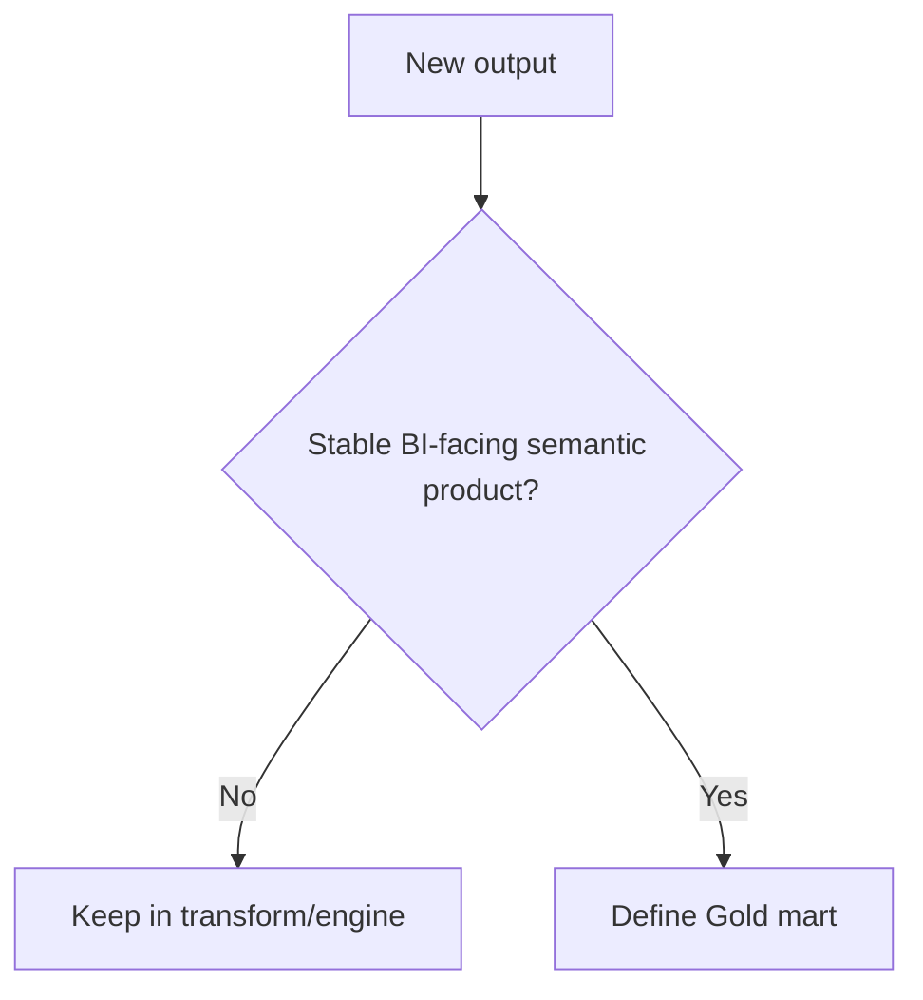
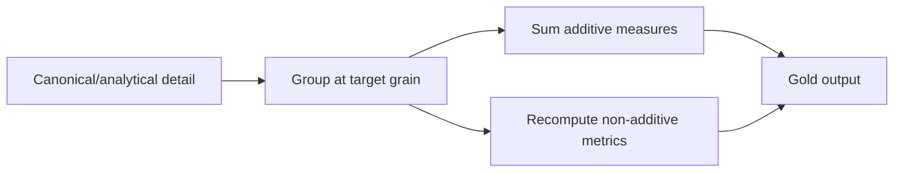
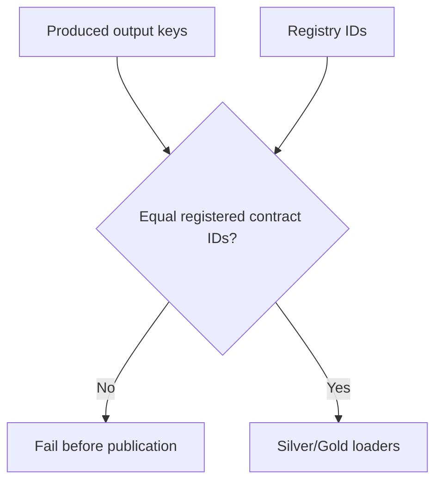
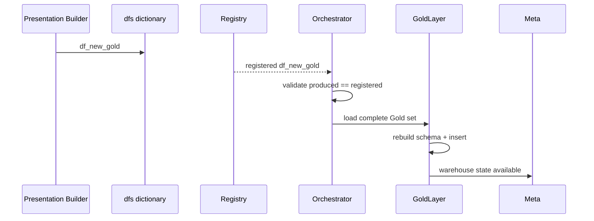

# Adding Gold Marts

Gold is the presentation contract between the analytical system and BI/report consumers. A new Gold mart should therefore answer a real analytical question at a deliberate grain. It should not exist merely because another dataframe can be produced.

Gold is rebuilt on every analytical publication and is governed by fixed DDL plus `DATA_CONTRACT_REGISTRY`.

## 1. Decide whether Gold is necessary

Add Gold when the output:

- represents a stable BI-facing analytical product;
- has a clear consumer and grain;
- benefits from precomputed semantics/performance;
- should be contract-governed and discoverable in Meta.

Do not add Gold merely to expose an intermediate calculation that belongs in Silver or an engine.



## 2. Write the grain first

Examples in the current Gold layer include month-level wealth/cashflow and investment aggregation by ISIN, subtype, class, geography, country, currency, portfolio, sector, or industry.

Define uniqueness and additive behavior before writing the builder.

## 3. Choose the producer

Gold output may come from:

- `WealthPresentationEngine` builders;
- investment post-processing/aggregation;
- `TaxGoldFormatter`;
- another explicit presentation owner.

Do not put domain reconstruction in `GoldLayer`. The loader publishes already-produced frames; it is not the financial calculation engine.

## 4. Build at target grain

Aggregate source facts/analytics to the intended Gold grain and preserve dimensions required by consumers.

For non-additive metrics, recompute rather than average.



## 5. Register the contract

Add a `DataContract` entry with:

```python
DataContract(
    contract_id="df_example",
    layer="gold",
    physical_table="gold.Example",
    domain="...",
    grain="...",
    producer="...",
    publication_order=..., 
)
```

The exact `contract_id` must be the key produced into the pipeline dataframe dictionary.

## 6. Add physical DDL

Gold has fixed physical DDL in `backend/load/schema/gold.py`. Add the table there with column names/types matching the produced frame.

The registry does not replace DDL. DDL does not replace the registry. They are separate contracts with different jobs.

## 7. Publication invariant

Before loading, the orchestrator rejects both:

- unregistered produced analytical outputs;
- registered outputs that were not produced.



This is why a new mart must update producer and registry in the same coherent change.

## 8. Publication order

Gold contracts are sorted by `publication_order`. Choose an order that remains deterministic and understandable. The current loader rebuilds the Gold schema, executes DDL, then loads registered Gold frames in order.

## 9. Schema replacement semantics

Gold is not incrementally patched. The loader drops/recreates the Gold schema and publishes the complete registered set.

Consequences:

- removed contracts disappear cleanly after registry/DDL removal;
- stale rows from previous runs do not survive;
- every run must produce every registered Gold output;
- performance cost is accepted for correctness simplicity.

## 10. Column semantics

For every output field, define:

- financial meaning;
- unit/currency;
- date basis;
- additive behavior;
- null behavior;
- whether value is observed, reconstructed, estimated, or simulated.

A column called `Return` without these details is not a metric contract. It is a future meeting invitation.

## 11. Tax Gold marts

Tax Gold is evidence-oriented. Do not introduce a new tax mart that implies statutory liability unless the Tax Engine actually implements that legal computation.

Preserve the distinction between indicative estimates and statutory outcomes.

## 12. Investment Gold marts

Investment Gold aggregations consume canonical Quant analytics. They should not rerun FIFO or create alternative realized-gain logic.

When grouping:

- sum additive values;
- recompute weighted/ratio metrics appropriately;
- recompute money-weighted returns from cashflows where required;
- preserve local/INR semantics.

## 13. Wealth/FIRE Gold marts

For stochastic metrics, document percentile direction. "Conservative P90" for time-to-FI and downside wealth percentiles do not share an intuitive "higher is better" rule.

Also distinguish internal model diagnostics from fields actually published by the Gold contract.

## 14. Meta integration

Meta derives contract metadata and row counts from the registry/current warehouse. A properly registered Gold mart becomes visible to operational inspection without a separate ad-hoc catalog.

## 15. BI compatibility

Before publication, consider:

- stable table/column names;
- expected data types;
- date keys;
- currency semantics;
- relationship keys;
- whether existing Power BI measures assume the old shape.

A schema change can be correct in Python and still break the reporting model five seconds later.

## 16. Validation

At minimum validate:

### Structural

- output key equals contract ID;
- produced columns match DDL;
- expected grain is unique;
- required columns are non-null where contract requires.

### Financial

- aggregates reconcile to authoritative lower-grain facts;
- no double counting after joins;
- ratios use correct denominator;
- local/INR values are not mixed;
- tax/forecast values retain their evidence/estimate semantics.

## 17. Example end-to-end path



## 18. Removing or renaming a Gold mart

Treat removal/rename as a contract change. Update:

- producer output;
- registry;
- DDL;
- Meta/reference documentation;
- BI/report consumers;
- docs links.

Because Gold is rebuilt, old physical tables do not linger once the schema contract is removed. External consumers can still break, of course. DuckDB cannot update a Power BI model through sheer optimism.

## 19. Gold-mart checklist

- [ ] stable analytical question exists;
- [ ] grain and uniqueness defined;
- [ ] semantic owner selected;
- [ ] builder produces registered key;
- [ ] DDL added/updated;
- [ ] registry contract added/updated;
- [ ] publication order chosen;
- [ ] additive/non-additive metrics handled correctly;
- [ ] financial reconciliation passes;
- [ ] BI compatibility reviewed;
- [ ] Reference docs updated;
- [ ] end-to-end run succeeds.

## 20. Gold naming conventions

Use stable business-facing names that reflect the analytical grain and subject. Avoid names tied to temporary implementation details or a specific dashboard visual.

The table is a contract that may outlive today's report page.

## 21. Dimensional relationships

A Gold mart may intentionally denormalize descriptive attributes for BI convenience, but relationship keys should remain consistent with canonical dimensions. Review whether a new mart should expose IDs, labels, or both.

Avoid creating a second incompatible geography/currency/category vocabulary in Gold.

## 22. Snapshot versus flow measures

Gold design must distinguish stock/snapshot measures from flows.

- market value and net worth are point-in-time state;
- income/expense are period flows;
- realized gains are events/flows;
- FI probability is a model result for an as-of context.

Summing snapshot values across months usually produces nonsense with excellent formatting.

## 23. Historical semantics

If a Gold table exposes historical values, specify whether rows represent:

- contemporaneous historical reconstruction;
- latest-known restatement of history;
- monthly closing state;
- event-date state.

This is especially important for reconstructed market holdings and revised source evidence.

## 24. Consumer-safe deprecation

When replacing a mart, prefer an explicit transition plan for external consumers. Since Gold rebuild removes retired tables cleanly, a consumer that was not updated will fail immediately rather than quietly reading stale data. That failure is annoying and healthier than stale success.

## 25. Gold QA matrix

| Mart type | Core reconciliation |
|---|---|
| cashflow | components reconcile to canonical income/expense/transfer logic |
| wealth | asset/liability components reconcile to net worth |
| investment | grouped values reconcile to Quant detail |
| tax | aggregates reconcile to `f_Tax_Events` |
| FIRE | published fields match simulation/deterministic outputs and as-of context |

## 26. Documentation contract

Every Gold mart should be discoverable in [Gold Data Contracts](../reference/gold-data-contracts.md). If its financial metric is non-obvious, define the formula/semantics in Finance rather than bloating the physical contract page with algorithm narrative.

## Related specifications

- [Gold Data Contracts](../reference/gold-data-contracts.md)
- [Metrics and Methodology](../finance/metrics-and-methodology.md)
- [Data Contract and Schema Evolution](data-contract-and-schema-evolution.md)
- [Adding Transformations](adding-transformations.md)
- [Testing and Validation](testing-and-validation.md)
