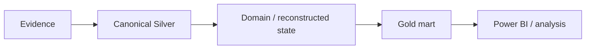
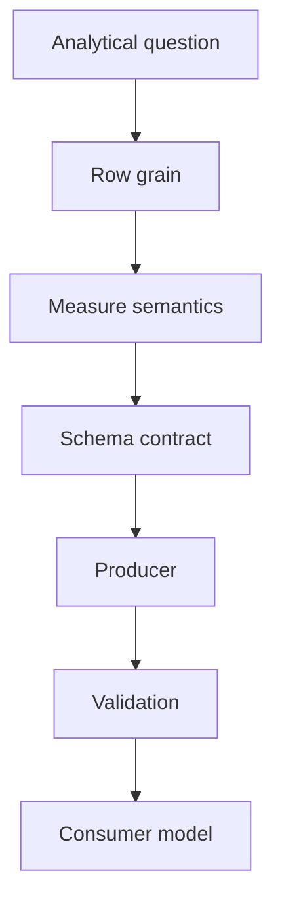
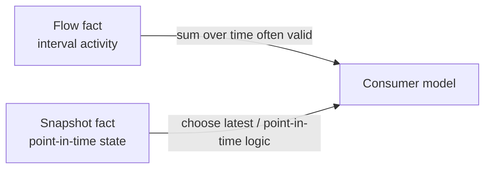
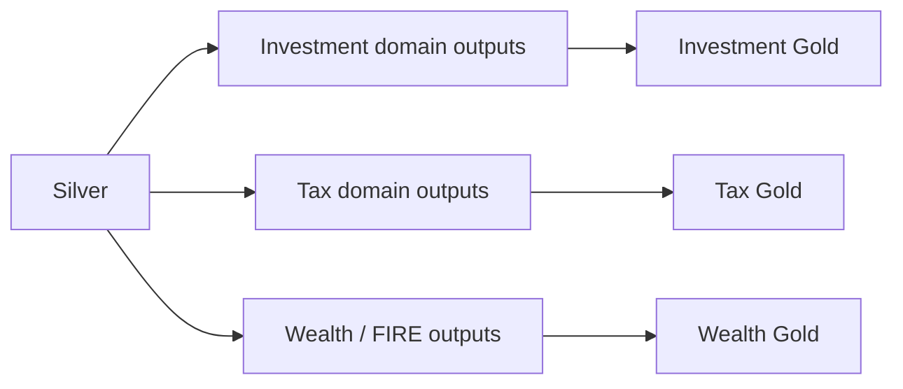

# Adding Gold Marts

Gold is where the application stops asking "what is true?" and starts asking "what decision do I want to make from that truth?"

That distinction is the whole design.

Silver and domain engines own canonical/reconstructed financial meaning. Gold reshapes that meaning for analysis, BI, and decision workflows.

A new Gold mart is therefore not permission to recompute finance in a more convenient table.

> **Gold may aggregate, project, label, and present canonical state. It should not quietly become the second implementation of FIFO, Tax, reconciliation, or performance methodology.**



This guide follows a mart from analytical question to grain, registry, publication, validation, and eventual consumer behavior.

## Start with the decision, not the table name

A Gold mart should answer a stable analytical question.

Examples:

```text
How has household net worth changed over time?
What realized investment activity occurred in each period?
What is current portfolio exposure by asset / geography / currency?
What Tax-relevant evidence is summarized by category and year?
How does actual progress compare with FI planning state?
```

If the mart cannot state its question, it may be an intermediate dataset wearing a blazer.

## Decide whether Gold is necessary

Not every useful view deserves a persistent contract.

Create a Gold mart when the output has durable analytical value:

- multiple consumers need it;
- BI needs a stable grain/shape;
- the aggregation is expensive enough to centralize;
- semantics deserve a named contract;
- the dataset is part of the intended product surface.

Do not create a Gold table for every one-off debugging query.

## Write the grain before the builder

The first specification is:

> One row represents ...

Examples:

```text
one household x month
one instrument x valuation date
one realized event
one Tax year x income category
one portfolio snapshot x asset class
```

Then define:

- key/identity fields;
- temporal field;
- currency semantics;
- additive measures;
- non-additive measures;
- nullable/validity fields;
- upstream authority.



Gold design should not begin with `group_by()`.

## Choose the producer based on meaning

A Gold builder should consume financial meaning produced elsewhere.

If the Gold mart needs a calculation that does not exist upstream, ask:

> Is this merely presentation/aggregation, or have I discovered missing domain logic?

### Presentation/aggregation

Keep it in Gold.

### New financial methodology

Implement it in the owning domain/application first, then publish the result.

This prevents BI-facing needs from redefining finance accidentally.

## Build at target grain

A good Gold builder should make its grain visible in code.

If the mart is one row per instrument x date, grouping/joining logic should preserve that key.

If the mart is one row per month, source snapshot rows should be deliberately collapsed to month grain.

After the builder runs, validate the key/grain instead of assuming the aggregation did what the code looked like it did.

## Measures need additivity classes

This is one of the most important Gold decisions.

### Additive

Safe to sum across intended dimensions.

Examples may include:

```text
realized proceeds
realized cost basis
cash inflow/outflow amounts
```

### Semi-additive

Can aggregate across some dimensions but not time.

Point-in-time balances often fall here.

### Non-additive

Should not be summed.

Examples:

```text
XIRR
CAGR
ratios
percentages
unit prices
many point-in-time rates
```

A Power BI model can technically sum almost anything.

That is a capability, not an endorsement. 😂

Gold documentation/reference contracts should make measure behavior explicit enough that downstream modeling does not invent nonsense.

## Currency semantics stay visible

A Gold mart involving multi-currency finance should not publish one ambiguous `value` column when several meanings coexist.

Distinguish, where relevant:

```text
local / transaction currency value
INR / base value
FX rate
FX attribution
currency code
```

If a mart intentionally publishes only base currency, state that explicitly.

## Snapshot and flow facts behave differently

A Gold model should distinguish:

### Flow facts

Occur over an interval.

Examples:

- income;
- expense;
- purchases;
- sales;
- realized events.

These often aggregate over time.

### Snapshot facts

Describe state at a point in time.

Examples:

- holdings;
- asset value;
- net worth;
- portfolio exposure.

Summing snapshots across dates usually double-counts state.



Gold mart design should encode this difference in grain and naming.

## Historical semantics must be intentional

A historical Gold mart can represent different things:

```text
state as observed at the time
state reconstructed today for a historical date
state restated under current rules
```

Those are not interchangeable.

For example, a historical portfolio reconstruction may use current code to rebuild past holdings from canonical transaction evidence.

That should not be described as a historical broker-certified snapshot unless the source actually provided one.

## Register the contract

Persistent analytical datasets belong in the Data Contract Registry.

The registry connects the logical dataset to its expected contract.

When adding a Gold mart, I review:

- contract name;
- physical table name;
- schema definition;
- producer;
- grain;
- identity/key semantics;
- publication expectations;
- downstream references.

The registry is part of the architecture, not an optional catalog.

The current registry model makes the mart contract explicit rather than inferring it from SQL:

```python
# src/personal_finance_etl/infrastructure/warehouse/registry.py
@dataclass
class DataContract:
    """Publication contract for analytical Silver and Gold warehouse datasets."""

    contract_id: str
    layer: str
    physical_table: str
    domain: str
    grain: str
    producer: str
    publication_order: int
```

Those fields are deceptively powerful: a Gold dataset must be named, placed in a layer, tied to a physical table, assigned to a domain/producer, given a grain, and ordered for publication. The registry therefore captures both shape *and ownership context*.
## Add physical DDL/schema definition

Gold physical schemas are declared in the warehouse schema catalog.

The contract should define:

```text
column order
DuckDB types
nullable behavior where relevant
table name
keys / expected grain metadata where modeled
```

A builder that emits extra/missing columns should fail validation rather than silently drifting from the declared schema.

## Registry, schema, and producer must agree

A complete Gold addition requires alignment:


Useful invariants include:

```text
registered Gold set == expected Gold contract set
produced Gold set == registered Gold set
builder output columns == physical schema columns
```

The exact checks belong to implementation/tests, but the development intent is that no layer quietly invents tables on its own.

## Publication order follows dependencies

Gold builders can depend on canonical/domain outputs and, in some cases, on other already-defined analytical state.

Publication order should reflect dependency rather than filename order.

A downstream mart should not publish before its upstream state is valid.



If one Gold mart truly depends on another, document that relationship explicitly rather than relying on incidental builder ordering.

## Gold publication is a warehouse operation

The warehouse owns physical persistence mechanics.

Gold builders should not open their own side-channel DuckDB connections or manually commit outside the publication lifecycle.

Centralized publication preserves:

- schema validation;
- transaction boundaries;
- run context;
- failure semantics;
- consistent table replacement behavior.

## Schema replacement semantics matter

For rebuilt analytical layers, Gold publication generally represents current computed analytical state rather than incremental event history.

That means schema/table replacement should be consistent with the warehouse rebuild model.

If a new mart requires incremental persistence semantics instead, that is a larger architectural decision and should not be smuggled in through one builder.

## Gold should not duplicate canonical IDs casually

A Gold mart can carry upstream IDs for traceability.

If it creates a new identity at a different grain, define why.

Examples:

```text
canonical transaction_id carried through
realized_event_id carried through
snapshot key derived from entity x valuation_date
```

Do not invent a new ID if an upstream canonical identity already represents the same grain.

## Tax Gold is presentation of Tax authority

Tax Gold should consume outputs from the Tax domain/application workflow.

It should not independently decide:

- capital-gain classification;
- exemptions;
- Tax rates;
- residual income treatment;
- credits.

Gold can summarize those outputs by year/category for analysis.

The Tax methodology remains owned upstream.

## Investment Gold is presentation of reconstructed investment state

Investment Gold may expose:

- holdings;
- valuations;
- realized events;
- performance;
- benchmark comparison;
- FX attribution;
- exposures.

The underlying reconstruction/measurement should come from investment domain/application outputs.

A Gold builder should not re-run FIFO in SQL because the lot book was inconvenient to join.

## Wealth and FIRE Gold require special validity care

Wealth is generally deterministic analytical state derived from known inputs.

FIRE may include deterministic planning metrics and stochastic simulation outputs.

Do not collapse those into one undifferentiated "forecast" mart.

Simulation provenance, scenario inputs, confidence/probability semantics, and deterministic metrics may need different grains and consumer treatment.

## Meta is context, not business presentation

DuckDB Meta contains current analytical/run context.

Do not use Meta as a dumping ground for Gold mart helper values that do not fit the business schema.

If a value is business/analytical state, model it in the appropriate domain/Gold contract.

If it is operational current context, Meta may be appropriate.

## BI compatibility is part of the contract

A Gold mart exists partly because downstream analytical tools need stable contracts.

Review:

- column names;
- types;
- date/time representation;
- relationship keys;
- snapshot vs flow behavior;
- currency semantics;
- measure additivity;
- null/validity semantics.

Power BI should not need to reverse-engineer domain assumptions from column values.

## Consumer-safe deprecation is deliberate

Renaming/removing a Gold mart or column can break external BI even when Python tests pass.

Before deprecation:

1. identify consumers;
2. decide whether alias/transition period is justified;
3. update schema/registry/builders together;
4. update BI/documentation expectations;
5. validate refresh/rebuild;
6. remove the old contract deliberately.

Avoid permanent aliases unless compatibility really requires them.

## Naming conventions should reveal grain and meaning

Gold names should describe the analytical concept, not the implementation step that created it.

Prefer names that communicate business meaning and stable dataset identity.

Avoid names whose main information is processing history such as:

```text
final_summary_v2
agg_step_7
new_dashboard_table
```

Column names should also distinguish value semantics where ambiguity is possible: local/base currency, realized/unrealized, amount/rate, snapshot/flow.

A good Gold name reduces the amount of BI-side archaeology required later.

## Dimensional relationships are part of the mart design

A Gold table rarely exists alone. Review how it relates to dimensions and other facts.

For each relationship, state:

```text
key
cardinality
temporal behavior
whether the dimension is current or historically varying
```

A many-to-many relationship should be intentional and usually deserves a bridge/explicit model rather than accidental duplicate rows.

Power BI relationship design is downstream, but the Gold grain/key should make the intended model possible without hidden transformations.

## Documentation is part of the Gold contract

A new Gold mart updates the reference contract with exact physical schema/grain and updates methodology docs only when it introduces a new analytical concept.

Do not duplicate full physical schemas inside every narrative page. Reference docs specify exact tables; finance docs explain meaning; this guide explains how to add them.
## Structural validation

A new Gold mart should validate:

- exact columns/types;
- grain/key uniqueness where required;
- registry presence;
- publication completeness;
- row count sanity where meaningful;
- required non-null fields.

## Financial validation

Structural correctness is not enough.

Depending on the mart, validate relationships such as:

```text
realized proceeds - cost basis == realized gain/loss
net worth == assets - liabilities
allocation percentages sum to expected total within tolerance
snapshot value reconciles to upstream canonical state
```

Use domain-appropriate tolerances where floating-point/numerical behavior requires them.

## A worked mart: portfolio exposure

Suppose I want a Gold mart for current exposure by asset class and currency.

### 1. Analytical question

What proportion of current portfolio value is exposed to each asset class and currency?

### 2. Upstream authority

Use canonical/reconstructed holdings and current valuation outputs.

Do not reread broker files.

### 3. Grain

One row per:

```text
valuation_date x asset_class x currency
```

### 4. Measures

```text
market_value_inr      additive across groups for same date
allocation_pct        non-additive
```

### 5. Builder

Aggregate upstream holdings to target grain.

### 6. Schema/registry

Declare columns/types and register the contract.

### 7. Validation

For each date:

```text
sum(market_value_inr) == upstream portfolio value
sum(allocation_pct) ~= 1.0
```

### 8. BI semantics

Use date as snapshot filter; do not sum allocation across dates.

That is a complete Gold design. The SQL/Polars aggregation is maybe ten percent of the work.

## Gold QA matrix

| Scenario | What to prove |
|---|---|
| normal publication | builder output matches schema/registry |
| empty upstream state | explicit empty/failure semantics |
| duplicate target key | grain validation fails |
| non-additive metric | contract/docs prevent misleading aggregation |
| currency conversion | base/local semantics remain correct |
| upstream schema change | builder fails visibly until updated |
| BI refresh | stable types/keys/relationships |
| full rebuild | deterministic analytical result for deterministic inputs |

## Gold completion checklist

- [ ] The mart answers a stable analytical question.
- [ ] The target grain is explicit.
- [ ] Upstream financial authority is identified.
- [ ] Gold does not re-own domain methodology.
- [ ] Additive/semi-additive/non-additive measures are classified.
- [ ] Currency and temporal semantics are explicit.
- [ ] Schema catalog is updated.
- [ ] Registry is updated.
- [ ] Producer/publication order is updated.
- [ ] Structural and financial validation exists.
- [ ] BI consumer behavior is reviewed.
- [ ] Deprecation/compatibility impact is understood.
- [ ] Reference documentation is updated.

At this point the extension story has moved from evidence, to meaning, to analytical publication.

The next developer problem is what happens when any of those steps changes a durable shape.

> **How do I evolve a contract without breaking grain, identity, replay, or consumers?**

That is the subject of [Data Contract and Schema Evolution](data-contract-and-schema-evolution.md).

## Related specifications

- [Warehouse Architecture](../architecture/warehouse-architecture.md)
- [Data Model](../architecture/data-model.md)
- [Adding Transformations](adding-transformations.md)
- [Data Contract and Schema Evolution](data-contract-and-schema-evolution.md)
- [Gold Data Contracts](../reference/gold-data-contracts.md)
