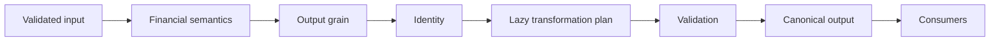
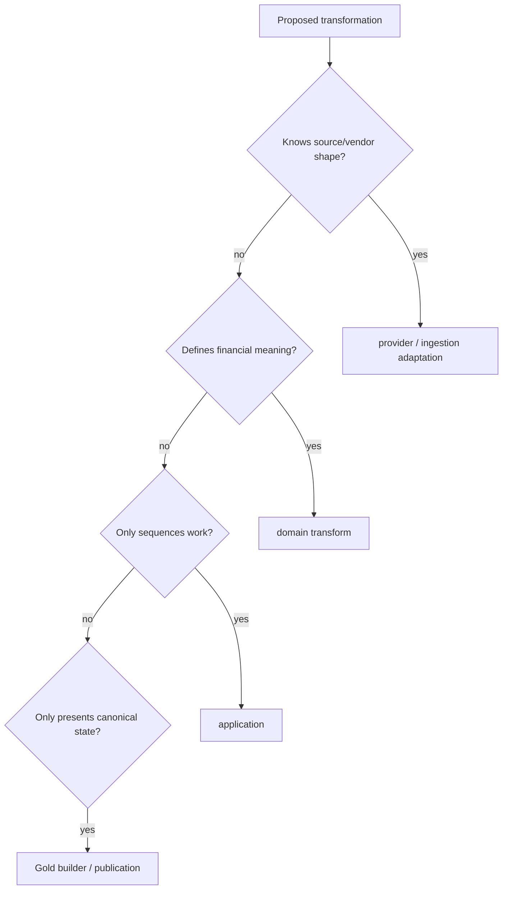
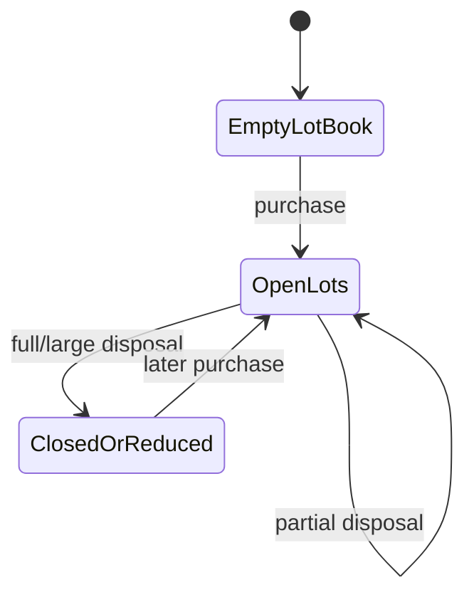
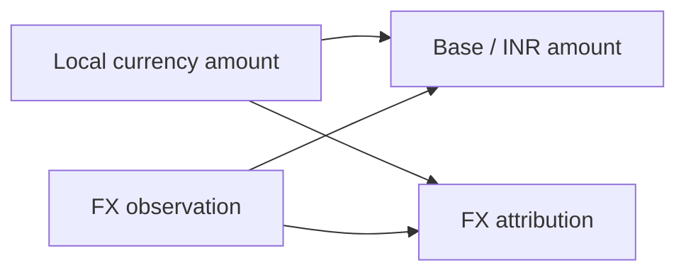
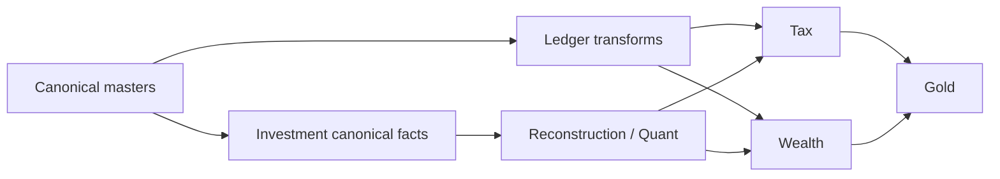
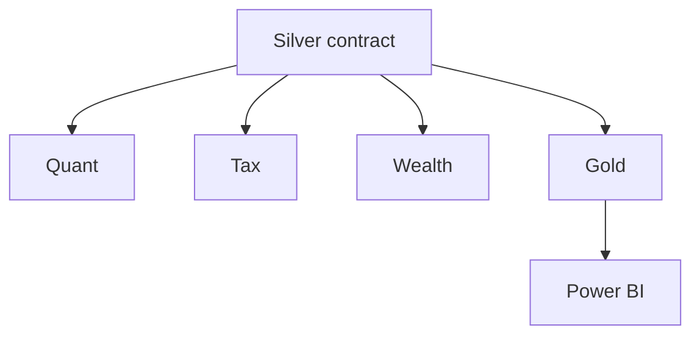

# Adding Transformations

A transformation is the first place evidence becomes *meaning*.

That makes this layer deceptively dangerous.

Renaming a source column is easy. Deciding that a cash movement is income rather than transfer is not. Joining market data to holdings is easy. Preserving the intended row grain after that join is not. Casting a string to a number is easy. Proving that an invalid populated value did not silently become zero is not.

This guide follows a new transformation from source authority to canonical output, then into publication and downstream consumption.

> **The governing rule is simple: a transformation may change representation freely, but it may change financial meaning only when the owning domain explicitly says so.**



The order matters. I want to know what the result *means* before I write expressions that happen to produce it.

## First decide whether this is actually a domain transformation

Not every dataframe operation belongs in the financial domain.

Ask what the operation knows.

### Source adaptation

If it knows vendor column names, sheet layout, transport details, or raw provider quirks, it belongs near the provider/source boundary.

### Canonical financial transformation

If it decides:

- transaction type;
- financial classification;
- sign semantics;
- currency meaning;
- canonical date/value interpretation;
- asset/liability/income/expense semantics;

then it belongs in the relevant domain transformation package.

### Workflow sequencing

If it only decides *when* transformations run or which outputs feed the next phase, that belongs in `application/`.

### Analytical shaping

If the financial meaning is already canonical and the job is to shape a BI-facing dataset, that belongs in the Gold publication path.



This classification prevents a common failure mode: every Polars expression ending up in the same `transforms.py` file regardless of meaning.

## Input authority comes before input schema

A transform should identify which input is authoritative for each fact it consumes.

Suppose I need:

```text
transaction quantity
instrument currency
valuation price
observed holding
```

Those may come from four different authorities.

The transformation must not accidentally prefer whichever table has the most convenient column.

A good input contract says:

```text
quantity       <- canonical transaction evidence
currency       <- instrument/currency master
valuation      <- market observation
observed qty   <- broker holding evidence
```

That makes later reconciliation possible.

## Write the output grain before code

Before adding a transformation, I state one sentence:

> One output row represents ...

That sentence governs nearly every later design choice.

For example:

```text
one canonical transaction
one instrument x date valuation
one disposal event
one disposal x acquisition-lot consumption
one household ledger posting
```

The grain determines:

- uniqueness;
- deterministic identity;
- valid joins;
- aggregation semantics;
- downstream BI relationships;
- whether the output is a fact, event, snapshot, or dimension.

A transformation with an unclear grain is not ready to be persisted.

## Decide identity behavior explicitly

A transformation can:

1. preserve upstream identity;
2. derive a deterministic new identity at a new grain;
3. produce non-identity analytical state;
4. expand one identity into several child identities.

Those are different contracts.

For identity-bearing outputs, use the centralized deterministic identity machinery rather than constructing local hashes.

Identity semantics are part of [Deterministic Identity and Replay](../architecture/deterministic-identity-and-replay.md).

## Preserve source provenance where the financial story needs it

Canonicalization should remove source-specific *vocabulary*, not necessarily all source provenance.

A downstream reconciliation, Tax audit, or forensic investigation may need to know:

- source artifact;
- source row/reference;
- provider entity;
- original transaction identifier;
- run context.

If provenance is useful to explain why a canonical fact exists, preserve it intentionally.

Do not keep every raw column forever, but do not erase the receipt just because the ledger entry is cleaner.

## Use LazyFrame as the default broad transformation surface

The codebase uses Polars lazy execution heavily because it allows transformation chains to remain optimizable.

A canonical transformation normally wants this shape:

```python
def transform(source: pl.LazyFrame, ...) -> pl.LazyFrame:
    return (
        source
        .with_columns(...)
        .filter(...)
        .join(...)
        .select(...)
    )
```

This preserves optimizer visibility across the plan.

A new `.collect()` should correspond to a real boundary:

```text
stateful algorithm
third-party API
publication
process boundary
scalar extraction
validation / diagnostic need
```

## Stateful finance is allowed to be stateful

Not every financial algorithm should be vectorized.

FIFO is the obvious example.

A lot book evolves as ordered transactions are processed. Remaining quantity and cost basis are state.

That algorithm should not be forced into a single dataframe expression merely to maintain aesthetic purity.



The engineering standard is not "vectorize everything."

It is "keep eager/stateful execution at the boundary where state is the actual model."

## Join cardinality is part of financial correctness

Every join should have an expected cardinality.

### Many-to-one enrichment

Example: transactions joined to a unique instrument master.

The master side must be unique at the key.

### One-to-many expansion

Example: a disposal expanded into consumed acquisition lots.

The output grain changes intentionally.

### Many-to-many

This should trigger a review.

Many-to-many joins can multiply value while preserving column types and producing perfectly valid-looking output.

A before/after row-count assertion is useful but not sufficient. Validate the key cardinality itself.

## Null semantics are part of the algorithm

A transformation should define what null means for important fields.

Examples:

```text
market price null       -> no valid observation available
xirr null               -> return not computable under current cash-flow structure
fx rate null            -> conversion evidence missing
cost basis null         -> basis unavailable, not zero
```

Do not fill nulls simply to make a column numeric.

## Invalid populated values should fail before defaulting

The dangerous path remains:

```text
bad source value
  -> permissive cast
  -> null
  -> default
  -> plausible financial output
```

Validation should distinguish:

```text
missing
invalid
zero
not applicable
not computable
```

This is particularly important for dates, quantities, prices, FX, and Tax-relevant amounts.

## Sign conventions must be explicit

Different parts of finance use different sign conventions.

A cashflow convention might represent outflows as negative.

A purchase quantity may remain positive while cash consideration is negative.

A liability may be modeled as a positive balance but subtract from net worth.

The transformation contract should state the chosen convention instead of expecting downstream code to infer it from field names.

## Currency-aware transforms need multiple named values

A multi-currency transformation should distinguish, where relevant:

```text
transaction currency
instrument / local market currency
base / INR value
FX rate
FX gain/loss or attribution
```

Do not overwrite local values with base-currency values.

Both can be legitimate analytical facts.



## FinancialRules belongs at the policy boundary

A transformation may need configurable financial policy.

That policy should come through validated configuration/rules rather than hard-coded literals scattered through expressions.

Examples include:

- classification thresholds;
- Tax parameters;
- planning assumptions;
- domain cutoffs.

A constant that changes financial meaning should be discoverable as policy.

## The application DAG owns ordering

Canonical transforms often depend on other canonical outputs.

The application transformation layer coordinates that ordering.

A transform should own its meaning.

The DAG/executor should own when it runs.



Do not hide ordering dependencies inside a transform by having it reach out and run another engine itself.

## Output naming should reflect meaning, not processing history

Prefer names that describe financial state:

```text
investment_transactions
realized_events
reconciliation_events
net_worth
```

Avoid pipeline-history names such as:

```text
step4_output_final_v2
```

The canonical layer is a model, not a scrapbook of implementation phases.

## Adding a Silver output is a contract change

If a transformation creates a new persistent Silver dataset, it needs more than code.

Review:

- schema catalog;
- registry entry;
- grain;
- identity;
- producer;
- publication order;
- downstream Gold/domain consumers;
- documentation/reference contract.

A DataFrame becoming durable changes the compatibility surface.

## Modifying an existing Silver output is even more sensitive

An existing Silver contract may already feed:

- Quant;
- Tax;
- wealth;
- Gold;
- Power BI;
- identity/reference joins.

Before changing it, build a consumer map.



A harmless-looking rename can have a large blast radius.

## Aggregation rules must match grain

Before aggregating, define which measures are:

- additive;
- semi-additive;
- non-additive.

Transactions may aggregate over time.

Point-in-time balances often should not.

Ratios, XIRR, CAGR, and many percentages are non-additive.

Do not let `group_by().agg(pl.sum(...))` decide semantics by default.

## Temporal transformations need explicit clocks

Financial data can contain several dates:

```text
transaction date
settlement date
valuation date
statement date
Tax period date
run timestamp
```

A transformation should document which date drives:

- ordering;
- period classification;
- market lookup;
- Tax classification;
- snapshot grain.

Using the wrong clock can preserve values while changing meaning.

## Reconciliation transforms preserve disagreement

When observed evidence and reconstruction disagree, the transform should not make the problem disappear.

The correct output may be a reconciliation event or adjustment record that preserves:

- observed quantity/value;
- reconstructed quantity/value;
- delta;
- reason/classification;
- provenance;
- synthetic adjustment where policy allows it.

Reconciliation is evidence about disagreement.

## Mapping/classification changes are financial changes

Mappings can look like configuration housekeeping.

But a category mapping can affect:

- income/expense classification;
- Tax treatment;
- wealth grouping;
- BI totals.

Treat mapping changes as semantic changes when they alter classification.

They deserve regression review.

## Empty-frame behavior must be explicit

A transform may receive no rows legitimately.

Decide whether it should:

```text
return an empty frame with the correct schema
skip publication
raise because evidence was required
emit a typed no-data state
```

Do not let empty behavior depend on accidental Polars inference.

## Idempotency expectations should be stated

For deterministic canonical transforms, equivalent input evidence and configuration should produce equivalent output.

If state outside the declared inputs affects the result, identify it.

For stochastic simulation, reproducibility semantics differ and are documented separately.

For deterministic finance, hidden time/random dependencies are usually bugs.

## Validation belongs around meaning, not only syntax

A transformation's validation may include:

### Structural

- required columns;
- expected types;
- grain/uniqueness.

### Financial

- non-negative quantities where required;
- allowed categorical vocabulary;
- date ordering;
- currency availability;
- reconciliation constraints;
- conservation relationships.

### Operational

- lazy plan executes;
- output can be published;
- required downstream contract exists.

## A worked change pattern

Suppose I add a canonical fee allocation to investment transactions.

### 1. Define semantics

Is the fee part of acquisition cost, disposal proceeds adjustment, or a separate expense fact?

### 2. Define grain

Does the fee remain one value per transaction, or can one transaction have multiple fee components?

### 3. Define identity

If the grain changes, existing transaction identity may no longer be sufficient.

### 4. Define currency

Is the fee in transaction currency, local market currency, or base currency?

### 5. Implement the transform

Keep it lazy if the logic is columnar.

### 6. Update contract/persistence

If Silver shape changes, evolve the schema/registry.

### 7. Review consumers

FIFO cost basis, Tax, performance, and Gold may all depend on fee treatment.

### 8. Test financial regression

Known purchase/sale cases should demonstrate the intended basis/proceeds effect.

That is a transformation change. The Polars expression is the smallest part of it.

## Performance review comes after semantics

Once the output is correct:

- inspect query plan/materialization;
- reduce duplicate joins/sorts;
- avoid repeated expensive expressions;
- remove unnecessary Python round-trips;
- benchmark meaningful workloads.

Do not micro-optimize before the financial model is stable.

Fast wrong finance is still wrong finance, just with excellent throughput.

## Refactoring an existing transformation is still contract work

A refactor that claims no semantic change should prove exactly that.

I compare:

```text
output grain
schema
identity
row counts at meaningful grains
financial totals / metrics
null behavior
currency/sign semantics
```

Then I review execution behavior separately:

```text
lazy plan/materialization
join strategy
sorts
Python round-trips
performance
```

The goal is to allow internal decomposition to change freely while keeping the canonical contract stable.

Do not use a refactor as an excuse to "clean up" financial semantics invisibly. If meaning changes, call it a behavior change and test/document it as one.
## Transformation QA matrix

| Scenario | What to prove |
|---|---|
| normal input | expected canonical output |
| missing optional field | explicit null/default semantics |
| malformed required field | validation failure |
| duplicate key | intentional duplicate/grain behavior |
| empty input | correct empty/failure semantics |
| currency conversion | local/base values preserved correctly |
| reconciliation case | observed and reconstructed state remain distinct |
| historical input | deterministic temporal behavior |
| rebuild | identity and output remain stable |
| performance-sensitive path | no accidental eager regression |

## Transformation completion checklist

- [ ] I classified the correct layer.
- [ ] Input authority is explicit.
- [ ] Output grain is explicit.
- [ ] Identity behavior is explicit.
- [ ] Join cardinality is reviewed.
- [ ] Missing/invalid/zero semantics are explicit.
- [ ] Sign and currency conventions are documented.
- [ ] Lazy execution is preserved until a justified boundary.
- [ ] Stateful behavior lives in a stateful owner.
- [ ] DAG/application ordering is explicit.
- [ ] Silver contract/registry is updated if persistence changed.
- [ ] Consumers are mapped.
- [ ] Financial and structural validation exists.
- [ ] Performance is measured after correctness.
- [ ] Canonical docs/reference contracts are updated.

Once canonical meaning is stable, the next question is not how to compute more finance.

It is:

> **How do I publish that meaning as a decision-ready analytical surface without accidentally creating a second financial model?**

That is the job of [Adding Gold Marts](adding-gold-marts.md).

## Related specifications

- [Adding Data Sources](adding-data-sources.md)
- [Data Model](../architecture/data-model.md)
- [Deterministic Identity and Replay](../architecture/deterministic-identity-and-replay.md)
- [Data Contract and Schema Evolution](data-contract-and-schema-evolution.md)
- [Adding Gold Marts](adding-gold-marts.md)
