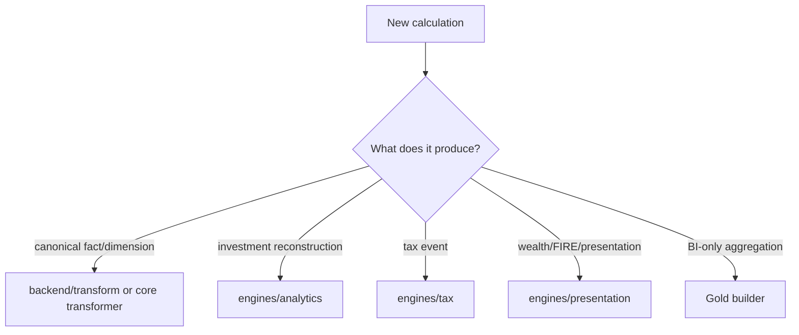
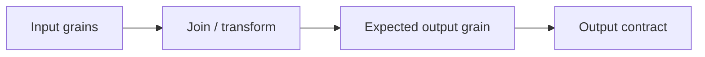
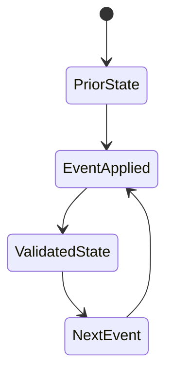
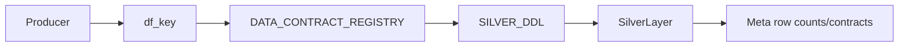
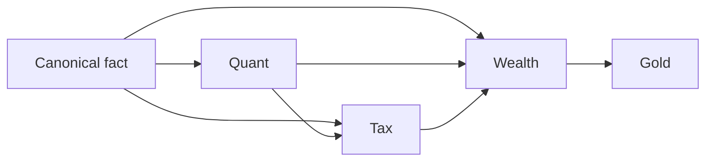
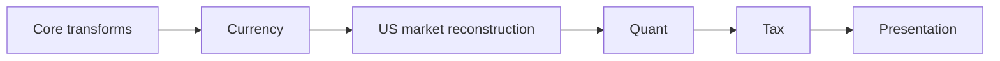

# Adding Transformations

Transformations are where retained evidence becomes canonical financial meaning. That makes transformation work more sensitive than ordinary dataframe plumbing: a join can change grain, a default can create false financial facts, and a convenient aggregation can destroy identity needed by Quant or Tax.

This guide covers additions to core canonical transforms and analytical transformation stages without violating ownership boundaries.

## 1. Choose the transformation layer

Do not add a transformation to the nearest file merely because its inputs are available there.

## 2. Define input authority

List every input contract and why it is authoritative. Distinguish:

- observed source evidence;
- canonical facts;
- reconstructed state;
- configuration/rules;
- derived analytics.

A transformation should not accidentally replace a stronger authority with a weaker one.

## 3. Write the grain before the code

State one sentence:

> One row represents ...

Then define uniqueness keys. If the output is persistent, the registry grain should agree with the implementation and Reference docs.

Many transformation bugs are grain bugs wearing arithmetic costumes.

## 4. Decide identity behavior

Ask whether output rows need deterministic identity across rebuilds.

If yes:

- reuse an existing namespace where semantics match;
- add an explicit identity contract where a new financial event truly exists;
- never use row order as financial identity;
- document null/canonicalization semantics.

See [Deterministic Identity and Replay](../architecture/deterministic-identity-and-replay.md).

## 5. Preserve LazyFrames where useful

Relational transformations should generally remain lazy until the pipeline intentionally collects them. This lets Polars optimize projections, filters, joins, and streaming execution.

Avoid premature `.collect()` simply to inspect intermediate state in production code.

Use explicit materialization when an algorithm genuinely requires in-memory ordered state.

## 6. Join semantics are financial semantics

For every join, document:

- key columns;
- expected cardinality;
- left/inner/as-of semantics;
- null behavior;
- temporal direction where applicable.

The US market pipeline's backward `join_asof` is a good example: join direction enforces temporal causality. Replacing it with nearest-neighbor matching would be a financial-model change, not a harmless optimization.

## 7. Null is not zero

A missing value may mean:

- evidence unavailable;
- calculation undefined;
- not applicable;
- not yet observable.

Zero means the quantity is known to be zero.

Do not fill null financial metrics with zero for presentation convenience unless the metric contract explicitly defines that equivalence.

## 8. Stateful transformations

FIFO, reconciliation, and stochastic simulation are explicit stateful algorithms. Extensions to these areas must preserve event ordering and mutation semantics.

For Quant changes, validate lot quantities, cost basis, realized-event lineage, and reconciliation effects after every relevant mutation.

## 9. FinancialRules belong at the policy boundary

If behavior varies by user financial policy, classification, tax treatment, or planning assumption, consume `FinancialRules` rather than embedding constants in the transformation.

If the value is an invariant of the algorithm itself, keep it in code and document it.

## 10. Output naming and pipeline dictionary

Analytical outputs are passed through the pipeline's dataframe dictionary using registry `contract_id` keys. A persistent output key must exactly match its registered contract.

The orchestrator enforces produced/registered equality before publication.

## 11. Adding a Silver output

A new persistent Silver transformation requires, at minimum:

1. producer logic;
2. stable output key;
3. Silver DDL;
4. `DataContract` entry;
5. publication order;
6. grain/domain/producer metadata;
7. downstream consumers;
8. Reference documentation;
9. validation/reconciliation.

## 12. Modifying an existing Silver output

Schema evolution is more dangerous than adding a new isolated column might suggest. Check:

- DDL type/nullability;
- producer expression type;
- grain and uniqueness;
- identity inputs;
- Gold consumers;
- Power BI/report consumers;
- contract fingerprints/replay implications;
- docs.

Use [Data Contract and Schema Evolution](data-contract-and-schema-evolution.md).

## 13. Aggregation rules

Additive values may be summed at a higher grain when semantics permit.

Non-additive metrics generally must be recomputed:

- XIRR from cashflows;
- CAGR from start/end state and time;
- drawdown from the value path;
- ratios from aggregated numerators/denominators;
- percentiles from the distribution.

Do not average a metric because SQL makes `AVG()` emotionally available.

## 14. Temporal transformations

When using historical prices, FX, benchmarks, or macro parameters, specify causality:

- can future observations ever be used?
- how stale can the last observation become?
- what happens on weekends/market closures?
- what date is the observation versus valuation date?

## 15. Validation inside the transformation

Fail close to the defect when possible. Examples:

- duplicate deterministic identity;
- negative quantity where contract forbids it;
- missing required currency;
- non-positive FX rate;
- impossible date ordering;
- unsupported classification.

Errors should preserve enough context to locate the affected source/ISIN/stage.

## 16. Consumer analysis

Before changing an output, search for every consumer. A canonical fact may feed:

A locally correct transformation can still be globally incompatible.

## 17. Worked extension pattern

Suppose a new canonical financial event is required.

### Step A: semantics

Define evidence source, grain, dates, amounts, currency, and ownership.

### Step B: identity

Define stable identity fields only if the event must survive rebuilds as the same fact.

### Step C: producer

Implement source-independent canonical logic.

### Step D: persistence

Add DDL and registry if persistent.

### Step E: consumers

Update engines that require the event.

### Step F: validation

Reconcile event counts and financial totals against source evidence.

## 18. Refactoring existing transformations

For behavior-preserving refactors, establish a financial equivalence baseline before modifying code. Compare:

- schema;
- row count;
- identities;
- sums/quantities;
- relevant metrics;
- null patterns;
- ordering only where semantically meaningful.

Byte-identical parquet/dataframe representation is not the goal. Financially identical contracts are.

## 19. Transformation completion checklist

- [ ] correct semantic owner chosen;
- [ ] authoritative inputs identified;
- [ ] output grain written down;
- [ ] identity behavior defined;
- [ ] join cardinalities understood;
- [ ] null/zero semantics defined;
- [ ] rules/config dependencies explicit;
- [ ] persistent contract registered if required;
- [ ] DDL matches produced schema;
- [ ] consumers updated;
- [ ] targeted validation added;
- [ ] end-to-end reconciliation passes;
- [ ] docs updated.

## 20. Mapping and classification changes

A transformation that maps source labels into financial categories should prefer explicit configuration/master mappings over fuzzy inference. Unknown values should fail or surface as unmapped according to the existing contract rather than being silently assigned to a convenient default.

## 21. Currency-aware transformations

For monetary fields, document the currency of every input and output. If conversion occurs, identify:

- observation date;
- FX source;
- join direction;
- stale/missing behavior;
- local versus INR/reporting values.

Never add two monetary columns merely because both are numeric.

## 22. Transformation ordering

Pipeline ordering is semantic. Currency and US market processing happen before Quant because Quant requires normalized market/FX evidence. Quant runs before Tax because Tax consumes realized events. Tax runs before presentation because presentation may consume tax-aware state.

When adding a stage, justify its dependency position rather than inserting it where orchestration code is easiest to edit.

## 23. Idempotency expectations

A deterministic transformation over the same canonical inputs/rules should reproduce equivalent outputs. Sources of accidental nondeterminism include:

- unordered iteration affecting IDs;
- current wall-clock time used as business data;
- random values without recorded seeds;
- unstable floating serialization in identity inputs.

## 24. Empty-frame semantics

The pipeline uses empty frames for absent/non-actionable source streams in several places. New transformations must distinguish:

- no source evidence;
- valid source with zero rows;
- transformation failure.

Do not catch exceptions and return empty output unless emptiness is genuinely the contract.

## 25. Performance review

Before optimizing, inspect the lazy plan and materialization boundaries. Common improvement targets include redundant collects, repeated joins/scans, wide frames carried too long, and Python loops over relational operations.

Stateful finance algorithms remain exceptions where explicit iteration is the correct representation.

## 26. Transformation QA matrix

| Risk | Validation |
|---|---|
| join explosion | assert expected grain/row cardinality |
| dropped evidence | reconcile source/canonical counts or totals |
| duplicated identity | uniqueness check |
| temporal leakage | assert observation date <= valuation date |
| currency mixing | reconcile local/reporting values |
| null-to-zero corruption | assert undefined metrics remain null/statused |
| aggregation drift | recompute from authoritative lower grain |

## Related specifications

- [Financial Model](../finance/financial-model.md)
- [Identity and Grain Contracts](../reference/identity-and-grain-contracts.md)
- [Silver Data Contracts](../reference/silver-data-contracts.md)
- [Data Contract and Schema Evolution](data-contract-and-schema-evolution.md)
- [Testing and Validation](testing-and-validation.md)
