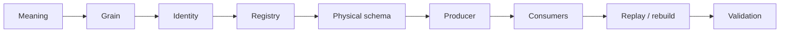
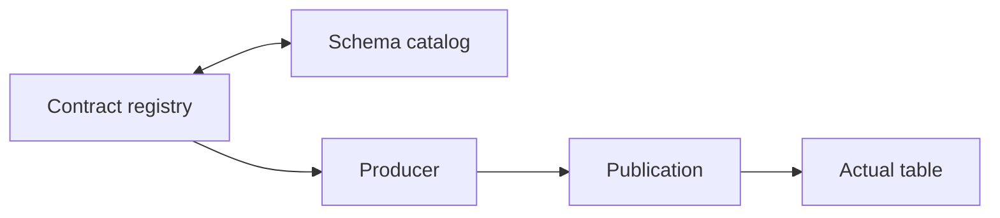
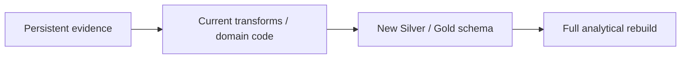
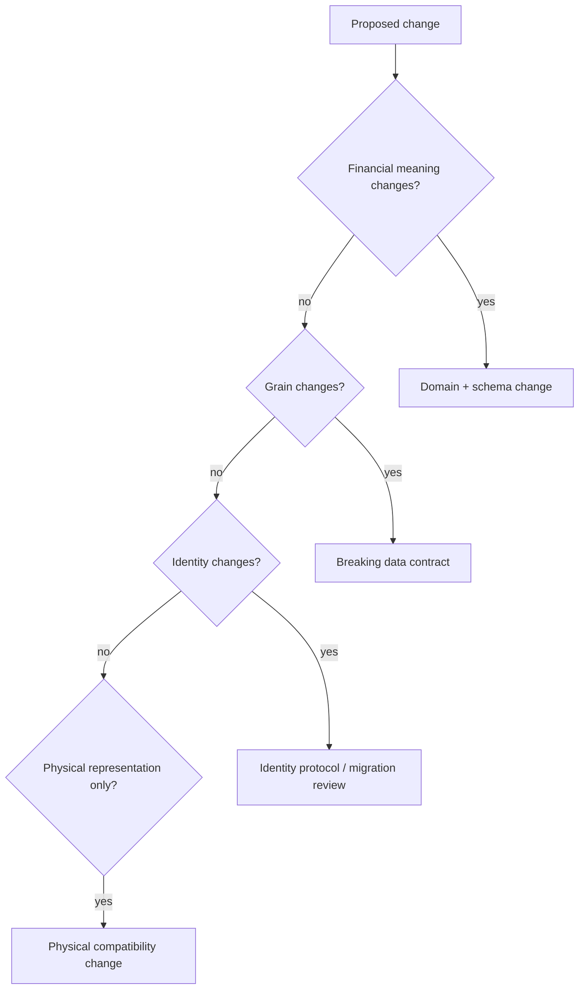
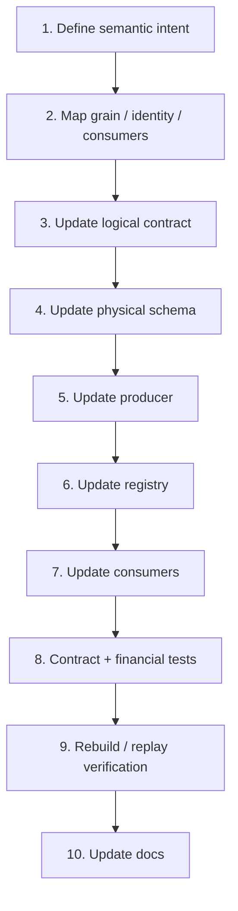

# Data Contract and Schema Evolution

A schema change is rarely only a schema change.

A column can carry financial meaning. A type can affect identity. A grain change can invalidate every aggregation downstream. A renamed table can be perfectly valid inside DuckDB and still break Power BI. An identity-field change can rebuild the same economics under entirely different keys.

That is why this system treats persistent shapes as **contracts**, not incidental table layouts.

> **A contract change is complete only when meaning, grain, identity, physical schema, registry, producer, consumers, replay behavior, validation, and documentation agree again.**



This guide follows that dependency chain rather than treating migration as a sequence of DDL commands.

## There are several contract layers

The system carries multiple kinds of contract, and they evolve differently.

### Domain contracts

Financial concepts owned by domain code.

Examples:

```text
Tax lot
realized event
reconciliation event
wealth state
FIRE model state
```

These contracts encode financial meaning and invariants.

### Application contracts

Stable workflow/status/result vocabulary that crosses use-case boundaries.

Examples include execution status, extraction outcomes, lifecycle results, and recovery outcomes.

### Warehouse contracts

Persistent Bronze/Silver/Gold/Meta datasets with physical schemas, grains, and producers.

### Operational contracts

Control Plane tables and lifecycle/provenance semantics.

A change can touch one layer or several.

Do not treat all of them as "just tables."

## Bronze evolves differently from Silver and Gold

Bronze is evidence-shaped persistent state.

Silver is canonical financial state.

Gold is decision-ready analytical state.

Those roles imply different compatibility concerns.

### Bronze change questions

```text
Can old retained evidence still rebuild?
Did source physical shape change?
Is dynamic schema behavior involved?
Does artifact/source provenance remain available?
Does replacement/upsert behavior change?
```

### Silver change questions

```text
Did financial meaning change?
Did grain change?
Did deterministic identity change?
Which domain engines consume it?
Can equivalent evidence rebuild equivalent state?
```

### Gold change questions

```text
Did BI-facing grain/type/name change?
Did measure additivity change?
Will external consumers refresh?
Is this presentation-only or hidden new domain logic?
```

The same DDL operation can have very different risk depending on layer.

## The registry is the logical contract authority

The warehouse Data Contract Registry exists so datasets are not defined independently by whichever builder writes them.

A registered contract should be able to answer:

- dataset name;
- layer;
- schema;
- producer;
- grain/identity expectations where modeled;
- publication relationship.

The registry and physical schema catalog form an executable map of the warehouse.



The useful invariant is that expected, registered, and produced surfaces agree.

The current implementation uses distinct contract models for analytical publication and Bronze synchronization:

```python
# src/personal_finance_etl/infrastructure/warehouse/registry.py
@dataclass
class DataContract:
    """Publication contract for analytical Silver and Gold warehouse datasets."""

    contract_id: str
    layer: str
    physical_table: str
    domain: str
    grain: str
    producer: str
    publication_order: int


@dataclass
class BronzeDataContract:
    """Relationship between extraction attributes, sync categories, and Bronze tables."""

    extraction_attribute: str
    sync_category: str
    physical_table: str
    is_full_replace: bool
```

That distinction is important. Bronze evolution is partly about evidence synchronization/replacement semantics; Silver/Gold evolution is about analytical publication contracts. The code models them differently because they are different jobs.
## Produced-versus-registered equality prevents shadow datasets

A common schema-drift failure mode is:

```text
builder starts producing table X
registry does not know X
```

The reverse is also dangerous:

```text
registry expects table Y
producer no longer creates Y
```

Both conditions mean the documented/persisted architecture has diverged from runtime behavior.

Validation should catch those mismatches.

## Physical DDL is an implementation of the contract

Schema modules under:

```text
infrastructure/warehouse/schema/
```

declare the physical tables for Bronze, Silver, Gold, Meta, and Control Plane-related schema concerns.

The DDL is not the complete semantic contract, but it is a concrete implementation artifact.

A schema evolution must keep the logical contract and DDL aligned.

## Full analytical rebuild changes the migration strategy

Silver and Gold are rebuildable analytical layers from persistent evidence.

That means many analytical schema changes do not require long-lived in-place migration logic.

Instead, the migration model is often:



That is powerful, but it does **not** mean schema evolution is free.

The current code still needs to be able to read the retained evidence and reconstruct the new contract correctly.

Identity continuity and downstream compatibility still matter.

## Control Plane evolution is different

The Control Plane is historical operational authority.

Its tables are not disposable analytical projections.

A Control Plane schema change may need to preserve:

- historical run records;
- artifact registry/history;
- retained payload references;
- failure/recovery evidence;
- provider request history;
- simulation provenance.

That is closer to operational migration than analytical rebuild.

Do not apply the "just rebuild it" model blindly to SQLite history.

## Meta evolution is also distinct

DuckDB Meta stores current analytical/run context rather than historical operational authority.

A Meta change should be reviewed for:

- current-run consumers;
- BI/query assumptions;
- synchronization with Control Plane-derived context;
- rebuild behavior.

Do not turn Meta into a second historical Control Plane simply because adding one more table is easy.

## Classify the change before editing code

A practical classification is:



This classification determines the amount of downstream analysis required.

## Grain changes are breaking changes

Suppose a dataset changes from:

```text
one row per disposal
```

to:

```text
one row per disposal x consumed acquisition lot
```

That is not "adding `lot_id`."

It changes:

- row count;
- key uniqueness;
- identity;
- joins;
- aggregation;
- Gold semantics;
- Power BI relationships.

Treat the new grain as a new contract even if the table name stays unchanged.

## Identity changes are protocol changes

Deterministic identity depends on:

- namespace;
- ordered fields;
- value normalization;
- serialization protocol;
- hash/truncation behavior.

Changing identity inputs can produce entirely new IDs for equivalent financial facts.

Before doing so, answer:

```text
Will historical references still join?
Will replay create duplicate "new" facts?
Do Gold/BI models carry these IDs?
Are child identities derived from them?
Is a compatibility/migration mapping needed?
```

Identity is not a cosmetic field.

## Contract fingerprints can change even when row values look similar

Where schema/contract/config fingerprints are used for provenance or validation, adding/renaming/retyping fields may change the fingerprint.

That can be desirable: the system should know the contract changed.

But it should be intentional and understood.

A change that alters contract fingerprints while pretending to be a no-op deserves review.

## Additive column changes are the lowest-risk class, not a free pass

Adding a nullable informational column may be relatively safe.

Still review:

- producer support;
- physical schema order/type;
- null semantics;
- downstream `select *` assumptions;
- BI refresh;
- reference docs.

A nullable column whose null meaning is undefined is unfinished design.

## Required columns raise the compatibility bar

A new required field raises questions:

```text
Can all retained evidence populate it?
What happens for historical records?
Is there a real default or just a convenient placeholder?
Does rebuild fail on old Bronze?
```

Do not invent financially meaningless defaults just to satisfy a non-null constraint.

## Renaming columns is a consumer migration

A rename can affect:

- Polars expressions;
- SQL;
- registry/schema;
- domain/application contracts;
- Gold builders;
- tests;
- BI models;
- docs.

Search is useful, but a consumer map is better.

If a compatibility alias is introduced, give it an exit plan.

Permanent duplicate names are often worse than one deliberate migration.

## Removing columns requires proof of non-authority

Before removal, establish:

- no producer still needs the value;
- no identity logic uses it;
- no downstream transform/Gold mart consumes it;
- no reconciliation/audit explanation depends on it;
- no documented public contract promises it.

A column that appears unused in one code search can still matter to an external BI model.

## Type changes can alter semantics

Examples:

```text
int -> float
date -> datetime
string -> categorical vocabulary
float -> Decimal-like canonical representation
nullable -> required
```

Type changes can affect:

- equality;
- joins;
- sorting;
- serialization/identity;
- Power BI model types;
- null handling;
- precision.

Test the semantic behavior, not only whether the cast succeeds.

## Nullability changes are financial decisions sometimes

Changing `nullable` to `required` says something about the financial model:

> this value must exist for every valid row.

That statement needs to be true for historical and future evidence.

Changing `required` to nullable may weaken an invariant.

Treat nullability as contract meaning, not a database convenience toggle.

## Publication order can become a hidden compatibility dependency

If a schema change causes a downstream table to require a new upstream output, publication order must still satisfy the dependency graph.

Do not patch this by having the downstream builder reach backward into another builder's internals.

Update the declared application/publication sequence.

## Producer changes and contract changes should move together

A robust schema change is atomic at the code-review level even if runtime persistence uses separate steps.

In one coherent change, update:

```text
logical contract
physical schema
producer
registry
validation/tests
consumers
documentation
```

Avoid committing a registry-only or producer-only half-state to the main branch.

## Schema evolution workflow

A practical workflow is:



For Control Plane changes, replace analytical rebuild with an operational migration/compatibility plan.

## Change matrix

| Change | Grain impact | Identity impact | Consumer risk | Typical action |
|---|---:|---:|---:|---|
| add nullable informational column | low | low | low-medium | update schema/producer/docs |
| add required semantic field | medium | possible | medium-high | historical/rebuild review |
| rename column | none | possible | high | consumer migration |
| change type | none | possible | medium-high | semantic regression |
| remove column | none | possible | high | prove non-use, migrate consumers |
| change grain | high | high | very high | full contract redesign |
| change identity fields | maybe | high | very high | replay/reference migration review |
| add new table/mart | new | new | medium | registry/schema/producer/publication |

The matrix is a starting point, not a substitute for understanding the dataset.

## Compatibility strategy should be explicit

Choose one:

### Hard cutover

All consumers move with the change.

Good when the repository owns all consumers and the contract is easy to rebuild.

### Transitional compatibility

Old and new names/shapes coexist temporarily.

Use only when a real external consumer needs migration time.

### New contract/table

Appropriate when grain/meaning changed enough that pretending continuity would be misleading.

The cleanest compatibility strategy is the one that tells the truth about semantic continuity.

## Full rebuild is a verification tool

For Silver/Gold changes, run a complete analytical rebuild from persistent evidence.

Then verify:

- schema completeness;
- identity continuity where expected;
- financial-output equivalence where expected;
- intended changes only;
- Gold/BI compatibility.

A rebuild proves the new code can reconstruct the warehouse, not only patch an existing database.

## Historical Bronze readability is part of future compatibility

If Bronze is retained as reconstruction input, schema changes to downstream layers must consider whether current code can still interpret historical Bronze.

If a new canonical field cannot be derived from older Bronze evidence, decide what that means explicitly:

```text
nullable historical state
reconstruction limitation
source backfill required
contract split
```

Do not hide the gap with a fabricated default.

## Replay is not always identity-preserving after a protocol change

If an identity protocol changes, a replay can produce economically equivalent rows with different IDs.

That may be acceptable if migration is deliberate.

It is not acceptable if discovered accidentally after downstream references duplicate.

Document protocol-level identity changes in the identity specification and release history as appropriate.

## Failure scenarios reveal incomplete migrations

### Producer updated, registry missing

Runtime output exists without an authoritative contract.

Expected response: validation/certification should fail.

### Registry updated, producer missing

The system promises a dataset it cannot create.

Expected response: publication completeness should fail.

### Registry and producer updated, DDL stale

The builder emits a shape persistence cannot accept.

Expected response: schema validation/publication fails before silent drift.

### DDL updated, consumer stale

Warehouse builds; downstream domain/Gold/BI breaks.

Expected response: consumer mapping/testing catches it.

### Grain changed without identity review

Totals may still look correct while joins/IDs become invalid.

Expected response: grain/identity tests catch semantic break.

### Control Plane table changed with rebuild thinking

Historical operational data is lost or unreadable.

Expected response: do not do this. Operational migration requires different planning.

## Rollback thinking belongs before migration

For analytical layers, rollback may mean:

```text
restore previous code
rebuild warehouse from persistent evidence
```

For Control Plane, rollback may require a database backup/snapshot or explicit migration reversal.

For external BI contracts, rollback may include restoring old column/table names.

Know the rollback surface before changing durable state.

## Financial migration validation

Schema tests alone are insufficient when financial meaning changes.

Compare representative outputs:

```text
transaction counts and sums
holdings quantities
cost basis
realized events
XIRR / performance
Tax summaries
net worth
FIRE deterministic inputs/outputs
```

The exact set depends on blast radius.

The goal is to separate **intended semantic change** from **accidental collateral change**.

## Documentation synchronization is part of compatibility

A schema change should update the surface that owns its meaning:

```text
reference docs     -> exact physical contract / grain / fields
finance docs       -> methodology / economic meaning
architecture docs  -> ownership / lifecycle if boundaries changed
developer docs     -> extension/migration rules if developer workflow changed
```

Do not paste the same schema table into all four surfaces.

## Schema-evolution checklist

- [ ] I classified semantic/grain/identity/physical impact.
- [ ] I mapped all producers and consumers.
- [ ] I reviewed deterministic identity impact.
- [ ] I reviewed historical evidence readability.
- [ ] I updated registry and physical schema together.
- [ ] I updated producer output.
- [ ] I updated publication order if dependencies changed.
- [ ] I handled BI/external consumer compatibility.
- [ ] I tested structural and financial behavior.
- [ ] I ran rebuild/replay verification where appropriate.
- [ ] I defined rollback strategy.
- [ ] I updated reference/canonical documentation.

After a contract changes, there is only one useful question left:

> **What evidence is strong enough to prove that the new contract and the finance built on it are still correct?**

That is the subject of [Testing and Validation](testing-and-validation.md).

## Related specifications

- [Warehouse Architecture](../architecture/warehouse-architecture.md)
- [Data Model](../architecture/data-model.md)
- [Deterministic Identity and Replay](../architecture/deterministic-identity-and-replay.md)
- [Testing and Validation](testing-and-validation.md)
- [Identity and Grain Contracts](../reference/identity-and-grain-contracts.md)
