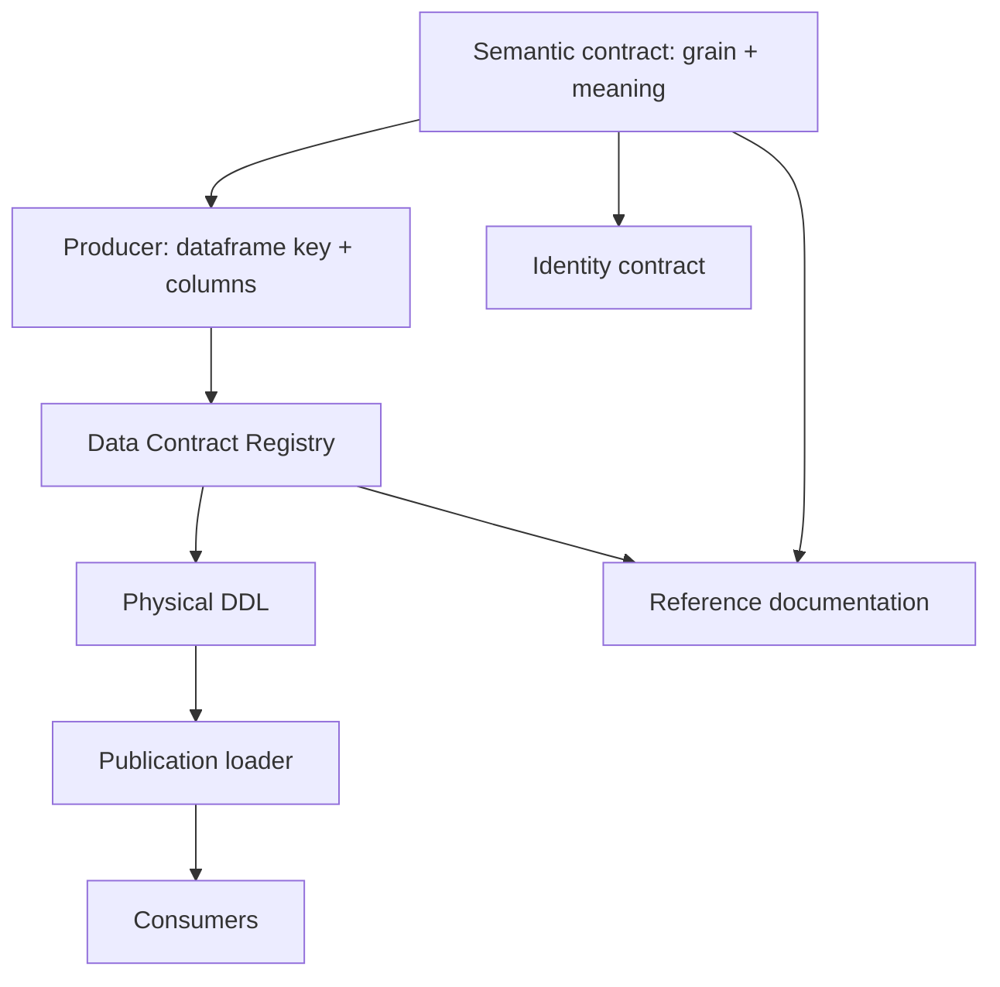
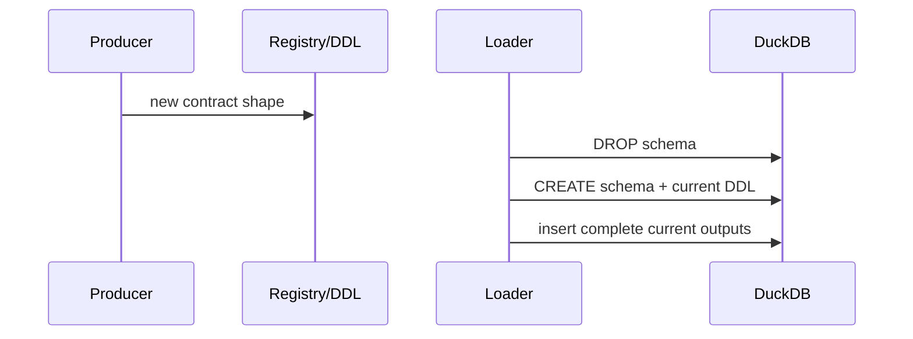
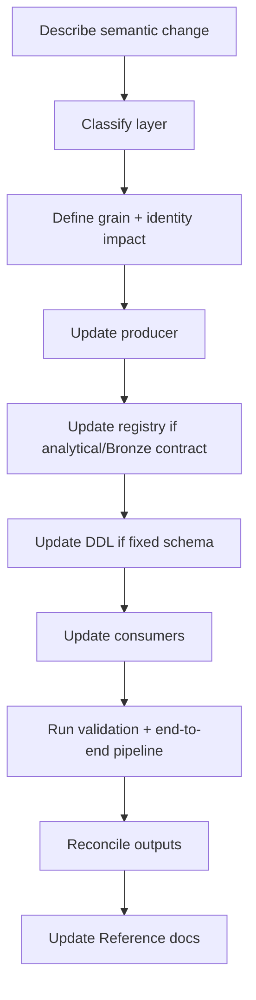
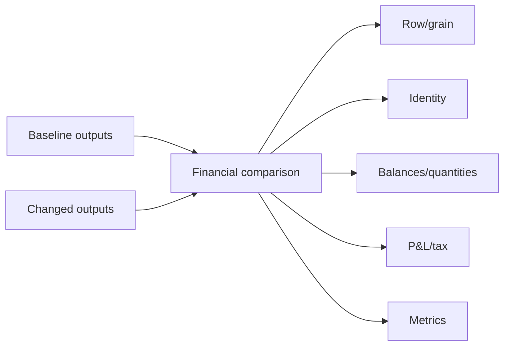

# Data Contract and Schema Evolution

Persistent schemas in Personal Finance ETL are not isolated SQL definitions. A contract spans semantic grain, producer output, deterministic identity where applicable, registry metadata, physical DDL, publication order, consumers, and documentation. Schema evolution must keep those pieces coherent.

A migration that only makes DuckDB accept the new column has passed the least interesting test.

## 1. Contract layers



A persistent analytical change should be reviewed across this entire graph.

## 2. Bronze contracts differ from Silver/Gold

Bronze uses `BronzeDataContract` to connect extraction attribute, sync category, physical table, and replacement mode. Its table schema is dynamically created from extracted frames.

Silver and Gold use:

- fixed DDL;
- `DataContract` registry entries;
- complete schema rebuild/publication.

Do not apply Silver/Gold migration assumptions to Bronze.

## 3. Registry authority

`DATA_CONTRACT_REGISTRY` stores:

- `contract_id`;
- layer;
- physical table;
- domain;
- grain;
- producer;
- publication order.

`validate_registry()` protects structural registry invariants such as duplicate IDs/table mappings and supported layer definitions.

The registry is a publication contract, not the full physical schema. Column definitions remain in DDL.

## 4. Produced-versus-registered equality

The orchestrator validates analytical outputs before publication:

```text
produced contract IDs == registered contract IDs
```

This catches two common drift modes:

1. code produces a table nobody registered;
2. registry promises a table code stopped producing.

Both fail before Silver/Gold publication.

## 5. Physical DDL

Silver and Gold DDL live under:

```text
backend/load/schema/silver.py
backend/load/schema/gold.py
```

Meta and Control Plane have separate schema authorities.

When adding/changing columns, check:

- DuckDB type;
- producer Polars dtype;
- nullability expectations;
- date/timestamp precision;
- numeric precision/financial interpretation;
- consumer compatibility.

## 6. Full-rebuild analytical migration model

Silver/Gold are rebuilt, so schema evolution does not require row-by-row historical migration of those derived layers. The next successful publication creates the new schema from current canonical state.



This dramatically simplifies derived-schema migration.

It does **not** remove the need to update external BI consumers.

## 7. Control Plane evolution is different

The SQLite Control Plane is historical operational state. `ensure_schema()` validates existing databases against the current schema and intentionally does not disguise stale schemas with `CREATE TABLE IF NOT EXISTS`.

Control Plane changes therefore require much more caution than Silver/Gold changes because historical state persists.

See [Control Plane Data Contracts](../reference/control-plane-data-contracts.md) and [Reliability and Recovery](../architecture/reliability-and-recovery.md).

## 8. Meta evolution

Meta is a current analytical projection. Changes should preserve its role as inspection/context rather than historical operational authority.

Do not move historical artifact/run ownership into Meta simply because adding a DuckDB table is convenient.

## 9. Grain changes are breaking changes

Changing a table from one row per transaction to one row per transaction-line, or one row per ISIN-date to ISIN-date-lot, is not a column change. It changes:

- uniqueness;
- row counts;
- aggregation behavior;
- joins;
- identity;
- BI relationships;
- downstream metrics.

Treat grain changes as explicit breaking semantic changes.

## 10. Identity changes are protocol changes

If deterministic identity inputs change, previously equivalent financial facts can receive different IDs on rebuild.

Before changing identity:

- explain why old identity is insufficient;
- evaluate lineage/replay consequences;
- update namespace field order if required;
- verify all consumers;
- document the protocol change.

Do not add a volatile field such as row position or ingestion timestamp to a financial identity.

## 11. Additive column changes

Adding a nullable descriptive column is usually lower risk, but still requires:

1. producer expression;
2. DDL column;
3. consumer review;
4. docs;
5. end-to-end publication.

If the field affects identity/grain or financial calculation, it is not merely additive.

## 12. Renaming columns

A rename is externally breaking even if semantics are unchanged. Update:

- producer;
- DDL;
- transformations/Gold consumers;
- Power BI/report consumers;
- docs;
- any serialization/fingerprint logic that includes the field.

Prefer semantic clarity over preserving a misleading historical name, but treat the change deliberately.

## 13. Removing columns/contracts

For Silver/Gold, full rebuild ensures removed physical columns/tables disappear after successful publication.

Before removal verify no:

- engine consumer;
- Gold builder;
- BI model;
- documentation link;
- identity/fingerprint logic;
- export/integration

still depends on it.

## 14. Type changes

Type changes deserve financial review.

Examples:

- integer -> float can introduce fractional semantics;
- date -> timestamp changes grain/ordering assumptions;
- string -> categorical mapping can alter unknown-value behavior;
- float -> decimal-like normalization can affect identity serialization if values participate in IDs.

## 15. Nullability changes

Making a field nullable can turn previously invalid evidence into accepted incomplete state. Making it required can cause old/legitimate source cases to fail.

Document what null means financially before changing the physical constraint or validation behavior.

## 16. Publication order

Registry publication order is deterministic. Change it only when needed for readability/dependency expectations. Loaders operate on already-produced frames, so publication order should not be abused as a hidden calculation dependency.

## 17. Contract fingerprint implications

The reproducibility layer fingerprints structural contract metadata. Registry changes can therefore alter replay/model context fingerprints even when financial values happen to remain the same.

That is desirable: the structural contract is part of the execution context.

## 18. Schema evolution workflow



## 19. Change matrix

| Change | Producer | Registry | DDL | Identity review | Consumer review | Docs |
|---|---:|---:|---:|---:|---:|---:|
| new Bronze source | yes | Bronze | dynamic | maybe | yes | yes |
| new Silver table | yes | yes | yes | likely | yes | yes |
| new Gold mart | yes | yes | yes | usually no | yes | yes |
| add Silver/Gold column | yes | usually no metadata change | yes | maybe | yes | yes |
| grain change | yes | update grain | maybe | yes | yes | yes |
| rename table | yes | yes | yes | maybe | yes | yes |
| Control Plane table change | repository/schema code | n/a analytical registry | SQLite DDL | operational IDs | yes | yes |

## 20. Compatibility strategy

Because this is a local application with full derived-layer rebuilds, the architecture favors **current-schema correctness** over maintaining multiple simultaneous analytical schema versions.

That simplifies internals but means upgrades must coordinate application code and external BI consumers.

## 21. Validation after schema changes

Check:

- registry validation;
- DDL execution;
- produced/registered equality;
- successful Silver/Gold load;
- Meta row counts/contracts;
- grain uniqueness;
- deterministic IDs;
- financial reconciliation;
- BI/report compatibility.

## 22. Failure scenarios

### Producer updated, registry missing

Pipeline fails as unregistered output.

### Registry updated, producer missing

Pipeline fails as missing required contract.

### Registry and producer updated, DDL stale

Load fails when frame/table schemas disagree.

### DDL updated, consumer stale

Pipeline may succeed while downstream analytics/BI fail. This is why database success is not the finish line.

### Grain changed without identity review

The most dangerous case: pipeline may succeed and financial semantics may silently drift.

## 23. Schema-evolution checklist

- [ ] semantic change described;
- [ ] layer ownership correct;
- [ ] grain impact reviewed;
- [ ] identity impact reviewed;
- [ ] producer updated;
- [ ] registry updated where required;
- [ ] DDL updated where required;
- [ ] consumers searched/updated;
- [ ] replay/fingerprint implications reviewed;
- [ ] end-to-end load succeeds;
- [ ] financial reconciliation passes;
- [ ] external BI compatibility reviewed;
- [ ] Reference docs updated.

## 24. Contract review by layer

### Bronze

Review extraction attribute, synchronization category, physical table, replacement semantics, provenance columns, and downstream canonicalization.

### Silver

Review canonical meaning, fixed DDL, registry grain, producer, identity, engine consumers, and Gold consumers.

### Gold

Review presentation grain, fixed DDL, producer, publication order, BI compatibility, and metric reconciliation.

### Meta

Review whether the field represents current analytical context. Historical operational facts generally belong in the Control Plane instead.

### Control Plane

Review persistence, foreign keys, historical retention, savepoint behavior, backup/restore, and compatibility strategy. This is the least casual schema surface.

## 25. Schema versioning versus application release versioning

Do not confuse application releases with technical schema/serialization versions. Ordinary docs remain release-agnostic, while genuine protocol versions such as Control Plane schema or identity serialization may be documented because code interprets them.

## 26. Backward compatibility questions

Before a breaking contract change ask:

1. can existing local databases open safely?
2. can derived layers be rebuilt from retained evidence?
3. will deterministic IDs remain meaningful?
4. can backups created under the prior schema be restored by the current implementation?
5. will external BI consumers fail clearly?

## 27. Financial migration validation

For changes affecting financial semantics, compare more than schema:



Unexpected differences require explanation before the new contract is accepted.

## 28. Rollback thinking

Silver/Gold can be rebuilt after reverting code because they are derived. Control Plane changes are harder to roll back because they mutate historical operational state. Backups become especially important before persistent schema changes.

## 29. Documentation synchronization

A schema change may require updates in multiple documentation surfaces:

- Reference for physical shape;
- Architecture for ownership/boundary changes;
- Finance for semantic/formula changes;
- Developer for extension workflow changes;
- Getting Started for user-visible configuration/operation changes.

Do not duplicate the same explanation everywhere. Update the owning surface and cross-link.

## Related specifications

- [Warehouse Architecture](../architecture/warehouse-architecture.md)
- [Deterministic Identity and Replay](../architecture/deterministic-identity-and-replay.md)
- [Identity and Grain Contracts](../reference/identity-and-grain-contracts.md)
- [Silver Data Contracts](../reference/silver-data-contracts.md)
- [Gold Data Contracts](../reference/gold-data-contracts.md)
- [Testing and Validation](testing-and-validation.md)
