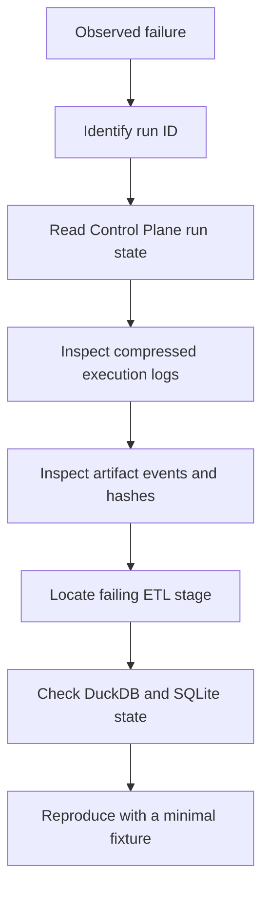

# Debugging and observability

I investigate the application by following a run identity across status messages, artifact synchronization, source processing, analytical publication, and durable SQLite evidence. A UI progress indicator is not a substitute for inspecting the actual run record.

## Run investigation flow



I begin with durable evidence before attempting a full rerun. The two stores can diverge if execution fails between independent commits.
## Orchestration checkpoints

**Source:** `src/personal_finance_etl/backend/pipeline/etl_pipeline.py` (line 248).

```python
    def run(self) -> None:
        self.cfg.validate_config()

        validate_registry()

        start_time = time.perf_counter()

        run_id = None
        cp = None
        log_file_path = self.db_manager.db_path.replace(".duckdb", ".log")

        try:
            add_queue_handler(cast("multiprocessing.Queue[Any]", self.status_queue))
            add_file_handler(log_file_path)

            logger.debug("=== ETL CONFIGURATION DUMP ===")
            if hasattr(self.cfg, "model_dump_json"):
```

**Source:** `src/personal_finance_etl/backend/pipeline/etl_pipeline.py` (line 150).

```python
    def _run_engines(self, cp: "ControlPlane | None", run_id: str) -> None:

        logger.info("Starting Investment Quant Engine...")
        self.status_queue.put(EngineStatus(msg="", data=None, progress=0.6, level=LogLevel.STEP))

        quant_engine = InvestmentQuantEngine(
            df_p=self.dfs["df_f_tf_inv_purchase"],
            df_s=self.dfs["df_f_tf_inv_sale"],
            df_m=self.dfs["df_f_investment_market_data"],
            df_i=self.dfs["df_d_investment_master"],
            df_b=self.dfs["df_f_investment_benchmark_data"],
            df_t=self.dfs["df_d_macro_parameters"],
            df_fx=self.dfs.get("df_f_currency_fx_rates"),
```

The orchestrator is the authoritative place to follow ordering between extraction, transformation, financial engines, validation, and publication.
## Run repository

**Source:** `src/personal_finance_etl/backend/load/control_plane/run_repo.py` (line 33).

```python
    def start_run(self, cfg_json: str | None = None, rules_json: str | None = None) -> str:
        run_id = str(uuid.uuid4())
        now = datetime.now().isoformat(timespec="seconds")
        settings_id: str | None = None
        rules_id: str | None = None
        with self.db.atomic():
            for payload, prefix, table in (
                (cfg_json, "snap_set_", "cp_settings_snapshots"),
                (rules_json, "snap_rule_", "cp_rules_snapshots"),
            ):
                if not payload:
                    continue
                canonical = self._canonical_json(payload)
                digest = hashlib.sha256(canonical.encode("utf-8")).hexdigest()
```

**Source:** `src/personal_finance_etl/backend/load/control_plane/run_repo.py` (line 100).

```python
    def finish_run(self, run_id: str, status: str) -> None:
        normalized_status = status.strip().upper()
        if not normalized_status:
            raise ValueError("Run status must be a non-empty string.")
        now = datetime.now().isoformat(timespec="seconds")
        with self.db.atomic():
            cursor = self.db.conn.execute(
                "UPDATE cp_runs SET status = ?, finished_at = ? WHERE run_id = ?",
                (normalized_status, now, run_id),
            )
            if cursor.rowcount != 1:
                raise KeyError(f"Cannot finish unknown run ID: {run_id}")

```

I correlate start/finalization records with saved logs and failure details. An incomplete record may represent interrupted execution rather than an ordinary business error.
## Artifact synchronization evidence

**Source:** `src/personal_finance_etl/backend/load/control_plane/file_sync.py` (line 30).

```python
    def sync_with_disk(
        self,
        discovered_files: dict[str, list[str]],
        hash_policy: FileHashPolicy,
        full_replace_categories: list[str],
    ) -> tuple[dict[str, list[str]], dict[str, list[str]], int, list[tuple[str, str, str]]]:
        """Synchronize the scan as one atomic control-plane operation."""
        with self.artifact_repo.db.atomic():
            return self._sync_with_disk(discovered_files, hash_policy, full_replace_categories)

    def _sync_with_disk(
        self,
        discovered_files: dict[str, list[str]],
        hash_policy: FileHashPolicy,
```

I compare artifact category, path identity, content hash, and lifecycle events when investigating an unexpected refresh, removal, or rename.
## Failure localization table

| Symptom | First inspection point | Next boundary |
|---|---|---|
| Source not discovered | discovery category/path configuration | artifact sync history |
| Bronze rows unexpectedly replaced | `BronzeLayer.upsert_table` | file basename and sync category |
| Missing analytical output | engine output keys | `DATA_CONTRACT_REGISTRY` |
| Schema mismatch | physical DDL and registered columns | Silver/Gold loader |
| UI reports completion but cron succeeds on failure | CLI completion handling | SQLite run status |
| Cross-store inconsistency | transaction commit ordering | next-run healing and snapshot |
## Minimal reproduction strategy

I reduce the input set and preserve the exact configuration snapshot. I do not modify original financial source artifacts while diagnosing a bug. Where a failure involves transaction state, I reproduce it on disposable database copies.
## Cross-references

See [Observability](../operations/observability-and-run-history.md), [Control Plane run lifecycle](../control-plane/run-lifecycle.md), and [Multiprocessing progress](../interfaces/multiprocessing-and-progress.md).
