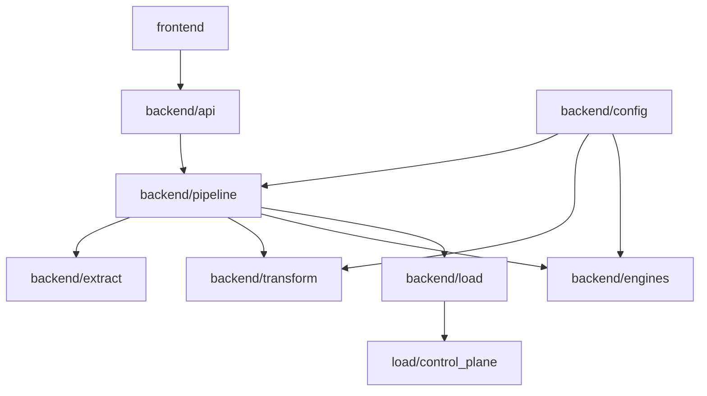
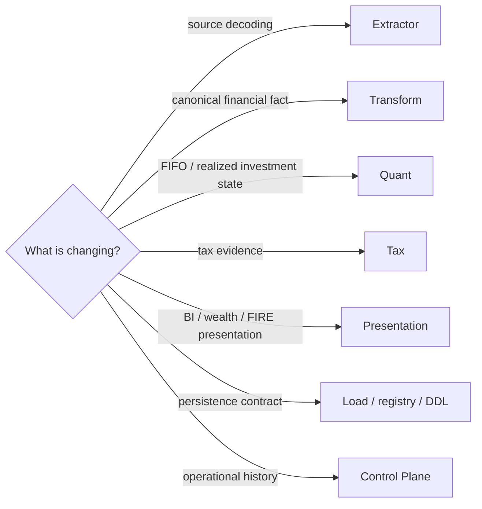
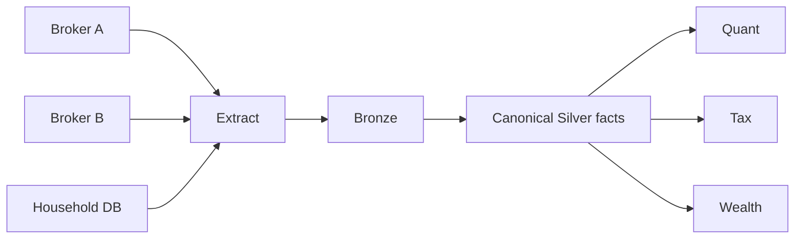
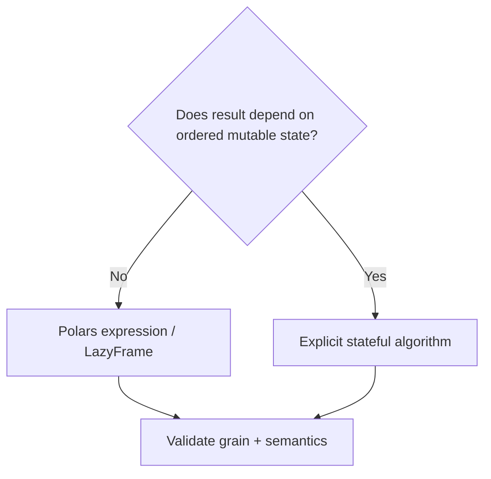
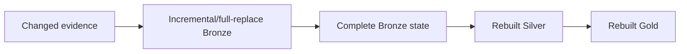
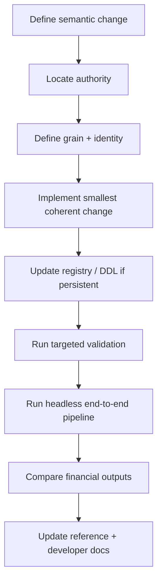
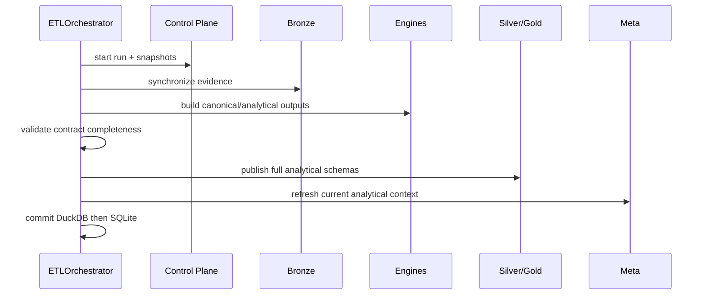

# Development Guide

Personal Finance ETL is a local-first financial data system whose code is divided by authority rather than merely by technical convenience. Development work is safest when it preserves those boundaries: extraction owns source decoding, canonical transformations own normalized financial facts, Quant owns investment reconstruction, Tax owns tax-event normalization, presentation engines own analytical views, the Control Plane owns operational history, and DuckDB owns analytical publication.

This guide describes the development model that follows from the implementation itself.

## 1. Package responsibilities



| Package | Primary responsibility | Should not become |
|---|---|---|
| `backend/config` | validated operational and financial configuration | hidden runtime state |
| `backend/extract` | decode source payloads | financial interpretation layer |
| `backend/pipeline` | orchestration and lifecycle | home for every calculation |
| `backend/transform` | canonical facts/dimensions | BI presentation layer |
| `backend/engines/analytics` | investment reconstruction and Quant | source adapter |
| `backend/engines/tax` | tax-event normalization/presentation | independent FIFO engine |
| `backend/engines/presentation` | wealth/FIRE/Gold-facing analytics | operational authority |
| `backend/load` | persistence and contracts | financial policy engine |
| `frontend` | user interaction | direct warehouse orchestrator |

## 2. Start from authority, not filename

Before changing code, decide who owns the behavior. A common failure pattern in data systems is implementing logic where the data happens to be available rather than where the semantic authority belongs.



A Gold builder having access to purchases does not make it the right place to calculate realized gain. The Quant Engine already owns that fact. Duplicate authority is how two dashboards eventually disagree while both look extremely confident.

## 3. Configuration is a dependency

`Settings` and `FinancialRules` are explicit constructor/runtime dependencies throughout the system. Do not replace them with module globals or hard-coded financial policy.

`Settings` controls physical execution. `FinancialRules` controls financial semantics. Their snapshots are persisted with run provenance.

See [Configuration Reference](../configuration/configuration-reference.md) and [Financial Rules Reference](../configuration/financial-rules-reference.md).

## 4. Canonical facts are the anti-corruption layer

Source formats are heterogeneous. Downstream engines should consume canonical tables rather than broker-specific spreadsheets or CSV column names.



If a new source requires downstream code to repeatedly ask which broker produced a row, the canonicalization boundary probably needs more work.

## 5. Lazy versus stateful computation

The codebase deliberately uses two compute styles.

**Polars LazyFrames** fit relational transformations, joins, filters, projections, and aggregation DAGs.

**Explicit Python state machines** fit FIFO lots, reconciliation, and stochastic simulation where ordered state mutation is the algorithm.

Do not force stateful financial reconstruction into clever relational expressions merely to reduce Python lines. Equally, do not replace vectorized transformations with row loops because they are easier to sketch.



## 6. Grain is mandatory

Every persistent analytical dataset needs a precise grain. The registry records grain for Silver and Gold contracts; documentation expands its semantic meaning.

Examples include:

- `Day`
- `Date-Currency`
- `Transaction`
- `ISIN-Date-Lot`
- `RealizedEvent`
- `ReconciliationEvent`

A table without a clear grain is not "flexible." It is an argument waiting for a future aggregation.

## 7. Identity is semantic

Deterministic identities are protocol contracts. When extending purchase, sale, lot, realized, reconciliation, or tax event semantics, inspect `backend/utils/identity.py` and [Deterministic Identity and Replay](../architecture/deterministic-identity-and-replay.md).

Never change identity inputs casually. A deterministic identifier is useful precisely because identical financial facts reproduce the same identity across rebuilds.

## 8. Registry-governed publication

`backend/load/registry.py` is the publication catalog for Bronze and analytical contracts. Before Silver/Gold loading, the orchestrator checks both directions:

```python
registered_contracts = {c.contract_id for c in DATA_CONTRACT_REGISTRY}
for df_key in self.dfs.keys():
    if df_key not in registered_contracts:
        raise RuntimeError(
            f"Engine produced unregistered table '{df_key}'. "
            "All analytical tables must be defined in DATA_CONTRACT_REGISTRY."
        )

missing_contracts = registered_contracts - set(self.dfs.keys())
if missing_contracts:
    raise RuntimeError(f"Engine failed to produce required tables: {missing_contracts}")
```

That establishes the core publication invariant:

$$\text{Produced analytical outputs} = \text{Registered analytical contracts}$$

Neither side gets to ghost the other.

## 9. Silver and Gold are complete publications

Silver and Gold loaders drop/recreate their schemas and publish all registered outputs in registry order. Development therefore targets complete analytical reconstruction, not incremental mutation of derived state.

Bronze is different: it is persistent and synchronization-aware.



This trade-off simplifies correctness at the current workload scale.

## 10. Failure semantics are part of the interface

An extension must decide whether malformed input:

- fails the run;
- produces null/undefined analytical state;
- creates a review status;
- is skipped as non-actionable evidence.

The choice must match financial meaning. For example, invalid XIRR evidence is represented with typed statuses rather than silently becoming zero return.

## 11. Cross-database boundaries

DuckDB and SQLite participate in one logical run but do not form a distributed ACID transaction. Extensions touching both must respect the documented commit/healing model.

Do not add a new cross-store write sequence that assumes atomicity the infrastructure does not provide.

See [Reliability and Recovery](../architecture/reliability-and-recovery.md).

## 12. Logging and operational context

Use the project logger and status interfaces rather than ad-hoc prints in production paths. Errors should preserve stage/workload context where useful, especially for per-ISIN Quant work.

A failure message that says only `ValueError` is technically honest and operationally useless.

## 13. Development environment

The project requires Python 3.13+ and is built with Hatchling. Dependency metadata lives in `pyproject.toml`. Development should use the package entry points rather than relying on accidental working-directory imports.

Before structural changes, inspect:

```text
pyproject.toml
src/personal_finance_etl/
tests/run_headless.py
production-hardening.md
qa-hardening.md
```

The hardening documents are useful QA intent, but production source remains the implementation authority.

## 14. Static quality tools

The repository configuration includes modern Python tooling. Run the configured formatter/linter/type checks appropriate to the project before treating a change as complete. Static tools catch structural defects; they do not validate financial semantics.

That distinction matters. A perfectly typed FIFO bug remains a FIFO bug, just with excellent autocomplete.

## 15. Financial-output equivalence

Refactors that claim to preserve behavior should compare financial outputs, not merely code execution. Relevant comparisons include:

- row counts by registered contract;
- deterministic identities;
- aggregate balances;
- investment quantities and cost basis;
- realized-event totals;
- tax-event totals;
- Gold metric outputs;
- simulation fingerprints where replay context is expected to match.

## 16. Performance work

Optimize after identifying the actual cost center. The architecture already separates persistent Bronze ingestion from full analytical rebuild, and uses Polars/streaming collection where useful.

Prefer removing redundant work, unnecessary materialization, repeated scans, and avoidable conversions before introducing concurrency complexity.

## 17. Development workflow



### Before coding

- identify authority and consumers;
- write down the intended grain;
- identify whether deterministic identity changes;
- determine persistence and migration implications;
- identify recovery boundaries.

### During coding

- keep source-specific logic at source boundaries;
- preserve canonical semantics;
- fail closed for invalid financial evidence where the existing subsystem does;
- avoid duplicate financial authorities;
- keep registry/DDL/output keys synchronized.

### Before merge/release

- run static checks;
- run targeted validation;
- run the headless pipeline on representative data;
- inspect contract row counts and financial reconciliation;
- verify deterministic identities where relevant;
- update docs from implementation, not from intention.

## 18. Completion checklist

A change is complete only when all applicable items are true:

- [ ] semantic owner is correct;
- [ ] grain is explicit;
- [ ] identity behavior is understood;
- [ ] producer output exists;
- [ ] persistence contract exists where required;
- [ ] DDL and registry agree;
- [ ] downstream consumers are updated;
- [ ] failure behavior is intentional;
- [ ] runtime validation exists where appropriate;
- [ ] end-to-end pipeline succeeds;
- [ ] financial outputs are reconciled;
- [ ] documentation is updated.

## 19. Reading the orchestration path

When a change behaves unexpectedly, trace it from `ETLOrchestrator.run()` rather than guessing from package names. The orchestrator establishes schemas, opens the Control Plane, creates the run, snapshots configuration, discovers/synchronizes evidence, executes transforms/engines, validates contracts, publishes Silver/Gold, refreshes Meta, and commits.



This sequence is the fastest way to answer "where should this hook live?". If a proposed extension needs to execute before canonical transformation, adding it to a Gold builder is structurally wrong even if it can technically access the required data.

## 20. Reading the registry as architecture

The registry is small enough to inspect directly and rich enough to reveal the analytical system's publication topology. During development, use it to answer:

- which outputs are persistent;
- which engine owns them;
- which layer receives them;
- what grain the system claims;
- in what deterministic order they publish.

When implementation and registry disagree, fix the disagreement rather than teaching documentation to explain around it.

## 21. Local-first development implications

Local-first changes should preserve:

- no mandatory cloud control plane;
- no source-data upload requirement;
- deterministic local database locations from Settings;
- backup/restore of the local recovery unit;
- privacy-safe logging and fixtures.

A convenience integration that requires transmitting raw financial evidence would be an architectural change, not merely another adapter.

## 22. Concurrency boundaries

Parallelism is useful only where state ownership remains clear. Per-ISIN analytical work and Polars collection can exploit concurrency; shared mutable portfolio/control-plane state requires stricter boundaries.

Before parallelizing a loop, identify:

1. mutable objects shared across tasks;
2. database connection/thread-safety assumptions;
3. deterministic ordering requirements;
4. error propagation/cancellation behavior;
5. whether result ordering affects identity.

Speeding up nondeterministic financial state is an unusually efficient way to create faster bugs.

## 23. Logging as an observability contract

Use structured prefixes/stages already present in the pipeline so logs can be read as an execution trace. Useful logs identify phase, workload, and elapsed time without dumping sensitive payloads.

Do not log full broker rows, tax evidence, account numbers, or retained payload bytes for convenience.

## 24. Documentation is part of definition of done

A code change that alters a contract but leaves `/docs` stale creates two implementations: the one Python executes and the one humans believe exists. The code will win eventually, usually after wasting someone's afternoon.

Update the narrowest authoritative surface:

- physical schema -> Reference;
- algorithm/financial semantics -> Finance;
- system boundary -> Architecture;
- extension procedure -> Developer;
- user operation -> Getting Started.

## Related specifications

- [System Architecture](../architecture/system-architecture.md)
- [Data Lifecycle](../architecture/data-lifecycle.md)
- [Reliability and Recovery](../architecture/reliability-and-recovery.md)
- [Data Contract and Schema Evolution](data-contract-and-schema-evolution.md)
- [Testing and Validation](testing-and-validation.md)
