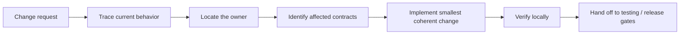
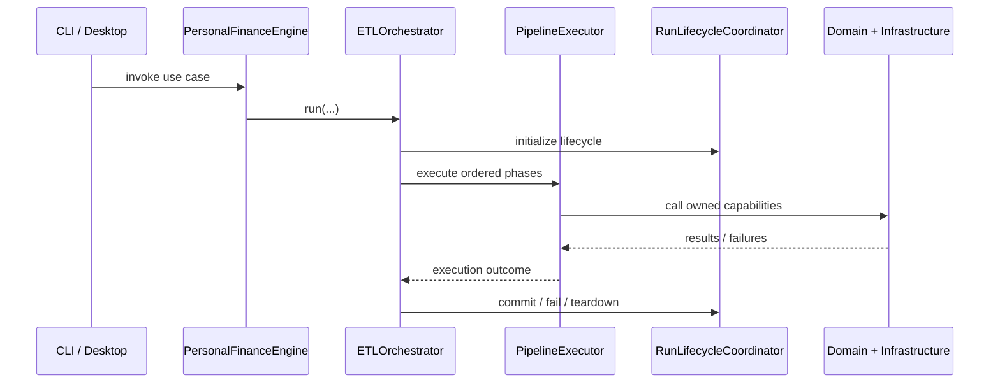
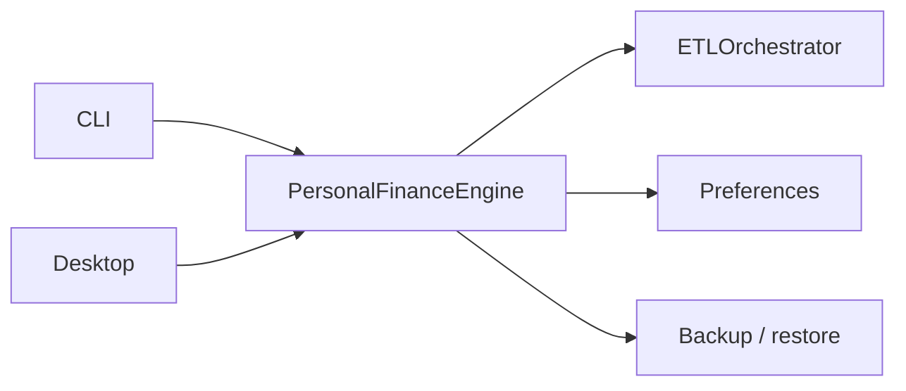
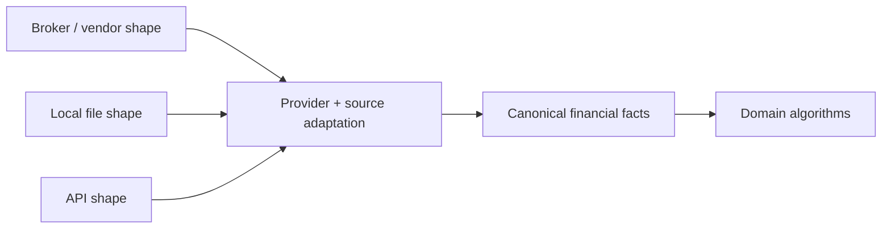
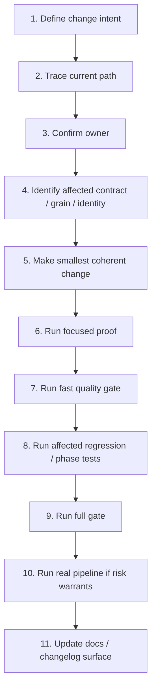

# Development Guide

Architecture tells me where responsibilities belong.

Development begins when I deliberately disturb that arrangement.

Maybe a broker changes a column. Maybe I add a new market-data stream. Maybe a portfolio metric needs a new canonical input. Maybe a Gold mart needs a different grain. Maybe a recovery path is too opaque to debug. The code change itself is rarely the hardest part.

The hard part is preserving the system's existing meanings while changing one of its mechanisms.

This guide follows that problem from the moment I open the repository to the point where a change is ready for deeper verification.



The ordering matters. I want to understand the existing behavior before I decide where to edit it.

## Start with the repository as a system, not a collection of files

The production package is organized around responsibility:

```text
src/personal_finance_etl/
├── application/
├── bootstrap/
├── config/
├── contracts/
├── domain/
├── infrastructure/
└── presentation/
```

Each top-level package answers a different question.

| Package | Developer question |
|---|---|
| `domain/` | What does this financial fact, algorithm, or invariant mean? |
| `application/` | Which use case runs, and how are domain/infrastructure capabilities sequenced? |
| `infrastructure/` | How is a concrete provider, database, filesystem, lock, log, or recovery mechanism implemented? |
| `contracts/` | What stable message crosses a boundary that deserves an explicit type? |
| `config/` | What settings and financial policy are valid at runtime? |
| `presentation/` | How does a human invoke or inspect the application? |
| `bootstrap/` | How are concrete dependencies assembled? |

A change may touch multiple packages, but only one should own the meaning.

## Read package contracts before code paths

The package docstrings are part of the architecture.

For example, application ingestion says exactly what it owns and refuses to own:

```python
# src/personal_finance_etl/application/ingestion/coordinator.py
"""Evidence extraction and gatekeeper schema validation coordinator.

Owns
----
- Orchestrating binary payload retrieval from the Control Plane Raw Store.
- Invoking file format providers (CSV, Excel, SQLite) to build lazy frames.
- Column mapping construction using column_master reference data.
- Gatekeeper schema validation and dry-run query evaluation on all actionable streams.

Does not own
-------------
- Physical file reading or network requests (owned by infrastructure.providers).
- Raw store storage transactions (owned by infrastructure.control_plane).
- Financial ledger or portfolio transformations (owned by domain.*).
"""
```

That docstring is more useful than a generic "service layer" diagram because it tells me what *not* to put there.

When I enter a package for the first time, I read:

1. the package/module docstring;
2. `__all__` exports;
3. public contracts/types;
4. orchestrating entry points;
5. tests that assert boundary behavior.

That usually tells me more than scanning filenames from top to bottom.

## The first development skill is tracing existing behavior

Before I implement a change, I trace the current path end to end.

For a pipeline change, the normal high-level route is:



If the change is financial, I keep tracing past orchestration until I reach the owning domain.

If the change is operational, I trace into the concrete infrastructure mechanism and its Control Plane/lifecycle consequences.

If the change is presentation-only, I stop before crossing into financial authority.

## The façade is the normal human-facing boundary

`PersonalFinanceEngine` is the application façade used by presentation surfaces.

That means presentation code should normally ask the façade to perform a use case rather than constructing storage managers or domain engines directly.



If a UI change seems to require importing a domain reconstruction engine directly, I pause. That usually means either:

- the application layer is missing a use-case boundary; or
- the UI is trying to own behavior it should only request.

## Bootstrap is assembly, not global reachability

`bootstrap/container.py` is the composition root.

It exists because concrete dependencies must be created somewhere.

```python
# src/personal_finance_etl/bootstrap/container.py
def create_orchestrator(
    self,
    config_path: str | None = None,
    rules_path: str | None = None,
    status_queue: ILogger | None = None,
    settings: Settings | None = None,
) -> ETLOrchestrator:
    """Assemble an ETLOrchestrator with all required dependencies wired."""
    cfg = settings or self.create_settings(config_path)
    rules = self.create_rules(rules_path)
    active_queue: ILogger = status_queue or cast(ILogger, _NullLoggerQueue())
    return ETLOrchestrator(cfg, active_queue, rules)
```

The important rule is not "everything must be injected."

The important rule is that concrete assembly stays visible and bounded instead of becoming a hidden service locator available from arbitrary domain code.

## Configuration is a dependency, not a bag of constants

The codebase separates environment/runtime settings from financial policy.

That distinction matters during development.

A setting such as a path, lock timeout, or application preference has different lifecycle and semantics from a financial rule such as a threshold, rate, or classification policy.

When adding configuration, I ask:

```text
Is this operational/runtime state?
    -> Settings / infrastructure-facing configuration

Is this financial policy?
    -> FinancialRules or domain-specific validated config

Is this temporary local developer behavior?
    -> probably not production configuration
```

A constant becomes dangerous when it silently encodes a financial decision that should have been explicit policy.

## Canonical facts are the anti-corruption boundary

External sources are messy by definition.

Broker names, vendor columns, Excel layouts, API payloads, and local database schemas are allowed to be ugly at the boundary.

They are not allowed to define the canonical financial vocabulary.



That means source-specific naming should disappear before canonical transformations and financial engines have to care about it.

A new source adapter should adapt to the model, not redesign the model around one broker's spreadsheet vocabulary.

## Grain is the first sentence of every data change

Before I add or modify a persistent/canonical dataset, I write one sentence:

> One row represents ...

Examples:

```text
one source artifact
one canonical transaction
one instrument x valuation date
one disposal x consumed acquisition lot
one run x external provider request
```

Grain determines:

- valid uniqueness keys;
- deterministic identity;
- join cardinality;
- aggregation rules;
- downstream BI behavior;
- reconciliation semantics.

A table can have every correct column and still be wrong if its grain is wrong.

## Identity is part of meaning

The project centralizes deterministic identity because local hash recipes are migration generators in disguise.

The identity system normalizes values and serializes ordered namespace fields before hashing.

If I add an identity-bearing record, I do not do this:

```python
# Do not create a one-off identity protocol.
row_id = sha256(f"{date}_{ticker}_{amount}".encode()).hexdigest()[:16]
```

I review the domain namespace and canonical identity machinery instead.

Identity changes are discussed in [Data Contract and Schema Evolution](data-contract-and-schema-evolution.md) because they affect replay continuity, references, and rebuild compatibility.

## LazyFrames are a pipeline capability

Polars lazy execution is the default for broad canonical transforms because it keeps optimization opportunities visible across chained operations.

A transformation like:

```python
lf.with_columns(...).filter(...).join(...).select(...)
```

keeps the plan available to Polars.

By contrast:

```text
LazyFrame
  -> collect()
  -> to_dicts()
  -> Python loop
  -> DataFrame
  -> lazy()
```

has crossed into eager Python execution.

Sometimes that is correct.

Stateful algorithms such as FIFO genuinely need ordered mutable state. Third-party libraries may require concrete Python structures. Publication is an explicit materialization boundary. Scalar extraction can be legitimate.

The engineering rule is:

> **Materialization must correspond to an actual boundary in the computation.**

This keeps performance review semantic instead of religious.

## Stateful finance stays stateful

The project intentionally does not force every financial algorithm into vectorized Polars.

FIFO lot accounting is a state machine over chronologically ordered purchases and disposals.

Trying to erase that state merely to keep everything "dataframe native" would make the code less honest.

Similarly, Monte Carlo simulation has numerical/runtime constraints that differ from canonical tabular transforms.

The useful split is:

| Problem | Preferred shape |
|---|---|
| deterministic column mapping | functional Polars expression |
| canonical projection/filter/join | functional lazy transform |
| lot book with mutable remaining quantity | stateful object/algorithm |
| workflow sequencing | application service/orchestrator |
| external provider with retries | infrastructure service |
| validated financial policy | Pydantic/config model |

OOP is used where there is something meaningful to own.

## Joins are financial semantics

A join is not only a dataframe operation.

It can change row multiplicity, evidence authority, and financial totals.

Before introducing a join, I make the cardinality explicit:

```text
1:1
many:1
1:many
many:many
```

For a many-to-one enrichment, I verify the lookup side is unique at the intended key.

For a one-to-many expansion, I verify the output grain changes intentionally.

A many-to-many join in financial data deserves suspicion until proven necessary.

## Null is not zero

Financial data routinely distinguishes:

- value not supplied;
- value invalid;
- value not applicable;
- value not computable;
- actual zero.

Those states should not be collapsed casually.

A dangerous pattern is:

```text
invalid populated string
    -> permissive cast
    -> null
    -> fill_null(0)
```

The result is convenient, numeric, and wrong with excellent confidence.

Validation should reject malformed required evidence before defaults are applied.

## Currency is part of the contract

A numeric value without clear currency semantics is incomplete financial data.

For multi-currency investments I distinguish, where relevant:

```text
transaction currency
market/local currency
base currency / INR representation
FX rate used
FX attribution
```

A change that renames or recomputes one of those values is a semantic change, not cosmetic refactoring.

## The registry is architecture in executable form

The Data Contract Registry connects named analytical datasets to schemas, grains, producers, and publication expectations.

When I add a persistent Silver or Gold output, I inspect the registry early rather than after the builder "works."

The important invariant is not merely that a table exists.

The important invariant is that:

```text
expected contract set
==
registered contract set
==
produced publication set
```

within the intended layer.

A producer without a registry entry is undocumented persistence. A registry entry without a producer is dead contract surface.

## Silver and Gold are complete publications

Silver and Gold are rebuilt/published as analytical layers from persistent evidence.

That affects how I think about changes:

- canonical transforms should be deterministic for equivalent evidence;
- schema changes should be compatible with rebuild behavior;
- identity continuity should be reviewed explicitly;
- downstream Gold should not depend on stale partial Silver state.

This is why schema evolution is not handled as ad hoc ALTER TABLE choreography throughout domain code.

## The Control Plane is not a warehouse convenience database

SQLite Control Plane state records operational history:

- runs;
- artifacts;
- retained payloads;
- artifact-run events;
- execution/failure history;
- provider request provenance;
- synchronization summaries;
- simulation provenance.

A development change that affects artifact lifecycle, recovery, or provider evidence may need Control Plane changes even if the analytical result is unchanged.

The Control Plane's historical authority is specified in [Control Plane and Artifact Lifecycle](../architecture/control-plane-artifact-lifecycle.md).

## Cross-database work must describe failure honestly

SQLite and DuckDB are separate transactional systems.

A coordinated workflow can sequence and recover them, but it does not become a distributed ACID transaction.

When I change persistence or lifecycle behavior, I trace:

```text
DuckDB started?
SQLite started?
DuckDB committed?
SQLite committed?
what CommitState follows?
what FailureDomain follows?
what can be rolled back?
what now requires convergence/recovery?
```

This is one of the places where precise language is engineering, not documentation polish.

## Logging carries operational context, not control flow

Logs are for humans and forensic reconstruction.

Machine behavior should use typed status/result structures rather than parsing log strings.

A log message can say:

```text
Gold publication complete
```

but code should not later decide success by checking whether the string contains `complete`.

Typed lifecycle state belongs in contracts. Human explanation belongs in logs.

## Local-first changes have local-first consequences

The application is intentionally local-first.

That influences development:

- file paths and permissions matter;
- database locks are real;
- snapshot/restore behavior matters;
- process termination can interrupt local transactions;
- desktop packaging matters;
- external providers are dependencies, not the system's permanent source of truth.

A feature that assumes a permanently available cloud service would need to justify changing that product principle.

## Concurrency is bounded by meaning

Concurrency is useful for independent extraction workloads and provider requests.

It is not automatically useful inside stateful finance or cross-store commit sequencing.

When adding concurrency, I ask:

1. are tasks truly independent?
2. does ordering matter?
3. does shared state exist?
4. does provider rate limiting change behavior?
5. can failure be attributed to one entity?
6. can results be combined deterministically?

The extraction contracts deliberately preserve entity-level status so concurrency does not erase attribution.

## The development environment should mirror the build metadata

The repository uses `pyproject.toml` as the package/build/dependency authority.

Hatchling is the build backend, and `uv` drives normal environment/build/publish workflows.

I avoid creating a second manual dependency universe for local development.

The useful setup principle is:

> Develop with the same package metadata that CI/release tooling will eventually build.

That reduces "works in the dev shell, fails in the wheel" drift.

## Use the repository task surface

Developer automation is exposed through Poe-backed tasks implemented in `scripts/tasks.py`.

The exact task graph is covered in [Tooling, Quality, and Release Engineering](tooling-quality-and-release-engineering.md), but the development loop usually looks like:

```text
focused edit
    -> focused tests
    -> audit-fast
    -> coherent commit
    -> audit-full
    -> PR / release workflow when appropriate
```

The task layer is preferred over copying long raw commands into random notes because it keeps one maintained execution surface.

## Static analysis is part of normal development

The repository's primary quality surface combines:

- Ruff;
- formatting checks;
- Mypy;
- Pyright;
- Pylint;
- Pytest.

Those tools overlap slightly but answer different questions.

They do not replace domain tests, financial regression, or pipeline execution.

A type checker cannot tell me whether FIFO consumed the correct acquisition lot. A passing FIFO test cannot tell me presentation code imported infrastructure illegally.

## Tests should protect contracts, not decomposition trivia

When I add tests, I prefer stable semantic assertions:

```text
financial result
identity
row grain
lifecycle state
failure classification
public contract
architecture dependency
```

I avoid coupling tests to private helper choreography unless that helper behavior is itself the thing being specified.

That preserves refactoring freedom.

## Performance work begins with evidence

The current codebase contains performance-sensitive areas:

- large lazy transformation plans;
- Quant/FIFO reconstruction;
- market-data workloads;
- Monte Carlo simulation;
- warehouse publication.

I benchmark representative workloads before and after a performance change.

The useful question is not:

> Did I remove three `.collect()` calls?

It is:

> Did I remove unnecessary materialization without changing financial outputs or making the implementation harder to reason about?

Performance and correctness are reviewed together.

## Documentation is part of the change

Canonical docs are not post-release archaeology.

If a change alters:

- public API;
- ownership;
- grain;
- identity;
- schema;
- failure semantics;
- recovery;
- financial methodology;
- developer workflow;

then documentation changes in the same conceptual batch.

Source docstrings explain local responsibility. `/docs` explains the canonical technical system. Wiki later teaches the mental model. README later shows the project.

Those surfaces have different jobs.

## The normal development workflow

The practical loop is:



### Before coding

I want to be able to answer:

- what owns this behavior now?
- what contract will change?
- what is the grain?
- does identity change?
- what persists?
- what can fail?
- what is the smallest useful proof?

### During coding

I watch for:

- anonymous stable structures;
- new eager boundaries;
- duplicate financial policy;
- provider-specific logic leaking inward;
- new cross-layer imports;
- implicit null/default semantics;
- logs becoming machine state.

### Before the change leaves my machine

I expect:

- focused behavior tests;
- source documentation updated;
- fast/full quality gates appropriate to the risk;
- architecture/contract regressions checked;
- real pipeline execution for high-risk financial/persistence changes;
- release notes when the change belongs in release history.

## A completion checklist should answer "why", not only "done"

Before I call a development change complete:

- [ ] I can name the owning package and responsibility.
- [ ] I can state the grain of every affected durable/canonical dataset.
- [ ] I reviewed deterministic identity impact.
- [ ] I preserved observed vs reconstructed semantics.
- [ ] I classified every new materialization boundary.
- [ ] I reviewed cross-database failure behavior if persistence changed.
- [ ] I used stable named contracts for stable cross-boundary state.
- [ ] I added/updated tests at the correct proof level.
- [ ] I updated source docs and canonical docs where meaning changed.
- [ ] The repository quality gate agrees with me.

The next question is therefore unavoidable:

> If this is the workflow, **what rules make a change acceptable even before tests run?**

That is the job of [Engineering Standards](engineering-standards.md).

## Related specifications

- [Engineering Standards](engineering-standards.md)
- [Application and Dependency Architecture](../architecture/application-and-dependency-architecture.md)
- [Data Lifecycle](../architecture/data-lifecycle.md)
- [Deterministic Identity and Replay](../architecture/deterministic-identity-and-replay.md)
- [Testing and Validation](testing-and-validation.md)
- [Tooling, Quality, and Release Engineering](tooling-quality-and-release-engineering.md)
