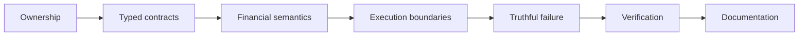
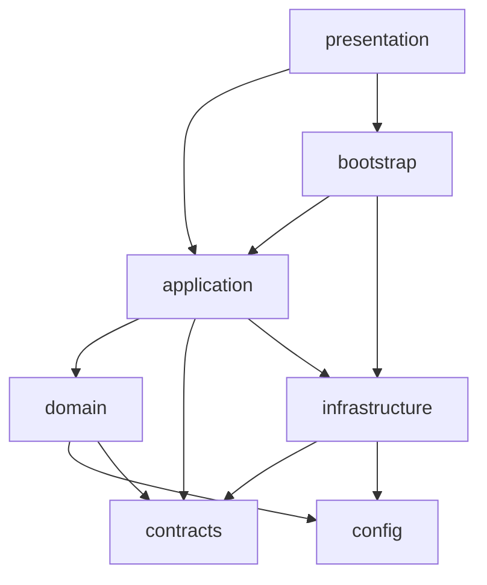

# Engineering Standards

A codebase can have clean packages and still drift.

All it takes is one convenient shortcut at a time.

A domain function reaches into DuckDB because the query is already written. A workflow returns a loose dictionary because creating a result type feels excessive. A provider failure becomes an empty frame because downstream code is easier that way. A long function gets split into five helpers that still share the same hidden state. A performance pass removes every `.collect()` except the one that was actually expensive.

None of those changes necessarily looks catastrophic in isolation.

Together, they dissolve architecture.

This specification defines the permanent engineering rules I use to keep that from happening.

> **The standard is not "make the code look clean." The standard is "make ownership, meaning, failure, and proof explicit enough that another competent engineer can reason about the system without rediscovering its architecture from runtime behavior."**



These rules are intentionally stronger than style guidance. They are the conditions under which a change belongs in the codebase.

## 1. Ownership is decided before implementation

Every production behavior has one primary owner.

The current ownership model is:

| Responsibility | Owner |
|---|---|
| financial meaning, formulas, invariants | `domain/` |
| use-case sequencing and workflow coordination | `application/` |
| concrete providers, files, stores, locks, recovery, logs | `infrastructure/` |
| stable messages that genuinely cross boundaries | `contracts/` |
| validated runtime settings and financial policy | `config/` |
| CLI/Desktop/docs presentation | `presentation/` |
| concrete dependency assembly | `bootstrap/` |

A change may cross these packages. Responsibility should not.

A Gold builder may consume Tax output. It does not become the owner of Tax classification.

An application service may decide when FIFO runs. It does not become the owner of FIFO mathematics.

A provider may know Yahoo Finance payload behavior. It does not become the owner of canonical market semantics.

## 2. Dependency direction must survive convenience

Architecture boundaries are valuable precisely when violating them would be convenient.

The dependency rule can be summarized as:



The exact legal imports are enforced by architecture tests.

I do not add an exception casually just because one import would save fifteen lines.

Fifteen lines are cheap. Architectural ambiguity compounds interest.

## 3. Package docstrings are contracts

A substantial package/module should state:

```text
Owns
Does not own
```

That wording is deliberate.

Most architecture drift begins with a module doing something nobody explicitly said it should not do.

The `Does not own` section provides a negative boundary.

For example, an ingestion coordinator can own evidence acquisition orchestration while explicitly refusing to own provider mechanics, persistence transactions, or financial transforms.

That is far more actionable than calling it a "service."

## 4. Public APIs are intentional surfaces

Meaningful packages expose deliberate `__all__` APIs.

That lets internal implementation evolve without forcing consumers to depend on deep file paths.

Prefer:

```python
from personal_finance_etl.application.investments import QuantService
```

over importing a private helper from three package levels down unless that helper is intentionally part of the supported surface.

An explicit API is a maintenance boundary.

## 5. Stable cross-boundary shapes get names

A stable structure that crosses a meaningful boundary should usually be represented by a named contract.

The codebase uses different Python mechanisms for different semantics.

### Dataclasses

Use when the value is a concrete state/result record with meaningful fields and possibly small behavior.

`ExtractionBatchResult` is a good example:

```python
# src/personal_finance_etl/contracts/extraction.py
@dataclass
class ExtractionBatchResult:
    """Structured extraction outcome across concurrent entity workers."""

    requested_entities: list[str] = field(default_factory=lambda: list[str]())
    successful_entities: list[str] = field(default_factory=lambda: list[str]())
    cached_entities: list[str] = field(default_factory=lambda: list[str]())
    no_new_data_entities: list[str] = field(default_factory=lambda: list[str]())
    failed_entities: dict[str, str] = field(default_factory=lambda: dict[str, str]())
    frames: list[pl.DataFrame] = field(default_factory=lambda: list[pl.DataFrame]())
```

### Protocols

Use when callers need behavior without depending on one concrete implementation. The status sink is intentionally defined as a capability contract:

```python
# src/personal_finance_etl/contracts/logging.py
class StatusQueue(Protocol):
    """Protocol for cross-process status queue sinks."""

    def put(
        self,
        status: object,
        block: bool = True,
        timeout: float | None = None,
    ) -> None:
        """Put a status item onto the queue."""
        ...
```

Application/presentation code can depend on `put(...)` capability rather than a concrete queue implementation.

### `TypedDict`

Use when dictionary semantics are genuinely useful but the shape is still stable.

Provider audit records are one example:

```python
class ExtractionProviderRequest(TypedDict, total=False):
    provider: str
    entity: str
    requested_start: date | None
    requested_end: date | None
    attempt_count: int
    status: str
    failure_class: str | None
    final_error: str | None
```

### Protocols

Use when callers need a behavior/capability but should not depend on one concrete implementation.

Logging/status queues and other cross-layer capabilities fit this model.

### Pydantic models

Use when validation, defaults, aliases, and configuration parsing are first-class concerns.

### Pydantic models

Use when validated configuration, defaults, aliases, and descriptive policy fields are first-class. Environment settings are an example:

```python
# src/personal_finance_etl/config/settings.py
class FileHashPolicy(BaseModel):
    """File content hashing policy flags for source deduplication across format categories."""

    csv: bool = True
    excel: bool = False
    sqlite: bool = False
```

FinancialRules uses the same validation machinery for a different authority: financial policy rather than filesystem/runtime environment. The shared library does not collapse those two responsibilities.

### Enums / `StrEnum`

Use when legal machine states are finite and should not be reconstructed from strings.

The recurring principle is simple:

> If the shape is stable enough that downstream code reasons about its fields, it is stable enough to deserve a name.

A `dict[str, Any]` can be flexible. So can a shopping bag with a hole in the bottom. Neither is a great long-term transport contract. 😂

## 6. `Any` belongs at dynamic edges, not in stable domain language

Some dynamic typing is legitimate:

```text
third-party libraries with incomplete typing
serialization/deserialization boundaries
heterogeneous external payloads
compiler/library constraints such as Numba integration
```

The standard is to **narrow uncertainty at the boundary**.

External data may enter dynamically.

Internal stable financial/application structures should become typed as soon as their shape is known.

## 7. Functions and classes are chosen by responsibility

The codebase intentionally mixes functional and object-oriented design.

Use a class when it meaningfully owns:

- mutable state;
- lifecycle;
- invariants;
- dependencies;
- policy;
- coordinated side effects.

Use a function when the responsibility is naturally:

```text
input -> deterministic transformation -> output
```

A canonical Polars mapping often wants a function.

A FIFO lot book wants state.

A pipeline lifecycle coordinator wants a lifecycle object.

A provider with retries/config/dependencies often wants an object.

The rule is not "OOP is better." The rule is "objects should own something."

## 8. SRP means one reason to change, not one tiny function

Single Responsibility Principle is about change authority.

A 500-line schema catalog can be cohesive if all of it changes because the schema contract changes.

A 60-line function can violate SRP if it mixes:

```text
provider retries
financial classification
database writes
UI messages
```

I use length/complexity metrics as investigation signals, not automatic refactoring commands.

## 9. Complexity is classified before it is reduced

High complexity can mean different things:

```text
orchestration doing too much
nested policy decisions
stateful financial algorithm
numerical kernel
large declarative catalog
error-handling fan-out
```

Those should not all be "fixed" the same way.

Useful classifications include:

```text
DECOMPOSE_RESPONSIBILITY
EXTRACT_POLICY
EXTRACT_TYPED_OPERATION
SIMPLIFY_BRANCHING
KEEP_COHESIVE
NUMERICAL_KERNEL_EXCEPTION
DECLARATIVE_EXCEPTION
STATEFUL_ALGORITHM_EXCEPTION
```

This protects the codebase from metric-driven decomposition that makes the architecture harder to understand.

## 10. Guard clauses are preferred when they clarify legal state

Nested control flow hides invalid states.

When possible, validate and exit early:

```text
invalid input
    -> fail now

missing required evidence
    -> fail now

unsupported state
    -> fail now
```

Then let the main body describe the valid path.

But readability remains the goal.

Turning a financial decision tree into one compressed boolean expression to reduce indentation is not simplification. It is cryptography.

## 11. Grain is part of every durable data contract

Every canonical or analytical dataset should be able to answer:

> What does one row mean?

The grain is not documentation garnish.

It determines:

- uniqueness;
- identity;
- joins;
- aggregation;
- reconciliation;
- BI relationships.

A change in grain is a contract change even if every column name stays the same.

## 12. Identity is centralized and deterministic

Deterministic identity is not implemented ad hoc inside each transform.

The shared identity machinery normalizes values, uses namespace-specific ordered fields, serializes canonically, and hashes deterministically.

If I need a new identity namespace, I extend that protocol deliberately.

I do not create a private hash recipe in a helper because "this ID is only local."

Local IDs have an impressive habit of becoming foreign keys later.

## 13. Financial semantics outrank storage convenience

Storage choices must preserve economic meaning.

Examples:

- observed holding evidence remains distinguishable from reconstructed holding state;
- realized and unrealized values remain distinct;
- transaction/local/base currency values remain explicit;
- reconciliation does not erase disagreement;
- Tax estimates are not described as statutory liability;
- stochastic FIRE output is not presented as deterministic replay.

If a storage model forces two different meanings into one field, the storage model is wrong.

## 14. Missing, invalid, zero, and not-applicable are different states

These values often have different economic meaning:

```text
0
null
invalid
not supplied
not applicable
not computable
```

I do not collapse them merely to make aggregation easier.

Validation should reject malformed required evidence before downstream defaults can turn it into a plausible number.

## 15. Joins require declared cardinality

A join can silently change financial totals.

Before introducing one, I declare the expected cardinality:

```text
1:1
many:1
1:many
many:many
```

Then I validate the lookup/relationship keys accordingly.

Many-to-many joins deserve explicit justification.

## 16. Currency is never implicit when multiple currencies matter

For investment and wealth logic, names and contracts should distinguish:

- source/transaction currency;
- market/local currency;
- INR/base representation;
- FX rate;
- FX contribution/attribution.

A generic `value` column is acceptable only where the surrounding contract makes the currency unambiguous.

## 17. Polars stays lazy until a real boundary

`LazyFrame` is the default for broad canonical transformation chains.

A materialization boundary must correspond to a reason.

Useful categories are:

| Boundary | Why eager state is legitimate |
|---|---|
| publication | data must be persisted |
| stateful algorithm | Python/object state is the model |
| third-party integration | API/library requires concrete values |
| process boundary | data crosses workers/processes |
| scalar extraction | one concrete value is required |
| diagnostic/validation | material state is necessary to inspect failure |

`collect_schema()` is schema inspection, not equivalent to collecting the dataset.

The code review question is not "Did you use `.collect()`?"

It is "Why does this point need materialized data?"

## 18. Avoid Polars -> Python -> Polars round-trips unless state requires it

Round-tripping a dataframe through Python containers discards optimizer visibility and often adds allocation/serialization cost.

It is justified when:

- FIFO needs ordered mutable lot state;
- a library accepts Python records only;
- process boundaries require serialization;
- the algorithm is fundamentally record-state driven.

It is not justified merely because Python loops feel familiar.

## 19. State machines use typed states

Lifecycle/recovery code uses explicit states such as commit/failure outcomes.

Machine decisions should depend on those structures.

Logs explain what happened to humans.

I do not build critical control flow like:

```python
if "success" in message.lower():
    ...
```

That is not a state machine. That is a séance.

## 20. Error semantics are part of the public contract

Exceptions and result states should communicate what failed and at which boundary.

For extraction, `ExtractionCompletenessError` includes failed entities, requested interval, and provider context.

For lifecycle/recovery, typed failure domains and commit states communicate cross-store state.

A generic `RuntimeError("failed")` is acceptable only when no caller needs more structured meaning.

## 21. Do not overclaim guarantees

Words such as:

```text
atomic
complete
recovered
rolled back
consistent
validated
reproducible
```

have technical meaning.

Use them only where the implementation proves the claim.

SQLite and DuckDB can be coordinated. They are not one distributed ACID transaction.

A provider batch can be complete according to requested-entity policy. That does not prove the external provider itself had perfect market history.

A FIRE simulation can be reproducible under captured inputs/seeds. That does not make stochastic output deterministic financial truth.

## 22. Source docstrings explain local ownership

Every substantial module should describe what it owns and excludes.

Public classes/functions/methods document:

- purpose;
- parameters;
- returns;
- raised errors;
- side effects;
- important invariants;
- financial grain/semantics where relevant.

Private helpers also need documentation when the algorithm is non-obvious, financial, stateful, or performance-sensitive.

## 23. Comments explain why, not syntax

Useful comment:

```text
# Preserve observed quantity even when reconciliation creates a synthetic adjustment lot.
```

Weak comment:

```text
# Increment i by 1.
```

Comments should preserve reasoning that is not obvious from the code.

## 24. Tests protect semantic contracts

The preferred assertions are around:

- financial outputs;
- grain;
- deterministic identity;
- lifecycle transitions;
- failure classification;
- public API behavior;
- architecture boundaries;
- replay/recovery invariants.

Tests should not freeze private decomposition without a reason.

## 25. Architecture rules are executable

The repository includes architecture tests that protect dependency direction and package boundaries.

When a new architectural exception is genuinely needed, I update the reasoning and tests deliberately.

I do not work around the test with dynamic imports and call the architecture preserved.

## 26. Quality tools are complementary

Ruff, Mypy, Pyright, Pylint, and Pytest are not competing for the title of "the tool that proves correctness."

They detect different classes of problems.

A clean quality gate is necessary evidence.

It is not sufficient evidence for financial correctness.

## 27. Performance work preserves semantic observability

A performance change should be measurable and explainable.

I record:

```text
representative workload
before timing
change
post-change timing
financial/output comparison
trade-off
```

A faster result that cannot be audited is not automatically better.

## 28. Security stays at the boundary

Secrets, tokens, and credentials:

- come from environment or controlled secret files;
- are not committed;
- are not printed;
- are not embedded in documentation examples.

Publishing tooling loads secrets for use, not display.

## 29. Exceptions are documented as exceptions

A standard can have justified exceptions.

A good exception records:

```text
where it applies
why the normal rule is unsuitable
what risk is accepted
what would allow the exception to disappear
```

Silent exceptions become precedent accidentally.

## 30. Canonical documentation is release-agnostic

Technical docs describe the stable current system.

Release history belongs in CHANGELOG and GitHub Releases unless a genuine protocol/compatibility version is part of the technical contract.

This keeps architecture readable as architecture rather than as a fossil record.

## 31. Documentation itself has ownership

The documentation surfaces have different responsibilities:

```text
README = SHOW
Wiki   = TEACH
/docs  = SPECIFY
Code   = PROVE
```

Developer docs therefore specify mechanics, contracts, failure behavior, and extension rules.

They do not need to repeat every conceptual explanation from the Wiki or every marketing proof point from the root README.

## 32. "Done" means another engineer can reason about the change

Before I call a non-trivial change done, another competent engineer should be able to answer:

```text
Who owns this behavior?
What contract changed?
What is the grain?
What determines identity?
What can fail?
What becomes durable?
Why is this eager?
Why is this object stateful?
What proves the change?
What did we deliberately not guarantee?
```

If those answers still require archaeology, the implementation may work, but the engineering contract is incomplete.

Standards are useful only if the repository can enforce them without relying on perfect human memory.

The next specification therefore moves from *rules* to *machinery*: the fast/full quality gates, tracked Git hooks, structured audits, commit/PR automation, build path, and release/publish controls that turn these standards into a repeatable developer loop.

Continue with [Tooling, Quality, and Release Engineering](tooling-quality-and-release-engineering.md).

## Related specifications

- [Development Guide](development-guide.md)
- [Adding Data Sources](adding-data-sources.md)
- [Testing and Validation](testing-and-validation.md)
- [Tooling, Quality, and Release Engineering](tooling-quality-and-release-engineering.md)
- [Application and Dependency Architecture](../architecture/application-and-dependency-architecture.md)
