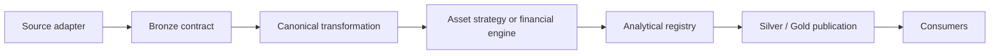

# Extension contracts and dependency rules

I extend the system at explicit seams: source adapters, canonical transformations, financial engines, analytical contracts, and presentation outputs. A new DataFrame alone does not justify a new table or a new domain abstraction.

## Extension dependency map



I keep source-specific parsing upstream of canonical financial facts and keep BI-oriented decisions downstream of financial calculation.
## Bronze contract declaration

**Source:** `src/personal_finance_etl/backend/load/registry.py` (line 16).

```python
class BronzeDataContract:
    """Defines the relationship between raw extraction attributes, control plane sync categories, and physical DuckDB tables."""

    extraction_attribute: str
    sync_category: str
    physical_table: str
    is_full_replace: bool


BRONZE_CONTRACT_REGISTRY: list[BronzeDataContract] = [
    BronzeDataContract("zcategory", "sqlite_source", "bronze.r_SQLite_ZCategory", True),
    BronzeDataContract("assetgroup", "sqlite_source", "bronze.r_SQLite_AssetGroup", True),
    BronzeDataContract("assets", "sqlite_source", "bronze.r_SQLite_Assets", True),
    BronzeDataContract("currency", "sqlite_source", "bronze.r_SQLite_Currency", True),
```

I register extraction attribute, synchronization category, physical table, and replacement policy together. This avoids a disconnected mapping between extraction and persistence.
## Analytical contract declaration

**Source:** `src/personal_finance_etl/backend/load/registry.py` (line 5).

```python
class DataContract:
    contract_id: str
    layer: str
    physical_table: str
    domain: str
    grain: str
    producer: str
    publication_order: int


@dataclass
class BronzeDataContract:
```

I define the physical table, domain, grain, producer, and publication order explicitly. The registry describes publication metadata; it does not replace the physical DDL.
## Asset strategy interface

**Source:** `src/personal_finance_etl/backend/pipeline/strategies.py` (line 33).

```python
class AssetPipeline(Protocol):
    def process(
        self,
        extracted: ExtractionResult,
        d_asset_subcategory_lazy: pl.LazyFrame,
        rules: FinancialRules,
        logger: logging.Logger,
    ) -> AssetPipelineResult:
        """
        Process the asset-specific logic.
        Must return AssetPipelineResult.
        """
        ...

```

**Source:** `src/personal_finance_etl/backend/pipeline/strategies.py` (line 48).

```python
class StockPipeline:
    def process(
        self,
        extracted: ExtractionResult,
        d_asset_subcategory_lazy: pl.LazyFrame,
        rules: FinancialRules,
        logger: logging.Logger,
    ) -> AssetPipelineResult:
        logger.debug("Parsing unstructured Stock Excel files...")
        market_data = get_stg_stock_market_data(
            extracted.stock_market_data_raw, rules.DEFAULT_CURRENCY_ID
        )
        market_data_ref = get_stg_stock_market_data_ref(market_data)

```

I prefer a new strategy only when a source or asset type has genuinely different canonicalization behavior. Existing stock, US-stock, and mutual-fund strategies illustrate the current seam.
## Transformation DAG

**Source:** `src/personal_finance_etl/backend/pipeline/core/transformer.py` (line 49).

```python
class TransformationDAG:
    def __init__(self, cfg: Settings, status_queue: ILogger, rules: "FinancialRules | None" = None):
        self.cfg = cfg
        self.status_queue = status_queue
        self.rules = rules

    def run(self, extracted: ExtractionResult) -> dict[str, pl.DataFrame]:
        assert self.rules is not None, "FinancialRules must be provided to TransformationDAG"
        logger.debug("Transforming Base Dimensions...")
        mappings = extracted.mappings
        d_income_category_lazy = transform_d_income_category(
            extracted.zcategory, mappings["category"], self.rules
        )
        d_income_subcategory_lazy = transform_d_income_subcategory(
            extracted.zcategory, mappings["category"], d_income_category_lazy, self.rules
        )
```

I add canonical fields and derived facts at the transformation boundary rather than introducing source-specific assumptions inside a shared finance engine.
## Publication interfaces

**Source:** `src/personal_finance_etl/backend/load/silver.py` (line 75).

```python
    def load(self, dfs: dict[str, pl.DataFrame]) -> None:
        """Truncates all silver.* tables and re-inserts via db_manager.conn."""

        logger.info("Loading transformed datasets into Silver layer...")

        contracts = sorted(
            (c for c in DATA_CONTRACT_REGISTRY if c.layer == "silver"),
            key=lambda c: c.publication_order,
        )
        # Phase 1: Cleanly wipe the entire schema and its foreign keys
        self.db_manager.conn.execute("DROP SCHEMA IF EXISTS silver CASCADE")
        self.db_manager.conn.execute("CREATE SCHEMA silver")
        self.db_manager.conn.execute(SILVER_DDL)

        # Phase 2: Insert all data in forward topological order (Dimensions -> Facts)
```

**Source:** `src/personal_finance_etl/backend/load/gold.py` (line 30).

```python
    def load(self, dfs: dict[str, pl.DataFrame]) -> None:
        """Truncates all gold.* tables and re-inserts presentation DataFrames."""

        logger.info("Loading presentation datasets into Gold layer...")

        contracts = sorted(
            (c for c in DATA_CONTRACT_REGISTRY if c.layer == "gold"),
            key=lambda c: c.publication_order,
        )
        # Phase 1: Cleanly wipe the entire schema
        self.db_manager.conn.execute("DROP SCHEMA IF EXISTS gold CASCADE")
        self.db_manager.conn.execute("CREATE SCHEMA gold")
        self.db_manager.conn.execute(GOLD_DDL)

        # Phase 2: Insert all data
```

I must update both registry and physical DDL when adding a persisted output. The loader cannot infer a correct financial grain from an arbitrary frame.
## Extension acceptance checklist

1. Identify source category and stable artifact identity.
2. Define extraction attribute and Bronze replacement policy.
3. Establish canonical schema, units, dates, currency, and financial grain.
4. Add a strategy or engine dependency only if the existing boundary cannot express the behavior.
5. Declare analytical contract and physical DDL together.
6. Verify output keys, null handling, and consumer assumptions.
7. Add isolated edge-case fixtures and an end-to-end regression scenario.
8. Update the appropriate documentation specification and manifest after the documentation tree is finalized.
## Boundaries and related guides

See [Adding data sources](adding-data-sources.md), [Adding asset pipelines](adding-asset-pipelines.md), [Adding Gold marts](adding-gold-marts.md), and [Reference contracts](../reference/README.md).
