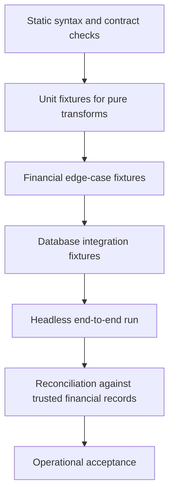
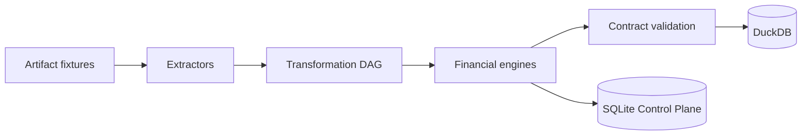

# Testing, regression, and verification

I treat testability as a contract between source inputs, canonical transformations, financial engines, and persisted analytical outputs. My repository contains a headless execution harness and configuration fixtures; I do not claim that it contains a comprehensive automated unit-test suite.

## Verification hierarchy



I distinguish what the repository currently exercises from tests that would be valuable to add. Daily paise-to-paise reconciliation is operational evidence, not automatic coverage of failure branches.
## Existing headless harness

**Source:** `tests/run_headless.py` (line 9).

```python
class LoggerQueue:
    def __init__(self) -> None:
        self._q: queue.Queue[EngineStatus] = queue.Queue()

    def put(self, status: EngineStatus, block: bool = True, timeout: float | None = None) -> None:
        self._q.put(status, block=block, timeout=timeout)


def main():
    print("Starting Headless ETL Pipeline...")
    q = LoggerQueue()
    start_time = time.time()

    try:
```

**Source:** `tests/run_headless.py` (line 17).

```python
def main():
    print("Starting Headless ETL Pipeline...")
    q = LoggerQueue()
    start_time = time.time()

    try:
        cfg = Settings.from_toml("config.toml")

        # Run in main thread for profiling
        orchestrator = ETLOrchestrator(cfg, q)
        orchestrator.run()
    except Exception as e:
        print(f"Error: {e}")
        raise e

    end_time = time.time()
```

I can run the orchestrator in the main thread using a queue-compatible status sink. This harness requires local configuration and source data; it is not a hermetic test with a known expected-result fixture.
## Registry validation as a fast guard

**Source:** `src/personal_finance_etl/backend/load/registry.py` (line 484).

```python
def validate_registry() -> None:
    seen_ids: set[str] = set()
    seen_tables: set[str] = set()
    silver_count = 0
    gold_count = 0

    for contract in DATA_CONTRACT_REGISTRY:
        if not contract.contract_id:
            raise ValueError("Contract ID cannot be empty.")
        if contract.contract_id in seen_ids:
            raise ValueError(f"Duplicate contract_id found: {contract.contract_id}")
        seen_ids.add(contract.contract_id)

        table_lower = contract.physical_table.lower()
        if table_lower in seen_tables:
            raise ValueError(
                f"Duplicate Silver/Gold physical table mapping: {contract.physical_table}"
            )
```

I check unique analytical IDs, unique physical tables, required producer/grain values, and allowed layers before trusting a registry. This verifies structural metadata, not financial arithmetic.
## Recommended financial regression cases

| Domain | Deterministic fixture | Assertion |
|---|---|---|
| FIFO | two acquisitions, partial sale | exact lot depletion and realized basis |
| FIFO oversell | sale exceeds remaining units | explicit expected behavior, including any remainder |
| FX | missing/zero/non-finite rate | documented validation or propagation behavior |
| Tax | acquisition dates around rule cutoffs | classification and review flags |
| FIRE | portfolio frame absent | explicit failure or fallback contract |
| Identity | reordered equivalent inputs | stable canonical event IDs |
| Registry | duplicate IDs and table names | validation rejects malformed registry |
| Recovery | interrupted second commit | inspect divergent stores and reconciliation |
## Layered testing boundary



I prefer small, synthetic fixtures at the lowest responsible boundary, then a small number of integrated scenarios that verify publication and persistence.
## Reproducible acceptance evidence

For each fixture I would record source artifact hashes, configuration snapshot, expected event-level outputs, physical table grain, tolerance policy for decimal arithmetic, and run result. I do not equate a successful import or syntax compilation with numerical correctness.
## Related technical specifications

See [Financial FIFO](../finance/fifo-and-lot-accounting.md), [Data quality](../data-engineering/data-quality-and-validation.md), [Identity contracts](../reference/identity-contracts.md), and [Failure scenarios](../operations/failure-scenarios.md).
