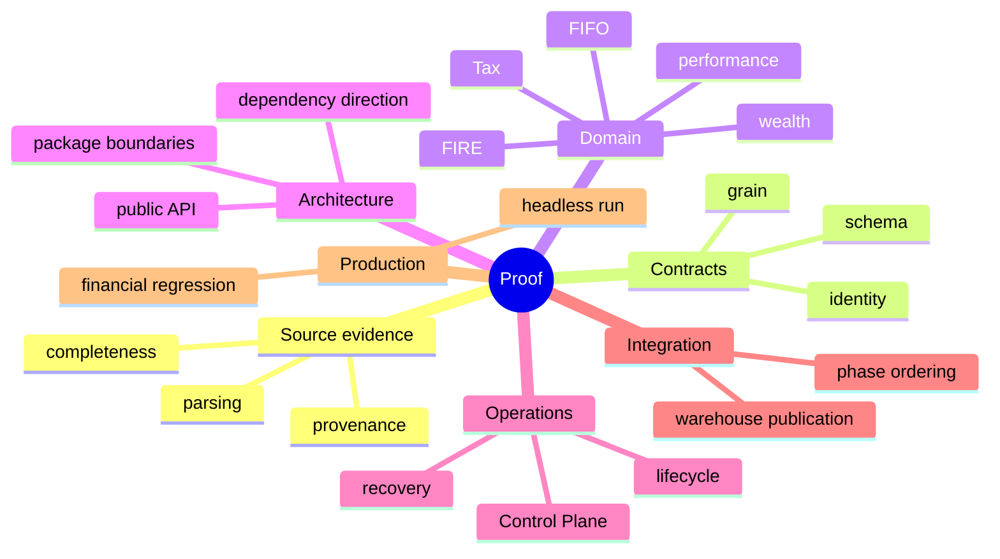

# Testing and Validation

A financial data system can be wrong in several different ways while still looking healthy.

The code can type-check and calculate the wrong Tax classification. A unit test can pass while a join duplicates portfolio value. A full pipeline can finish successfully while one provider silently returned incomplete evidence. A schema can match perfectly while its grain changed. A stochastic simulation can vary exactly as designed and still fail a brittle snapshot test.

That is why testing here is not one pyramid.

It is a **proof system** built around different kinds of risk.



The governing rule is:

> **Use the smallest proof that matches the risk, then escalate until the affected contract is covered end to end.**

## Start by asking what can be wrong

Before writing a test, classify the failure mode.

| Risk | Best first proof |
|---|---|
| formula/financial rule | focused domain test |
| schema/grain/identity | contract test |
| wrong package dependency | architecture test |
| workflow order | application/phase test |
| provider completeness | extraction integration test |
| cross-store failure | lifecycle/recovery test |
| real installation/runtime wiring | headless pipeline/smoke run |
| performance regression | representative benchmark |

A test is useful when it proves a specific contract.

"Coverage went up" is not a contract.

## The repository has an intentionally layered test surface

The current tests encode several scopes:

```text
contracts
configuration and primitives
infrastructure
extraction and ingestion
canonical domains
investments and Quant
Tax
household / wealth / FIRE
orchestration and bootstrap
presentation
legacy-boundary demolition
constitutional / architecture certification
```

The phase naming reflects the history of how the architecture was hardened, but the permanent value is present-day regression coverage.

Those tests protect boundaries that ordinary local unit tests could miss.

## Architecture tests make package rules executable

Architecture is not only described in Markdown.

Tests should fail when illegal dependencies return.

Examples of high-value architecture assertions:

```text
domain does not import concrete persistence or presentation
presentation enters through application-facing surfaces
retired package topology does not reappear
public package exports remain intentional
composition/bootstrap ownership stays bounded
```

This matters because architecture drift usually arrives as a useful one-line import.

The test is there to make that convenience expensive immediately instead of after six months.

## Contract tests prove more than column presence

For a durable/canonical dataset, a meaningful contract test can include:

- exact schema;
- field types;
- grain/key uniqueness;
- deterministic identity;
- null/required semantics;
- allowed categorical vocabulary;
- producer/registry presence;
- relationship/cardinality assumptions.

A table with the right columns at the wrong grain is not valid.

A row with the right values under a new random ID may not be valid either.

## Configuration validation is its own proof layer

Settings and financial rules are executable dependencies. Tests should prove invalid configuration fails before deep pipeline execution.

Useful cases include:

```text
missing required paths/settings
invalid enum/vocabulary values
out-of-range financial assumptions
inconsistent date/rate inputs
alias/default parsing behavior
```

Configuration tests are especially valuable because they turn user-facing mistakes into early, local failures instead of downstream financial anomalies.

## QA specifications and executable tests are different evidence

Not every quality assertion belongs in Pytest.

Some checks are better expressed as:

```text
manual visual review
real production run comparison
performance benchmark
BI refresh / model inspection
documentation rendering QA
```

The important rule is to label the evidence honestly.

A Markdown checklist is not an automated test. A one-time successful smoke run is not a regression suite. An architecture test that runs on every gate is stronger evidence for that specific invariant.

The documentation should never blur those maturity levels.
## Extraction tests prove evidence completeness

Provider/entity extraction should test categorical outcomes, not merely whether a DataFrame was returned.

The extraction vocabulary includes states such as:

```text
SUCCESS
CACHED
NO_NEW_DATA
PARTIAL
EMPTY_RESPONSE
FAILED
RETRY_EXHAUSTED
INVALID_PAYLOAD
```

Tests should prove the application distinguishes them correctly.

For example:

```text
one required entity -> RETRY_EXHAUSTED
```

should not become:

```text
batch complete with fewer rows
```

The `ExtractionBatchResult` completeness contract is the thing being tested.

## Source-adapter tests need ugly inputs

Happy files are useful but insufficient.

A file/provider test matrix should include:

```text
valid complete input
valid empty input where allowed
missing required columns
invalid populated dates/numerics
duplicate keys
unexpected sheet/table
partial provider batch
retry exhaustion
missing retained payload
renamed/overlapping evidence where relevant
```

Source code is supposed to protect the financial model from messy evidence.

If the tests only contain pristine fixtures, they are testing a world the source boundary was invented to handle already.

## Gatekeeper validation should fail before finance becomes plausible

Gatekeeper tests should prove malformed required data is rejected before transformations can default it into apparently valid values.

A useful negative test is often:

```text
populated invalid numeric
    -> validation error
```

rather than:

```text
populated invalid numeric
    -> null
    -> zero
```

That difference is financial correctness.

## Transformation tests should state grain and authority

A canonical transformation test should normally specify:

```text
input authority
input grain
expected output grain
identity behavior
currency/sign/null semantics
```

Then assert the transformation.

This makes the fixture explain the contract rather than merely exercise expressions.

## Join tests should prove cardinality

When a transformation introduces a join, test the relationship that makes the join safe.

For a many-to-one enrichment:

- lookup key is unique;
- output row count remains at left grain;
- no amount/quantity duplication occurs.

For an intentional one-to-many expansion:

- child grain is explicit;
- parent identity remains traceable;
- aggregates reconcile back when appropriate.

A row-count assertion by itself is helpful but can miss value duplication inside equal counts.

## Identity tests protect replay continuity

For deterministic identities, tests should use known canonical values and prove stable output.

When a refactor changes implementation but not semantics, IDs should remain the same.

If IDs intentionally change because the namespace/protocol changed, the test should change *with explicit migration intent*.

Identity snapshots are one of the few places where exact string values can be highly valuable regression evidence.

## FIFO tests should exercise the lot state machine

FIFO needs more than one purchase and one sale.

Useful cases include:

```text
single purchase, partial sale
multiple purchases, sale spans lots
full lot consumption
remaining quantity/cost basis
same-day ordering rules where defined
multi-currency basis semantics
reconciliation-created adjustments where applicable
```

The test should assert both realized output and remaining lot state.

That proves the state transition, not only the immediate sale gain.

## Reconciliation tests preserve both sides of disagreement

A reconciliation test should not assert only that the final quantity matches observation.

It should prove the system preserved:

- observed state;
- reconstructed state;
- delta;
- event/adjustment classification;
- resulting synthetic/adjustment state where policy allows it;
- provenance.

The whole point of reconciliation is that disagreement remains explainable.

## Performance metric tests need validity cases

XIRR/CAGR/risk metrics have domains where they are valid and domains where they are not computable.

Tests should distinguish:

```text
valid result
insufficient cash-flow structure
missing evidence
invalid input
edge periods
```

Do not assert `0.0` for every unavailable case merely to simplify expected values.

Zero return and unavailable return are different financial facts.

## Tax tests should focus on classification and reconciliation

Tax tests should prove the rule path that creates an output.

Depending on implemented methodology, useful cases include:

- income-category classification;
- capital-gain holding-period logic;
- exemption/residual handling;
- Tax credits/adjustments;
- annual aggregation;
- informational reconciliation;
- cases that require review rather than false certainty.

The goal is not to test a statutory universe the application does not claim to implement.

The goal is to prove the implemented indicative methodology exactly.

## Wealth tests prove accounting relationships

Useful wealth invariants include relationships such as:

```text
net worth = assets - liabilities
```

where those are the application's defined semantics.

Also test:

- period snapshots;
- asset/liability classifications;
- household cash-flow relationships;
- integration of investment value into total wealth;
- missing/invalid source handling.

The best wealth tests often verify relationships rather than one hard-coded table dump.

## FIRE testing separates deterministic and stochastic behavior

FIRE contains two different testing problems.

### Deterministic planning mechanics

These can be tested with exact expectations:

- real/nominal conversions;
- savings/investment inputs;
- target formulas;
- scenario configuration;
- deterministic FI metrics.

### Stochastic simulation

Do not require one universal random path unless the seed/provenance contract makes that the point.

Instead test:

- seeded reproducibility where supported;
- output shape;
- probability bounds;
- scenario input capture;
- sensible monotonic relationships where mathematically justified;
- invalid configuration rejection.

Stochastic output varying is not a regression by itself.

## Control Plane tests protect operational history

Control Plane tests should cover more than schema creation.

Important behavior includes:

```text
run lifecycle
artifact registration
payload retention
artifact-run events
provider request history
sync summaries
failure records
simulation provenance
savepoint behavior
```

Because the Control Plane is historical authority, accidental destructive behavior deserves especially strong tests.

## Savepoint tests are scoped atomicity tests

SQLite savepoints can provide scoped atomicity within the Control Plane transaction.

Tests should prove:

```text
nested operation fails
    -> scoped rollback occurs
    -> surrounding valid transaction state remains correct
```

Do not extend the test claim into distributed atomicity with DuckDB.

That is not what a SQLite savepoint proves.

## Cross-database failure tests should assert commit state

The pipeline coordinates DuckDB and SQLite, but they commit independently.

Failure tests should therefore assert typed commit/failure state.

Interesting scenarios include:

```text
failure before either store begins
failure with both transactions open
DuckDB rollback succeeds
SQLite rollback succeeds
DuckDB commits, SQLite fails
recovery required after irreversible split state
```

The expected result is not always "rolled back."

Sometimes the truthful result is "partial commit / recovery required."

That is exactly why the state model exists.

## Recovery tests should prove convergence, not optimistic logging

A recovery test should verify the durable state after recovery actions.

Examples:

- stale/incomplete run detection;
- warehouse rollback/rebuild behavior;
- Control Plane recovery marking;
- snapshot fallback where applicable;
- uncertainty surfaced rather than hidden.

The test should assert the recovery result/state, not only that the function returned without raising.

## Backup and restore tests have several boundaries

A restore path can fail during:

```text
archive validation
extraction
snapshot/database validation
installation/replacement
post-install verification
rollback
```

Tests should isolate those phases.

A good restore test suite proves the original databases survive a failed restore where rollback guarantees exist.

Backup/restore is one of the places where filesystem-level testing is worth the effort.

## Gold tests combine structure and financial semantics

A Gold mart test should include:

### Structural proof

- schema matches contract;
- target grain is satisfied;
- registered table is produced;
- required keys are unique.

### Financial proof

- aggregations reconcile to upstream state;
- snapshot/flow semantics are correct;
- non-additive metrics are not accidentally aggregated in builder logic;
- local/base currency fields reconcile.

A BI-friendly table with wrong finance is still wrong finance, just easier to chart.

## Registry tests protect publication completeness

The registry is a good candidate for equality-style tests:

```text
expected contracts == registered contracts
registered contracts == producers / published outputs
```

Where exact sets are intentionally dynamic, validate the invariant appropriate to that layer.

The point is to prevent silent contract drift.

## Phase/application tests protect sequencing

Application orchestration tests should prove:

- required phase order;
- failure stops/cleanup behavior;
- dependency handoff;
- status/lifecycle integration;
- commit/teardown semantics.

Avoid asserting every private helper call unless helper order is itself the contract.

The executor/lifecycle decomposition should remain refactorable.

## Presentation tests stop at the application boundary

CLI/Desktop tests should prove:

- arguments/actions map to application use cases;
- status/results are rendered correctly;
- configuration/user input is validated appropriately;
- presentation does not become financial authority.

Do not duplicate domain finance tests inside the GUI suite.

That would make UI refactoring needlessly expensive.

## Static quality is verification too

Runtime tests cannot prove:

- type consistency;
- illegal imports;
- lint/style rules;
- dead/unreachable patterns detectable statically.

The repository's main quality gate uses:

```text
Ruff
Ruff format check
Mypy
Pyright
Pylint
Pytest
```

These are complementary proof layers.

The quality gate encodes those tiers directly instead of reconstructing them from shell folklore:

```python
# scripts/quality_gate.py
engine_specs: list[tuple[str, str, list[str], Any]] = [
    ("Ruff Check", "Fast", ["uv", "run", "ruff", "check", "."], _parse_ruff_output),
    (
        "Ruff Format",
        "Fast",
        ["uv", "run", "ruff", "format", "--check", "src/"],
        _parse_generic_failures,
    ),
    ("Mypy Typecheck", "Fast", ["uv", "run", "mypy"], _parse_mypy_output),
]
```

The full tier then extends that catalog with Pyright, Pylint, and Pytest. This matters because the fast/full distinction is executable repository behavior, not only advice in this document.
## Fast gate and full gate serve different feedback loops

The tracked pre-commit hook runs the fast tier:

```sh
# .githooks/pre-commit
uv run poe audit-fast
```

The tracked pre-push hook runs the full tier:

```sh
# .githooks/pre-push
uv run poe audit-full
```

The distinction is intentional.

Fast feedback belongs in the tight edit loop.

The broader gate belongs before code leaves the machine or before certification artifacts are generated.

## Headless smoke runs prove assembly

A real headless pipeline run proves things unit tests cannot:

- actual dependency assembly;
- actual files/databases;
- orchestration order;
- provider/runtime integration;
- warehouse publication;
- lifecycle teardown.

Use a smoke run for high-risk changes.

Do not require a full production run for every typo fix.

## Financial regression compares outputs, not implementation shape

For large refactors/performance work, compare trusted financial outputs before and after.

Useful regression surfaces can include:

```text
row counts by contract
deterministic IDs
portfolio quantities
cost basis
realized events
performance metrics
Tax summaries
net worth
FI deterministic outputs
```

The exact set should match the change's blast radius.

A successful refactor is allowed to change logs, helper structure, and timings.

It is not allowed to change finance accidentally.

## Property-style invariants are powerful

Some financial truths are better expressed as relationships than fixtures.

Examples:

```text
remaining quantity cannot be negative after valid FIFO processing
realized lot consumptions sum to disposed quantity
allocation percentages sum to approximately 1 within a snapshot
net worth reconciles to asset/liability definition
successful required extraction batch has no failed entities
Gold target key is unique
```

Property-style tests make good guardrails against unexpected inputs.

## Failure injection deserves deliberate coverage

For reliability paths, inject failures at boundaries:

```text
provider failure
Bronze persistence failure
Silver/Gold publication failure
SQLite commit failure
DuckDB commit failure
snapshot write failure
restore install failure
```

Then assert the typed state and durable aftermath.

This is much stronger than hoping production will eventually test the branch for us. 😭

## Performance regression tests need representative workloads

Microbenchmarks are useful for local algorithms.

Pipeline performance claims require realistic scale and comparable conditions.

Record:

```text
workload
cache state
input scale
baseline timing
new timing
output equivalence
```

Avoid hard thresholds so tight that normal machine variance makes the suite flaky.

Use performance evidence to detect material regression, not to turn CI into a stopwatch contest.

## Test data must protect privacy

Real personal financial data should not become committed test fixtures.

Prefer:

- synthetic transactions;
- minimal anonymized structures only when safe/necessary;
- generated market sequences;
- temporary databases/files.

A test suite does not need my actual holdings to prove FIFO.

## Documentation QA is engineering QA

Canonical documentation makes precise implementation claims.

Those claims can drift.

Documentation QA should validate:

- source paths;
- class/function names;
- authentic code excerpts;
- schema/table counts;
- Markdown links;
- anchors;
- Mermaid syntax where tooling allows;
- formulas;
- release-agnostic language;
- cross-document consistency.

A stale technical document is a failed contract between the codebase and the reader.

## Test evidence has maturity levels

Not every claim has the same proof strength.

A useful mental model is:

| Level | Evidence |
|---|---|
| 1 | code inspection / local assertion |
| 2 | focused automated test |
| 3 | contract/domain regression test |
| 4 | architecture/full-suite certification |
| 5 | real pipeline / representative workload |
| 6 | production-use observation / long-term monitoring where relevant |

Do not describe a behavior as fully proven when the only evidence is that the code path looks right.

## Definition of tested

I call a non-trivial change tested when the relevant combination of these has been demonstrated:

```text
behavior
contract
grain
identity
failure
architecture
integration
financial regression
performance, when material
```

Not every change needs all nine.

The risk model decides.

## Change validation checklist

Before merge/release:

- [ ] Focused tests cover the changed behavior.
- [ ] Contract/grain/identity tests were updated where relevant.
- [ ] Failure paths are tested where lifecycle/recovery changed.
- [ ] Architecture boundary tests still pass.
- [ ] Fast/full static quality gates pass at the appropriate stage.
- [ ] Financial regression covers the affected domain.
- [ ] A real pipeline run was used when assembly/persistence risk warrants it.
- [ ] Performance was measured when the change claims performance impact.
- [ ] Test fixtures protect personal data.
- [ ] Documentation QA covers changed technical claims.

At this point the Developer loop is complete. Ownership was located, standards constrained the implementation, repository tooling enforced the baseline, extension guides changed evidence/meaning/publication, contract evolution handled compatibility, and this specification established the proof model.

The next documentation question is no longer *how to change the code*. It is **which runtime settings and financial policy the code is designed to accept**. That handoff belongs to the Configuration specifications.

## Related specifications

- [Engineering Standards](engineering-standards.md)
- [Reliability and Recovery](../architecture/reliability-and-recovery.md)
- [Backup and Restore](../architecture/backup-and-restore.md)
- [Data Contract and Schema Evolution](data-contract-and-schema-evolution.md)
- [Tooling, Quality, and Release Engineering](tooling-quality-and-release-engineering.md)
