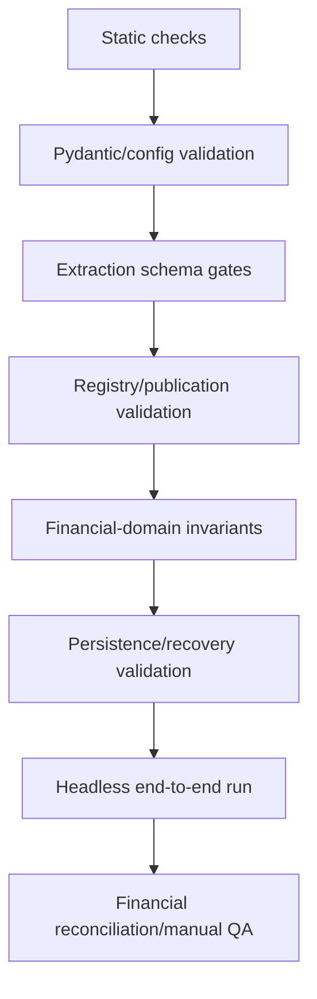
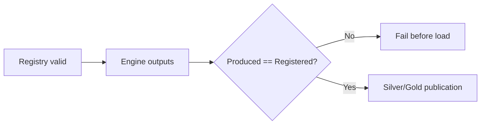
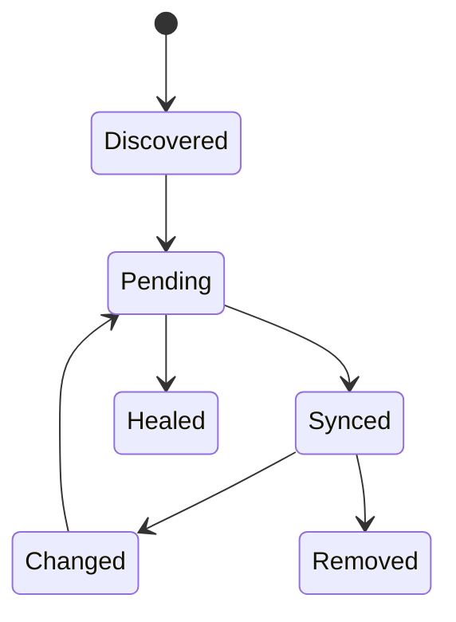
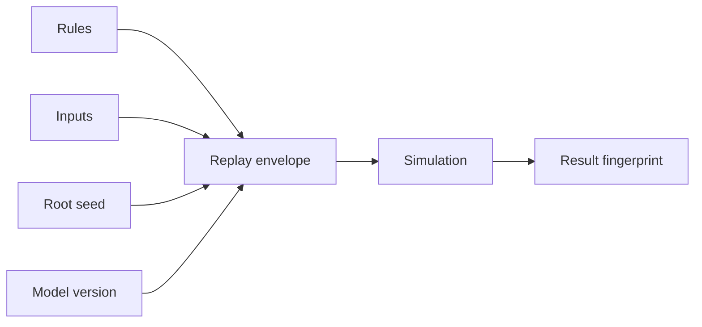
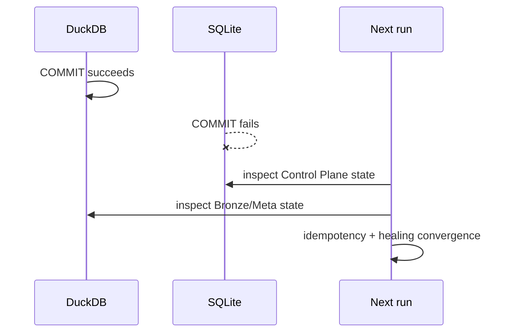
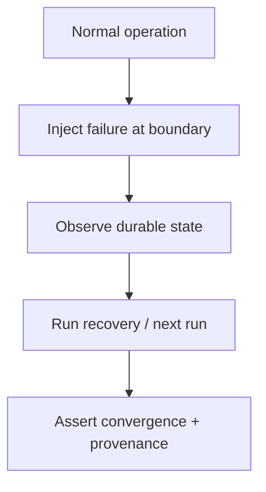

# Testing and Validation

Personal Finance ETL has meaningful runtime validation, hardening rules, and an end-to-end headless execution path, but its conventional automated test suite is currently thin. This document deliberately separates those facts.

Calling every runtime guard a "test" would make the quality story sound nicer and the engineering story less accurate. The latter wins.

## 1. Quality layers



These layers catch different defect classes. None replaces all the others.

## 2. Conventional test surface

The repository's `tests/` directory currently contains:

```text
tests/
├── config.toml
├── financial_rules.toml
└── run_headless.py
```

There is not currently a broad pytest-style unit/integration suite covering every engine and financial invariant.

The existing headless runner executes the real orchestrator:

```python
cfg = Settings.from_toml("config.toml")

# Run in main thread for profiling
orchestrator = ETLOrchestrator(cfg, q)
orchestrator.run()
```

That is valuable smoke/integration coverage, but it is not fine-grained regression coverage.

## 3. QA specifications versus executable tests

`qa-hardening.md` and `production-hardening.md` contain valuable requirements, defect history, and validation intent. They should inform test design.

They do not become executable tests merely by being detailed Markdown.

Use this vocabulary consistently:

| Term | Meaning |
|---|---|
| unit test | isolated executable test of a small behavior |
| integration test | executable test across multiple components/persistence boundaries |
| smoke test | broad run proving the main path can execute |
| runtime validation | production code rejects invalid state during normal execution |
| manual QA | human comparison/inspection |
| QA specification | documented requirement/check that may or may not be automated |

## 4. Configuration validation

Pydantic models validate types and selected field/cross-field constraints. `Settings.validate_config()` validates required paths/files before execution.

Configuration validation answers:

> Is this configuration structurally and operationally acceptable?

It does not answer:

> Are all financial assumptions economically sensible?

The Configuration docs explicitly list semantic invariants not currently enforced by Pydantic.

## 5. Extraction Gatekeeper

`DataExtractor` runs schema validation on active extraction streams before canonical transformation.

```python
logger.info("[QUALITY] Running Gatekeeper Schema Validation on 18 active streams...")
...
schema = lf.collect_schema()
if len(schema.names()) > 0:
    logger.debug(
        f"[QUALITY:GATEKEEPER] Validating schema constraints: {schema.names()}"
    )
```

This catches source-shape failures close to the evidence boundary.

## 6. Registry validation

`validate_registry()` protects structural contract consistency. Before publication, the orchestrator additionally enforces produced/registered equality.



This is runtime contract enforcement, not a substitute for unit tests of individual builders.

## 7. Silver/Gold persistence validation

Silver and Gold are rebuilt from fixed DDL and registered outputs. Load failures catch type/shape mismatches that survive earlier checks.

After load, Meta records current row counts and contract metadata, supporting operational inspection.

## 8. Control Plane schema validation

The Control Plane validates existing SQLite schema against the current expected schema and fails closed on stale/partial structures. It does not silently "upgrade" an incompatible historical database with `CREATE TABLE IF NOT EXISTS`.

This is an important operational safety property.

## 9. Artifact lifecycle validation

Control Plane logic validates artifact states, payload availability, synchronization transitions, rename behavior, and scoped SQLite savepoint operations.

When extending artifact behavior, tests should cover state transitions, not only final rows.



## 10. Quant financial gates

Quant code contains financial validation around:

- transaction ordering/state;
- FIFO quantity availability;
- lot mutation;
- reconciliation quantities/cost basis;
- FX validity;
- XIRR input/status behavior;
- benchmark/market state;
- deterministic identities.

A robust automated suite should eventually target these as isolated invariants because they carry high financial consequence.

## 11. XIRR validation philosophy

XIRR failure does not silently become `0%`. Typed statuses distinguish invalid input, undefined economics, non-convergence, and valid results.

Tests should preserve those distinctions.

A test asserting only "function returns a float" would actively weaken the contract.

## 12. Tax validation

Tax event construction validates required source IDs, tax classification context, event identities, and monetary fields. Tests should verify:

- ledger/Quant double-count exclusions;
- signed tax credits;
- `CHECK_REQUIRED` semantics;
- indicative estimate retention;
- three Gold outputs reconciling to canonical TaxEvents.

Tax tests must not assert statutory behaviors the engine intentionally does not implement.

## 13. FIRE validation

FIRE testing has two dimensions.

### Deterministic mechanics

Test formulas, seed derivation, configuration mapping, percentile selection, and output mapping deterministically.

### Stochastic behavior

Replay a recorded seed/context and compare results under a compatible runtime/model implementation. Do not require unrelated runs to produce identical Monte Carlo paths.



## 14. Backup/restore validation

The backup manager performs runtime checks for:

- pipeline lock acquisition;
- DuckDB checkpoint;
- SQLite backup consistency;
- ZIP CRC;
- archive member safety;
- duplicate/unexpected members;
- path traversal/symlinks;
- extracted SQLite/DuckDB validity;
- rollback on replacement failure.

Automated tests should exercise failure injection around these boundaries where feasible.

## 15. Cross-database failure testing

Because DuckDB commits before SQLite, reliability testing should explicitly cover the acknowledged failure window:



The desired property is recoverable convergence, not impossible distributed atomicity.

## 16. Source-adapter tests

For every extractor/source family, useful fixtures include:

- valid minimal file;
- missing required column;
- extra harmless column;
- malformed numeric/date;
- duplicate source rows;
- empty-but-valid source;
- renamed artifact;
- changed content at same path.

Fixtures should avoid real personal financial data.

## 17. Transformation tests

At transformation boundaries, assert:

- expected grain uniqueness;
- canonical dtypes;
- null semantics;
- deterministic IDs;
- join cardinality;
- temporal causality;
- reconciliation totals.

For financial transformations, property/invariant assertions are often more valuable than snapshotting every output cell.

## 18. Gold tests

Gold tests should compare analytical reconciliation, not only schema.

Examples:

- grouped market value equals authoritative lower-grain total;
- income/expense breakdowns reconcile to core monthly facts;
- Tax Gold sums reconcile to `f_Tax_Events`;
- allocation weights reconcile to expected denominator;
- non-additive metrics are recomputed correctly.

## 19. Headless smoke run

`tests/run_headless.py` is the current broad smoke path. It should be run with representative configuration/data after material changes.

The smoke run proves that the integrated pipeline can execute. It does not prove every edge case.

## 20. Financial regression baseline

For high-impact changes, capture a baseline of:

- contract row counts;
- key deterministic IDs;
- household balances/net worth;
- investment quantities and basis;
- realized P&L;
- reconciliation events;
- tax-event totals;
- Gold headline metrics;
- simulation fingerprints/context where applicable.

Then compare after the change.

## 21. Test data privacy

Personal Finance ETL is local-first and processes sensitive financial data. Automated fixtures should use synthetic/minimized data. Never commit personal broker statements, database backups, account identifiers, or real tax evidence merely to make a regression test convenient.

## 22. Suggested future test architecture

The current maturity gap is a conventional automated regression suite. A sensible future structure would mirror architectural boundaries:

```text
tests/
├── unit/
│   ├── config/
│   ├── identity/
│   ├── transform/
│   ├── quant/
│   ├── tax/
│   └── fire/
├── integration/
│   ├── control_plane/
│   ├── bronze/
│   ├── warehouse/
│   └── backup_restore/
├── fixtures/
└── smoke/
```

This is a recommendation, not a claim about current repository contents.

## 23. Definition of tested

When documentation says behavior is "tested," it should identify the evidence:

- executable test path/name;
- runtime assertion/validator;
- headless smoke run;
- manual QA procedure.

Avoid unqualified "well tested" language. Precision is cheaper than confidence theater.

## 24. Validation checklist for a change

- [ ] static checks pass;
- [ ] configuration validates;
- [ ] relevant extraction schemas validate;
- [ ] registry validates;
- [ ] targeted domain invariants checked;
- [ ] persistent schemas load successfully;
- [ ] headless end-to-end run succeeds;
- [ ] financial reconciliation compared to baseline;
- [ ] recovery behavior tested if persistence boundaries changed;
- [ ] no personal data added to fixtures/logs;
- [ ] docs describe the actual level of test evidence.

## 25. High-value automated-test priorities

Given the current thin conventional suite, the highest-value future tests are those protecting irreversible or financially consequential boundaries:

1. deterministic identity canonicalization;
2. FIFO partial/multi-lot sales;
3. quantity and cost-basis reconciliation;
4. temporal price/FX causality;
5. tax double-count exclusions;
6. cross-database healing after commit-window failure;
7. backup/restore rollback;
8. simulation seed/replay context.

These provide more risk reduction than chasing raw test-count vanity metrics.

## 26. Property-style invariants

Many financial algorithms have useful properties independent of one fixture:

- total remaining lot quantity = purchases - disposals +/- reconciliation adjustments;
- realized sale quantity cannot exceed consumed lot quantity;
- Gold grouped market value reconciles to lower-grain market value;
- future observations never satisfy historical as-of joins;
- deterministic identity is stable under dictionary insertion order;
- same replay envelope/compatible implementation reproduces stochastic result fingerprint.

Property tests are especially suitable for these invariants.

## 27. Failure-injection testing

Reliability code should be tested at failure boundaries, not only happy paths. Useful injection points include:

- payload missing after discovery;
- Bronze write failure before `mark_synced`;
- DuckDB commit succeeds / SQLite commit fails;
- restore fails after old files are renamed;
- corrupt ZIP member;
- stale Control Plane schema;
- Quant workload raises for one ISIN.



## 28. Performance regression testing

Performance observations should be measured on representative workloads and reported as observations, not guarantees. Record:

- source artifact count;
- row volumes;
- cache state;
- machine/runtime context;
- phase timings.

A faster run that changes financial outputs is not a performance improvement.

## 29. Documentation QA as engineering QA

Because `/docs` contains source paths, contracts, formulas, and invariants, documentation QA should verify those references against code. Broken docs can misdirect future development even when production execution remains correct.

The final project QA pass should therefore validate source references, registry counts, schema names, formulas, Mermaid, links, and release-agnostic wording.

## 30. Test evidence maturity labels

For internal documentation/reviews, it can be useful to classify critical behavior as:

- **Runtime-enforced**
- **Smoke-covered**
- **Automated regression-covered**
- **Manually reconciled**
- **Specified but not yet automated**

This makes quality gaps visible without pretending the system is less mature than its runtime hardening actually is, or more tested than its executable suite actually proves.

## Related specifications

- [Reliability and Recovery](../architecture/reliability-and-recovery.md)
- [Backup and Restore](../architecture/backup-and-restore.md)
- [Data Contract and Schema Evolution](data-contract-and-schema-evolution.md)
- [Development Guide](development-guide.md)
- [Configuration Reference](../configuration/configuration-reference.md)
