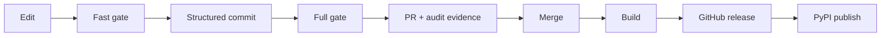
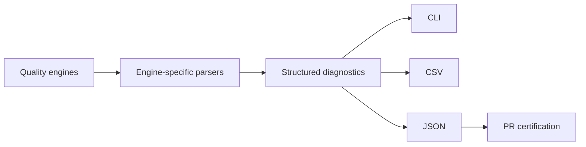
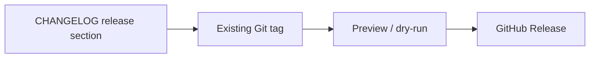
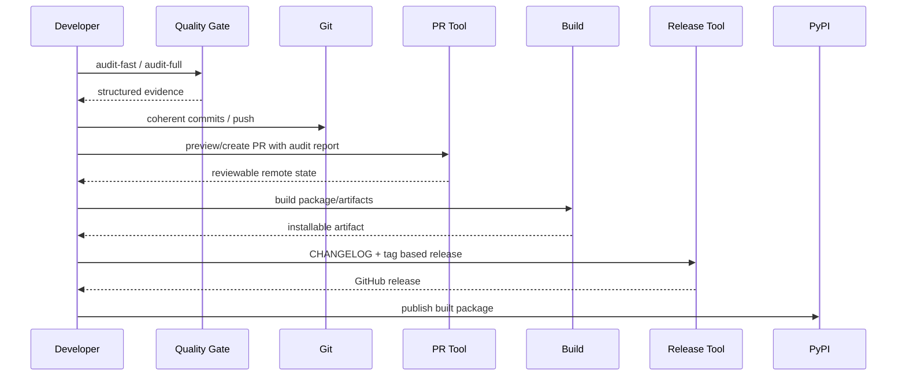
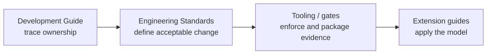

# Tooling, Quality, and Release Engineering

A change is not finished when it works on my machine.

That is merely the point where the repository begins asking for receipts.

The delivery system around Personal Finance ETL exists to turn a local edit into a reproducible, reviewable, buildable, and publishable artifact without relying on memory.

That means the tooling has to preserve the same engineering values as the application itself:

```text
explicit state
structured evidence
conservative failure
repeatable sequencing
small, inspectable boundaries
```

The result is a developer transaction that looks like this:



Not every change travels all the way to PyPI.

The important part is that every stage has a clear purpose, input, output, and failure rule.

## The task layer is the developer-facing control plane

Repository automation is centralized in `scripts/tasks.py` and exposed through Poe tasks.

The file intentionally groups the recurring developer/release operations:

The public task surface is real code, not a README-only command list. For example, development and executable build are thin wrappers around the supported tools:

```python
# scripts/tasks.py
def dev():
    """Run the app with hot-reloading."""
    print("Starting development server...")
    sys.exit(subprocess.call(["tkreload", "main.py"]))


def build():
    """Build the executable using PyInstaller."""
    print("Building executable with PyInstaller...")
    sys.exit(subprocess.call(["pyinstaller", "--clean", "-y", "main.spec"]))
```

The audit tasks then route into the shared quality gate rather than duplicating tool invocation logic:

```python
# scripts/tasks.py
def audit_fast():
    """Run fast tier quality gate audit (Ruff + Mypy, < 3s)."""
    from scripts.quality_gate import run_quality_gate

    sys.exit(run_quality_gate(tier="fast", export="cli"))


def audit_fast_fix():
    """Run fast tier quality gate audit with auto-fix enabled."""
    from scripts.quality_gate import run_quality_gate

    sys.exit(run_quality_gate(tier="fast", export="cli", auto_fix=True))


def audit_full():
    """Run full tier quality gate audit (Ruff, Mypy, Pyright, Pylint, Pytest) and export reports."""
    from scripts.quality_gate import run_quality_gate

    sys.exit(run_quality_gate(tier="full", export="all"))
```

The value is not shorter commands.

The value is one maintained execution surface.

Without it, the same workflow slowly forks across:

```text
README snippets
shell history
IDE tasks
one-off batch files
release notes
memory
```

Memory is a particularly brave choice for release infrastructure. 😭

## Development mode is a repository task, not a secret local command

The `dev` task provides the supported local development entry path, including the Desktop hot-reload workflow where configured.

That matters because developer ergonomics are part of maintainability.

A development entry point should be discoverable from repository metadata, not passed down orally from one laptop to another.

## Build is separate from run

The package build uses the project metadata in `pyproject.toml` and Hatchling as the build backend.

That gives a clean distinction:

```text
run from source
    !=
installable Python artifact
    !=
standalone desktop executable
```

Those artifacts have different consumers and failure modes.

The release workflow should prove the one being shipped, not assume successful source execution means the wheel/executable is healthy.

## Quality is split into fast and full tiers

The repository deliberately has two main verification loops.

### Fast tier

Designed for the tight edit/commit cycle.

The tracked pre-commit hook describes it directly:

```sh
# .githooks/pre-commit
#!/usr/bin/env sh
# Personal Finance ETL - Pre-Commit Quality Gate (Fast Tier)
# Runs Ruff Check, Ruff Format Check, and Mypy Typecheck (< 2s).
echo "[Quality Gate] Running Pre-Commit Fast Verification (Ruff + Mypy)..."

uv run poe audit-fast
EXIT_CODE=$?
```

If the fast gate fails, the commit stops.

That is intentional.

The fast tier should be quick enough to run frequently and broad enough to reject obvious structural/type/style regressions before they enter history.

### Full tier

Designed for pre-push and certification.

```sh
# .githooks/pre-push
#!/usr/bin/env sh
# Personal Finance ETL - Pre-Push Quality Gate (Full Tier)
# Runs Ruff, Format, Mypy, Pyright, Pylint, and Pytest (~40-70s).
echo "[Quality Gate] Running Pre-Push Full Verification Suite..."

uv run poe audit-full
EXIT_CODE=$?
```

The full tier expands the proof surface before code leaves the machine.

## The primary quality engines are complementary

The full gate combines several engines because they answer different questions.

| Engine | Main question |
|---|---|
| Ruff | Does the source violate configured lint rules? |
| Ruff format | Is formatting canonical? |
| Mypy | Does the typed program satisfy the primary static type model? |
| Pyright | Does an independent type checker expose additional inconsistencies? |
| Pylint | Do broader code-quality/static diagnostics pass? |
| Pytest | Does runtime behavior satisfy the automated test contracts? |

The collection is useful because the tools are complementary.

It is not useful merely because six badges look impressive.

## Quality-gate output is structured

`scripts/quality_gate.py` does more than invoke commands and print their stdout.

It parses tool output into structured diagnostic records.

The module has dedicated parsers for:

```text
Ruff
Mypy
Pyright
Pylint
generic command failures
```

That lets the audit system build machine-readable reports instead of treating terminal text as the only artifact.



This is a small but important design choice: the quality system creates evidence another workflow can consume.

## Fast failure is part of the tooling contract

Both tracked hooks follow the same control model:

```text
run gate
    -> capture exit code
    -> non-zero: abort Git operation
    -> zero: continue
```

The hook does not downgrade failure to a friendly warning because "I will fix it later" is not a reproducible pipeline stage.

Developers can still run tools manually and investigate, but the Git boundary remains explicit.

## Hooks are versioned with the repository

`scripts/install_hooks.py` writes tracked hook scripts under `.githooks/` and configures Git to use them:

```python
# scripts/install_hooks.py
proc = subprocess.run(
    ["git", "config", "core.hooksPath", ".githooks"],
    cwd=ROOT_DIR,
    capture_output=True,
    text=True,
    check=False,
)
```

The installer also supports a fallback copy into `.git/hooks` when available.

This solves an important developer-experience problem:

> quality behavior should live in version control, not as invisible local configuration.

A clone can reconstruct the intended Git workflow.

## Auto-fix is bounded to the fast loop

The task layer exposes a fast-fix path for formatting/lintable issues.

That is useful for mechanical cleanup.

It should not "fix" domain semantics, test failures, or typing design decisions automatically.

There is a meaningful boundary between:

```text
format this code
```

and:

```text
invent the correct financial contract
```

Tooling should know which one it is qualified to do.

## Commit automation creates structure, not authority

The repository includes automated conventional-commit support through `scripts/auto_commit.py` and Poe task wrappers.

Useful modes include:

```text
preview
run
interactive review
overrides
overrides preview
mapped-only execution
```

The existence of preview/override modes is important.

The commit helper may infer a useful grouping/message.

The maintainer still owns the meaning of the change.

Automation reduces repetitive Git choreography; it does not become the product manager.

## Why file-by-file or coherent commit grouping matters

A repository with deep architecture benefits from commit history that preserves conceptual boundaries.

A commit that simultaneously changes:

```text
provider retry behavior
FIFO methodology
Tax schema
README badges
```

may technically work.

It creates a miserable archaeology surface later.

Structured commit automation encourages changes to retain coherent intent.

## Pull requests carry verification evidence

`scripts/create_pr.py` integrates local quality evidence into the PR body.

If an audit report is missing or a fresh one is requested, it can invoke the full quality gate:

```python
# scripts/create_pr.py
if force_run or not report_file.exists():
    console.print("[dim]Generating fresh Quality Gate audit report (Full Tier)...[/dim]")
    from scripts.quality_gate import run_quality_gate

    exit_code = run_quality_gate(tier="full", export="all", quiet=True)
    if exit_code != 0:
        console.print("[yellow]Warning: Some quality gate engines failed during audit.[/yellow]")
```

That makes PR creation dependent on explicit, inspectable quality state rather than a handwritten "tests pass" sentence.

## Audit evidence becomes PR Markdown

The PR tool formats engine-level results into a Markdown table.

```python
# scripts/create_pr.py
lines: list[str] = [
    "---",
    "## 🛡️ Quality Gate & Constitutional Certification",
    "",
    "| Quality Engine | Tier | Duration | Issues | Status |",
    "| :--- | :---: | :---: | :---: | :---: |",
]
```

The generated section includes per-engine status, duration, issue count, overall gate state, timestamp, and branch flow.

That turns local verification into reviewable evidence.

The PR still needs human review.

Evidence improves review; it does not replace judgement.

## PR creation is idempotent where practical

The tooling checks whether an open PR already exists for the selected head/base pair.

That means repeated invocation can update/reuse workflow state instead of blindly creating duplicate PRs.

This is the same engineering instinct used elsewhere in the application:

> repeated execution should converge toward a known state when the operation semantics allow it.

Developer tooling benefits from idempotency too.

## GitHub CLI availability is treated as a real dependency

PR automation checks `gh auth status` and fails clearly when the GitHub CLI is unavailable or unauthenticated.

It does not pretend the publish step succeeded.

```python
if not check_gh_cli():
    console.print("[bold red]Error: GitHub CLI (gh) is not installed or authenticated.[/bold red]")
    console.print("[dim]Run 'gh auth login' to authenticate with your GitHub account.[/dim]")
    return 1
```

This is a good tooling pattern:

- test dependency;
- surface missing state;
- stop before partial remote mutation.

## Dry-run and preview modes reduce release anxiety

PR and release tooling provide preview/dry-run paths.

That lets the maintainer inspect:

```text
title
body
branch flow
release notes
tag mapping
draft state
automation decisions
```

before remote mutation.

Preview modes are especially valuable for automation that derives metadata from CHANGELOG or commit history.

The safest automation is automation that can show its homework.

## CHANGELOG is the release narrative authority

Release tooling parses release sections from `CHANGELOG.md`.

That gives the workflow one human-maintained narrative source for what belongs in a release.

`scripts/create_releases.py` resolves CHANGELOG entries against existing Git tags.

Conceptually:



A release note without a matching tag is not silently invented into a GitHub release.

## Tag resolution is explicit

The release tool gathers existing tags and resolves release versions against them.

That protects against a subtle but common automation bug:

> publishing metadata for a release state Git does not actually contain.

If the tag does not exist, the tool can skip/warn rather than manufacture history.

## Release modes make intent explicit

The task layer exposes separate commands for:

```text
preview latest
preview all
dry run
release latest
release latest as draft
release all
release all as draft
```

Those modes make remote mutation a conscious decision.

A preview is not a publish.

A draft is not a final release.

The command vocabulary preserves that distinction.

## Build artifacts have different audiences

The repository can produce at least two broad artifact classes.

### Python package artifacts

Built through the standard Python build metadata / Hatchling path.

Typical consumers:

```text
PyPI
uv/pip installation
other Python environments
```

### Desktop executable artifacts

Built through the PyInstaller-oriented workflow.

Typical consumer:

```text
end user running the local Desktop application without a source checkout
```

A source tree running successfully proves neither artifact automatically.

Build is its own verification step.

## PyPI publishing is explicit and secret-aware

The task layer includes a token-loading helper and publishing function.

The token loader checks supported environment names / root `.env` without printing the secret.

This is the correct boundary:

```text
secret is located
secret is consumed
secret is never narrated
```

Publishing then uses the supported package tooling rather than hard-coded credentials.

## Missing publish credentials are a hard stop

A publish path without a token should not attempt a partial upload or log a mystery failure later.

The tooling should report the missing prerequisite and stop.

Conservative failure is especially important at irreversible remote boundaries.

## Release automation should fail before mutation whenever possible

Useful preconditions include:

```text
quality gate state known
CHANGELOG entry exists
tag exists
gh authenticated
package build succeeds
publish token exists
```

The more validation happens before remote mutation, the simpler recovery becomes.

## The release pipeline is a sequence of authorities

The full release path can be modeled as:



Each step consumes evidence from the previous one.

That is much safer than one mega-script that modifies Git, GitHub, package artifacts, and PyPI before the first error can be inspected.

## Quality reports are useful beyond one run

CSV/JSON exports allow:

- PR embedding;
- trend inspection;
- machine-readable issue analysis;
- reproducible evidence for a release decision.

The report should record enough context to explain what was run and whether it passed.

Do not treat exported quality data as a KPI leaderboard detached from engineering judgement.

Zero lint issues does not prove correct finance.

## Additional static/security tools are secondary evidence

The repository also carries configuration/integration with broader audit/security services and tools.

Those can be valuable for:

- security scanning;
- alternative static analysis;
- repository review;
- code-quality feedback.

But the primary local gate remains intentionally understandable.

A developer should know which tools are release-blocking and which are supplementary.

An eleven-tool wall of warnings with no authority model is not rigor. It is notification weather.

## CI-like discipline can exist locally

Even when a workflow is primarily local, tracked hooks and deterministic task commands create CI-like properties:

```text
same commands
same configuration
same dependency metadata
same test suite
same quality rules
```

That is useful for a local-first project because reproducibility does not require a cloud runner.

The repository itself can encode the verification contract.

## Failure semantics in tooling should be boring

Good release tooling has predictable failure rules.

### Quality gate fails

Stop commit/push/certification as configured.

### GitHub CLI unavailable

Stop PR/release remote actions.

### CHANGELOG entry missing

Stop/skip release generation.

### Git tag missing

Do not invent a release for code Git cannot identify.

### Build fails

Do not publish.

### PyPI token missing

Do not publish.

### Remote command fails

Return non-zero state and preserve enough output for diagnosis.

Boring failure is a feature.

Exciting release failures usually mean the rollback plan just became the main character. 😂

## The tooling itself needs tests and review

Automation code can break production delivery even if application code is perfect.

Review tooling changes for:

- command quoting/path behavior;
- Windows compatibility where relevant;
- subprocess return-code handling;
- secret leakage;
- dry-run fidelity;
- idempotency;
- destructive operations;
- branch/tag assumptions;
- generated Markdown correctness.

A release script is production code for the repository.

Treat it accordingly.

## Developer experience is an engineering constraint

A quality system nobody can remember or tolerate will be bypassed.

That is why the workflow separates:

```text
fast local feedback
full pre-push verification
previewable remote automation
```

The best developer experience is not "no rules."

It is rules that are easy to discover, fast at the right time, and explicit about why they block.

## Tooling establishes the rails; extension work now uses them

The first three Developer specifications have established the operating system for change:



The tooling does not tell me what a new broker source *means*, how a canonical transformation should preserve grain, or whether a Gold measure is additive. It provides the rails those changes must run on.

The next specification therefore returns to the outermost product boundary and applies the model to a concrete capability change: **new evidence entering the system**.

Continue with [Adding Data Sources](adding-data-sources.md).

## Tooling completion checklist

Before using the release path for a substantial change:

- [ ] Focused/domain tests passed.
- [ ] `audit-fast` passes in the edit loop.
- [ ] Commits are coherent and reviewable.
- [ ] `audit-full` passes before push/certification.
- [ ] Structured audit evidence is fresh enough for the PR.
- [ ] PR preview/body accurately represents the change.
- [ ] CHANGELOG release entry is correct where a release is intended.
- [ ] Git tag matches the intended release state.
- [ ] Python/desktop artifacts build successfully as applicable.
- [ ] Remote tooling prerequisites (`gh`, auth, publish token) are present.
- [ ] Dry-run/preview was used when remote mutation deserves inspection.
- [ ] Secrets are not printed or committed.
- [ ] Release/publish failures stop conservatively.

## Related specifications

- [Development Guide](development-guide.md)
- [Engineering Standards](engineering-standards.md)
- [Testing and Validation](testing-and-validation.md)
- [Design Decisions](../architecture/design-decisions.md)
- [Reliability and Recovery](../architecture/reliability-and-recovery.md)
