<div class="pf-doc-identity">
  
  <div><strong>PERSONAL FINANCE ETL</strong><span>Technical Documentation · SPECIFY</span></div>
</div>

# Personal Finance ETL Technical Documentation

Personal Finance ETL turns fragmented household, investment, market, currency, and configuration evidence into something much harder to fake: **traceable financial state**.

That requires more than moving files through Bronze, Silver, and Gold.

The system has to preserve where evidence came from, distinguish observation from reconstruction, keep financial identity deterministic, reconcile disagreement instead of hiding it, publish analytical state at explicit grains, survive partial failure, and still leave enough provenance behind to explain what happened later.

This `/docs` tree is where I specify how that works.

It is intentionally deeper than the root README and more implementation-heavy than the Wiki. The goal is not to introduce the project quickly. The goal is to make the engineering inspectable.

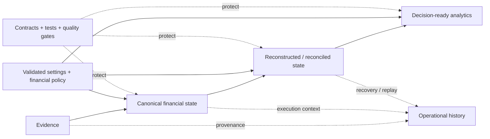

The documentation follows the same logic. Start with the question you have, then move toward the layer that owns the answer.

---

## The documentation contract

The project deliberately uses four documentation surfaces.

| Surface | Job | Use it when you want to... |
| --- | --- | --- |
| Root README | **SHOW** | understand quickly what the project is, why it is interesting, and where to explore next |
| GitHub Wiki | **TEACH** | build a conceptual mental model through guided explanations |
| `/docs` | **SPECIFY** | inspect architecture, algorithms, contracts, grains, failure semantics, configuration, and engineering decisions |
| Source code | **PROVE** | verify the implementation when prose and runtime behavior ever disagree |

The boundaries are intentional.

A Wiki page may explain *why* reconciliation exists. A Finance specification explains the exact event model and state mutation. A Reference page gives the physical contract. The source proves what the software actually does.

If all four surfaces say exactly the same thing at exactly the same depth, we have successfully built four copies of one document. That would be impressive in the least useful possible way. 😄

For the concept-first route, use the [GitHub Wiki](https://github.com/tks18/personal-finance-etl/wiki).

For implementation truth, stay here.

---

## Start with the question, not the folder

### I want to run the application

Start with [Getting Started](getting-started/README.md).

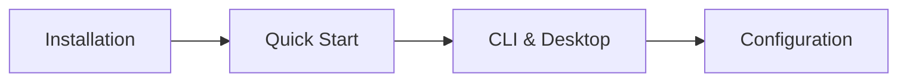

Recommended path:

1. [Installation](getting-started/installation.md)
2. [Quick Start](getting-started/quick-start.md)
3. [CLI and Desktop](getting-started/cli-and-desktop.md)
4. [Configuration Reference](configuration/configuration-reference.md)

You do not need to understand deterministic identity serialization before pressing Run. The rabbit hole will still be there when you are ready.

### I want to understand the architecture

Start with [Architecture](architecture/README.md).

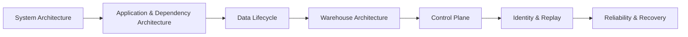

This route explains:

- package ownership;
- application orchestration;
- composition and dependency direction;
- SQLite Control Plane versus DuckDB analytical state;
- persistent Bronze and rebuilt analytical layers;
- deterministic identity;
- failure, recovery, backup, and restore.

### I want to understand the financial model

Start with [Finance](finance/README.md).

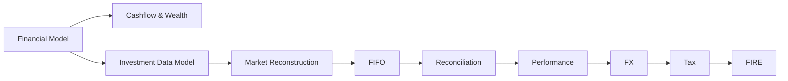

This is the best path for understanding the distinction between:

- observed evidence;
- canonical facts;
- reconstructed financial state;
- reconciliation evidence;
- realized and unrealized outcomes;
- local-currency and reporting-currency values;
- indicative Tax outputs;
- deterministic FI metrics and stochastic FIRE planning.

### I need the exact schema, grain, identity, or producer

Go directly to [Reference](reference/README.md).

Reference answers questions like:

> What is the exact Silver table grain?

> Which producer owns this dataset?

> Is this metric additive?

> Which identity namespace protects this record?

> Is this operational history in SQLite or analytical state in DuckDB?

If you already know what you are looking for, Reference is the shortest route between curiosity and receipts.

### I want to change the system safely

Start with [Developer Engineering](developer/README.md).

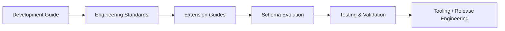

This route covers the complete change lifecycle:

- finding the owning package;
- preserving financial authority;
- choosing contracts and types;
- adding sources;
- adding transformations;
- adding Gold marts;
- evolving schemas and identities;
- validating behavior;
- using the repository quality gates;
- moving verified code through PR, build, release, and publishing workflows.

### I want to change financial assumptions or runtime behavior

Start with [Configuration](configuration/README.md).

Configuration intentionally separates:

```text
runtime topology
    from
financial policy
    from
stochastic planning assumptions
```

That distinction matters. Changing where a database lives is not the same category of change as changing Tax policy, an investment exclusion, or the return process used in FIRE simulations.

### I want the project story rather than another technical specification

Use [About](about/README.md).

It explains how repeated real-world finance problems pushed the project from automation toward provenance, reconstruction, reconciliation, deterministic financial state, recovery, and formal engineering discipline.

Then use the [Roadmap](roadmap.md) for the current maturity philosophy: protect correctness, reliability, financial regression behavior, maintainability, and evidence-driven evolution before collecting shiny features like Pokémon cards.

---

## The knowledge map

The documentation domains are not independent silos. They answer different questions about the same system.

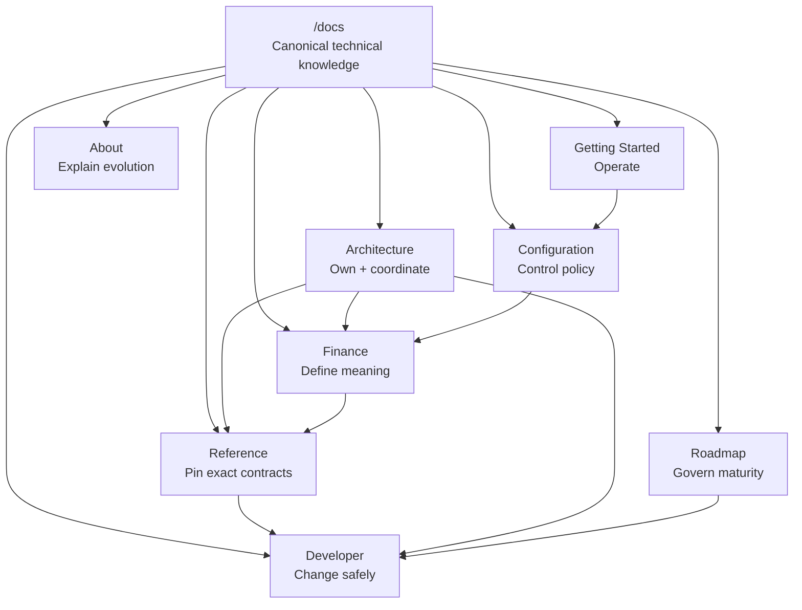

A few useful relationships:

- **Architecture** explains who owns a responsibility.
- **Finance** explains what the responsibility means economically.
- **Reference** freezes the exact contract shape.
- **Configuration** explains which behavior is policy-driven.
- **Developer** explains how to change any of the above without weakening the system.
- **Getting Started** keeps all of that complexity out of the way until the user actually needs it.

That is the point of the corpus. Depth should be available without being compulsory.

---

## Recommended reading paths

### New user

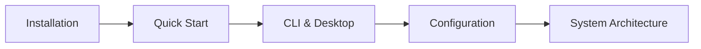

1. [Installation](getting-started/installation.md)
2. [Quick Start](getting-started/quick-start.md)
3. [CLI and Desktop](getting-started/cli-and-desktop.md)
4. [Configuration Reference](configuration/configuration-reference.md)
5. [System Architecture](architecture/system-architecture.md)

Goal: get the application running before learning why its recovery coordinator has opinions.

### Data engineer / software architect

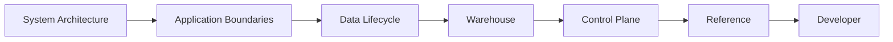

1. [System Architecture](architecture/system-architecture.md)
2. [Application and Dependency Architecture](architecture/application-and-dependency-architecture.md)
3. [Data Lifecycle](architecture/data-lifecycle.md)
4. [Warehouse Architecture](architecture/warehouse-architecture.md)
5. [Control Plane Artifact Lifecycle](architecture/control-plane-artifact-lifecycle.md)
6. [Reference](reference/README.md)
7. [Developer Engineering](developer/README.md)

Goal: understand ownership, data movement, persistence, operational provenance, contracts, and safe extensibility.

### Finance / Quant reader

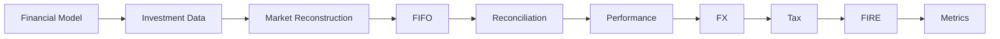

1. [Financial Model](finance/financial-model.md)
2. [Investment Data Model](finance/investment-data-model.md)
3. [Investment Market Reconstruction](finance/investment-market-reconstruction.md)
4. [FIFO and Realized Events](finance/fifo-and-realized-events.md)
5. [Investment Reconciliation](finance/investment-reconciliation.md)
6. [Investment Performance and Risk](finance/investment-performance-and-risk.md)
7. [Multi-Currency and FX](finance/multi-currency-and-fx.md)
8. [Tax Methodology](finance/tax-methodology.md)
9. [FIRE Methodology](finance/fire-methodology.md)
10. [Metrics and Methodology](finance/metrics-and-methodology.md)

Goal: follow evidence from observation through reconstruction, interpretation, Tax, and planning without collapsing those epistemic layers together.

### Reliability / audit reader

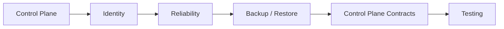

1. [Control Plane Artifact Lifecycle](architecture/control-plane-artifact-lifecycle.md)
2. [Deterministic Identity and Replay](architecture/deterministic-identity-and-replay.md)
3. [Reliability and Recovery](architecture/reliability-and-recovery.md)
4. [Backup and Restore](architecture/backup-and-restore.md)
5. [Control Plane Data Contracts](reference/control-plane-data-contracts.md)
6. [Testing and Validation](developer/testing-and-validation.md)

Goal: understand what happened, what became durable, what can be replayed, what cannot be called atomic, and how recovery truth is preserved.

### Contributor

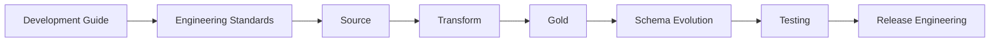

1. [Development Guide](developer/development-guide.md)
2. [Engineering Standards](developer/engineering-standards.md)
3. [Adding Data Sources](developer/adding-data-sources.md)
4. [Adding Transformations](developer/adding-transformations.md)
5. [Adding Gold Marts](developer/adding-gold-marts.md)
6. [Data Contract and Schema Evolution](developer/data-contract-and-schema-evolution.md)
7. [Testing and Validation](developer/testing-and-validation.md)
8. [Tooling, Quality and Release Engineering](developer/tooling-quality-and-release-engineering.md)

Goal: make the change, prove the change, and ship the change without moving financial authority by accident.

---

## Architecture

[Architecture](architecture/README.md) specifies how the system divides responsibility, moves state, persists evidence, preserves identity, and recovers from failure.

Its pages form one causal sequence.

### [System Architecture](architecture/system-architecture.md)

The whole system in one narrative: presentation, application, domain, infrastructure, configuration, contracts, composition, SQLite, DuckDB, Bronze, Silver, Gold, Meta, and operational history.

Read this first when you need the complete mental model.

### [Application and Dependency Architecture](architecture/application-and-dependency-architecture.md)

Explains why responsibilities stay where they do: façade, orchestration, execution coordination, composition root, typed cross-boundary contracts, package APIs, and enforceable dependency direction.

Read this when a change raises the question: *which layer should own this?*

### [Data Lifecycle](architecture/data-lifecycle.md)

Follows evidence through discovery, acquisition, Control Plane registration, Bronze synchronization, canonical transformation, domain reconstruction, Gold publication, Meta projection, commit, and failure paths.

Read this when you want to know *what happens next* during a run.

### [Warehouse Architecture](architecture/warehouse-architecture.md)

Specifies the SQLite/DuckDB split, persistent Bronze, rebuilt Silver/Gold state, Meta projections, registry-driven publication, transaction boundaries, and analytical rebuild behavior.

Read this when you want to know *where state lives and why*.

### [Control Plane Artifact Lifecycle](architecture/control-plane-artifact-lifecycle.md)

Covers artifact identity, source payload retention, discovery, change detection, rename/removal behavior, event history, synchronization summaries, external-provider provenance, simulation provenance, and healing.

Read this when you need historical operational truth rather than current analytical state.

### [Deterministic Identity and Replay](architecture/deterministic-identity-and-replay.md)

Specifies canonical normalization, namespace-specific ordered fields, versioned serialization, deterministic IDs, configuration fingerprints, replay boundaries, and simulation provenance.

Read this when continuity matters more than row position.

### [Reliability and Recovery](architecture/reliability-and-recovery.md)

Explains savepoints, cross-database commit state, failure domains, stale runs, healing, rollback, convergence, locking, and the precise limits of what the system can call atomic.

Read this when reality has ignored the happy path.

### [Backup and Restore](architecture/backup-and-restore.md)

Specifies coordinated SQLite/DuckDB snapshots, checkpointing, archive validation, staged extraction, pair installation, rollback, and restore outcomes.

Read this before assuming a ZIP file automatically counts as a recovery strategy.

### [Data Model](architecture/data-model.md)

Connects household, investment, currency, Tax, wealth, FIRE, operational, and analytical state through explicit grains and relationships.

Read this when table names alone stop being enough.

### [Design Decisions](architecture/design-decisions.md)

Closes the architecture story with the trade-offs behind local-first operation, SQLite + DuckDB, evidence retention, rebuilt analytical layers, explicit reconciliation, deterministic identity, typed contracts, functional/OOP boundaries, and constrained complexity.

Read this when you want the *why*, not just the topology.

---

## Finance

[Finance](finance/README.md) specifies what the numbers mean.

This section is deliberately strict about the difference between observation, reconstruction, reconciliation, estimation, and simulation. A number can be precise and still answer the wrong question.

### Foundations

#### [Financial Model](finance/financial-model.md)

Defines the hierarchy of observed evidence, canonical facts, reconstructed state, reconciled state, analytical presentation, estimates, and simulations.

Everything else in Finance depends on these categories staying separate.

#### [Cashflow and Wealth](finance/cashflow-and-wealth.md)

Covers household ledger semantics, opening balances, income, expenses, transfers, book state, market-state injection, budget behavior, savings, liquidity, net worth, and wealth analytics.

#### [Investment Data Model](finance/investment-data-model.md)

Defines canonical purchases, sales, instruments, market observations, benchmarks, FX evidence, transaction grain, deterministic identity, and the handoff into reconstructed investment state.

### Investment engine

#### [Investment Market Reconstruction](finance/investment-market-reconstruction.md)

Reconstructs daily US holding/valuation state from transaction evidence, backward as-of observations, price staleness, closure gaps, and temporally causal FX.

#### [FIFO and Realized Events](finance/fifo-and-realized-events.md)

Specifies acquisition lots, chronological depletion, partial and multi-lot sales, holding period, realized-event grain, deterministic lineage, and benchmark shadow state.

#### [Investment Reconciliation](finance/investment-reconciliation.md)

Explains what happens when reconstructed portfolio state disagrees with independent broker evidence: additions, removals, basis adjustments, synthetic state, uncertainty, and future FIFO consequences.

#### [Investment Performance and Risk](finance/investment-performance-and-risk.md)

Covers realized/unrealized performance, CAGR, XIRR, benchmark comparison, drawdown, grouping, aggregation, validity states, and risk semantics.

#### [Multi-Currency and FX](finance/multi-currency-and-fx.md)

Specifies transaction currency, local market currency, reporting/base values, acquisition FX, valuation FX, temporal causality, asset-versus-FX attribution, and fail-closed foreign FX behavior.

### Tax, planning, and metrics

#### [Tax Methodology](finance/tax-methodology.md)

Explains canonical TaxEvents, household versus investment evidence, Quant realized-event integration, double-count protection, indicative estimates, `READY` / `CHECK_REQUIRED` states, Tax Gold outputs, and statutory limitations.

#### [FIRE Methodology](finance/fire-methodology.md)

Separates deterministic FI measures from stochastic future-path modelling and documents regimes, jumps, inflation, human-capital shocks, glide paths, debt, withdrawals, sequence risk, reproducibility, and simulation provenance.

#### [Metrics and Methodology](finance/metrics-and-methodology.md)

The quantitative dictionary for XIRR, CAGR, drawdown, savings, liquidity, FI coverage, rolling measures, Tax metrics, null/zero/NaN semantics, additivity, validity, and metric lineage.

---

## Reference

[Reference](reference/README.md) is where narrative gives way to exact contracts.

Architecture says *why* a layer exists. Finance says *what* it means. Reference says **exactly what the contract is**.

### [Bronze Data Contracts](reference/bronze-data-contracts.md)

Source-shaped persistent evidence contracts, synchronization categories, replacement behavior, provenance fields, dynamic-schema behavior, and registry metadata.

### [Silver Data Contracts](reference/silver-data-contracts.md)

Canonical physical schemas, grains, producers, and publication contracts.

### [Gold Data Contracts](reference/gold-data-contracts.md)

Decision-facing analytical schemas, BI grains, producers, and presentation contracts.

### [Meta Data Contracts](reference/meta-data-contracts.md)

Current analytical context in DuckDB: registry, row-count, settings, rules, data-contract, and simulation projections.

### [Control Plane Data Contracts](reference/control-plane-data-contracts.md)

SQLite operational history: runs, failures, snapshots, artifacts, payloads, artifact events, provider requests, synchronization summaries, and simulation runs.

### [Identity and Grain Contracts](reference/identity-and-grain-contracts.md)

The compact authority map for dataset grain, deterministic identity, ownership, namespaces, and continuity rules.

### [Glossary](reference/glossary.md)

Shared vocabulary for evidence, reconstruction, reconciliation, publication, provenance, metrics, lifecycle, recovery, and financial state.

---

## Configuration

[Configuration](configuration/README.md) explains which parts of system behavior are intentionally policy-driven.

The section follows a simple progression:

```text
Where does the application run?
    ↓
What financial rules should it apply?
    ↓
What assumptions should modeled futures use?
    ↓
How is that configuration fingerprinted for provenance?
```

### [Configuration Reference](configuration/configuration-reference.md)

Runtime Settings, source/target paths, validation, discovery, hashing policy, preferences boundaries, snapshots, and operational consequences.

### [Financial Rules Reference](configuration/financial-rules-reference.md)

Household classification, assets, investments, Tax rules, macro assumptions, budgets, mappings, portfolio behavior, policy validation, and downstream consumers.

### [FIRE and Simulation Reference](configuration/fire-and-simulation-reference.md)

Deterministic FIRE assumptions plus the stochastic parameter tree: regimes, jumps, inflation, human-capital shocks, glide paths, debt, withdrawals, fingerprints, and provenance.

---

## Developer Engineering

[Developer Engineering](developer/README.md) specifies how the system is changed without weakening the contracts documented above.

The section treats a code change as another controlled state transition.

### [Development Guide](developer/development-guide.md)

The end-to-end development journey: find ownership, trace execution, identify the contract, preserve grain/identity, understand lazy/stateful boundaries, document the change, and choose the right verification level.

### [Engineering Standards](developer/engineering-standards.md)

The permanent source standard: package ownership, typed contracts, `Any` exceptions, public APIs, OOP vs functional transformations, complexity classification, materialization policy, financial semantics, documentation, and evidence-driven performance work.

### [Adding Data Sources](developer/adding-data-sources.md)

Extends the evidence boundary through provider mechanics, typed extraction outcomes, completeness policy, Control Plane provenance, Bronze persistence, normalization, failure handling, and testing.

### [Adding Transformations](developer/adding-transformations.md)

Extends canonical financial meaning while protecting input/output grain, deterministic identity, required-field validation, sign/currency semantics, temporal causality, lazy execution, and downstream equivalence.

### [Adding Gold Marts](developer/adding-gold-marts.md)

Publishes new analytical state without smuggling a second financial model into the warehouse. Covers decision purpose, grain, additivity, canonical inputs, schema/registry integration, validity, and publication tests.

### [Data Contract and Schema Evolution](developer/data-contract-and-schema-evolution.md)

Handles the compatibility problem once a change touches durable shapes: grain, identity, schemas, registry, producers, consumers, replay, rebuilds, and downstream migration risk.

### [Testing and Validation](developer/testing-and-validation.md)

Explains focused tests, domain/phase regression, architecture certification, contract tests, failure-path tests, static analysis, real pipeline verification, and documentation QA.

### [Tooling, Quality and Release Engineering](developer/tooling-quality-and-release-engineering.md)

Closes the change lifecycle: Poe task orchestration, fast/full quality gates, Ruff, Mypy, Pyright, Pylint, Pytest, Git hooks, structured audits, Conventional Commits, PR automation, builds, GitHub releases, PyInstaller, and PyPI publishing.

---

## Getting Started

[Getting Started](getting-started/README.md) is intentionally practical.

It should get the system alive before asking the reader to study its internals.

### [Installation](getting-started/installation.md)

Environment, package installation, application entry points, filesystem prerequisites, and first verification.

### [Quick Start](getting-started/quick-start.md)

Initial Settings/rules setup, validation, first run, generated stores, expected outputs, and troubleshooting.

### [CLI and Desktop](getting-started/cli-and-desktop.md)

Operational surfaces, CLI commands/options, Desktop behavior, asynchronous runs, preferences, docs integration, snapshots, restores, and interface-specific errors.

---

## About

[About](about/README.md) deliberately steps away from specification language and explains the system as an engineering journey.

### [Project](about/project.md)

How fragmented finance evidence gradually forced stronger answers around repeatability, provenance, domain modelling, reconstruction, reconciliation, Tax evidence, multi-currency state, recovery, and documentation.

### [About Me](about/about-me.md)

How accounting, Tax, analytics, software engineering, data engineering, and quantitative finance converged in the way I designed and built the project.

---

## Roadmap

[Roadmap](roadmap.md) describes what maturity means now that the architecture is stable.

The priority is not permanent feature acceleration.

The roadmap focuses on:

- documentation completeness;
- executable QA;
- financial regression protection;
- reliability and recovery testing;
- maintainability;
- evidence-driven performance work;
- genuinely useful future finance capabilities.

A feature earns implementation when a real requirement, correctness gap, reliability issue, source variation, or measured bottleneck justifies it.

The parking lot remains free of charge. 😄

---

## Authority map

When two parts of the system appear to say different things, start by asking **which kind of truth is involved**.

| Question | Primary authority |
| --- | --- |
| What source evidence was observed and what happened to it operationally? | SQLite Control Plane + retained payloads |
| What raw analytical evidence persists across runs? | Bronze |
| What is the canonical household/investment fact model? | Domain transformations + Silver contracts |
| Who owns acquisition-lot reconstruction and realized investment events? | Investment domain / FIFO engine |
| Who owns investment reconciliation? | Investment reconciliation domain |
| Who normalizes Tax-relevant evidence? | Tax domain |
| Who owns deterministic FIRE measures and stochastic planning logic? | FIRE domain |
| What is the BI-facing decision surface? | Gold |
| Where is current analytical runtime context projected? | DuckDB Meta |
| Where is historical operational provenance retained? | SQLite Control Plane |
| What defines physical table shape and publication metadata? | Reference contracts + source registry/schema |
| What wins when prose and implementation disagree? | Source code |

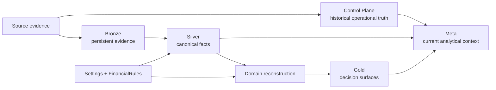

This map is intentionally compact. The moment it starts trying to replace [System Architecture](architecture/system-architecture.md), it has missed its job.

---

## How to use these specifications

### When you need meaning

Use **Finance** and **Architecture**.

They explain why a concept exists, who owns it, and what invariants make it trustworthy.

### When you need shape

Use **Reference**.

It is the shortest path to physical schemas, grains, identity, and producers.

### When you need policy

Use **Configuration**.

It distinguishes operational settings from financial rules and model assumptions.

### When you need to modify something

Use **Developer Engineering** after reading the specification owned by the thing you are changing.

For example:

```text
new broker source
    → Adding Data Sources
    → Bronze contracts
    → relevant Finance model

new investment metric
    → Metrics and Methodology
    → Adding Transformations / Gold Marts
    → schema evolution if contract changes

new recovery behavior
    → Reliability and Recovery
    → Engineering Standards
    → Testing and Validation
```

### When you need proof

Go to the source and tests.

Documentation is designed to make that proof easier to find, not to replace it.

---

## Documentation principles

The corpus follows a few permanent rules.

### Explain less, prove more

Generic prose is cheap. Source-backed implementation detail is useful.

The deeper specifications therefore favor:

- authentic production excerpts;
- exact classes and functions;
- schemas and grains;
- formulas;
- state machines;
- sequence diagrams;
- failure paths;
- explicit trade-offs.

### Preserve epistemic boundaries

The documentation keeps these categories distinct:

```text
observed
canonical
reconstructed
reconciled
estimated
simulated
```

Those words are not stylistic synonyms.

They describe different kinds of financial truth.

### Grain before aggregation

A metric without a grain is an invitation to create a correct-looking wrong number.

The docs therefore describe row grain, identity, additivity, and temporal semantics wherever they affect interpretation.

### Failure is part of the design

Happy paths are only half an architecture.

Reliability documentation therefore specifies:

- what can fail;
- what becomes durable first;
- what can roll back;
- what requires recovery;
- what can only converge later;
- what provenance remains after the failure.

### Narrative flow matters

The documents are not collections of independent headings.

Each substantial page is designed so one section creates the question answered by the next. If the H2 sections could be shuffled like a playlist without damaging comprehension, the narrative probably needs more work.

### Character is allowed; ambiguity is not

A little Gen-Z sarcasm is welcome when it sharpens an engineering point.

Financial semantics do not get the same freedom. If a number is reconstructed, estimated, stale, invalid, or not computable, the docs say so.

The jokes can be loose. The contracts cannot. 😂

---

## Where to go next

If this is your first visit:

**[Install and run the application →](getting-started/README.md)**

If you want the system mental model:

**[Enter Architecture →](architecture/README.md)**

If you want the finance:

**[Enter Finance →](finance/README.md)**

If you are auditing exact shapes:

**[Open Reference →](reference/README.md)**

If you are changing the code:

**[Enter Developer Engineering →](developer/README.md)**

If you want the concept-first guided route instead of the canonical specification layer:

**[Open the GitHub Wiki →](https://github.com/tks18/personal-finance-etl/wiki)**

The source remains the final authority.

The documentation exists so getting to that authority does not require spelunking through 150 modules with a flashlight. 🔦
